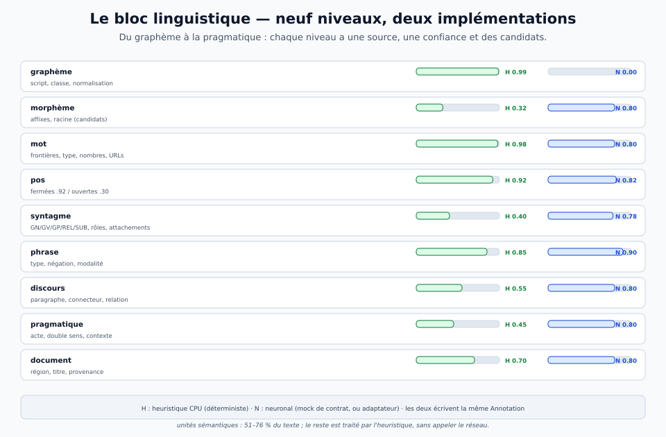
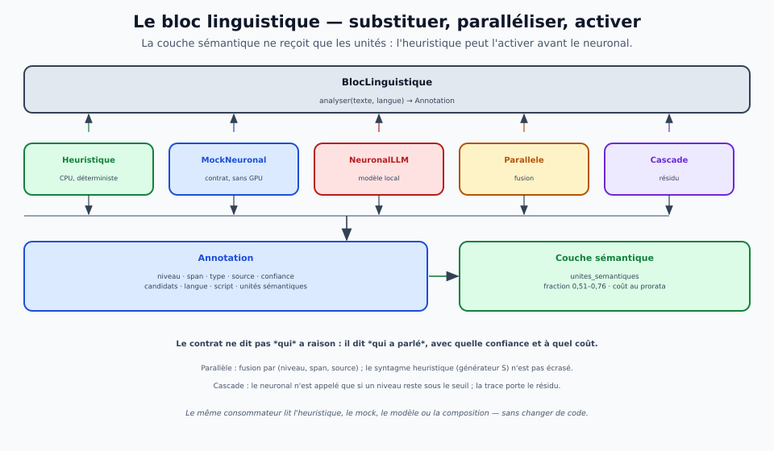

# Le bloc linguistique — un contrat, deux implémentations, neuf niveaux

> **Ce que ce document est.** La **spécification** du bloc d'étiquetage linguistique : ce qu'il
> étiquette du **graphème** à la **pragmatique**, ce que chaque étiquette porte, comment
> l'**heuristique CPU** et la **version neuronale** se substituent, se **parallélisent** ou se
> **cascadent**, et comment l'heuristique peut activer la **couche sémantique** sur une
> **fraction** des unités. Le code est [`bloc_linguistique.py`](../../tools/bloc_linguistique.py) ;
> la porte est [`porte-bloc-linguistique.sh`](../../tools/porte-bloc-linguistique.sh) ; la fiche
> est [`rapport-bloc-linguistique.md`](../../reports/rapport-bloc-linguistique.md).
>
> **Ce que ce n'est pas.** Ni un analyseur syntaxique complet, ni un modèle de langue, ni la
> couche sémantique. C'est une **couche de surface typée** : elle **déclare** ce qu'elle couvre,
> avec quelle confiance et quels candidats ; le neuronal (ou l'humain) tranche l'ambigu, et la
> couche sémantique ne reçoit que les unités qui en ont besoin.

## 1. Le besoin

Drave avait trois briques qui **touchaient** la langue sans être le bloc :

- **R0.1** découpe un document en **régions** (titre, section, paragraphe, tableau, code,
  maths, figure) — c'est du **document**, pas du mot ni de la phrase ;
- **R4.1–R4.4** lisent la **structure** (tableaux, code, maths, scans) — c'est de la forme, pas
  de la langue ;
- la **coloration** (`tools/structures/generateur.py`) segmente en GN/GV/GP/REL/SUB, devine des
  rôles et produit des **candidats d'attachement** — c'est un générateur de candidats français,
  un banc de validation humaine, pas un bloc avec un contrat, une trace et une porte.

Il manquait le **bloc** : un objet typé qui prend un texte, rend une **annotation** multi-niveaux
avec `source`, `confiance` et `candidats`, et que l'on peut remplacer par une version neuronale
sans changer le consommateur. C'est ce que spécifie ce document.

## 2. Les neuf niveaux



| niveau | ce qu'on étiquette | heuristique CPU | neuronal | ce que le consommateur en fait |
|---|---|---|---|---|
| **graphème** | script, classe de caractère, normalisation | **0,99** | — | découper sans perdre les offsets |
| **morphème** | affixes, racine, flexion (candidats) | **0,32** (candidats) | 0,80 | lemme, racinisation, recherche |
| **mot** | frontières, type (mot, nombre, URL, emoji, ponctuation) | **0,98** | 0,80 | unité de citation, offsets |
| **pos** | classe fermée (DET, PREP, PRON, CONJ, AUX) / ouverte | **0,92** / **0,30** | 0,82 | filtres, rôles, syntaxe |
| **syntagme** | GN, GV, GP, REL, SUB ; rôle ; attachement | **0,40** (candidats S) | 0,78 | structure, attachement, lecture |
| **phrase** | frontière, type, négation, modalité | **0,85** | 0,90 | unité de sens, portée, réponse |
| **discours** | paragraphe, connecteur, relation | **0,55** | 0,80 | enchaînement, cause/contraste |
| **pragmatique** | acte, double sens, contexte | **0,45** / **0,25** | 0,80 | intention, ambiguïté voulue |
| **document** | région, titre, provenance | **0,70** | 0,80 | lecture, citation, navigation |

**Ce que « couverture » veut dire.** Les nombres sont des **confiances déclarées**, pas des
précisions mesurées. L'heuristique ne dit pas « je sais » : elle dit « voici mon étiquette, ma
confiance, mes candidats, et voici ce que je ne couvre pas ». Un niveau sans étiquette est
**absent**, pas implicitement faux ; le consommateur peut alors appeler le neuronal ou refuser.

Le **graphème** est étiqueté par **plages** (lettres, chiffres, ponctuation, espace, symbole,
marque), pas par caractère : une annotation de 1 000 caractères reste lisible.

## 3. La sortie : une annotation, pas un corps

Une `Etiquette` porte :

```json
{"niveau": "syntagme", "type": "GP", "valeur": "de la voisine",
 "debut": 8, "fin": 21, "source": "heuristique", "confiance": 0.40,
 "candidats": ["« qui dort » → Le chat", "« qui dort » → la voisine"],
 "langue": "fra", "script": "Latn", "meta": {"role": "possession", "niveau": 0}}
```

Une `Annotation` porte le texte, la langue, le script, la **liste des étiquettes**, les unités
sémantiques, la fraction, la trace, le coût et un éventuel refus. Le schéma est **fermé** :
`source ∈ {heuristique, neuronal, humain}`, `niveau ∈` les neuf, `confiance ∈ [0,1]`.

**La RSN n'est pas touchée.** L'annotation du bloc est une **annotation de surface** : elle vit
à côté du corps, avec la source et la confiance ; le corps (le sens) reste neutre, et
l'empreinte ne dépend que du corps. C'est le théorème de non-fuite appliqué à la langue : la
langue, le script, la source et la confiance sont des annotations ; le `code` interne ne
traverse pas.

## 4. Le contrat

```python
class BlocLinguistique(Protocol):
    nom: str
    def analyser(self, texte: str, langue: str | None = None,
                 contexte: str | None = None) -> Annotation: ...
```

| élément | contenu |
|---|---|
| **entrée** | un texte (ou un fichier), une langue **facultative** (un prior, pas un verdict), un contexte **facultatif** |
| **sortie** | une `Annotation` : étiquettes, langue, script, unités sémantiques, trace, coût, refus |
| **source** | chaque étiquette dit qui l'a produite ; une composition peut mélanger les sources |
| **confiance** | une valeur déclarée, pas une probabilité calibrée ; la calibration est un travail séparé |
| **candidats** | les alternatives plausibles ; le bloc **énumère**, il ne tranche pas l'ambigu |
| **refus** | vide, ponctuation seule, langue incertaine : le bloc le dit, il n'invente pas |
| **rejeu** | aucun aléa, aucune horloge dans la trace ; deux exécutions rendent le même JSON (hors durée) |

**Le contrat est le même pour toutes les implémentations.** Le consommateur ne connaît que
`analyser` et `Annotation` ; il ne sait pas si l'étiquette vient d'un CPU, d'un mock ou d'un
modèle. C'est ce qui rend la **substitution** possible.

## 5. Les deux implémentations

### 5.1 L'heuristique CPU

`Heuristique` est déterministe, sans GPU, et **déclare sa couverture** :

- **langue** : des profils de **trigrammes de caractères** par langue (398 langues UDHR, voir
  § 7), ou un profil de secours à mots-outils ; l'indice de langue est un **prior** (+0,02),
  jamais un verdict ; un score sous le seuil rend `und` ;
- **script** : les plages Unicode (latin, cyrillique, arabe, hébreu, devanagari, CJK, hangul,
  thaï, etc.) ; une page japonaise est `Jpan`, une page chinoise `Hani` ;
- **mot** : les frontières par expression régulière (mots, nombres, URLs, emoji, ponctuation) ;
- **pos** : les **classes fermées** françaises et anglaises (DET, PREP, PRON, CONJ, AUX), les
  nombres, et des **candidats** de classe ouverte par suffixe ; une classe ouverte est marquée
  `ouvert` et devient une **unité sémantique** ;
- **morphème** : des suffixes et préfixes productifs, en **candidats** à basse confiance ;
- **syntagme** : le **générateur de la coloration** (`generateur.analyser`) est importé en
  lecture seule ; s'il est absent, un chunker simple (DET+GN, PREP+GN, AUX+GV, REL) prend le
  relais ; les attachements restent des **candidats** ;
- **phrase** : les frontières fortes, les abréviations protégées, le type, la négation, la
  modalité ;
- **discours** : les paragraphes, les connecteurs (contraste, cause, conséquence, but) et une
  relation candidate ;
- **pragmatique** : l'acte de parole (question, exclamation, ordre, assertion) à basse
  confiance, le double sens possible (`ou`, guillemets, question), le contexte fourni ;
- **document** : les paragraphes, les titres Markdown/numérotés, la provenance.

### 5.2 La version neuronale

Deux objets, un même contrat :

- **`MockNeuronal`** : le **double de contrat**. Il est déterministe, sans GPU, et rend les
  niveaux profonds (morphème, POS ouverte, syntagme, pragmatique) avec `source = neuronal`. Il
  ne prétend pas être un modèle : il prouve que le contrat accepte une autre implémentation,
  que le parallèle fusionne et que la cascade n'appelle le neuronal que sur le résidu.
- **`NeuronalLLM`** : l'**adaptateur réel**. Il construit un prompt JSON, appelle un modèle local
  (`llama-cli`), parse la réponse et la convertit en `Annotation` ; si le modèle est absent, ne
  répond pas ou rend un JSON invalide, il lève `RefusNeuronal` — il ne simule pas.

**Ce que le modèle local a fait ici.** L'adaptateur est **livré et testé** avec un faux
`llama-cli` (un script qui rend le JSON attendu) : le chemin de parsing, la source, la langue et
les étiquettes sont vérifiés. Le **vrai** `Qwen2.5-0.5B` local n'a pas fini dans le délai
(110 s, puis 35 s en CPU pur) : sa **qualité n'est donc pas revendiquée**. C'est une limite
d'environnement, pas un résultat ; la prochaine campagne doit qualifier un modèle (ou un
tagger) sur un gold.

## 6. Substituer, paralléliser, cascader



### 6.1 La substitution

Le consommateur écrit :

```python
annotation = bloc.analyser(texte, langue="fr")
```

et `bloc` peut être `Heuristique`, `MockNeuronal`, `NeuronalLLM`, `Parallele` ou `Cascade`. Le
test `test_substitution` vérifie que `Heuristique` et `MockNeuronal` rendent **le même schéma**
(mêmes clés, mêmes spans valides) et que seules la `source` et les valeurs changent.

### 6.2 Le parallèle

`Parallele([heuristique, neuronal])` exécute les deux et **fusionne** :

- la clé de fusion est `(niveau, debut, fin, type, source)` : les deux sources restent visibles ;
- à niveau égal, les étiquettes qui se **chevauchent** sont des **alternatives** : on garde la
  plus confiante, sauf pour le **syntagme**, où la segmentation **heuristique** (le générateur
  de la coloration) est prioritaire — le mock neuronal ne doit pas écraser un découpage plus
  fin avec un gros span ;
- la langue et le script vont à la meilleure source ; les unités sémantiques sont réunies.

### 6.3 La cascade

`Cascade(heuristique, neuronal, seuil=0,6)` exécute d'abord l'heuristique, regarde les niveaux
`morphème`, `pos`, `syntagme`, `discours`, `pragmatique` : si l'un reste sous le seuil, elle
appelle le neuronal et fusionne ; sinon, elle rend l'heuristique seule. La trace porte le
**résidu** et `appel_neuronal`. C'est le mode qui **paie** quand l'heuristique couvre la surface
et que le neuronal est cher.

## 7. Activer la couche sémantique à une fraction

L'annotation expose :

- `unites_semantiques` : les **mots de classe ouverte** (noms, verbes, adjectifs, adverbes) que
  la couche sémantique doit traiter ; les classes fermées (déterminants, prépositions,
  pronoms, conjonctions, auxiliaires) ne sont **pas** envoyées ;
- `fraction_semantique` : la part de texte couverte par ces unités — **0,51 à 0,76** sur les
  cinq échantillons mesurés.

Le consommateur peut donc :

1. appeler l'**heuristique** (millisecondes), obtenir les unités et la fraction ;
2. **activer la couche sémantique** sur ces unités seulement, sans attendre le neuronal ;
3. lancer le neuronal **en parallèle** pour les niveaux profonds ou le résidu ;
4. fusionner ; la couche sémantique n'a jamais vu la surface inutile.

Le coût se lit :

**C = c_h · B + c_s · U_h + c_n · U_n**

où `B` est le texte, `U_h` les unités heuristiques, `U_n` le résidu neuronal. Le gain vient de
`U_h < B` et de `c_n >> c_s` : la couche sémantique est activée sur une **fraction** des unités,
pas sur le texte entier. Une heuristique fausse, elle, coûte plus qu'un appel réseau : la
confiance et la porte sont le garde-fou.

## 8. Le multilingue : 398 langues au niveau langue

Le bloc ne prétend pas étiqueter 398 langues au niveau du syntagme. Il sépare :

- **universel** : Unicode, script, frontières de phrase, classes de caractères — indépendant de
  la langue ;
- **famille** : les classes fermées et les affixes partagés (latin, germanique, roman) ;
- **langue** : les profils de trigrammes et les paquets de classes fermées.

La mesure UDHR (articles 0–14 pour les profils, article 15 tenu à l'écart) :

| mesure | résultat |
|---|---|
| langues avec profil | **398** |
| articles de test | **447** |
| **accuracy langue** | **0,9687** |
| **accuracy script** | **1,0000** |
| contrôle **profils permutés** | **0,0022** (proche du hasard) |
| construction des profils + test | **4,0 s** |

**Les erreurs sont nommées** : l'anglais et le scots sont proches, et l'échantillon anglais du
banc est classé `sco` (ou `und` sous le seuil) par l'heuristique ; le profil UDHR est
**parallèle et propre**, ce n'est pas 398 langues de déploiement. Le bloc est honnête : il dit
`und` sous le seuil, il ne force pas une langue.

## 9. La mesure et la porte

La porte [`porte-bloc-linguistique.sh`](../../tools/porte-bloc-linguistique.sh) :

1. les **tests de contrat** (`tools/tests/linguistique/`) : niveaux, spans, langue/script,
   substitution, parallèle, cascade, activation, refus, rejeu, faux `llama-cli` ;
2. l'**autotest UDHR** : profils, accuracy, script, permuté, échantillons, activation ;
3. le verdict `ok` ; la fiche et le JSON [`bloc-linguistique.json`](../../reports/bloc-linguistique.json).

Les **contrôles négatifs** : profils permutés (0,0022), texte vide, ponctuation seule, langue
inconnue (`und`), indice faux (`und`), rejeu identique.

**Le gold 180** (`gold.py` 20 réels + `gold_synthetique.py` 160 synthétiques) mesure les niveaux
profonds : POS **0,765** (fermé **0,939**, ouvert **0,621**), syntagmes exacts **0,194**,
**par tête 0,560**, acte **1,0**, négation **1,0**, modalité **0,994**, double sens **0,889** ;
la cascade (mock de contrat) préserve ces chiffres et couvre **67,1 %** en unités sémantiques.
Le lexique synthétique est **disjoint** des listes de l'heuristique : les classes ouvertes
chutent à **0,586** sur les mots inconnus. **L'attachement** des GP/REL/SUB est mesuré :
**97 cibles** (dont **29 ambiguës** annotées en double lecture), couverture par **span** **0,338**
(top-1 0,323) et surtout par **tête** **1,000** (top-1 **0,957** avec les deux lectures, 0,870 avec
une seule ; top-k **1,000**), hasard 0,015 ; les GP au verbe sont lus comme le GN le plus proche
(les réels passent de 40 % à 80 % en tête avec les deux lectures). Le **vrai** modèle neuronal est **refusé**
(`llama-cli` expire) : la qualification neuronale reste à faire.

## 10. Les limites

- **La langue n'est pas la traduction** : 398 langues identifiées ne veulent pas dire 398
  langues analysées ; les classes fermées et les affixes sont français/anglais.
- **Les niveaux profonds sont mesurés sur 180 phrases** : POS 0,751, syntagmes exacts 0,194,
  par tête 0,560, pragmatique 0,889–1,0 ; l'ouvert chute à 0,621 sur le lexique disjoint ; le
  syntagme exact mesure surtout un désaccord de segmentation.
- **L'attachement par tête couvre 100 %** ; le gold annote 29 cibles ambiguës en double lecture,
  mais ces lectures sont celles de l'auteur ; les 3 cibles anglaises n'ont pas de cible S.
- **Le neuronal réel n'est pas qualifié** : le modèle local a expiré ; le mock est un contrat,
  pas une qualité.
- **Le corpus UDHR est parallèle et propre** : 0,9687 en langue ne se transporte pas tel quel
  sur du bruit, des codes mêlés ou des langues proches.
- **Un article par langue** : la mesure de langue est un test tenu à l'écart, pas une campagne
  multi-domaines.
- **La couche sémantique est un stub** : elle compte les unités et le coût ; elle ne produit pas
  encore de RSN.
- **Le bloc n'est pas encore un port DRVM** : il a le contrat, la trace, le coût et la porte ;
  le manifeste et le port sont la prochaine étape.
- **Le générateur S est français** : 7 phrases, 11 tests ; la coloration est un germe, pas une
  couverture.

## 11. Ce qui rouvrirait / la suite

1. **Un gold** de POS/syntagme/pragmatique sur 100–200 phrases, pour transformer les confiances
   déclarées en précisions mesurées.
2. **Un modèle neuronal qualifié** (tagger ou LLM) sur ce gold ; l'adaptateur `NeuronalLLM` est
   déjà branché.
3. **Les paquets de langue** : classes fermées et affixes pour les 71 langues du dépôt, pas
   seulement fr/en.
4. **Le profil de langue** versionné (`data/` ou `reports/`) et son empreinte.
5. **L'intégration RSN/DRVM** : l'annotation `langue`, `script`, `source`, `confiance` à côté du
   corps ; le bloc comme port du bus.
6. **Le split `bloc-langue` / `bloc-coloration`** si le bloc devient trop gros : le contrat
   reste, les implémentations se séparent.

## 12. Fichiers

- Code : [`tools/bloc_linguistique.py`](../../tools/bloc_linguistique.py).
- Tests : [`tools/tests/linguistique/test_bloc_linguistique.py`](../../tools/tests/linguistique/test_bloc_linguistique.py).
- Porte : [`tools/porte-bloc-linguistique.sh`](../../tools/porte-bloc-linguistique.sh).
- Fiche : [`reports/rapport-bloc-linguistique.md`](../../reports/rapport-bloc-linguistique.md) ;
  JSON : [`reports/bloc-linguistique.json`](../../reports/bloc-linguistique.json).
- Théorie : [`pre-traitement-linguistique.md`](../theorie/pre-traitement-linguistique.md) ;
  coloration : [`tools/structures/README.md`](../../tools/structures/README.md).
- Schémas : [`bloc-linguistique-niveaux.svg`](../schemas/bloc-linguistique-niveaux.svg),
  [`bloc-linguistique-substitution.svg`](../schemas/bloc-linguistique-substitution.svg).
