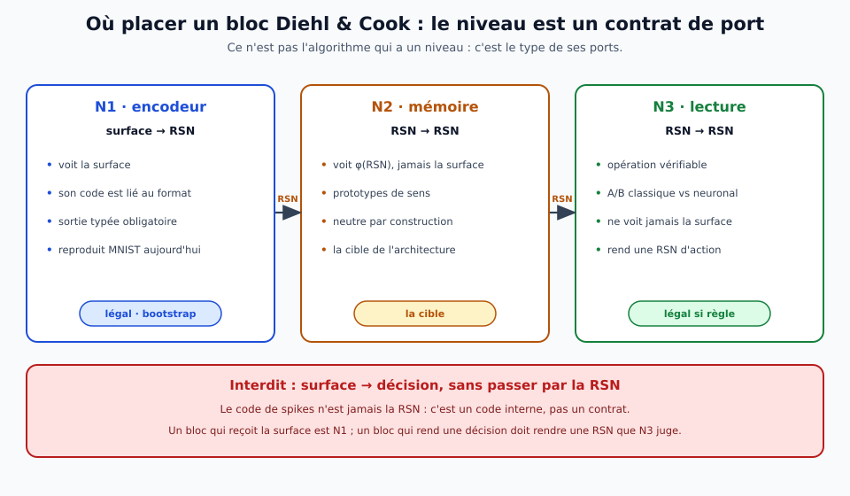
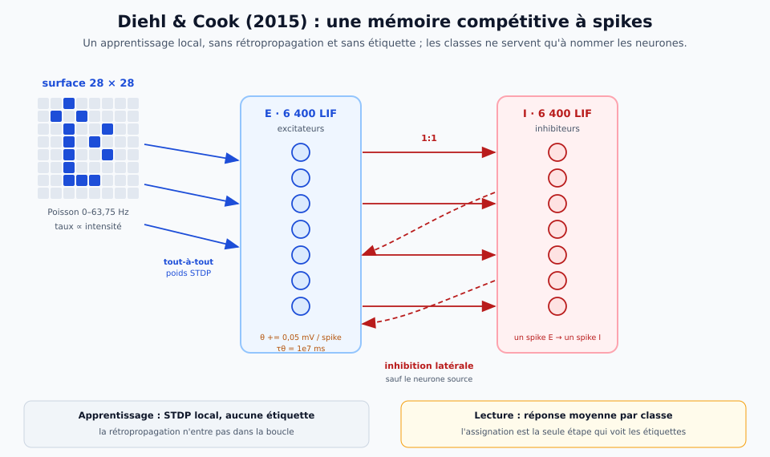
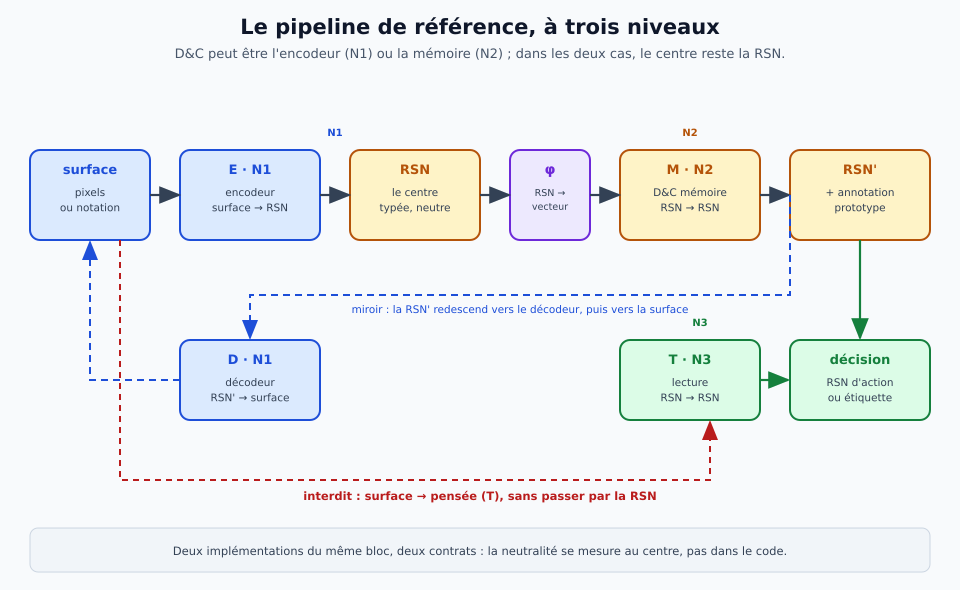
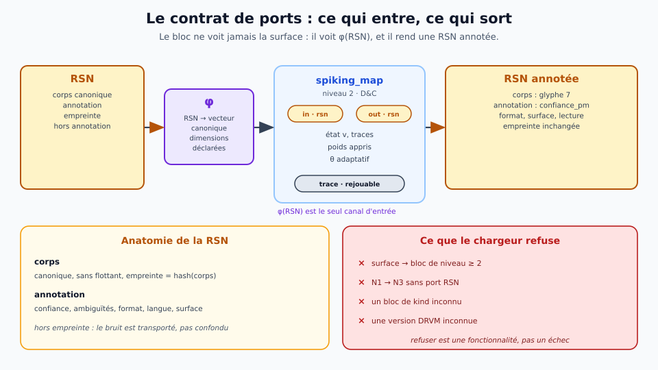
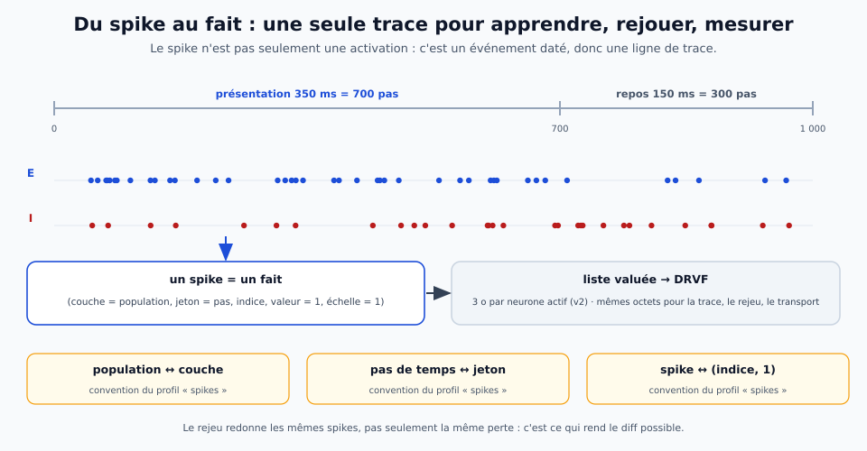
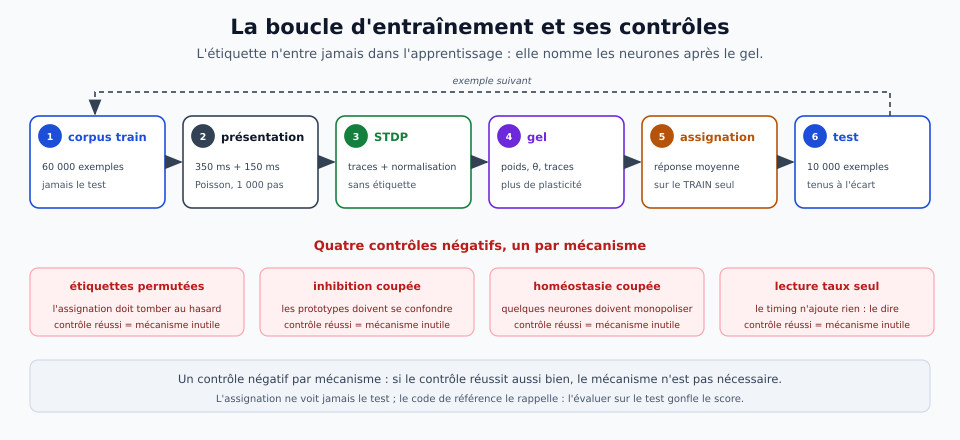

# Un bloc Diehl & Cook dans Drave — implémenter un réseau impulsionnel sans franchir les niveaux

> **Ce que ce document est.** Le **cahier d'implémentation** d'un bloc de type **Diehl & Cook (2015)** dans
> Drave : le modèle d'origine, ses équations, le contrat de ports, le manifeste DRVM, le flux DRVF,
> l'entraînement, les contrôles et les portes — et surtout **où le placer** dans la séparation à trois niveaux
> (surface → RSN → pensée) sans que la surface fuite au centre. Le modèle d'origine : Diehl & Cook,
> *Unsupervised learning of digit recognition using spike-timing-dependent plasticity*, Front. Comput.
> Neurosci. 9:99, 2015, [doi:10.3389/fncom.2015.00099](https://doi.org/10.3389/fncom.2015.00099).
> Le code de référence est [peter-u-diehl/stdp-mnist](https://github.com/peter-u-diehl/stdp-mnist).

> **Fiche concept — le bloc impulsionnel.**
> Un réseau **LIF à conductance**, entraîné par **STDP** locale, avec **inhibition latérale** et **seuil
> adaptatif**, qui apprend des **prototypes** sans étiquette. Dans Drave, ce n'est ni un modèle de langue ni un
> raisonneur : c'est un **bloc** qui reçoit et rend un type déclaré. S'il reçoit la surface, il est **N1** ; s'il
> reçoit `φ(RSN)`, il est **N2**. Le spike n'est pas le sens ; le sens est le **contrat**.
> **Glossaire :** [RSN](../theorie/glossaire/entrees/representation-semantique-neutre.md) ·
> [couche / étage](../theorie/glossaire/entrees/couche-etage.md) · [rejeu](../theorie/glossaire/entrees/rejeu.md)
> **Illustration :** 

## 1. Le modèle d'origine, en une page

**L'architecture.** 784 entrées (28 × 28 pixels) émettent des trains de Poisson dont le taux est proportionnel à
l'intensité du pixel (0 à 63,75 Hz). Ces entrées sont connectées **tout-à-tout** à une population de neurones
**LIF excitateurs** ; chaque excitateur est connecté **un-pour-un** à un inhibiteur ; chaque inhibiteur est
connecté à **tous les excitateurs sauf celui dont il reçoit le spike**. C'est une **inhibition latérale** qui
forme un **gagnant** (soft WTA). Les synapses entrée → excitateur sont apprises par **STDP** ; les synapses
inhibitrices ne le sont pas. Chaque excitateur porte un **seuil adaptatif** : chaque spike augmente son seuil,
qui décroît lentement.



| mécanisme | ce qu'il fait | ce qu'il n'est pas |
|---|---|---|
| **LIF à conductance** | intégration avec `g_e`, `g_i` et des potentiels d'équilibre | pas un intégrateur parfait |
| **STDP** | apprentissage local des synapses d'entrée | pas de rétropropagation |
| **inhibition latérale** | compétition, diversité des prototypes | pas un softmax appris |
| **seuil adaptatif** | homéostasie : aucun neurone ne monopolise | pas une régularisation globale |
| **Poisson en entrée** | le taux porte l'intensité | pas un code temporel |
| **assignation des classes** | nommer les neurones après l'apprentissage | pas une étiquette dans la boucle |

**Le résultat publié** : **95 %** sur MNIST avec **6 400** neurones excitateurs, après **15 passages** du jeu
d'entraînement ; 82,9 / 87,0 / 91,9 / 95,0 % pour 100 / 400 / 1 600 / 6 400 neurones. Le code de démonstration,
lui, utilise **400** neurones et annonce **~89 %** à l'entraînement et **91,56 %** avec les poids pré-entraînés.
Ce sont des résultats **du papier et de son code**, pas de Drave : ils servent de **banc de reproduction**, pas
de score à revendiquer.

**Ce que le modèle n'a pas** : ni langue, ni sémantique typée, ni raisonnement, ni rejeu, ni contrat de ports. Il
classe des chiffres écrits en pixels. C'est précisément pour cela qu'il est un bon **premier bloc** : le
mécanisme est simple, la littérature est stable, et la question « où le placer ? » est tout le sujet.

## 2. Ce que le modèle est, et ce qu'il n'est pas

**C'est une mémoire compétitive de prototypes.** Chaque neurone excitateur apprend un prototype moyen des
entrées qui le font décharger ; l'inhibition empêche deux prototypes de se confondre ; l'homéostasie donne à
chaque neurone une chance de participer. Le **code de population** (quels neurones ont déchargé, combien de fois)
est la représentation interne ; la **classe** est une **assignation** faite après coup, en comparant la réponse
moyenne de chaque neurone aux étiquettes du **train**.

**Ce n'est pas une RSN.** Le code de population est :
- **lié à la surface** : il dépend des pixels, du cadrage, du bruit, du format ;
- **non canonique** : deux écritures du même chiffre peuvent donner deux codes différents ;
- **non annoté** : il ne porte ni confiance, ni ambiguïté, ni langue, ni format ;
- **non réversible** : on ne redit pas la surface depuis le code.

La RSN, elle, est **canonique**, **annotée** et **réversible**. Entre les deux, il y a un **travail de
typage** — la tête RSN — et c'est ce travail qui fait la différence entre un classifieur et un bloc Drave.

| ce qu'on peut dire | ce qu'on ne peut pas dire |
|---|---|
| « ce bloc apprend des prototypes sans étiquette » | « ce bloc comprend le sens d'un chiffre » |
| « son code est parcimonieux et local » | « son code est une représentation neutre » |
| « il classe MNIST à un niveau connu » | « il est un module de langue ou de pensée » |
| « il peut être N1 ou N2 selon son port » | « il est le centre parce qu'il est impulsionnel » |

**La phrase à retenir** : *le spike n'est pas le sens*. Un train de spikes est un **code interne** ; la RSN est
un **contrat externe**. Confondre les deux, c'est refaire l'erreur que le dépôt combat depuis le début : appeler
« jeton » ce qui est une unité de sens.

## 3. Le principe à trois niveaux, appliqué

Le contrat est celui de [`modele-natif.md`](../theorie/modele-natif.md) § 2 : **N1** surface, **N2** RSN,
**N3** pensée ; une arête porte un **type**, et le type décide du niveau. Un bloc D&C peut être placé à trois
endroits, et **pas un seul de plus** :


| placement | entrée → sortie | verdict | pourquoi |
|---|---|---|---|
| **N1 — encodeur** | surface → RSN | **légal** | il voit la surface, mais il **rend** une RSN typée ; c'est le bootstrap MNIST |
| **N2 — mémoire** | RSN → RSN | **la cible** | il voit `φ(RSN)`, jamais la surface ; les prototypes sont des prototypes de **sens** |
| **N3 — lecture** | RSN → RSN | **légal si règle** | une opération vérifiable sur la RSN ; l'A/B classique contre neuronal tranche |
| **surface → décision** | surface → décision | **interdit** | c'est le raccourci qui rend l'invariance invérifiable |

**La recommandation** : commencer par **N1** (c'est le seul placement où le résultat publié est reproductible
tel quel), puis **déplacer le même code en N2** dès qu'un encodeur RSN existe. Le déplacement ne change pas
l'algorithme : il change le **port d'entrée** et le **type de la sortie**. C'est exactement ce que la
séparation à trois niveaux rend possible — et c'est ce qui rend le bloc **substituable**.

Un D&C peut aussi servir de **lecture associative** en N3 (RSN → RSN), mais ce n'est pas la cible : la lecture
de référence est **classique et exacte**, et l'A/B tranche. Le centre reste N2 ; N3 est une opération, pas une
représentation.

**Trois refus, à tester comme des portes** :

1. **surface → N3** : le chargeur refuse une arête `surface` qui touche un bloc de niveau ≥ 2 ;
2. **code → RSN** : le code de spikes n'est jamais promu en RSN sans tête typée ; une RSN sans `corps` ni
   `annotation` n'est pas une RSN ;
3. **étiquette dans STDP** : aucune étiquette n'entre dans la plasticité ; l'assignation est **après** le gel.

> **Vocabulaire.** Dans DRVF, le champ `jeton` est un **compteur technique** (ici, le pas de temps). Il ne
> désigne **jamais** la RSN : la RSN est faite d'**unités de sens**. Cette distinction est non négociable.

## 4. L'architecture de référence



**Le pipeline complet** :

1. **N1 — `E_vision`** : surface (28 × 28) → RSN-visuelle. C'est un bloc D&C **classique**, avec une **tête
   typée** qui transforme le code de population en `corps` + `annotation`.
2. **N2 — `M_proto`** : RSN → RSN. C'est le **même code D&C**, mais son entrée est `φ(RSN)` et sa sortie est une
   RSN enrichie d'une annotation de **prototype** (identifiant, distance, confiance). Il ne voit jamais un pixel.
3. **N3 — `T_lecture`** : RSN → RSN. C'est une **règle classique** (plus proche prototype, table, solveur) ou un
   petit réseau ; elle rend une RSN d'action (la classe, ou `null` + candidats).

**Pourquoi deux blocs D&C et pas un seul ?** Parce que le **même algorithme** peut rendre deux services
différents, et que la séparation oblige à le dire :

- en **N1**, il **réduit** la surface à un code typé ; il a le droit de voir les pixels, et son code est
  surface-bound ;
- en **N2**, il **mémoire** des sens ; il n'a pas le droit de voir la surface, et son code doit être invariant
  au format.

Le **v0** peut n'implémenter que **N1** (c'est le banc MNIST). Le **v1** ajoute **N2** dès que `φ` et la RSN
existent. Le **v2** branche **N3** et compare une lecture classique à une lecture neuronale sur la **même**
RSN — c'est l'A/B qui justifie l'hybridation.

**La tête typée (N1)** est un bloc **classique**, pas un réseau :

```python
def tete_rsn(spikes_par_neurone, assign):
    # 1. réponse MOYENNE par classe : la somme divisée par le nombre de neurones assignés
    reponse, compte = [0] * 10, [0] * 10
    for neurone, n in enumerate(spikes_par_neurone):
        c = assign[neurone]
        if c >= 0:
            reponse[c] += n
            compte[c] += 1
    score = [reponse[c] / compte[c] if compte[c] else 0.0 for c in range(10)]
    # 2. classement canonique : score décroissant, puis classe croissante (déterministe)
    candidats = sorted(((score[c], c) for c in range(10)), key=lambda x: (-x[0], x[1]))
    total = sum(score)
    # 3. RSN : le corps ne porte que le sens ; le bruit va dans l'annotation
    corps = {"modalite": "vision", "glyphe": candidats[0][1] if total else None}
    annotation = {
        "format": "mnist",
        "langue": None,
        "confiance_pm": int(1000 * candidats[0][0] // total) if total else 0,
        "candidats": [[c, int(1000 * s // total)] for s, c in candidats[:3] if s],
        "surface": "sha256:…",
        "lecture": 2,
    }
    return {"nature": "etat", "corps": corps, "annotation": annotation}
```

**Pourquoi `confiance_pm` en pour-mille et pas un flottant ?** Parce que le `corps` d'une RSN ne porte **aucun
flottant** : l'empreinte ne doit pas dépendre d'un arrondi de machine. La confiance est du **bruit**, donc dans
l'**annotation**, et un entier en pour-mille suffit.

## 5. Le contrat de ports et le manifeste DRVM



**Le principe** : un bloc D&C ne voit jamais la surface **en N2**. Il voit `φ(RSN)`, un vecteur **canonique**,
de **dimensions déclarées**, dérivé du **corps** de la RSN — jamais de l'annotation (le format, la langue et la
confiance sont des ports séparés, et un bloc qui décide dessus doit le déclarer).

**Le manifeste DRVM** (extension proposée, à ajouter au lecteur) :

```json
{
  "format": "DRVM",
  "version": 0,
  "model": {
    "name": "dc-mnist-n2",
    "architecture": {
      "kind": "spiking_map",
      "n_input": 16,
      "n_exc": 400,
      "n_inh": 400,
      "dt_ms": 0.5,
      "ticks": 1000,
      "phi": "rsn-visuel-v1"
    }
  },
  "graph": {
    "blocks": [
      {"id": "rsn_in", "kind": "input", "niveau": 2,
       "ports": {"out": "rsn"}, "inputs": [], "outputs": ["rsn"]},
      {"id": "dc", "kind": "spiking_map", "niveau": 2,
       "ports": {"in": "rsn", "out": "rsn"}, "inputs": ["rsn"], "outputs": ["rsn"]},
      {"id": "rsn_out", "kind": "output", "niveau": 2,
       "ports": {"in": "rsn"}, "inputs": ["rsn"], "outputs": ["rsn"]}
    ],
    "regions": [{"id": "r0", "blocks": ["rsn_in", "dc", "rsn_out"]}],
    "heads": [],
    "routes": [],
    "thought": {"steps": 0}
  },
  "execution": {
    "profile": "spikes",
    "dt_ms": 0.5,
    "ticks": 1000,
    "rng": {"kind": "counter", "seed": 1234},
    "replay": {"seed": 1234, "tolerance": 0}
  }
}
```

**Les tenseurs du bloc** :

| tenseur | forme | dtype | rôle |
|---|---|---|---|
| `w_in` | `n_input × n_exc` | f32 | synapses entrée → E, **apprises** |
| `w_ei` | `n_exc` | f32 | E → I, un-pour-un (10,4 nS dans la référence) |
| `w_ie` | `n_exc × n_exc` | f32 | I → E, diagonale nulle (17 nS) |
| `theta` | `n_exc` | f32 | seuil adaptatif |
| `assign` | `n_exc` | u8 | classe assignée, `255` = aucune |
| `assign_conf` | `n_exc` | u16 | confiance d'assignation, pour-mille |

**Les règles du chargeur** (la porte D0) :

1. un **kind inconnu** est refusé, en le nommant ;
2. un bloc `spiking_map` doit déclarer `niveau` et `ports` ; sans eux, il est refusé ;
3. aucune arête de type `surface` ne touche un bloc de `niveau >= 2` ;
4. aucune arête de type `code` n'existe **entre** blocs : le code de spikes est **interne** au bloc ;
5. une arête `rsn` est légale entre N1, N2 et N3 ;
6. un fichier DRVM v0 **sans** `niveau` reste lisible (compatibilité), mais un `spiking_map` ne l'est pas sans
   `niveau`.

**Le point important** : ces règles ne sont pas une discipline de l'implémenteur, elles sont dans le
**manifeste** et dans le **lecteur**. Un graphe interdit est refusé **avant** l'exécution, pas signalé après.
C'est la différence entre une architecture et une convention.

## 6. Les équations et le pas de temps

### Le neurone

Le neurone est un **LIF à conductance** (équations 1–2 du papier) :

```
τ_m dV/dt = (E_rest − V) + g_e (E_exc − V) + g_i (E_inh − V)
τ_ge dg_e/dt = −g_e
τ_gi dg_i/dt = −g_i
```

Un spike présynaptique ajoute son poids à `g_e` (ou `g_i`) : `g_e ← g_e + w`. Le neurone décharge quand
`V > V_thr`, puis `V ← V_reset` et il est **réfractaire** pendant quelques millisecondes.

Dans l'équation, `g_e` et `g_i` sont les conductances **normalisées par 1 nS** ; les poids du tableau sont en
nS, comme dans le code de référence. Un poids de 17 nS n'est donc pas un courant : c'est une **conductance**
multiplicatrice.

### Le pas de temps

`dt = 0,5 ms`. Une présentation dure **350 ms = 700 pas** ; le repos dure **150 ms = 300 pas**. Un exemple fait
donc **1 000 pas**. L'ordre des opérations dans un pas est **fixé** (et testé) :

1. **décroissance** de `g_e`, `g_i`, des traces STDP et de `θ` ;
2. **entrée** : pour chaque neurone d'entrée, un spike de Poisson de taux `r_i` (tirage contré) ajoute `w_in` à
   `g_e` des excitateurs ;
3. **membrane** : mise à jour de `V` avec les équations ci-dessus ;
4. **seuil** : `V > V_thr` → spike ; on note l'indice ;
5. **reset** : `V ← V_reset`, `refractaire ← t + n`, `θ ← θ + θ_plus` ;
6. **STDP** : pour chaque spike post-synaptique, `Δw` selon la règle ; mise à jour des traces pré et post ;
7. **inhibition** : chaque spike E programme un spike I au pas suivant ; chaque spike I ajoute `w_ie` à `g_i`
   de tous les E **sauf** sa source ;
8. **trace** : on écrit la liste des spikes du pas.

**Le tirage de Poisson doit être contré**, pas séquentiel : `u = hash(seed, exemple, pas, neurone)`. Sinon, le
rejeu dépend de l'ordre d'appel, et un bloc distribué ne redonne pas la même trace. C'est une exigence de
**rejeu**, pas une élégance.

### Les paramètres

Valeurs du papier et du code de référence (à vérifier sur le code, pas sur une intuition) :

| paramètre | valeur | unité |
|---|---|---|
| `V_rest` E / I | −65 / −60 | mV |
| `V_reset` E / I | −65 / −45 | mV |
| `V_thr` E / I | −52 / −40 | mV |
| `réfractaire` E / I | 5 / 2 | ms |
| `τ_m` E / I | 100 / 10 | ms |
| `τ_ge` / `τ_gi` | 1 / 2 | ms |
| `E_exc` / `E_inh` | 0 / −100 (E), −85 (I) | mV |
| `w_ei` / `w_ie` / `w_ii` | 10,4 / 17,0 / 0,4 | nS |
| `θ_plus` / `τ_θ` | 0,05 / 1e7 | mV / ms |
| `θ(0)` / `offset` | 20 / 20 | mV |
| `η_pre` / `η_post` | 1e-4 / 1e-2 | — |
| `w_max` | 1,0 | — |
| `τ_pre` / `τ_post1` / `τ_post2` | 20 / 20 / 40 | ms |
| taux d'entrée max | 63,75 | Hz |
| présentation / repos | 350 / 150 | ms |

**Deux règles STDP, et il faut choisir** :

- **celle du papier (Eq. 3)** : `Δw = η (x_pre − x_tar) (w_max − w)^μ`, déclenchée par le spike
  post-synaptique ; c'est celle qui donne **95 %** à 6 400 neurones ;
- **celle du code de démonstration** : une variante à traces **pré/post**, proche de la règle symétrique du
  papier (`x_pre` 20 ms, `post1` 20 ms, `post2` 40 ms), `η_pre = 1e-4`, `η_post = 1e-2`, `w` borné à `[0, 1]` ;
  elle donne **~89 %** à 400 neurones.

Le document ne tranche pas à la place de la mesure : **les deux** sont implémentables, et la porte D3 compare
la règle du papier à la variante du code **à budget égal**. Ce qui compte pour Drave, c'est que la règle soit
**locale** (elle ne lit que des traces pré/post) et **déterministe** (mêmes spikes → mêmes poids).

### La normalisation des poids

Le code de référence ramène, à chaque exemple, la **somme des poids d'entrée** de chaque excitateur à
**78**. C'est une **normalisation divisive** : elle empêche les poids de croître sans borne et garde les
neurones comparables.

**Mais elle coûte cher** : elle touche `n_input × n_exc` poids par exemple, même si l'exemple n'a activé qu'une
petite fraction des neurones. C'est le point où le **coût de l'apprentissage** cesse d'être proportionnel à
l'activité. Trois options, à mesurer :

1. **normaliser les colonnes actives** seulement (les neurones qui ont déchargé) ;
2. **normaliser tous les `k` exemples** au lieu de chaque exemple ;
3. **utiliser la règle du papier** (Eq. 3), dont la dépendance `(w_max − w)^μ` borne les poids sans
   normalisation globale.

C'est un exemple typique de la différence entre **exécution creuse** et **apprentissage creux** : le premier est
acquis, le second est un chantier. La porte **D5b** mesure le coût de l'apprentissage séparément du coût de
l'inférence.

### Le code du pas

```python
def pas(t, etat, params, rng, trace):
    # 0. les spikes I programmés au pas précédent s'appliquent maintenant
    for k, actif in enumerate(etat["spike_i"]):
        if actif:
            etat["g_i"][:k] += params.w_ie
            etat["g_i"][k + 1:] += params.w_ie
    etat["spike_i"][:] = 0

    # 1. décroissance
    etat["g_e"] *= params.exp_ge
    etat["g_i"] *= params.exp_gi
    etat["x_pre"] *= params.exp_pre
    etat["post1"] *= params.exp_post1
    etat["post2"] *= params.exp_post2
    etat["theta"] *= params.exp_theta

    # 2. entrée de Poisson (tirage contré, indépendant de l'ordre)
    spike_entree = [rng.bernoulli(i, t, params.rate[i] * params.dt)
                    for i in range(params.n_input)]
    for i, actif in enumerate(spike_entree):
        if actif:
            etat["g_e"] += etat["w_in"][i]

    # 3. membrane
    etat["v"] += params.dt / params.tau_m * (
        (params.E_rest - etat["v"])
        + etat["g_e"] * (params.E_exc - etat["v"])
        + etat["g_i"] * (params.E_inh - etat["v"])
    )

    # 4. seuil (hors réfractaire)
    spikes = [j for j in range(params.n_exc)
              if etat["v"][j] > params.v_thr + etat["theta"][j] - params.theta0
              and t >= etat["refractaire"][j]]
    trace.append(("E", t, spikes))

    # 5. reset, réfractaire, seuil adaptatif
    for j in spikes:
        etat["v"][j] = params.v_reset
        etat["refractaire"][j] = t + params.refrac_pas
        etat["theta"][j] += params.theta_plus

    # 6. STDP (variante à traces pré/post du code de référence)
    for i, actif in enumerate(spike_entree):
        if actif:
            etat["w_in"][i] -= params.eta_pre * etat["post1"]
    for j in spikes:
        etat["w_in"][:, j] += params.eta_post * etat["x_pre"] * etat["post2"][j]
        etat["w_in"][:, j] = etat["w_in"][:, j].clip(0.0, params.w_max)
        etat["post2"][j] = 1.0
        etat["post1"][j] = 1.0
    etat["x_pre"] += spike_entree

    # 7. inhibition : un spike E programme un spike I au pas suivant
    for j in spikes:
        etat["spike_i"][j] = 1
    trace.append(("I", t, [j for j, a in enumerate(etat["spike_i"]) if a]))

    return spikes
```

**Ce que ce code ne fait pas** : il ne normalise pas les poids (l'option est choisie ailleurs), il ne gère pas
le multi-exemple, et il fixe une convention d'ordre : la trace pré est mise à jour **après** les spikes post du
même pas. C'est un choix, et la porte D1 le vérifie contre le simulateur de référence.

**Les délais** : le v0 utilise un délai **nul** pour l'entrée et **un pas** pour l'inhibition. Le papier tire
des délais de 0–10 ms (entrée) et 0–5 ms (E→I) ; les ajouter change la dynamique et doit être **mesuré**, pas
supposé. Le simulateur de référence et le bloc Rust doivent utiliser **les mêmes** délais, sinon D1 diverge. C'est volontairement un
**squelette de pas**, pas un simulateur complet : le simulateur de référence vit dans `tools/neuro/` (fichier `diehl_cook.py`), et le bloc Rust doit
reproduire **exactement** ses spikes (porte D1).

## 7. Le flux : un spike est un fait



**La convention** : un spike est un **fait** `(population, pas, neurone)` ; il devient une entrée de **liste
valuée** dans DRVF :

| champ DRVF | valeur pour un spike | pourquoi |
|---|---|---|
| `couche` | `0` entrée · `1` E · `2` I | la population est la « couche » du format |
| `jeton` | le pas global (0…999 par exemple) | le compteur technique, jamais la RSN |
| `n_actifs` | le nombre de spikes du pas | une liste par pas et par population |
| `échelle` | `1,0` | les valeurs sont des présences |
| valeurs | `1` | un spike n'a pas de magnitude |

**Ce que ça donne** : 1 000 pas × 2 populations (E, I) = 2 000 listes par exemple, plus l'entrée. À 5 % de
densité sur 400 neurones, 20 spikes par pas → 20 × 3 octets + 14 = **74 octets** par liste. C'est petit, mais
2 000 listes font **148 ko** par exemple : on ne trace **pas** les 60 000 exemples d'entraînement. On trace un
**échantillon** (par exemple 200 exemples), et on rejoue **ce** qu'on veut auditer. Le reste de l'entraînement
se mesure par les agrégats (taux, poids, accuracy), pas par la trace complète.

**Le rejeu** : à partir de la trace et des poids initiaux, on rejoue les spikes dans le même ordre ; les
équations sont déterministes, donc les spikes et les poids doivent être **identiques**. C'est la porte **D2**.
Si le rejeu diverge, ce n'est pas un problème de tolérance : c'est un **ordre d'opérations** ou un **tirage**
non contré.

**Le coût, en projection** (à mesurer, pas à croire) : pour 784 entrées à 20 Hz pendant 350 ms, environ
**5 500 spikes d'entrée** ; chacun touche `n_exc` synapses, soit **2,2 M événements** pour 400 neurones
(35 M pour 6 400). Le dense, lui, calcule `784 × n_exc × 700` produits : **219 M** pour 400, **3,5 G** pour
6 400. Le rapport est **~100×** et il ne dépend pas de `n_exc` : il dépend du **taux d'entrée** et de la
**durée**. C'est exactement l'argument de Drave — mais c'est une **projection**, et la porte **D5** la remplace
par une mesure sur la machine.

## 8. L'entraînement

**Le protocole, dans l'ordre** :

1. **corpus** : MNIST train (60 000), test (10 000) ; **jamais** le test dans l'apprentissage ni dans
   l'assignation ;
2. **présentation** : 350 ms de Poisson + 150 ms de repos ; si un excitateur fait **moins de 5 spikes** sur
   350 ms, on augmente le taux max de **32 Hz** et on représente l'exemple (procédure du papier) ;
3. **STDP** : plasticité active sur `w_in` seulement ; les synapses `w_ei` et `w_ie` sont **fixes** ;
4. **normalisation** : selon l'option choisie (§ 6) ;
5. **répétition** : 1 à 15 passages selon la taille (le papier : 3, 7, 15 pour 400, 1 600, 6 400) ;
6. **gel** : `η = 0`, seuils et traces figés ;
7. **assignation** : pour chaque neurone, on présente **le train** et on calcule sa réponse moyenne par classe ;
   on lui assigne la classe du maximum ; les neurones sans réponse ou ex æquo sont marqués **ambigus** ;
8. **test** : on présente le test, on somme les spikes par classe (ou par neurone assigné), on prend le
   maximum ; on répète 10 fois (Poisson) et on rapporte la moyenne et l'écart-type.

**Le piège du code de référence**, écrit dans son README : évaluer l'assignation sur le **test** gonfle le
score. Le papier ne le fait pas ; le code de démonstration le fait dans sa version par défaut. Dans Drave,
l'assignation est une **étape du train**, et le test est **tenu à l'écart** — c'est le contrôle **D6**.

**Les hyperparamètres de l'assignation** : aucun. C'est le point du papier : « no additional parameters, no
linear classifier on top ». Si on ajoute un classifieur, on ne reproduit plus D&C ; on fait un **autre** bloc, et
il faut le dire.

**Les quatre règles STDP** : le papier montre que la puissance, l'exponentielle, la symétrique et la triplet
donnent des résultats proches. C'est un argument de **robustesse**, pas une permission de tout mélanger : on en
choisit **une**, on la teste, et on garde les autres comme **contrôle de sensibilité**.



## 9. La RSN de sortie

**Un exemple de RSN-visuelle** (N1) :

```json
{
  "nature": "etat",
  "corps": {"modalite": "vision", "glyphe": 7},
  "annotation": {
    "langue": null,
    "format": "mnist",
    "confiance_pm": 970,
    "candidats": [[7, 970], [1, 20], [9, 10]],
    "surface": "sha256:…",
    "lecture": 2
  }
}
```

| partie | ce qu'elle porte | ce qu'elle ne porte pas |
|---|---|---|
| **corps** | le sens : modalité, glyphe | la confiance, le format, la surface |
| **annotation** | le bruit : confiance, candidats, format, langue, hash de surface | le sens lui-même |

**La canonicalisation** : clés triées, pas d'espaces inutiles, UTF-8, aucun flottant dans le corps, listes
triées par score puis par valeur. L'**empreinte** est `sha256(corps canonique)` ; elle ne dépend pas de
l'annotation. Deux surfaces du même chiffre doivent donner **le même corps** — c'est la mesure d'invariance.

**Le codec `φ`** : `φ` ne lit que le **corps**. Pour la RSN-visuelle, un one-hot du glyphe (10) + un one-hot de
la modalité (4) + un drapeau « glyphe nul » (1) = **15 dimensions**. Pour une RSN plus riche, `φ` est un
encodeur **typé** (one-hot pour les énumérés, tranches pour les entiers, hachage pour les unités de sens),
**déclaré** dans le manifeste, **fitté sur la RSN seulement**, jamais sur la surface. Si `φ` est appris, son
jeu d'entraînement est un corpus de RSN ; il ne voit pas les pixels.

**Les deux sondes, et c'est le cœur de la neutralité** :

1. **sonde de format** : un classifieur linéaire qui prédit le format (MNIST, texte, autre) depuis (a) le **code
   de spikes** et (b) `φ(corps)`. Sur (a), il **doit** réussir : le code est N1, il est surface-bound. Sur (b),
   il **doit** échouer : si le format est prédictible depuis le corps, la RSN a fui la surface. C'est la porte
   **D4**.
2. **sonde de classe** : un classifieur qui prédit le chiffre depuis `φ(corps)`. Il **doit** réussir : c'est le
   sens. Une RSN qui ne porte pas la classe n'est pas une RSN utile ; une RSN qui porte le format n'est pas
   neutre. Les deux ensemble sont la définition opérationnelle de « neutre mais informatif ».

## 10. Les contrôles négatifs

**Sans contrôle, un résultat est une histoire.** Chaque mécanisme a le sien :

| contrôle | ce qu'il tue | résultat attendu | si ça échoue |
|---|---|---|---|
| **étiquettes permutées** | l'assignation apprise | accuracy ≈ hasard (10 %) | l'assignation lit autre chose que la réponse |
| **inhibition coupée** | la compétition | prototypes confondus, accuracy en baisse | l'inhibition n'était pas nécessaire |
| **homéostasie coupée** | l'équilibre des taux | quelques neurones monopolisent | le seuil adaptatif n'était pas nécessaire |
| **lecture taux seul** | le « code temporel » | même accuracy qu'avec les spikes | le timing n'apporte rien : le dire, et ne pas le revendiquer |
| **sonde de format** | la neutralité de la RSN | échec sur `φ(corps)`, succès sur le code | la RSN fuit la surface |
| **graphe illégal** | la séparation | le chargeur refuse | la règle n'est pas dans le format |
| **rejeu** | la reproductibilité | spikes et poids identiques | l'ordre ou le tirage n'est pas fixé |
| **assignation sur le train** | la fuite du test | score plus bas et honnête | le test a servi à nommer les neurones |

**Le contrôle le plus important est le quatrième.** D&C est, au fond, un modèle **en taux** : l'entrée est
Poisson, la décision est une somme de spikes. Il est très possible que la **lecture taux seul** fasse aussi bien
que la lecture par neurones. Si c'est le cas, il faut le **dire** : le spike apporte la **parcimonie** et le
**coût événementiel**, pas un code temporel. Ce n'est pas un échec ; c'est une clarification. La revendication
« le temps porte l'information » serait, elle, une erreur.

## 11. Les portes D

| porte | question | critère | contrôle négatif |
|---|---|---|---|
| **D0** | le graphe est-il légal ? | surface → N2/N3 refusé, kind inconnu refusé | un graphe illégal doit **échouer** |
| **D1** | le bloc Rust = le simulateur ? | mêmes spikes, mêmes poids (tolérance 0) | un pas décalé doit diverger |
| **D2** | le rejeu est-il exact ? | trace identique, mêmes spikes | changer la graine doit changer la trace |
| **D3** | STDP apprend-il ? | accuracy > poids aléatoires gelés | poids gelés = témoin |
| **D4** | la RSN est-elle neutre ? | sonde de format : échec sur `φ(corps)`, succès sur le code | une RSN qui garde le format échoue |
| **D5** | le coût suit-il l'activité ? | événements < dense au régime creux | le dense doit gagner au régime dense |
| **D5b** | l'apprentissage est-il creux ? | poids touchés < 100 % par exemple | la normalisation globale doit se voir |
| **D6** | l'assignation fuit-elle ? | test jamais lu avant le gel | assigner sur le test doit gonfler |

**D1 est la porte la plus dure**, et c'est voulu : deux implémentations du même pas doivent donner **le même
spike au même tick**. Si elles divergent, ce n'est pas « un détail de virgule flottante » : c'est un ordre
d'opération, un seuil, un délai ou un tirage qui n'est pas le même. Un bloc qu'on ne peut pas confronter à une
référence n'est pas un bloc, c'est une boîte.

## 12. Le plan d'implémentation

| étape | fichier | ce qu'on fait | porte |
|---|---|---|---|
| **0** | `docs/implantation/diehl-cook.md` | ce document : le contrat et les équations | — |
| **1** | `tools/neuro/` | simulateur de référence (`diehl_cook.py`), 400 E, 10 000 exemples | D1, D3 |
| **2** | `tools/neuro/` | tête typée, `φ`, canonicalisation, empreinte (`rsn_visuel.py`) | D4 |
| **3** | `tools/drvm.py` | `spiking_map`, `niveau`, `ports`, `profile: spikes` | D0 |
| **4** | `drave-core/src/` | le bloc Rust, `pas()`, tirage contré, trace (`impulsion.rs`) | D1, D2 |
| **5** | `drave-core/tests/` | golden trace, parité Python/Rust, refus de graphe (`impulsion.rs`) | D0–D2 |
| **6** | `tools/neuro/` | export DRVM, lecture, rejeu, diff (`porter_dc.py`) | D2, D5 |
| **7** | `reports/` + `journal/` | la fiche, le récit, le commit | toutes |

**Le budget matériel** : pas de GPU. 400 excitateurs × 784 entrées = **313 600 poids** ; 10 000 exemples ×
1 000 pas × 400 neurones = **4 milliards** de pas-neurone, ce qui est trop pour un premier passage en Python
pur. Le plan réaliste :

- **v0** : 100 excitateurs, 2 000 exemples d'entraînement, 1 000 de test, 1 passage — on valide les
  **mécanismes** et les portes D0–D4, pas le score ;
- **v1** : 400 excitateurs, 10 000 exemples, 3 passages — on compare au 82,9 % du papier à 100 neurones et au
  87,0 % à 400, **à protocole constant** ;
- **v2** : 1 600 / 6 400, seulement si le coût par exemple est mesuré et si le corpus suit.

**Le message** : on ne commence pas par 6 400 neurones pour impressionner ; on commence par **100** pour
prouver que le pas, la trace et le refus sont justes. La capacité ne paie qu'avec les données — la leçon du
natif s'applique aussi au bloc impulsionnel.

**Pour le bloc Rust** : `std` seul, pas de dépendance. `V`, `g`, `θ` en `f64` ; les poids en `f32` ou `f64`
(choisir et **fixer** : le mélange est une source de divergence). Le tirage contré s'écrit avec un hash
(`splitmix64` ou PCG) sur `(seed, exemple, pas, neurone)`. La trace s'écrit en DRVF v2 (listes) pour rester
compatible avec les outils existants ; une variante bitmap est une **optimisation mesurée**, pas un prérequis.

## 13. Ce qui rendrait l'implémentation fausse

- **La surface entre en N2** : si `φ` lit l'annotation (format, langue, hash de surface), la RSN n'est plus
  neutre. Le test : la sonde de format sur `φ(corps)` doit échouer.
- **Le code est promu en RSN** : si la sortie du bloc est le vecteur de spikes sans tête typée, ce n'est pas une
  RSN. Le test : la sortie doit avoir un `corps` et une `annotation`, et une empreinte stable.
- **L'étiquette entre dans STDP** : si une étiquette module la plasticité, ce n'est plus D&C, c'est un modèle
  supervisé. Le test : l'A/B avec étiquettes permutées doit tomber au hasard.
- **Le test sert à assigner** : le score monte, la science baisse. Le test : l'assignation ne lit que le train.
- **Le dense est mesuré sur GPU** : le coût événementiel est comparé à un dense optimisé pour une autre machine.
  Le test : même machine, même nombre de cœurs, même taille de bloc.
- **Le rejeu n'est pas exact** : si les spikes divergent, la trace n'est pas une preuve. Le test : deux
  exécutions, zéro différence.
- **La normalisation globale n'est pas comptée** : le coût de l'apprentissage est caché dans une opération
  dense par exemple. Le test : compter les poids touchés, pas seulement les spikes.
- **Le « code temporel » est revendiqué sans contrôle** : si la lecture taux seul fait aussi bien, le timing
  n'apporte rien. Le test : l'A/B taux contre spikes.

## 14. La phrase

**Le spike n'est pas le sens ; le sens est le contrat.** Un bloc D&C est Drave-compatible le jour où il ne voit
que la RSN, ne rend que la RSN, et laisse le chargeur refuser tout le reste. Le reste — les neurones, les
conductances, les traces — est de l'implémentation, et c'est là que le travail commence.
