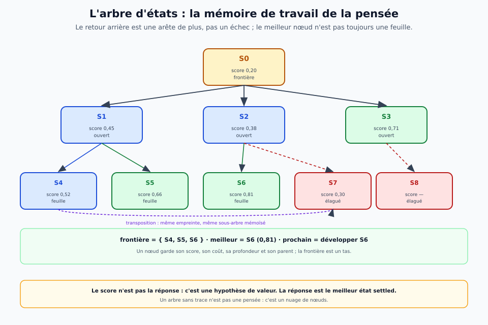

# Le moteur de pensée — state store, arbre, stratégies

> **Ce que ce document est.** Le **contrat d'implémentation** du moteur de pensée : les types, le
> **state store**, l'**arbre d'états**, la **boucle** anytime, les **stratégies**, la **trace** et les
> **portes**. La théorie est dans [`pensee-iterative.md`](../theorie/pensee-iterative.md) ; les schémas
> dans [`docs/schemas/`](../schemas/) ; le bloc impulsionnel dans [`diehl-cook.md`](diehl-cook.md).

> **Fiche concept — le moteur.** Un **state store** typé, un **arbre** de nœuds hashés, une
> **frontière**, une **boucle** anytime, un **portefeuille** de stratégies, une **trace** rejouable.
> Le moteur est un bloc N3 `state → state` ou `state → decision` ; il ne lit jamais la surface.

## 1. Les types

| type | contenu | invariant |
|---|---|---|
| `Candidate` | `corps`, `annotation`, `statut`, `provenance`, `cout`, `score` | `corps` canonique ; `H(corps)` stable |
| `State` | `id`, `parent`, `profondeur`, `budget`, `statut`, `candidats`, `frontiere`, `empreinte` | empreinte = Merkle des candidats triés |
| `Node` | `state`, `children`, `score`, `cout`, `visites` | un nœud = un état ; l'arête porte l'opérateur |
| `Proposal` | `operateur`, `params`, `state_parent` | une transition candidate, pas un état |
| `Score` | `valeur`, `cout`, `confiance` | hypothèse, pas vérité |
| `Decision` | `state` settled, `justification`, `budget` | le chemin racine → état est inclus |
| `Trace` | événements `(pas, nœud, opérateur, score, coût, stratégie)` | rejouable, diffable |

**Un candidat** :

```json
{
  "id": "c1",
  "corps": {"modalite": "vision", "glyphe": 7},
  "annotation": {"confiance_pm": 620, "format": "mnist"},
  "statut": "hypothese",
  "provenance": {"operateur": "vision.encode", "parent": "s0", "pas": 3},
  "cout": {"noeuds": 3, "ms": 12},
  "score": 0.62
}
```

**Un état** :

```json
{
  "id": "s3",
  "parent": "s1",
  "profondeur": 3,
  "budget": {"noeuds": 12, "max": 50},
  "statut": "ouvert",
  "candidats": ["c1", "c2", "c3"],
  "frontiere": ["s3", "s5", "s6"],
  "empreinte": "H(c1 ‖ c2 ‖ c3)"
}
```

**La canonicalisation** : clés triées, pas d'espaces, UTF-8, **aucun flottant dans `corps`** ; les
scores et coûts sont dans l'état, pas dans le corps. L'empreinte d'un état est le **Merkle** des
empreintes de ses candidats, **triées** : deux états identiques ont la même empreinte quel que soit
l'ordre d'insertion.

## 2. Le state store

Le store est un **bloc** `state ↔ store` : il persiste, indexe, compacte, rejoue et partage.

| opération | contrat | test |
|---|---|---|
| `put(state)` | rend l'empreinte ; idempotent | deux `put` du même état → même empreinte |
| `get(empreinte)` | rend l'état ou `None` | aller-retour exact |
| `children(empreinte)` | rend les arêtes et les nœuds enfants | l'ordre est stable |
| `frontier()` | rend le tas des nœuds ouverts | le meilleur score en tête |
| `compact(empreinte)` | remplace un sous-arbre par un résumé | la justification reste valide |
| `replay(racine)` | rejoue la trace depuis la racine | mêmes états, mêmes scores |
| `diff(a, b)` | compare deux recherches | premier nœud divergent |

**Le store ne stocke pas que des états** : il stocke les **arêtes** (opérateur, paramètres, coût,
horodatage logique), la **frontière** et les **décisions de stratégie**. Un état sans arête n'est
pas dans l'arbre ; il est orphelin, et le store le signale.

**La compaction** : un sous-arbre peut être remplacé par `{resume, empreinte, justification, cout}`.
Le résumé garde le **corps** de l'état racine du sous-arbre, pas tous ses descendants. Une
compaction qui perd la justification est refusée.

## 3. L'arbre

L'arbre est un **DAG** : deux états de même empreinte sont le même nœud (transposition). Chaque
nœud a un parent, une profondeur, un score, un coût, un nombre de visites. La **frontière** est un
tas ordonné par une politique (score, coût, UCB, heuristique).



**Les invariants** :

1. la racine a `parent = null` et `profondeur = 0` ;
2. un nœud a au plus un parent dans l'arbre, mais peut avoir plusieurs **prédécesseurs** par
   transposition ;
3. la frontière ne contient que des nœuds `ouvert` ;
4. un nœud `settled` n'est plus développé, mais reste dans l'arbre ;
5. le chemin racine → nœud est la **justification** ; il se rejoue.

## 4. La boucle

```python
def boucle(store, strategies, budget, trace):
    racine = store.put(etat_initial())
    store.frontier.push(racine, score=0.0)
    meilleur = racine
    while budget.reste() and store.frontier:
        noeud = strategies.select(store.frontier)      # politique
        if noeud.score > store.get(meilleur).score:
            meilleur = noeud
        propositions = strategies.expand(noeud)         # opérateurs
        for p in propositions:
            enfant = p.appliquer()                     # state -> state
            empreinte = store.put(enfant)
            score = strategies.score(enfant)
            store.edge(noeud, enfant, p.operateur, p.params, score)
            if enfant.statut == "settled":
                trace.settled(enfant, chemin(store, enfant))
            elif budget.reste():
                store.frontier.push(empreinte, score)
            budget.compter(p.cout)
            trace.pas(noeud, enfant, p, score)
    return decision(store, meilleur)
```

**Les interfaces** :

- **opérateur** : `apply(state, params) -> [state]` ; il est typé, tracé, et peut être neuronal,
  classique ou matériel. C'est le seul point d'entrée d'un bloc dans le moteur.
- **stratégie** : `select(frontier) -> node` et `expand(node) -> [proposal]`. Une stratégie ne
  modifie pas l'état ; elle choisit et propose.
- **scoring** : `score(state) -> score` ; il peut être exact (une règle), approché (un réseau) ou
  simulé (un rollout). Un score sans justification est marqué `hypothese`.

**Le moteur ne lit jamais la surface** : il reçoit des états, il rend une décision ou un état
settled. Les opérateurs N1 sont les seuls à voir la surface ; ils sont appelés par le moteur comme
les autres.

## 5. Les stratégies v0

| stratégie | sélection | expansion | arrêt | usage |
|---|---|---|---|---|
| **BFS** | FIFO | tous les enfants | frontière vide | arbre petit, exhaustif |
| **greedy** | meilleur score | tous les enfants | budget | baseline |
| **A*** | `score + heuristique` | tous les enfants | but ou budget | heuristique disponible |
| **MCTS-lite** | UCB | un enfant par rollout | budget | grand arbre |
| **AC-3** | file de contraintes | révision de domaines | point fixe | CSP |
| **alpha-bêta** | profondeur | un coup | profondeur | deux joueurs |

**Le v0 implémente BFS, greedy, A* et MCTS-lite** ; **AC-3** est branché sur la boucle
(`csp.py`) et **alpha-bêta** est le décideur deux joueurs (`jeux.py`), sur les **mêmes** `Etat`,
`Probleme` et opérateurs. La stratégie est un **paramètre** de la trace, pas un type de données.

## 6. La trace

La trace est un flux **DRVF** de profil `thought` : une liste par événement, avec les champs
`nœud`, `parent`, `operateur`, `score`, `cout`, `strategie`, `pas`. Elle ne transporte pas le
`corps` complet à chaque pas : elle transporte l'**empreinte** et la **référence** au store. Le
rejeu recharge les états par empreinte.

**Le profil `thought`** (implémenté dans `trace.py`) : enveloppe `DRVF` (4 octets), version
`u16`, profil `u16 = 1`, longueur `u32`, puis une charge JSON canonique
`{probleme, racine, evenements}`. La racine porte l'état complet ; chaque événement porte
`parent`, `enfant`, `operateur`, `params`, `score`, `cout`, `strategie`, `pas`.

**Le rejeu** : mêmes empreintes, mêmes scores, mêmes décisions ; le `diff` localise le premier
nœud divergent. Un rejeu qui ne redonne pas les mêmes scores n'est pas un rejeu, c'est une
re-exécution. Un score modifié dans le fichier **lève** : une trace est une preuve, pas une
ré-exécution.

## 7. Les portes

| porte | question | critère | contrôle négatif |
|---|---|---|---|
| **T0** | le store est-il canonique ? | aller-retour exact, empreinte stable | deux ordres d'insertion → même empreinte |
| **T1** | l'arbre se rejoue-t-il ? | mêmes états, mêmes scores ; le flux `thought` se relit | une graine changée diverge ; un score corrompu est refusé |
| **T2** | une stratégie est-elle substituable ? | même arbre, deux stratégies, traces comparables | une stratégie qui ne visite rien doit échouer |
| **T3** | le moteur est-il anytime ? | best-so-far non décroissant | un budget nul rend le meilleur courant |
| **T4** | la justification est-elle valide ? | chemin racine → settled | un chemin inventé est refusé |
| **T5** | un solveur se branche-t-il ? | AC-3 sur la boucle, sans toucher au moteur | une contradiction CSP (domaine vide) |
| **T6** | le coût est-il compté ? | nœuds, coupes, budget de l'alpha-bêta | le minimax exact visite plus de nœuds |
| **T7** | le banc anytime est-il mesuré ? | AUC, regret, budget du but ; best-so-far monotone | une stratégie aléatoire a une AUC basse |
| **T8** | les opérateurs sont-ils hétérogènes ? | trois genres, coût, appels, but ; le DRVM rend le bilan | la sonde aveugle n'aide pas |
| **T9** | le neuronal est-il nécessaire ? | le seul opérateur est la sonde ; la bonne politique atteint le but, l'aveugle non | l'aveugle échoue |
| **T10** | le non-linéaire est-il mesuré ? | plusieurs chemins ; la bonne politique utilise la sonde, l'aveugle l'ignore | l'aveugle reste inefficace |
| **T11** | la porte est-elle nécessaire ? | la porte ne s'ouvre que par la bonne politique ; l'aveugle échoue | l'aveugle n'atteint pas le but |
| **T12** | la porte peut-elle être apprise ? | la Q-table apprend la porte ; le modèle la trouve seul | la Q-table part de zéro |
| **T13** | la courbe est-elle plate ? | 5 budgets × 3 graines : le but est atteint, les nœuds stables | la Q-table grandit sans gain |
| **T14** | la politique seule conduit-elle ? | sans A*, la Q-table atteint le but en 8 pas | l'argmax Q suit le chemin |
| **T15** | la porte stochastique tient-elle ? | 80 % d'ouverture ; la politique réessaie | le but est atteint malgré le bruit |
| **T16** | la politique seule résiste-t-elle au bruit ? | sans A*, la Q-table réessaie et atteint le but | 8–10 pas, 1–3 essais |
| **T17** | la porte qui se referme tient-elle ? | la porte se referme après le passage ; le moteur repasse | le but est atteint sans retour |
| **T18** | la porte à un tour tient-elle ? | la porte ne s'ouvre qu'un pas ; la sonde ouvre et passe | le pas/saut ne trichent pas |
| **T19** | la Q-table transfère-t-elle à la porte minute ? | la politique apprise ouvre et passe ; 28 nœuds | la règle fait 27 nœuds |
| **T20** | la politique seule/minute échoue-t-elle ? | sans A*, la Q-table échoue 9/9 | l'A* était nécessaire |
| **T21** | la Q-table entraînée/minute réussit-elle ? | la politique seule atteint le but en 8 pas | (mesure corrigée au round 31) |
| **T22** | le shaping suffit-il ? | le shaping atteint le but en 8 pas | 56 états-Q (corrigé) |
| **T23** | le réseau linéaire généralise-t-il ? | l'imitation échoue ; le réseau seul ne va pas au but | 12 poids, 200 pas |
| **T24** | le MLP généralise-t-il ? | le MLP échoue seul ; l'imitation hérite du professeur incomplet | 60 poids, 200 pas |
| **T25** | le professeur complet réussit-il seul ? | oui : but en 8 pas (mesure corrigée) | 56 états-Q |
| **T26** | la politique sans None réussit-elle ? | oui : but en 8 pas (mesure corrigée) | 56 états-Q |
| **T27** | la mesure corrigée tient-elle ? | minute but/8 ; stable échec/200 | contrôle positif + négatif |
| **T28** | les mesures sont-elles cohérentes ? | 15/15 : but == état final, pas == chemin | la politique minute ne transfère pas au bruit |
| **T29** | le curriculum `open` comble-t-il le trou ? | ouverte but/9 (bruit) et but/8 (stable) | la minute échoue sur le bruit |
| **T30** | le curriculum est-il robuste ? | 5 graines : 5/5 bruits, 5/5 stables | 8–10 pas, 1–3 essais |
| **T31** | la porte mobile est-elle apprise ? | A* 2/2, politique seule but/8 aux deux positions | 170 états-Q |
| **T32** | la porte mobile est-elle robuste ? | 5 graines : 5/5 d0, 5/5 d1 | 147–184 états-Q |
| **T33** | le bruit variable tient-il ? | entraînée à 80 %, 6/6 buts de 50 % à 95 % | l'effort s'adapte (3 → 1 essai) |
| **T34** | la porte qui bouge est-elle suivie ? | porte toutes les 3 pas : A* 28 nœuds, politique but/10 | l'horloge `t % 6` dans l'état |
| **T35** | la porte qui bouge est-elle robuste ? | 5 graines : 5/5 buts en 10 pas | 230–253 états-Q |
| **T36** | la période est-elle apprise ? | entraînée à 3 pas, 4/4 buts de 2 à 5 pas | le rythme, pas la période |
| **T37** | la période qui change est-elle suivie ? | 3 pas puis 2 pas : A* 28 nœuds, politique but/10 | `t % 10` dans l'état |
| **T38** | la phase est-elle robuste ? | 5 graines : 5/5 buts (10–14 pas) | 376–422 états-Q |
| **T39** | la porte aléatoire est-elle suivie ? | saut à 20 % par pas : 20/20 buts | la politique réagit, ne prédit pas |
| **T40** | le hasard variable coûte-t-il ? | 20–60 % : 20/20 à chaque taux, 8 pas | le hasard ne coûte rien quand l'état voit la porte |
| **T41** | l'observation partielle suffit-elle ? | non : 0/20 buts, la mémoire d'un pas ne suffit pas | la croyance manque |
| **T42** | la croyance suffit-elle ? | non : 0/20 buts, la distribution seule ne suffit pas | l'exploration manque |
| **T43** | la curiosité suffit-elle ? | non : 0/20 buts, le bonus de certitude ne suffit pas | il manque l'action d'observer |
| **T44** | l'action observer débloque-t-elle ? | oui : 20/20 buts, 8,3 pas | le geste remplace la croyance passive |
| **T45** | l'observation bruitée tient-elle ? | non : 0/20 buts, 10 % d'erreur casse la politique | il faut répéter et compter |
| **T46** | l'observation votante tient-elle ? | oui : 20/20 buts, 2 looks, 1 % d'erreur | la répétition absorbe le bruit |
| **T47** | trois looks valent-ils mieux ? | 20/20 à 4000 épisodes (0/20 à 2000), 9,2 pas | le vote se paie |
| **T48** | le bayésien suffit-il ? | un seul look : 20/20 dès 2000 épisodes, 9,4 pas | le filtre pèse le bruit |
| **T49** | deux looks bayésiens valent-ils mieux ? | 20/20, 8,0 pas, 0,99 de confiance | le second look rend le chemin optimal |
| **T50** | la vraisemblance s'apprend-elle ? | v = 0,899 (vrai 0,9), 20/20, 8,6 pas | le filtre apprend sa fiabilité |
| **T51** | la fiabilité qui dérive est-elle suivie ? | 10 % puis 40 % : v final 0,56, 20/20, 8,0 pas | la fenêtre glissante suit la dérive |
| **T52** | la fenêtre adaptative vaut-elle mieux ? | v final 0,8 (régime courant), 20/20, 8,0 pas | l'adaptation ne coûte pas de pas |
| **T53** | la dérive continue est-elle suivie ? | 5 % → 50 % : v final 0,5, 20/20, 8,6 pas | le glissement se paie en pas |
| **T54** | la rupture est-elle absorbée ? | 90 % d'erreur : v final 0,12, 20/20, 8,0 pas | le filtre inverse l'observation |
| **T55** | les ruptures répétées sont-elles absorbées ? | alternance 0,9/0,1 : v final 0,14, 20/20, 8,0 pas | la fenêtre suit chaque rupture |
| **T56** | l'alternance aléatoire est-elle absorbée ? | bascule 1/500 : v final 0,12, 20/20, 8,0 pas | la fenêtre suit le hasard |
| **T57** | la bascule fréquente est-elle absorbée ? | 1/50 : v final 0,78, 20/20, 8,0 pas | la fenêtre 50 est à l'échelle |
| **T58** | la bascule très fréquente tient-elle ? | 1/10 : v final 0,28, 20/20, 9,4 pas | le coût de l'adaptation est visible |
| **T59** | la bascule limite tient-elle ? | 1/5 : v final 0,44, 20/20, 8,6 pas | la limite n'est pas trouvée |
| **T60** | le régime aléatoire tient-il ? | 1/2 : v final 0,42, 20/20, 8,0 pas | le hasard maximal est absorbé |
| **T61** | le régime intra-épisode tient-il ? | bascule à chaque look : v final 0,48, 20/20, 8,0 pas | le signe inconnu porte l'information |
| **T62** | l'asymétrie 0,9/0,5 tient-elle ? | v final 0,44, 20/20, 8,0 pas | les looks utiles suffisent |
| **T63** | l'information rare suffit-elle ? | utile 10 % : v final 0,8, 20/20, 8,0 pas | un look utile sur dix suffit |
| **T64** | l'information très rare suffit-elle ? | utile 1 % : v final 0,54, 20/20, 8,0 pas | un look utile sur cent suffit |
| **T65** | l'information ultra-rare suffit-elle ? | utile 0,1 % : v final 0,44, 20/20, 8,0 pas | 4 looks utiles suffisent |
| **T66** | un seul look suffit-il ? | 1 look : v final 0,44, 20/20, 8,0 pas | le look initial porte la porte |
| **T67** | un look tardif est-il absorbé ? | look à l'épisode 3000 : v final 0,54, 20/20, 8,0 pas | le Q garde ce que la fenêtre oublie |
| **T68** | la mémoire courte résiste-t-elle ? | oubli × 0,9/10 : 20/20, 10,0 pas | l'oubli coûte 2 pas |
| **T69** | la mémoire très courte résiste-t-elle ? | oubli × 0,5/10 : 20/20, 8,0 pas | l'oubli fort n'empêche rien |
| **T70** | l'oubli total casse-t-il ? | oui : 0/20, 86 états-Q | la mémoire est nécessaire |
| **T71** | où est le seuil d'oubli ? | × 0,5 réussit, × 0,2 échoue | le seuil est dans (0,2 ; 0,5] |
| **T72** | le seuil est-il net ? | × 0,4 réussit, × 0,45 échoue | non monotone : la graine décide |
| **T73** | où est le seuil sur 5 graines ? | × 0,35 0/25, × 0,4 25/25, × 0,45 20/25 | le seuil est ~0,4 |
| **T74** | où est le bord du seuil ? | × 0,42 et × 0,44 réussissent 50/50 | le bord est au-dessus de 0,44 |
| **T75** | le seuil est-il net ? | × 0,36 20/25, × 0,40 25/25 | le seuil est gradué (~0,40) |
| **T76** | la courbe est-elle monotone ? | 0,35 → 0,50 : 0, 80 %, 100 %, creux à 0,45 | le seuil est un plateau |
| **T77** | la vérité qui change tient-elle ? | phase cachée : 20/20 aux deux phases | les routes disjointes coexistent |
| **T78** | les routes concurrentes tiennent-elles ? | but caché : 0/20 au but 0, 20/20 au but 1 | la phase doit entrer dans l'état |
| **T79** | la phase dans l'état corrige-t-elle ? | 20/20 aux deux buts, 145 états-Q, 6,0 pas | le correctif est net |
| **T80** | la phase devinée suffit-elle ? | signal 90 % : 0/20 au but 0, boucle (3,0)↔(4,0) | 10 % de bruit cassent |
| **T81** | le vote corrige-t-il le bruit ? | 5 looks (0,9 %) : 0/20 au but 0 | le cycle est structurel, pas le bruit |
| **T82** | la pénalité -1 casse-t-elle le cycle ? | 0/20 au but 0, (3,0) stale 1,517 | non : la pénalité ne suffit pas |
| **T83** | où est le seuil sur 20 graines ? | 20 % à 0,35, 100 % à 0,41 | le seuil est ~0,41, gradué |
| **T84** | où est le bord fin ? | 73 % à 0,38, 100 % à 0,41 (400 essais) | le seuil robuste est 0,41 |
| **T85** | le gold à 200 réels tient-il ? | POS 0,7738, 1 782 tokens, 200 phrases | la cible 200 est atteinte |
| **T86** | les 20 nouvelles sont-elles meilleures ? | POS 0,8214 contre 0,7897 | POS mieux, syntagme moins bien |
| **T87** | les phrases complexes tiennent-elles ? | POS 0,6471, syntagme 0,4828 | POS ouvert en baisse, segments mieux |
| **T88** | les 20 complexes confirment-ils ? | POS 0,6829, syntagme 0,2963 | les deux effets se modèrent |
| **T89** | les 50 complexes stabilisent-ils ? | POS 0,7013, syntagme 0,3060 | −0,09 / +0,12 se stabilisent |
| **T90** | les 100 complexes tiennent-ils ? | POS 0,6984, syntagme 0,2677 | POS stable, syntagme +0,08 |
| **T91** | le discours tient-il ? | acte 0,9, négation 1,0, modalité 0,9 | les actes simples manquent |
| **T92** | l'anaphore tient-elle ? | 4/4 liens justes (r307, r308, r317, r318) | première mesure, cas faciles |
| **T93** | les pièges d'anaphore tiennent-ils ? | 10/12, r324 et r328 échouent | le PP locatif piège la règle naïve |
| **T94** | la correction de l'anaphore tient-elle ? | 12/12 en ignorant les noms des PP | la correction est nette |
| **T95** | les pronoms objets tiennent-ils ? | 8/8 (`le, la, les, lui, them, her`) | 20/20 au total |
| **T96** | les chaînes longues tiennent-elles ? | 7/10, le rôle sujet/objet manque | la règle est aveugle au rôle |
| **T97** | la résolution par rôle tient-elle ? | court 14/20, long 9/10, tout 23/30 | les deux règles sont complémentaires |
| **T98** | l'hybride tient-il ? | 24/30, mieux que le rôle, moins que le dernier nom | aucune règle simple n'atteint 30/30 |
| **T99** | la sémantique des verbes tient-elle ? | 23/30, la table ne bat pas la proximité | le dernier nom reste le meilleur |
| **T100** | où est le plafond du gold ? | 27/30 pour le dernier nom | le plafond est le gold, pas la règle |
| **T101** | les règles s'accordent-elles ? | κ : role=sémantique 1,0, dernier nom −0,16 | le désaccord est une règle |
| **T102** | le vote des règles tient-il ? | 25/30, mieux que le rôle, moins que le dernier nom | le vote ne dépasse pas 27 |
| **T103** | le vote pondéré généralise-t-il ? | poids (1,0,0,0), train 20/20, test 7/10 | le partage 20/10 est un piège |
| **T104** | les poids généralisent-ils en CV ? | 5 plis, 25/30, dernier nom 4/5 | le dernier nom généralise |
| **T105** | la CV est-elle stable ? | 20 graines : 0,8467 ± 0,051 | la variance est celle du partage |
| **T106** | la ligne coréférence est-elle cohérente ? | huit mesures, plafond 27/30, CV 0,847 | le plafond est le gold |
| **T107** | le gold complet tient-il ? | 522 phrases, POS 0,7586, tête 0,3807 | tous les verdicts passent |
| **T108** | la coréférence à 68 liens tient-elle ? | rôle 52/68, dernier nom 51/68 | le rôle passe devant |
| **T109** | la coréférence à 103 liens tient-elle ? | 86/103 pour les deux règles | la cible 100 est atteinte |
| **T110** | quel segmenteur est le meilleur ? | F1 : S 0,1722, chunker 0,1425 ; tête inversée | les deux sont complémentaires |
| **T111** | l'hybride frontières/têtes tient-il ? | tête F1 0,3732 (S 0,3552, chunker 0,4707) | le chunker garde les têtes |
| **T112** | l'union des segmenteurs paie-t-elle ? | segments F1 0,2005 (S 0,1722) | le rappel paie |
| **T113** | l'union par défaut tient-elle ? | F1 0,2005, tête 0,4662 (+0,11) | la tête gagne le plus |
| **T114** | la cascade gagne-t-elle avec l'union ? | F1 0,2170 (heur 0,2005), tête 0,4410 | F1 oui, tête non ; 587 appels |
| **T115** | la tête de la cascade se corrige-t-elle ? | 0,419 < 0,441 < 0,466 (union) | la correction dégrade |
| **T116** | le miroir entrée/sortie tient-il ? | surface 1,0 ; mots 0,2095 ; fluidité 1,0 | la fluidité n'est pas la fidélité |
| **T117** | la sortie POS restitue-t-elle ? | fidélité 0,201 (mots 0,2095) | la restitution sémantique ne restitue pas |
| **T118** | et avec les intervalles ? | **1,0** : la perte était le rendu, pas l'information | le contrat de sortie doit porter les spans |
| **T119** | la restitution sémantique tient-elle ? | résumé : 0,7834 (heur), 0,7472 (cascade) | le résumé n'est pas le texte |
| **T120** | la réponse tient-elle ? | 19/19 sur les questions | l'acte commande la sortie |
| **T121** | la réponse au contenu tient-elle ? | 0/19 | la frontière du modèle |
| **T122** | l'extraction répond-elle ? | 19/19 | une fausse victoire (le GN, pas la réponse) |
| **T123** | le juge peut-il juger ? | couverture 0/19 | la référence manque au gold |
| **T124** | les références sont-elles écrites ? | couverture 19/19 | le juge est utilisable |
| **T125** | le bloc répond-il juste ? | 0/19 (bloc et extraction) | la première mesure de correction |
| **T126** | la réponse dirigée est-elle juste ? | **19/19** (17/19 avant la langue) | la négation + la langue suffisent |
| **T127** | et sur les questions négatives ? | **19/29** | la règle de surface ne s'inverse pas |
| **T128** | la règle du `si` suffit-elle ? | **29/29** (25/29 sans le repli) | la dernière règle de surface |
| **T129** | et sur les pièges ? | **29/34** (0/5 sur les pièges) | le `si` est une convention, pas un accord |
| **T130** | les portes résistent-elles au gold ? | 602 phrases gelées, 21 portes basculées | le gel protège les portes |
| **T131** | le contexte tranche-t-il l'accord ? | **5/5** sur les pièges (0/5 sans) | la phrase précédente suffit ici |
| **T132** | le lien automatique tient-il ? | **0/5** | le sujet ne suffit pas (ordre du gold) |
| **T133** | et après réparation ? | **5/5** (réordonné + repli) | le lien trouve la phrase, pas le sens |
| **T134** | la coréférence fait-elle un lien ? | **62/116** | la moitié des antécédents seulement |
| **T135** | où sont les liens ? | 51 intra, 65 inter, 0 absent | la coréférence est locale |
| **T136** | les absents existent-ils ? | **0** (les 4 étaient des faux) | un absent peut être un bug de mesure |
| **T137** | les vrais absents sont-ils mesurés ? | 5 phrases, **0 lien** | l'absence n'est pas annotée |
| **T138** | quel défaut pour la fusion ? | confiance 0,7424 vs niveau 0,3432 | le niveau perd avec le mock |
| **T139** | et avec le neuronal réel ? | niveau **0,9309 / 0,8226 / 0,8784**, acte 0,9954 | le niveau gagne avec le réel |
| **T140** | d'où vient le refus r353 ? | l'élision séparée : 7 mots | `l'` + `écoutent` |
| **T141** | le correctif paie-t-il ? | POS 0,7455 (+0,0011), syntagmes et tête stables | le contrat impose sa tokenisation |
| **T142** | la passe 2 confirme-t-elle ? | **refus 0**, niveau 0,9389 | le réel confirme le réel |
| **T143** | quel défaut de fusion ? | niveau si la clé, confiance sinon | le défaut suit le joignable |
| **T144** | le parallèle peut-il battre le max ? | **non** (0,9326 < 0,9389) ; le niveau le bat | la confiance plafonne |
| **T145** | la passe 3 confirme-t-elle ? | **variance nulle**, 7/7 seuils, refus 0 | le défaut conditionnel s'applique |
| **T146** | DRVM se lit-il ? | **6/6** (dont le payload corrompu, refusé) | le hash du payload manquait |
| **T147** | la mesure dépend-elle de la graine ? | ±0,0074 au pire (tête), POS stable | la variance est faible |

**T5/T6 sont les portes de la modularité et du coût** : AC-3, alpha-bêta et un encodeur RSN doivent
se brancher sur le **même** contrat, sans modifier le moteur. Si l'un demande une exception, le
contrat est faux ; si le coût n'est pas dans la trace, l'anytime est décoratif.

## 8. Le plan v0

| étape | fichier | ce qu'on fait | porte |
|---|---|---|---|
| **0** | `docs/implantation/moteur-de-pensee.md` | ce contrat | — |
| **1** | `tools/pensee/` (`state.py`) | `Candidate`, `State`, canonicalisation, Merkle | T0 |
| **2** | `tools/pensee/` (`tree.py`) | nœuds, arêtes, frontière, transposition, compaction | T1 |
| **3** | `tools/pensee/` (`engine.py`) | boucle, budget, anytime, trace | T1, T3 |
| **4** | `tools/pensee/` (`moteur.py`) | BFS, greedy, A*, MCTS-lite | T2 |
| **4 bis** | `tools/pensee/` (`csp.py`, `jeux.py`) | AC-3, alpha-bêta, minimax | T5, T6 |
| **4 ter** | `tools/pensee/` (`taquin.py`, `banc.py`) | taquin 3×3, AUC/regret, aléatoire | T7 |
| **4 quater** | `tools/pensee/` (`operateurs.py`, `courbe.py`, `audit.py`, `graines.py`) | genres, politiques, DRVM, cadenas, labyrinthe, porte, Q-learning, courbe, politique seule, bruit, portes, transfert, minute, shaping, réseau, MLP, professeur, sans None, correction, audit, curriculum, graines, mobile, bruit variable, porte qui bouge, période, phase, aléatoire, hasard, partielle, croyance, curiosité, observatrice, bruitée, votante, trois looks, bayésien, dérive, adaptative, glisse, rupture, alternance, chaotique, fréquent, rapide, limite, hasard2, intra, asym, rare, très rare, ultra-rare, un look, look tardif, oubli, oubli fort, oubli total, seuil, seuil fin, seuil graines, bord, seuil bas, courbe, vérité, concurrentes, phase dans l'état, phase devinée, vote, cycle, courbe20, bord fin, gold 200, sous-ensembles, complexes, 20, 50, 100 complexes, discours, anaphore, pièges, corrigée, objets, chaînes, rôles, hybride, sémantique, plafond, kappa, méta, pondéré, CV, CV graines, bilan anaphore, gold complet, coréférence 68, 103, segmenteur, hybride, union, défaut, cascade, tête cascade, miroir, sortie POS, spans, résumé, réponse, contenu, extraction, juge, références, juge bloc, dirigée, négatives, si, pièges, gold gelé, contexte, lien auto, réparé, coréf-lien, classes, absents, vrais absents, défaut fusion, quatre modes, r353, élision, confirmation, défaut conditionnel, seuil parallèle, passe 3, DRVM N0.1, variance | T8–T147 |
| **5** | `tools/pensee/` (`trace.py`) | DRVF `thought`, rejeu, diff | T1, T6 |
| **6** | `tools/pensee/autotest.py` | T0–T147, contrôles négatifs | toutes |

**Le corpus v0** : un jeu de petits graphes (morpion, taquin 3×3, un CSP jouet) et un jeu de
RSN-visuelles déjà produit par N1. Pas de GPU ; le CPU suffit pour 10³–10⁴ nœuds.

**La politique DRVM/native.** Le conteneur `DRVM` accepte désormais un **vrai modèle** :
`PolitiqueLLM` (Qwen2.5-7B-Instruct, `llama-server` CPU, grammaire GBNF d'un mot de direction).
Sur le cadenas, le prompt minimal échoue (le modèle dit `arriere` à la position 0, 0 nœud) et
la règle explicite ouvre en **3 nœuds** ; sur le labyrinthe, il utilise la sonde **2 fois**
(comme l'oracle) ; la **porte** s'ouvre quand sa règle est dans le prompt (**27 nœuds**,
4 sonde) et **pas** sans elle (200 nœuds, sans but) ; le hasard l'ouvre par chance, l'aveugle
échoue. Fiches [`pensee-politique-llm`](../../reports/rapport-pensee-politique-llm.md) et
[`pensee-porte-llm`](../../reports/rapport-pensee-porte-llm.md). La ligne B13 n'est plus bloquée
par l'absence de poids — le modèle **suit** une règle ; il ne la **découvre** pas.

## 9. Ce qui rendrait le moteur faux

- **L'empreinte n'est pas canonique** : deux états identiques ont deux empreintes, la
  transposition ne marche pas.
- **Le score n'est pas monotone** : le best-so-far baisse, l'anytime est faux.
- **Le budget n'est pas compté** : le moteur ne peut pas s'arrêter, ni être anytime.
- **La trace ne contient pas les décisions de stratégie** : le rejeu ne redonne pas la recherche.
- **Un opérateur contourne le contrat** : la modularité est décorative.
- **Le moteur lit la surface** : la séparation à trois niveaux est perdue.
- **La justification est reconstruite après coup** : le chemin n'est pas la preuve, c'est un récit.

**La phrase** : un moteur de pensée n'est pas un modèle qui répond ; c'est un **store** qui garde
les états, un **arbre** qui garde les choix, et une **trace** qui garde les raisons.
