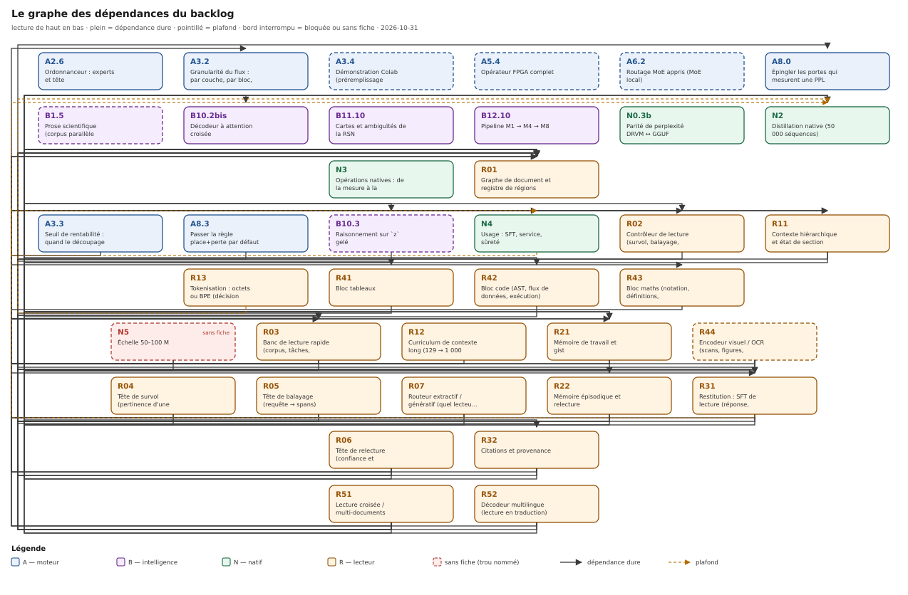

# Le graphe des dépendances du backlog

> **Ce que ce document est.** Le **graphe** que l'index ne peut pas porter : pour chaque item des
> quatre chantiers (A, B, N, R), ce qu'il attend, ce qu'il débloque, et de **quel type** est
> l'arête. Il est **vérifié** par `tools/verifie_backlog.py` (arêtes mortes, cycles, priorités
> inversées, frontière) et **dessiné** dans
> [`backlog-dependances.svg`](../../schemas/backlog-dependances.svg).
>
> **Relevé du 2026-10-29.** 29 fiches, 8 lignes ouvertes **sans fiche**, 41 arêtes dures,
> 3 plafonds. La roadmap donne l'ordre, l'index donne le statut, ce document donne le graphe ;
> les trois se contredisent s'ils sont écrits trois fois — d'où l'outil.

## 1. Trois types d'arête, et pourquoi un seul ne suffit pas

| type | clé de la fiche | ce que ça veut dire | effet |
|---|---|---|---|
| **dure** | `Dépend de` | l'artefact d'entrée n'existe pas encore | la fiche est bloquée, elle ne peut pas être mesurée |
| **douce** | `Plafonné par` | le travail peut avancer, le résultat est borné par autre chose | la fiche avance, son chiffre est plafonné |
| **fait** | `Contraint par` | un résultat déjà mesuré fixe le contrat | rien à attendre : la contrainte est acquise |

Un backlog qui ne connaît que l'arête dure se trompe **dans les deux sens**. Il se croit **bloqué**
là où il est libre : `R21` attendait `N5`, la mémoire — or `N5` n'est pas une ligne à faire, c'est
un négatif déjà mesuré (le signal à 8 pas n'est pas lisible, R² −0,681). Il se croit **libre** là
où il est bloqué : `R11` dépendait de `N2`, qui plafonne à **2,708** — alors que la hiérarchie est
justement le levier que `N2` n'a pas encore essayé.

Les trois types séparent trois questions différentes : *puis-je coder ?* (dure), *mon chiffre
peut-il être bon ?* (douce), *qu'est-ce qui est déjà interdit ?* (fait).

## 2. Le graphe

*Lecture de haut en bas ; trait plein = arête dure, pointillé = plafond, bord interrompu = bloquée
ou sans fiche. La marge de gauche est un rail : les arêtes longues y descendent pour ne traverser
aucune boîte.*

Trois chiffres se lisent sur le graphe.

- **La profondeur est 5** : `R01 → R02 → R03 → R31 → R32 → R51`. C'est le chemin le plus long du
  backlog ; tout le reste est plus court.
- **La frontière fait 12 items** : le « jamais en attente » n'est pas une file d'un seul élément.
- **Le chemin critique passe par le banc** (`R03`) : `R04`, `R05`, `R06`, `R31`, `R51` en dépendent.
  Le banc n'est pas un instrument parmi d'autres, c'est le nœud par lequel tout le reste se mesure.

## 3. Le graphe, par chantier

Les tables sont **générées** depuis les fiches (`python3 tools/verifie_backlog.py --tables`) : une
table recopiée à la main diverge au premier ajout. « Acquis » = la ligne est mesurée ou close, elle
ne demande aucun travail ; « sans fiche » = une ligne ouverte de la roadmap qui n'a pas encore de
contrat, donc pas de porte ni de contrôle négatif.

### A — le moteur

| item | état | dépend de (dure) | plafond / contrainte | débloque | fiche |
|---|---|---|---|---|---|
| **A2.6** | sans fiche | A2 (acquis) | — | — | — |
| **A3.2** | mesurée | A3 (acquis) | — | A3.3 | [A3.2-granularite.md](A3.2-granularite.md) |
| **A3.3** | mesurée | A3.2 (dure) | — | — | [A3.3-seuil.md](A3.3-seuil.md) |
| **A3.4** | bloquée | A3 (acquis) | bloqué : le compte et le runtime Colab | — | [A3.4-colab.md](A3.4-colab.md) |
| **A5.4** | bloquée | A5 (acquis) | bloqué : la carte Stratix V | — | [A5.4-fpga.md](A5.4-fpga.md) |
| **A6.2** | bloquée | A6 (acquis) | bloqué : aucun MoE local dans 16 Go de VRAM | — | [A6.2-moe-local.md](A6.2-moe-local.md) |
| **A8.0** | mesurée | A8 (acquis) | — | A8.3 | [A8.0-portes-ppl.md](A8.0-portes-ppl.md) |
| **A8.3** | mesurée (négative) | A8.0 (dure) | le mélange déplace les portes de −5,9 % à +19,5 % | — | [A8.3-defaut.md](A8.3-defaut.md) |

### B — l'intelligence

| item | état | dépend de (dure) | plafond / contrainte | débloque | fiche |
|---|---|---|---|---|---|
| **B1.5** | bloquée | B1 (acquis) | bloqué : aucun corpus parallèle humain d'articles | — | [B1.5-prose-scientifique.md](B1.5-prose-scientifique.md) |
| **B10.2bis** | mesurée (négative) | — | l'attention ne franchit pas le plancher (16,5/11,2) | B10.3 | [B10.2bis-decodeur-attention-croisee.md](B10.2bis-decodeur-attention-croisee.md) |
| **B10.3** | bloquée | B10.2bis (dure) | B10.2 négatif (chrF 12,7 / 5,3 contre 39,6) | R52 | [B10.3-raisonnement-z.md](B10.3-raisonnement-z.md) |
| **B11.10** | prête | B11 (acquis) | — | — | [B11.10-cartes-ambiguites.md](B11.10-cartes-ambiguites.md) |
| **B12.10** | partiel | B12 (acquis) | — | — | [B12.10-pipeline-m1-m4-m8.md](B12.10-pipeline-m1-m4-m8.md) |

### N — le natif

| item | état | dépend de (dure) | plafond / contrainte | débloque | fiche |
|---|---|---|---|---|---|
| **N0.3b** | prête | N0 (acquis) | — | — | [N0.3b-parite-ppl.md](N0.3b-parite-ppl.md) |
| **N2** | en cours | N1 (acquis) | — | N5, R11 | [N2-distillation.md](N2-distillation.md) |
| **N3** | sans fiche | N1 (acquis) | — | — | — |
| **N4** | partiel | — | N2 (plafond) | N5 | [N4-usage-sft.md](N4-usage-sft.md) |
| **N5** | sans fiche | N2 (dure), N4 (dure) | — | — | — |

### R — le lecteur

| item | état | dépend de (dure) | plafond / contrainte | débloque | fiche |
|---|---|---|---|---|---|
| **R01** | mesurée | — | — | R02, R03, R04, R05, R11, R21, R22, R31, R32, R41, R42, R43, R51 | [R01-graphe-document.md](R01-graphe-document.md) |
| **R02** | mesurée | R01 (dure) | — | R03 | [R02-controleur-lecture.md](R02-controleur-lecture.md) |
| **R03** | partiel | R01 (dure), R02 (dure) | — | R04, R05, R06, R31, R51 | [R03-banc-lecture-rapide.md](R03-banc-lecture-rapide.md) |
| **R04** | spécifiée | R03 (dure), R01 (dure) | — | — | [R04-tete-survol.md](R04-tete-survol.md) |
| **R05** | spécifiée | R03 (dure), R01 (dure) | le manque M4 (aucun encodeur exécutable) | — | [R05-tete-balayage.md](R05-tete-balayage.md) |
| **R06** | spécifiée | R03 (dure), R21 (dure), R22 (dure) | — | — | [R06-tete-relecture.md](R06-tete-relecture.md) |
| **R11** | spécifiée | R01 (dure), N1 (acquis), N2 (dure) | — | R12, R21 | [R11-contexte-hierarchique.md](R11-contexte-hierarchique.md) |
| **R12** | spécifiée | R11 (dure) | les cinq négatifs 129–256 | — | [R12-curriculum-contexte.md](R12-curriculum-contexte.md) |
| **R13** | spécifiée | — | N2 (plafond) | — | [R13-tokenisation-bpe.md](R13-tokenisation-bpe.md) |
| **R21** | spécifiée | R01 (dure), R11 (dure) | la mémoire à 8 pas est négative (mesuré) | R06, R22, R31, R32 | [R21-memoire-travail-gist.md](R21-memoire-travail-gist.md) |
| **R22** | spécifiée | R01 (dure), R21 (dure) | — | R06 | [R22-memoire-episodique.md](R22-memoire-episodique.md) |
| **R31** | spécifiée | R01 (dure), R03 (dure), R21 (dure) | N4 (plafond) | R32, R51, R52 | [R31-restitution-sft.md](R31-restitution-sft.md) |
| **R32** | spécifiée | R31 (dure), R01 (dure), R21 (dure) | — | R51, R52 | [R32-citations-provenance.md](R32-citations-provenance.md) |
| **R41** | spécifiée | R01 (dure) | — | R44 | [R41-bloc-tableaux.md](R41-bloc-tableaux.md) |
| **R42** | spécifiée | R01 (dure) | — | R44 | [R42-bloc-code.md](R42-bloc-code.md) |
| **R43** | spécifiée | R01 (dure) | — | R44 | [R43-bloc-maths.md](R43-bloc-maths.md) |
| **R44** | spécifiée | R41 (dure), R42 (dure), R43 (dure) | — | — | [R44-encodeur-visuel.md](R44-encodeur-visuel.md) |
| **R51** | spécifiée | R31 (dure), R32 (dure), R03 (dure), R01 (dure) | le manque M4 (aucun encodeur exécutable) | — | [R51-lecture-croisee.md](R51-lecture-croisee.md) |
| **R52** | spécifiée | B10.3 (dure), R31 (dure), R32 (dure) | — | — | [R52-multilingue-decodeur.md](R52-multilingue-decodeur.md) |

## 4. Les défauts trouvés le 2026-10-29

Sept défauts, tous corrigés dans les fiches. Aucun n'était visible à la lecture ; tous le sont
dans le graphe.

1. **Une collision d'identifiants.** `N5` désignait l'**échelle** (roadmap) et la **mémoire**
   (manques) — deux choses opposées : une ligne à faire, un négatif mesuré. La roadmap les citait
   à trente lignes d'écart. Corrigé : le négatif de mémoire n'a plus d'identifiant, il est
   nommé « la mémoire à 8 pas est négative ». Même dette pour `N3` (opérations natives /
   apprentissage local) et `M4` (module cerveau / manque encodeur) : **les identifiants se
   réutilisent, pas les faits**.
2. **Un déblocage sans fiche.** `B10.3` dépendait de `B10.2`, qui est un **négatif**, pas un
   travail. Le travail qui débloque — un décodeur à attention croisée — n'existait nulle part. Il
   est nommé `B10.2bis` et il est **sans fiche** : c'est un trou nommé, pas une ligne du backlog.
3. **Une condition sans identifiant.** `A8.3` (« opt-in → défaut ») exige d'« épingler les portes
   qui mesurent une PPL ». Cette condition n'avait ni id ni fiche : elle est nommée `A8.0`.
4. **Un cycle.** `R06` dépendait de `R22`, et `R22` disait, dans ses étapes, « implémenter le
   déclencheur (R06) ». Le déclencheur ne peut pas précéder le store qu'il interroge. L'ordre est
   `R22a` (store, offsets, éviction) → `R06` (déclencheur) → `R22b` (éviction réglée par le gain).
5. **Une même mesure sous deux noms.** `R02` disait dépendre de `R03`, et `R03` de `R02` : le
   contrôleur se mesure sur le banc, le banc a besoin des modes du contrôleur. Ce n'est pas un
   cycle de travail, c'est **une seule mesure**. L'ordre est `R03.1` (corpus, questions, mode
   intégral, closed-book) → `R02` → `R03.2` (courbe, modes), avec **une fiche de résultat jointe**
   pour R02 + R03.2.
6. **Sept dépendances manquantes.** `R11` prend en entrée les frontières de section de `R01` sans
   le dire ; `R21` et `R22` ont besoin des régions ; `R31` et `R32` du gist ; `R51` et `R52` de la
   provenance (`R32`) pour leur porte « deux sources citées » ; `R04` et `R05` des régions.
   Corrigées.
7. **Une priorité inversée.** `R06` (P1) dépendait de `R22` (P2) : l'urgent attendait le moins
   urgent. `R06` passe **P2** — il est la troisième des trois têtes, derrière le store et derrière
   `R04`/`R05`, qui ne demandent que le banc.

Et un défaut de méthode, qui n'est pas dans le graphe : **le statut mélange deux axes** —
l'avancement de la fiche (`spécifiée`, `prête`, `en cours`) et l'état de la mesure (`partiel`,
`mesurée`). `N4` est à la fois « partiel » et « non bloqué » ; `B12.10` aussi. La disponibilité se
**calcule** (c'est ce que fait l'outil), elle ne se déclare pas dans un champ à deux sens.

## 5. La frontière : ce qui est réellement non bloqué

Douze items, dont sept fiches et cinq lignes sans fiche. C'est la file « jamais en attente »
réelle : elle est plus large que l'ordre du jour de la roadmap, et c'est voulu.

| item | état | pourquoi c'est libre | la prochaine action |
|---|---|---|---|
| **R01** | prête | aucune dépendance ; le contrat est écrit | écrire le schéma de manifeste, brancher un parseur, mesurer 50 pages |
| **N0.3b** | prête | N0 est mesuré sauf elle | reproduire la PPL GGUF puis DRVM, sur 59 et 1 076 octets |
| **N4** | partiel | aucune arête dure ; `N2` n'est qu'un plafond | SFT avec partage par document, évalué tenu à l'écart |
| **N2** | en cours | `N1` acquis ; le levier reste à choisir | données et capacité, 3 graines — laisser la hiérarchie à `R11` |
| **B11.10** | prête | `B11` mesuré ; le codec lit 100 % | étendre le codec aux cartes, nommer les ambiguïtés |
| **B12.10** | partiel | `B12` acquis ; les modules existent | jeu de codes neufs et ablation de M4 |
| **R13** | spécifiée | aucune arête dure ; `N1` suffit à deux tokenisations | chiffrer octets contre BPE à budget égal |
| **A2.6** | sans fiche | `A2` mesuré | compléter l'ordonnanceur : experts, tête |
| **A3.2** | sans fiche | `A3` mesuré | granularité par bloc |
| **A8.0** | sans fiche | c'est une condition, pas une dépendance | épingler les portes qui mesurent une PPL |
| **B10.2bis** | sans fiche | le négatif `B10.2` est acquis | décodeur à attention croisée, 20–30 articles, 3 graines |
| **N3** | sans fiche | `N1` mesuré | porter les briques mesurées en production et en porte |

**Ce qui n'y est pas, et pourquoi** : `A3.4`, `A5.4`, `A6.2`, `B1.5` sont bloqués par une
ressource externe nommée ; `B10.3` et `R52` attendent `B10.2bis` ; `N5` attend `N2` et `N4` ; tout
le reste du lecteur attend le banc.

## 6. Les priorités (arrêtées le 2026-10-29)

Le critère n'est pas la date : c'est **valeur / coût / dépendances**. Trois règles en découlent.

- **Ce qui rend mesurable passe avant ce qui est mesuré.** Le banc n'est pas un accessoire de la
  lecture : sans lui, ni le contrôleur ni les têtes ne peuvent être départagés.
- **Ce qui n'ouvre rien attend.** `R43` (maths), `R44` (OCR) et `R52` (multilingue) n'ouvrent que
  sur eux-mêmes ; ils ne sont pas la prochaine action, quel que soit leur intérêt.
- **Un négatif écrit ne se refait pas.** Les longueurs 130–256, la mémoire à 8 pas et `B10.2` ont
  leur réponse ; les refaire coûte sans apprendre.

**Les quatre arbitrages rendus le 2026-10-29.**

1. **La hiérarchie est portée par N2.** `R11` en mesure la fenêtre et **attend N2** : sa
   dépendance redevient dure. Conséquence assumée : `R11` et `R12` ne démarrent pas avant la série
   hiérarchie de N2, qui porte donc deux choses — sa porte `< 2,5` et le changement d'architecture.
2. **Le SFT se partage.** `N4` porte la **consigne courte sans document** (format, arrêt, refus) ;
   `R31` porte la **lecture multi-sections** (gist, citations, refus). Le protocole de partage par
   document est écrit **une fois** et sert aux deux.
3. **L'échelle `N5` est gelée** jusqu'au verdict de `R11` sur le contexte. On ne paie pas 50–100 M
   pour contourner un défaut de schéma.
4. **R0 suit l'ordre du graphe** : `R01` (schéma, parseurs), puis `R02` (contrôleur), puis `R03`
   (banc). La courbe de `R03.2` est la **mesure jointe** de `R02` : une seule fiche de résultat.

| rang | items | pourquoi |
|---|---|---|
| **P0** | `R01` → `R02` → `R03` | l'ordre du graphe : aucun entraînement, et tout le reste se mesure avec |
| **P0 bis** | `N0.3b` | coût faible, ferme N0, rend le banc natif crédible |
| **P1** | `N2` | la hiérarchie : le verrou du contexte, et le seul levier non essayé |
| **P1** | `R11`, `R12` | après N2 : la fenêtre qui en résulte |
| **P1** | `N4`, `R21`, `R31` | la consigne courte, la mémoire, la restitution de lecture |
| **P1** | `R04`, `R05` | les deux têtes qui ne demandent que le banc |
| **P2** | `R22`, `R06`, `R32`, `R41`, `R42`, `R13` | le reste du lecteur, dans l'ordre du graphe |
| **P2** | `N3`, `B11.10`, `B12.10`, `A2.6`, `A3.2`, `A8.0` | lignes autonomes, utiles, non bloquantes |
| **P3** | `R43`, `R44`, `R51`, `R52`, `B10.3`, `B10.2bis`, `A3.3`, `A8.3` | plus tard, ou dépend d'un bloc absent |
| **gelé** | `N5` | 50–100 M : après le verdict de `R11` sur le schéma |
| **bloqués** | `A3.4`, `A5.4`, `A6.2`, `B1.5` | ressource externe nommée : on prend la ligne suivante |

**Ce que ces choix coûtent.** `N2` est le point de charge du plan : il porte sa porte et la
hiérarchie. `R31` attend `R21`, donc la restitution ne se mesure pas avant la mémoire. `R03`
venant en dernier, la première courbe vitesse-compréhension arrive après `R01` et `R02` — c'est le
prix de l'ordre strict, et il est nommé.

## 7. Les sous-items : là où un item cache deux contrats

| item | sous-items | ce qui les sépare | ordre |
|---|---|---|---|
| `R01` | `R01.1` schéma, `R01.2` parseurs et corpus | le schéma est le seul artefact dont `R02` a besoin ; les parseurs se mesurent sur le corpus | schéma d'abord |
| `R03` | `R03.1` corpus et banc minimal, `R03.2` courbe et modes | le corpus ne dépend ni de `R01` ni de `R02` ; la courbe dépend des deux | corpus préparé en parallèle ; courbe = mesure jointe avec `R02` |
| `R22` | `R22a` store, `R22b` éviction | le store précède le déclencheur ; l'éviction se règle par le gain du déclencheur | `R22a` → `R06` → `R22b` |
| `R02` + `R03.2` | une mesure jointe | deux fiches mesureraient deux fois le même chiffre | une seule fiche de résultat |

## 8. Ce que le graphe ne dit pas

- **la valeur** : le graphe dit ce qui est possible, pas ce qui vaut la peine — c'est le § 6, et
  c'est un arbitrage humain ;
- **le coût** : un item court peut cacher trois semaines (le manque M4 : 3–4 semaines) ;
- **les ressources** : un item bloqué par le matériel n'est pas bloqué par le code ;
- **les dates** : il n'y en a pas, et c'est voulu.

## Voir aussi

- [L'index du backlog](index.md) — les fiches, leur statut et leur priorité.
- [La roadmap unique](../roadmap.md) — l'ordre du jour et les programmes.
- [L'état courant](../en-cours.md) — la prochaine action.
- [Le concept du lecteur](../../theorie/lecture-rapide.md) — les 14 techniques et les cinq couches.
