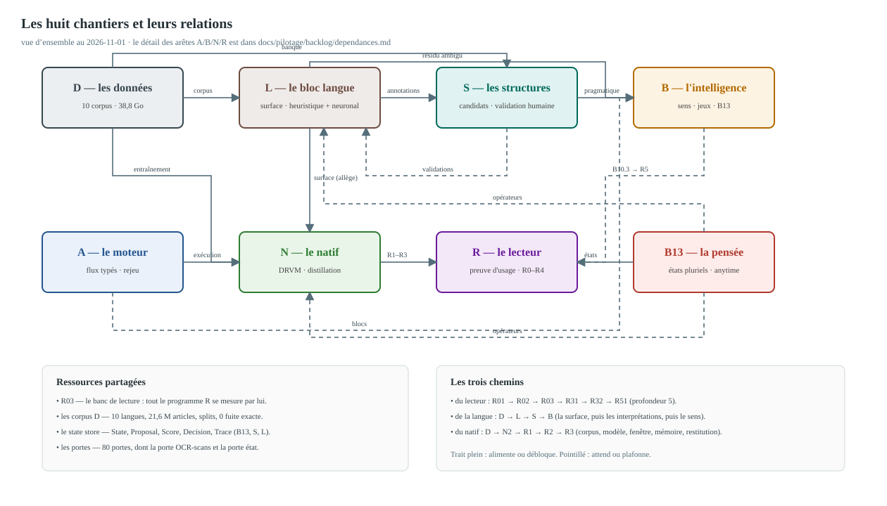

# Les chantiers — la vision à jour et leurs relations

> **Ce que ce document est.** La **vue d'ensemble des chantiers** : ce que les demandes des
> 48 dernières heures ont déplacé, l'inventaire élargi (A, B, N, R, **S**, **L**, **D**, B13),
> leurs **relations** (ce que chacun attend et ce qu'il fournit) et les **tensions** à trancher.
> Il ne remplace ni la [roadmap](roadmap.md) (l'ordre et les états), ni l'[en-cours](en-cours.md)
> (l'état courant), ni le [backlog](backlog/index.md) (les contrats par fonctionnalité) : il dit
> **comment les morceaux tiennent ensemble**.
>
> **Date** : 2026-11-01. **Méthode** : relecture des messages humains des sessions des 48 h
> (`0b69f616`, `22e518ee`, `0b0a6a0d`, `fe3c05f0`, `e181ce02`, les sessions de QA visuelle),
> des plans et rapports de session, et des documents de vision, roadmap, programme R et backlog.
>
> **Chargement** : ce document (une fois), puis la roadmap pour l'ordre. Ne pas charger le
> backlog entier.

## 1. Ce que les 48 heures ont demandé

Les demandes humaines, dans l'ordre, et ce qu'elles ont déplacé. Les citations sont les mots du
mandat, pas une reformulation.

| quand | demande | ce qu'elle a déplacé |
|---|---|---|
| 30/10 21 h 47 | « tu es la seule session active. termine les chantiers en cours » | clôture de R0.4, R0.5, R13 ; consolidation de l'état |
| 31/10 11 h 14 | « commence par compléter proprement les autres sessions avant d'entreprendre quelque chose du backlog » | archives, plans, journal, état ; la session unique devient la règle de départ |
| 31/10 17 h 43 | « fais une documentation détaillée du modèle Drave natif. utilise beaucoup de diagrammes […] Comment implémenter un modèle de type Diehl & Cook (2015) en respectant notre principe de séparation à 3 niveaux (sémantique neutre au centre) » | la documentation du natif et la **séparation à 3 niveaux** comme contrat |
| 31/10 22 h 09 | « chaque bloc […] peut utiliser la technologie et les moyens les plus appropriés […] modularité extrême […] L'interface reste Drave, où des flux de données typées transigent » | la **substituabilité des blocs** (neuronal / classique / matériel) comme principe, pas comme option |
| 31/10 22 h 15 | « je te donne 10 h de liberté totale. impressionne-moi » (N2.h) | corpus propre, mètre honnête, diversité, longueur, typoglycémie, coloration, S, formation |
| 31/10 22 h 14 | « tu dois être plus ambitieux. je te donne 10 h humain » (R4.4) | le programme des scans : 5 familles, colonnes, tableaux, vrais livres, porte |
| 31/10 22 h 22 | « le RSN (le pluriel sera plus approprié car tu dois avoir plusieurs candidats) est une représentation de données interne qui te permet d'itérer indéfiniment dans des cycles de pensées à plusieurs niveaux. Il te faudra donc un arbre d'états et toutes les stratégies de l'IA traditionnelle » | la **RSN plurielle**, l'arbre d'états, le moteur de pensée (B13) |
| 31/10 22 h 38 | « en-cours.md doit contenir pour chaque session tout ton plan, ambition et stratégie et objectif final » | le **contrat de synergie** entre sessions |
| 01/11 10 h 29 | « s'éloigner du modèle octet et modèle token pour aller vers un modèle qui voit la structure du texte en surface […] la saccade et les mots dont on peut mélanger les lettres du milieu » | la **typoglycémie** et la **structure de surface** comme objet d'entraînement |
| 01/11 10 h 38 | « un outil semblable [à la coloration syntaxique] pour la linguistique […] coloration et découpage visuel de la structure des phrases et paragraphes […] en entrée de notre modèle pour accélérer son apprentissage » | l'outil **S** (structures candidates) et la **coloration** comme entrée du modèle |
| 01/11 10 h 46 | « créons d'abord un outil pour humain […] afficher en web un ensemble de structures d'interprétation candidates […] valider les interprétations par un humain […] soumettre à DeepSeek via l'API […] construire une banque de corpus robuste » | le **S** outil web, humain + LLM, banque d'interprétations |
| 01/11 11 h 10 | « un niveau pragmatique pour trancher et conserver les 2 sens » | la **pragmatique** comme niveau, le double sens conservé |
| 01/11 11 h 36 | « commencer l'entraînement avec des phrases non ambiguës et étudier les effets sur la qualité du bloc linguistique » | le protocole d'entraînement du **bloc linguistique** |
| 01/11 11 h 33 | « une couche linguistique de prétraitement par heuristique pour l'étiquetage des différents niveaux du mot jusqu'au document en plusieurs langues […] alléger le traitement linguistique des réseaux de neurones » | l'analyse de la **couche heuristique** (Pensée) |
| 01/11 13 h 04 | « on n'a pas encore de bloc d'étiquetage de structure linguistique ? » | le **bloc langue** est nommé comme bloc manquant |
| 01/11 13 h 23 | « fait les deux. Le bloc langue doit couvrir l'étiquetage tous les niveaux linguistiques jusqu'à la pragmatique. on doit avoir une version heuristique et une neuronale. Le contrat garantissant la possibilité de substituer ou faire fonctionner en parallèle » | le **contrat du bloc langue** : deux implémentations, un contrat, la substitution |
| 01/11 10 h 33 – 13 h | inventaire des données, corpus FR, corpus des autres langues | **D** : 10 corpus, 38,8 Go, 21,6 M articles |

**Ce que ces demandes disent ensemble.** Le projet ne cherche plus seulement « un modèle qui a
une bonne perplexité » : il cherche un **runtime cognitif** où le texte est **structuré en
surface** (heuristique + neuronal, niveaux du mot au document, jusqu'à la pragmatique), où les
**interprétations sont plurielles** (RSN, S, humain), où les **blocs sont substituables** (même
contrat, technologies différentes), et où le **lecteur R** prouve l'usage. Les données (D) sont
le carburant ; la mesure (fiches, portes) est la règle.

## 2. La vision à jour, en huit principes

1. **Le bus de flux typés, et la structure bat la taille.** Un bloc est une unité de conception à
   entrées/sorties typées, coût mesurable et trace ; il peut être neuronal, classique ou matériel.
   Le bus ne fait pas la différence — c'est ce qui rend la substitution et la comparaison honnêtes.
2. **Le texte se lit en surface d'abord.** Les niveaux **octet/Unicode → morphème → mot →
   syntagme → phrase → paragraphe → document → multilingue** sont des **annotations**, pas des
   prompts. Le CPU étiquette la surface et **énumère le plausible** ; le réseau tranche
   l'ambiguïté et le sens. La cascade se juge sur **couverture × précision par unité de calcul**,
   pas sur le débit.
3. **La pragmatique est un niveau.** L'ambiguïté ne se tranche qu'en contexte ; le double sens se
   **conserve** comme donnée (statuts, niveaux 0–4, niveau minimal) au lieu d'être écrasé.
4. **Les interprétations sont plurielles.** La RSN est un ensemble de candidats, pas un objet
   canonique : arbre d'états, opérateurs hétérogènes, stratégies classiques (BFS, A*, MCTS, AC-3,
   alpha-bêta), décisions justifiables, trace et rejeu.
5. **La validation humaine construit la banque.** S montre les structures candidates, l'humain et
   le LLM les évaluent ; l'export alimente le corpus d'entraînement du bloc linguistique.
6. **Le lecteur R est la preuve.** Un document, une question, un budget → une réponse **avec sa
   source** ou un **refus motivé**. R0 et R4 sont mesurés ; R1–R3 attendent le natif ; R5 attend
   B10.3.
7. **Le natif N est la capacité.** Distillation, corpus propre, mètre honnête, longueur, diversité ;
   N2.h a mesuré le domaine (3,09) et le hors-domaine (3,85 avec diversité) ; le levier suivant est
   du **français réel en volume** — les corpus D.
8. **La mesure est la règle.** Un chiffre, un contrôle négatif, une fiche, une porte, un état ; les
   limites sont **nommées**, pas cachées. Les résultats et les écarts s'accueillent sans jugement.

## 3. L'inventaire élargi des chantiers

Huit chantiers. Les quatre premiers (A, B, N, R) ont leurs fiches dans le backlog ; **S** et
**B13** ont une fiche de session et des rapports ; **L** et **D** sont les deux chantiers que les
48 h ont fait sortir de l'implicite.

| chantier | la question à laquelle il répond | état au 01/11 | prochaine action | dépend de | fournit à |
|---|---|---|---|---|---|
| **A — le moteur** | un flux de blocs typés peut-il tourner, se placer, se répartir, se rejouer ? | ✅ A1–A8 ; A3.4, A5.4, A6.2 bloqués ; A2.6 partiel ; A8.3 expliqué | **A2.6** (experts, A6.2 bloqué) ; réduire le lot | — | N, B (exécution) |
| **B — l'intelligence** | le sens, la logique, les jeux, les maîtres : que sait faire le système ? | ✅ B1–B12 ; B10.3 bloqué (encodeur) ; **B13** state store v0 + AC-3/alpha-bêta + DRVF + banc, 10/10 portes | B10.3 (encodeur) ; **B13** : opérateurs/DRVM | A, N1, D (corpus) | R (R5), S/L (sémantique, pragmatique) |
| **N — le natif** | le modèle natif peut-il être petit, creux, honnête et général ? | 🔬 N0/N1 mesurés ; N2.h : 3,09 en domaine, 16,70 → 3,85 hors dépôt ; N4 partiel | **N2** (français réel, capacité) ; N4 (consigne) | A (moteur), D (corpus) | R1–R3, N5 |
| **R — le lecteur** | un document, une question, un budget : réponse sourcée ou refus motivé ? | ✅ R0.1–R0.3 ; R0.4/R0.5 négatifs ; R4.1–R4.4 mesurés (R4.4 : 4/5 familles ≥ 90 %) | **R1.1/R1.2** (contexte natif) ; R2/R3 attendent N ; R5 attend B10.3 | R03 (banc), N, B10.3, D (docs) | la preuve d'usage pour tous |
| **S — les structures** | quelles structures d'interprétation candidates, et lesquelles un humain valide ? | 🔬 v0 : 7 phrases, générateur, pragmatique (niveaux 0–4, double sens), LLM, export ; 11 tests | **analyseur plus riche** (rôles, subordonnées) ; brancher l'export au corpus | L (annotations), D (corpus), B (sens) | L (banque), B (pragmatique), D (corpus) |
| **L — le bloc langue** (nouveau) | le CPU peut-il étiqueter la surface et le réseau ne traiter que le résidu ? | ✅ **contrat + bloc v0** : 9 niveaux, **398 langues à 0,9687**, **gold 360** (POS 0,772, exact 0,190, tête 0,510), **attachement tête 1,0/0,966/0,932** (59 ambiguës ; 40 nouveaux sans cible) ; cascade 67,1 % | **B13 neuronal nécessaire** ; **modèle neuronal qualifié** | D (corpus), S (banque), N2 (entraînement) | R (prétraitement), B (sémantique), N2 (allègement) |
| **D — les données** (nouveau) | avec quoi entraîne-t-on, et à quel prix ? | ✅ inventaire local ; **10 corpus** (21,6 M articles, 38,8 Go), dédup, splits, 0 fuite | texte intégral (dumps), PDF/OCR, filtrage des stubs, licences | — | N2, L, S, R03 |
| **B13 — le moteur de pensée** | penser est-il une recherche tracée sur des états pluriels ? | ✅ state store v0 + AC-3/alpha-bêta + **DRVF `thought`** + **banc anytime** + **opérateurs hétérogènes** + **nécessaire** + **labyrinthe** + **porte** + **apprise** + **courbe** + **seule** + **stochastique** + **sto seule** + **ferme** + **minute** + **minute apprise** + **minute seule** + **minute entraînée** + **shaping** + **réseau** + **MLP** + **professeur** + **sans None** + **correction** + **audit** + **ouverte** + **graines** + **mobile** + **mobile graines** + **bruit** + **bouge** + **bouge graines** + **période** + **phase** + **phase graines** + **aléatoire** + **hasard** + **partielle** + **croyance** + **curiosité**, **46/46 portes** | la **politique DRVM/native** et le coût mesuré | L (états), R (documents), N (opérateurs) | B, R, L |

**Deux remarques d'inventaire.** (1) **S** et **L** ne sont pas des sous-produits de B : ce sont
des **blocs** avec leur contrat, leur coût et leur trace — et le contrat de L est précisément ce
que la demande du 01/11 13 h 23 réclame. (2) **D** n'est pas un « prétraitement » : c'est un
chantier avec ses sources, ses licences, ses splits et ses contrôles, et il alimente quatre autres
chantiers.

## 4. Les relations

*Trait plein = alimente ou débloque ; pointillé = attend ou plafonne. Le détail des arêtes dures
du backlog (A/B/N/R) est dans [dependances.md](backlog/dependances.md) ; la carte de décision
existante (quatre couloirs) est dans [chantiers-decision.svg](../schemas/chantiers-decision.svg).*

### 4.1 Les six relations qui portent

1. **D → N2, L, S, R03.** Les corpus nourrissent l'entraînement du natif, du bloc langue et de S ;
   ils fournissent aussi les documents du banc. Sans D, N2 reste sur 5,36 Mo de prose et L n'a
   rien à étiqueter.
2. **L → R, B, N2, S.** La surface étiquetée entre dans le lecteur (frontières, régions,
   structure), dans la couche sémantique (le résidu ambigu), dans N2 (moins de surface à
   apprendre) et dans S (les candidats d'interprétation).
3. **S → L, B, D.** Les structures candidates et les validations humaines/LLM deviennent la
   **banque** : elle entraîne L (version neuronale), elle alimente la pragmatique de B, elle
   grossit D.
4. **N → R1, R2, R3 ; B10.3 → R5.** La fenêtre native, la mémoire et la restitution attendent N2
   et N4 ; la lecture croisée attend l'encodeur qui porte (B10.3).
5. **A → N, B.** Le moteur exécute les modèles et les blocs ; sans lui, N et B restent des
   maquettes torch.
6. **B13 → L, R, N.** Le moteur de pensée consomme les états de L, les documents de R et les
   opérateurs de N ; il rend des décisions justifiables et rejouables.

### 4.2 Les ressources partagées

| ressource | ce qu'elle est | qui l'utilise |
|---|---|---|
| **le banc R03** | les questions, les passages, le lecteur extractif | tout le programme R ; c'est le nœud de mesure |
| **les corpus D** | 10 langues, 21,6 M articles, 38,8 Go, splits, 0 fuite | N2, L, S, R03 |
| **le state store** | `State`, `Proposal`, `Score`, `Decision`, `Trace` | B13, S, L (opérateurs) |
| **les portes** | 80 portes, dont la porte OCR-scans et la porte état | tous les commits |
| **en-cours** | le contrat de synergie (plan, ambition, stratégie, objectif par session) | toutes les sessions |

### 4.3 Les chemins critiques

- **Le chemin du lecteur** : `R01 → R02 → R03 → R31 → R32 → R51` (profondeur 5). R03 est le nœud
  par lequel tout se mesure.
- **Le chemin de la langue** : `D → L → S → B` — la surface, puis les interprétations, puis le
  sens. C'est le chemin que les 48 h ont rendu explicite.
- **Le chemin du natif** : `D → N2 → R1 → R2 → R3` — le corpus, le modèle, la fenêtre, la mémoire,
  la restitution.
- **Le chemin de la pensée** : `B13 → L/R/N` — les états, les documents, les opérateurs.

## 5. Les tensions, et ce qui reste à trancher

1. **La frontière heuristique/réseau.** Où s'arrête l'étiquetage CPU et où commence le réseau ?
   La réponse n'est pas idéologique : elle se mesure par **couverture × précision par unité de
   calcul**, avec le contrôle négatif « une heuristique rapide mais fausse coûte plus qu'un appel
   réseau ». La première mesure (langue/frontières, 71 langues) est la prochaine action de L.
2. **Le contrat de L.** « Une version heuristique et une neuronale, substituables ou en parallèle »
   demande un contrat d'entrée/sortie identique, une trace, un coût et une porte. Il n'est pas
   encore écrit : c'est le premier livrable de L.
3. **La pragmatique.** Le niveau 4 (double sens conservé) est dans S ; il n'est pas encore un
   contrat de L ni une mesure de B. La question « quel contexte pour trancher ? » (01/11 11 h 24)
   reste ouverte.
4. **Le natif contre les blocs.** N2 améliore le domaine (3,09) et le hors-domaine (3,85) ; L
   allège le réseau ; S construit la banque. Les trois se composent-ils, ou se cannibalisent-ils ?
   La question est mesurable : entraîner N2 sur D, avec et sans la surface de L, et comparer.
5. **La mesure de S.** L'humain valide, le LLM évalue, l'export alimente le corpus — mais à quelle
   échelle, avec quel accord inter-juges, et avec quel contrôle ? Le protocole n'est pas écrit.
6. **Les limites nommées de R4.4.** Fax 1 bit (56,7 % de parité), exposant fusionné, tableaux photo
   (2/10 pages) : ce sont des limites physiques ou d'information, pas des tâches ouvertes. Elles
   restent dans la fiche R4.4.
7. **Le 10 h de liberté.** Les deux sessions de la nuit (N2.h, R4.4) ont livré des mesures, des
   fiches, des portes et des limites ; la leçon de méthode — « un résultat, un contrôle négatif,
   une fiche, un commit » — est ce qui rend la suite possible.

## 6. La frontière : ce qui peut démarrer maintenant

| priorité | action | chantier | pourquoi maintenant |
|---|---|---|---|
| 1 | écrire le **contrat de L** (deux implémentations, trace, coût, porte) | L | la demande du 01/11 13 h 23 ; l'analyse est faite |
| 2 | première **mesure de cascade** (langue, frontières, 71 langues) | L | elle juge la couche heuristique avant de l'étendre |
| 3 | **analyseur plus riche** de S + export vers le corpus | S | la banque est le carburant de L neuronal |
| 4 | entraîner **N2 sur D** (fr/en), avec et sans surface | N2, L, D | le levier « français réel » est le seul qui reste à N2 |
| 5 | **opérateurs hétérogènes/DRVM** | B13 | le banc anytime est mesuré (10/10) |
| 6 | **R1.1/R1.2** (contexte natif) | R | R0/R4 sont closes ; R1 attend N2 |
| 7 | **texte intégral** des 10 corpus + PDF/OCR | D | 38,8 Go de résumés, pas encore les articles entiers |

## 8. La capacité simultanée

Combien de chantiers peuvent tourner **en même temps**, avec les moyens d'aujourd'hui ? Mesuré
le 2026-11-01 : **40 cœurs**, **125 Go de RAM** (109 disponibles), **2 GPU Quadro RTX 5000 de
16 Go** (libres), **2,0 To libres** sur `Data13TB`, **34 Go libres** sur `IA` (97 % plein), et
**4 processus `dsh`-TUI actifs** (l'état ne déclare qu'une session active, Pensée).

| ressource | ce qu'elle permet | ce qu'elle limite |
|---|---|---|
| 40 cœurs, 125 Go | 6 à 10 tâches CPU simultanées (OCR 1–2 cœurs, entraînement 8–16, éval 4–8) | les gros entraînements CPU se disputent les cœurs |
| 2 × 16 Go GPU | **1 à 2 chantiers GPU** (un entraînement par GPU ; le modèle 32 B et le professeur ne tiennent pas en 16 Go) | la VRAM, pas les cœurs |
| disque | les corpus (38,8 Go) et les sorties | **IA à 34 Go libres** : pas de nouveau gros modèle sans supprimer |
| sessions | **3 à 4 sessions DSH** avec des territoires disjoints | l'**état s'écrit une session à la fois**, et les commits se disputent l'index Git |

**Ce qui est prêt maintenant** (non bloqué) : **N2** (GPU, libre), **L** (contrat + cascade),
**S** (analyseur + export), **D** (texte intégral, PDF/OCR), **A2.6/A8.3** (CPU), **B13**
(AC-3, alpha-bêta). Soit **6 chantiers** possibles sur le papier. **Ce qui est bloqué** : B10.3
(encodeur), A3.4 (Colab), A5.4 (FPGA), A6.2 (MoE local), R2/R3 (N5/N4), R5 (B10.3), N5 (gelé).

**La capacité réaliste est plus basse que le matériel** : **4 sessions** — N2 (GPU), Pensée
(L + B13), S (structures), D/lecteur/A (corpus, R1.1/R1.2, A2.6) — et **2 à 4 sous-agents par
session** pour les tâches bornées (la cascade de L, AC-3/alpha-bêta, l'analyseur de S, l'extraction
PDF, le texte intégral). Soit **4 à 6 chantiers en vol** et **6 à 8 tâches bornées**, pas plus,
parce que :

- l'**état** s'écrit une session à la fois (la règle de `continuite.md`) ; au-delà de 4 écrivains,
  les compteurs dérivent et les commits se verrouillent (observé le 01/11 : `cannot lock ref
  'HEAD'` sur deux commits concurrents) ;
- les **territoires de fichiers** se chevauchent vite (N2 réserve `data/`, `tools/corpus*`,
  `reports/n2-*` ; Pensée `tools/pensee/`, `reports/pensee-*`, `r44-*` ; S `tools/structures` ;
  D `data/corpus*`, `reports/corpus-*`) ;
- la **mesure** est un point de sérialisation (R03, les portes, les JSON) ;
- l'**humain** est le vrai goulot : S, la pragmatique, le contrat de L et les choix de design
  demandent sa relecture — plus d'agents produisent plus à relire, pas plus de **validé**.

**Sessions ou sous-agents ?** Les deux, à des échelles différentes :

| besoin | unité | pourquoi |
|---|---|---|
| un **mandat long** (heures, objectif propre, contexte qui compacte, territoire réservé) | **session DSH** | elle survit, elle écrit son plan et son état, elle peut être reprise ; elle coûte la coordination |
| une **tâche bornée** (une mesure, un outil, une fiche, un audit) | **sous-agent** (2 à 4, AGENTS § 10) | il rend un diff, la session intègre et commite ; il ne touche ni `en-cours` ni la roadmap |
| un **audit massif** en lecture seule (110 sessions, 435 documents) | **workflow** (fan-out) | il parallélise la lecture, pas l'écriture |

Une **seule session avec beaucoup de sous-agents** ne remplace pas les sessions : le contexte
d'une session unique compacte, l'état reste un écrivain unique, et 8 sous-agents qui écrivent
dans le même arbre se sérialisent à l'intégration. Les sessions sont l'**unité de mandat**, les
sous-agents l'**unité de tâche**. Le bon régime aujourd'hui : **4 sessions + 2 à 4 sous-agents
par session**, un écrivain d'état à la fois, et l'humain sur S, L et la pragmatique.

## 7. Où lire quoi

| question | document |
|---|---|
| la vision (ce qui reste vrai) | [vision.md](../theorie/vision.md) |
| l'ordre et les états | [roadmap.md](roadmap.md) |
| l'état courant, les sessions | [en-cours.md](en-cours.md) |
| les contrats par fonctionnalité | [backlog/index.md](backlog/index.md), [dependances.md](backlog/dependances.md) |
| le lecteur | [programme-r.md](programme-r.md) |
| la couche heuristique (analyse) | [pre-traitement-linguistique.md](../theorie/pre-traitement-linguistique.md) |
| la RSN plurielle et le moteur de pensée | [pensee-iterative.md](../theorie/pensee-iterative.md) |
| les données | [inventaire-donnees-entrainement.md](../../reports/inventaire-donnees-entrainement.md), [corpus-wikipedia](../../reports/rapport-corpus-wikipedia.md) |
| les résultats mesurés | [reports/README.md](../../reports/README.md) |
