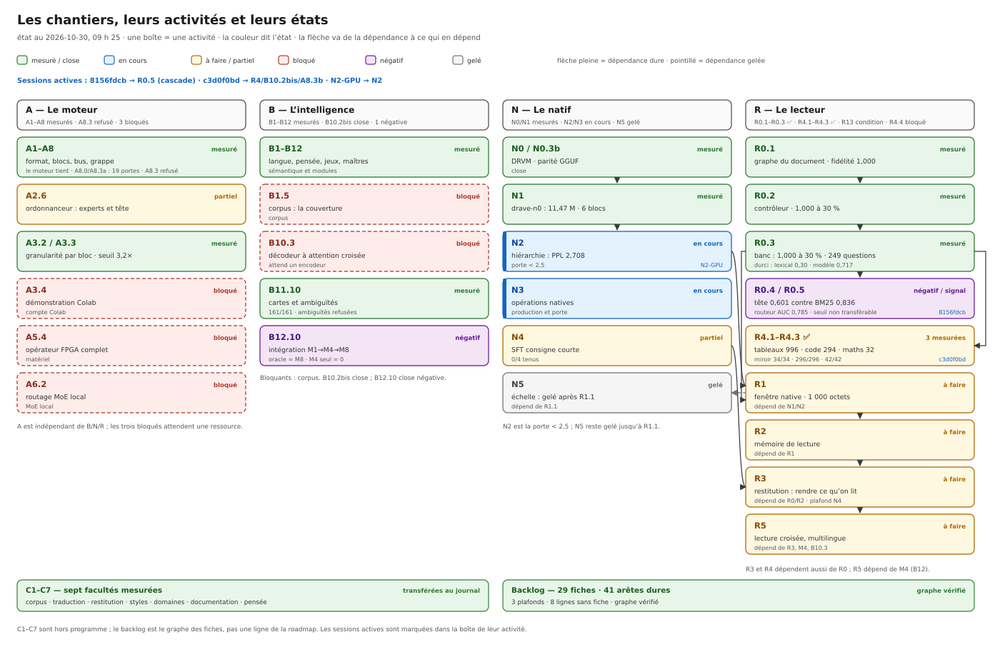

# En ce moment

**Mis à jour : 2026-10-29, 16 h 03 HAE (heure locale, EDT).**

> **État courant, pas histoire.** Une sous-section par **session active** ; une ligne par **chantier** avec son
> **bloquant**. Les détails de méthode sont dans [`methode/`](../methode/) — chargement et budget dans
> [`contexte.md`](../methode/contexte.md), contrat des sessions dans [`continuite.md`](../methode/continuite.md).
> Les résultats sont dans [`reports/`](../../reports/) ; l'histoire dans
> [`journal/`](../../journal/) ; le plan dans [`roadmap.md`](roadmap.md).

## Sessions en cours

> Contrat et budget : [`continuite.md`](../methode/continuite.md) ; sessions terminées :
> [`journal/sessions/`](../../journal/sessions/).

> **Écriture.** Toute session écrit l'état, **une à la fois** : un commit est atomique, et
> aucun fait (`reports/`, roadmap, backlog) ne se commite sans sa ligne. La garantie est au
> commit, pas dans un rôle : `tools/verifie_etat_a_jour.py` refuse le commit (hook
> `pre-commit`) et la porte `porte-etat.sh` compare les commits. Une session qui trouve
> l'état en retard le corrige — elle n'attend pas qu'on désigne une « principale ».

### Session `8156fdcb` — R0.1–R0.5 (lecteur)

- **Id** : `8156fdcb-5033-4ba4-a5f3-f8a078e6e57e`.
- **Rôle** : graphe du backlog (livré), **R0.1–R0.3 mesurés** ; **R0.4** (pilote négatif) et
  **R0.5** (routeur) ouverts.
- **Ce qu'elle fait** : R0.4 **deux négatifs** (v1 0,601 ; v2 0,448 contre BM25 0,811) ; R0.5 routeur :
  AUC **0,785**, z-score transfère **0,734** mais reste sous le choix fixe. Défaut : extractif.
- **Ce que font les autres** : `71d57f53` A8.0/B11.10 ; `N2-GPU` N2 ; `c3d0f0bd` R4.2.
- **Fichiers réservés** : `tools/lecteur_modele.py`, `tools/routeur.py`, `reports/r03-*`, `reports/r07-*`.
- **Prochaine action** : **plus de paraphrases** (le banc de 19 bloque R0.4 et R0.5) ; ensuite R0.4 avec un encodeur ajusté.
- **Bloquants** : aucun ; le GPU 0 lit à 1 409 t/s de prompt, le GPU 1 reste à N2.
- **Journal** : commits `4ffa34b7` (R0.1), `08149617` (R0.2) · [docs du jour](../../journal/2026-10-29/docs.md).

### Session `c3d0f0bd` — R4.1–R4.3 les blocs structurels

- **Id** : `c3d0f0bd-e344-4600-a023-0ed50d25b48b`.
- **Rôle** : **R4.1**, **R4.2**, **R4.3** mesurées (`7fb1c8a6`, `4ccf641f`, ce cycle) ; l'état se commite avec le fait.
- **Ce qu'elle fait** : grille (R4.1) ; AST et interpréteur en sable (R4.2) ; LaTeX et CAS exact (R4.3).
- **Ce que font les autres** : `8156fdcb` R0.5 ; `N2-GPU` N2 ; `71d57f53` A8.0/B11.10.
- **Fichiers réservés** : `tools/bloc_*.py`, `tools/porte-bloc-*.sh`, `tools/tests/tableaux/`,
  `tools/tests/code/`, `tools/tests/maths/`, `reports/r4*`, `docs/implantation/bloc-*.md`.
- **Prochaine action** : **R4.4 bloqué** (aucun OCR) ; la ligne lecteur reprend à **R0.4**.
- **Bloquants** : aucun.
- **Journal** : [mesures du jour](../../journal/2026-10-29/mesures.md).

### Session `N2-GPU` — calcul : distillation

- **Id** : aucun Id DSH (job GPU, hors session).
- **Rôle** : N2 — professeur et distillation ; ne touche ni aux docs ni aux fiches.
- **Ce qu'elle fait** : 49 999 fenêtres, 4 sources ; professeur 30k ; student 20k–30k ; mesure de PPL.
- **Ce que font les autres** : `71d57f53` A8.0/B11.10 ; `8156fdcb` R0.5 ; `c3d0f0bd` R4.2.
- **Prochaine action** : N2 — la **hiérarchie** (état de section), porte **< 2,5** (meilleur **2,6998**, plateau **2,708**) ; **N5 gelé**.
- **Bloquants** : GPU occupé ; les contextes 130/136/160/256 sont négatifs ; le corpus est à 4 sources.
- **Journal** : [mesures du jour](../../journal/2026-10-29/mesures.md).

## Ce qui est en cours

- **R0 — lecteur v0** : R0.1–R0.3 **mesurés** ; R0.4 **négatif**, R0.5 **signal** (AUC 0,785) ; suite **R0.4**.
- **R4.1–R4.3 — les blocs structurels** : **mesurées entrée+sortie** : 996 cellules,
  802 exactes, texte plat **0/3** ; 294 fichiers, 24/24 extraits, texte seul **0/3** ; 32 formules,
  10/10 dérivées, surface **0/3** ; **miroir 34/34, 296/296, 42/42**) ; fiches
  [`r41`](../../reports/rapport-r41-bloc-tableaux.md), [`r42`](../../reports/rapport-r42-bloc-code.md),
  [`r43`](../../reports/rapport-r43-bloc-maths.md), [`miroir`](../../reports/rapport-miroir-blocs.md).
- **A8.0 — portes épinglées** : flux **61,9920 / 60,8135**, pont **113,0068 / 111,9225**
  (falaise **+2,81 % / +25,35 %**) ; fiches [`a80-flux`](../../reports/rapport-a80-porte-flux.md),
  [`a80-pont`](../../reports/rapport-a80-porte-pont.md).
- **B11.10** : **mesurée** — codec **161/161**, ambiguïtés refusées ; **69,3 %** = natif ;
  fiche [`b1110`](../../reports/rapport-b1110-cartes.md).
- **Backlog — graphe** : 41 arêtes dures, 8 sans fiche ; vérifié par `tools/verifie_backlog.py`.
- **N2 — distillation** : GPU ; meilleur **2,6998** ; porte **< 2,5** non atteinte ; N4 **0/40**.
  Suite : [journal/sessions/f0969e87…](../../journal/sessions/f0969e87-af0c-43b1-93cf-f278d9c90846.md).

## Les chiffres de l'état

> **Source unique.** Ces valeurs sont vérifiées par `tools/revue_documentation.py`.

| invariant | valeur | contrôle |
|---|---|---|
| portes | **56** (54 vertes, 2 rouges structurelles) | `tools/porte-*.sh` |
| chapitres de la synthèse | **8** | `docs/theorie/synthese/0*.md` |
| fichiers / JSON de résultats | **290** / **360** | `reports/*.md` / `reports/*.json` |
| documents de `docs/` | **97** (hors archive et README) | `docs/**/*.md` |
| dernière passe complète | **1 h 40** (28/10 00 h 12) | `docs/pilotage/references-non-regression.md` |

## Les chantiers et leurs bloquants

| chantier | état | bloquant | prochaine action |
|---|---|---|---|
| **A — le moteur** | ✅ A1–A8 ; **A8.0 : 2 portes épinglées** ; A2.6/A3.2/A3.3 ouverts | A3.4 Colab ; A5.4 FPGA ; A6.2 MoE local | A2.6, A3.2/A3.3 ; A8.3 en opt-in |
| **B — l'intelligence** | ✅ B1–B12 ; B10.3 ouvert ; **B12.10 close (négatif)** | B10.3 décodeur sous le plancher ; B1.5 corpus | **B11.10 mesurée**, puis B10.3 (bloqué) |
| **N — le natif** | N0/N1 mesurés ; N0.3b **close** ; N2 plateau ; N4 partiel | N2 **< 2,5** non atteint ; N4 **0/4** tenus ; N5 gelé | N2 (hiérarchie) ; N4 (consigne) |
| **R — le lecteur** | 🔬 R0.1–R0.3 **mesurés** ; R0.4/R0.5 ouverts ; **R4.1–R4.3 mesurées** | **R4.4 bloqué** (aucun OCR) ; R1 dépend de N1/N2 | **R0.4** (négatifs difficiles), **R0.5** (routeur) ; **R4.4 bloqué** |
| **C1–C7** | ✅ corpus, traduction, restitution, styles, domaines, documentation, pensée | C4 date à contrôler ; le reste est hors plan | transférés au journal |
| **Backlog — graphe** | 29 fiches ; 41 arêtes dures | 8 lignes sans fiche ; priorités arrêtées | vérifier le graphe (`8156fdcb`) |

*Lecture : la flèche va de ce qui est nécessaire à ce qui en dépend ; la couleur dit l'état ; les sessions actives
sont marquées dans la boîte de leur activité. Le détail est dans la [roadmap](roadmap.md) et le
[backlog](backlog/index.md).*

**C1** corpus · **C2** traduction · **C3** restitution · **C4** styles · **C5** domaines ·
**C6** documentation · **C7** pensée : ✅ mesurés ; détail dans
[`etat-transfere.md`](../../journal/2026-10-29/etat-transfere.md).

## Ce qui reste

**R0** — R0.1–R0.3 **mesurés**, R0.4/R0.5 ouverts ; **R4.1–R4.3** — **mesurées** ; **R4.4 bloqué** (aucun OCR). **N2** — la **hiérarchie**.
**N4** — SFT tenu à l'écart. **B10.3** — décodeur (bloqué).
**Bloqués** : A3.4 (Colab), A5.4 (FPGA), A6.2 (MoE local), B1.5 (corpus).

## Les questions ouvertes

- **R0** : **90 %** à **30 %** du coût ? → R0.3 a tranché la **sélection** (1,000 ; paraphrase 0,30 contre 0,717) ;
  R0.4 (tête) et R0.5 (routeur) tranchent la **compréhension**.
- **R1** : **1 000 octets** sans refaire 130–256 ? → **N2** (hiérarchie), puis **R1.1**, tranchent.
- **N2** : **< 2,5** ? → **N2** (la hiérarchie) tranche.
- **B10.3** : chrF **> 39,6** ? → **B10.3** (attention croisée) tranche.
- **Backlog** : graphe sans cycle ni arête morte ? → `tools/verifie_backlog.py` tranche.

## La carte

- **Méthode** : [contexte](../methode/contexte.md) · [continuité](../methode/continuite.md) ·
  [résultats](../methode/resultats.md) · [portes](../methode/portes.md).
- **Plan** : [roadmap.md](roadmap.md) · [backlog](backlog/index.md) · [graphe](backlog/dependances.md) ·
  [carte](../theorie/carte.md) · [inventaire](../README.md).
- **Preuves** : [reports/](../../reports/) · [journal/](../../journal/) ·
  [état transféré](../../journal/2026-10-29/etat-transfere.md).
