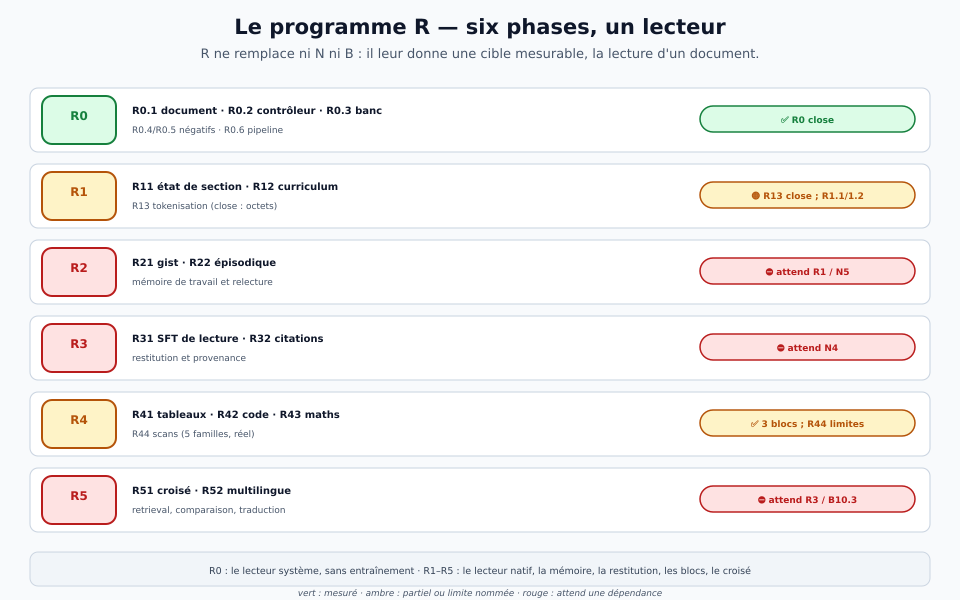
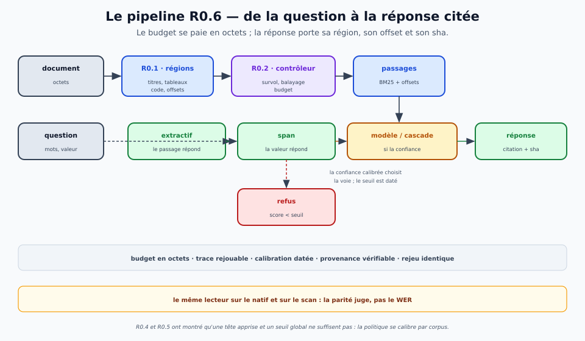

# Le programme R — le lecteur, de la surface à la réponse

> **Charte de programme.** Ce document dit ce qu'est **R**, pourquoi il existe, ses six phases, ses
> lois, ce qui tient et ce qui ne tient pas, ses dépendances et sa prochaine action. **État au
> 2026-11-01.** Les chiffres sont dans les fiches [`reports/`](../../reports/) ; l'ordre et les
> états dans [`roadmap.md`](roadmap.md) ; la théorie de la lecture dans
> [`lecture-rapide.md`](../theorie/lecture-rapide.md). Cette page ne remplace ni les unes ni les
> autres : elle dit **ce qu'on peut affirmer** et **ce qui manque**.
>
> **Ce que R n'est pas.** Ni la ligne **N** (le natif), ni la ligne **B** (le sens), ni **A** (le
> moteur). R n'est pas un modèle ni un benchmark : c'est le **lecteur** — la cible mesurable qui
> donne un sens aux trois autres. Un modèle qui a une bonne perplexité mais qui ne sait pas
> répondre à une question sur un document n'a pas encore de lecteur.

## 1. Qu'est-ce que le programme R ?

Drave a quatre lignes de travail : **A** (le moteur : bus, blocs, DRVM), **B** (l'intelligence :
sémantique, codec, jeux), **N** (le natif : `drave-n0`, la RSN, la pensée) et **R** (le lecteur).
Les trois premières construisent des **capacités** ; R construit la **preuve d'usage** : un
document, une question, un budget → une réponse **avec sa source**, ou un **refus motivé**.

R est donc un **programme**, pas un modèle :

- il a des **phases** (R0–R5) et des **blocs** (R01–R52) ;
- chaque bloc a une **mesure**, une **fiche**, une **porte** et un **état** ;
- il **assemble** des blocs classiques (parseurs, BM25, AST, sympy, OCR) et des blocs neuronaux
  (le modèle 0,5 B, plus tard le natif) ;
- il **ne remplace pas** N/B : il leur donne une cible. Sans R, N2 est une course à la perplexité
  et B10 un `z` qui ne dit pas ce qu'il contient.

| phase | la question à laquelle elle répond | état |
|---|---|---|
| **R0 — le lecteur v0** | un système peut-il lire un document, choisir un passage, citer sa source et refuser ? | ✅ **close** : R0.1–R0.3, R0.6 mesurés ; R0.4/R0.5 négatifs nommés |
| **R1 — la fenêtre native** | le natif peut-il lire 1 000 octets sans refaire 130–256 ? | 🟡 **R13 close (octets)** ; R1.1/R1.2 attendent le contexte natif |
| **R2 — la mémoire** | le lecteur peut-il garder un gist, des entités, et relire ? | ⛔ attend R1 et le verdict de N5 |
| **R3 — la restitution** | le lecteur peut-il répondre, résumer, extraire et citer ? | ⛔ attend N4 |
| **R4 — les blocs structurels** | tables, code, maths, scans : peut-on les lire sans modèle ? | ✅ R4.1–R4.3 ; **R4.4 close avec limites** |
| **R5 — la lecture croisée** | comparer, recouper, traduire plusieurs documents | ⛔ attend R3 et B10.3 |

La carte des phases et de leurs dépendances :

Le programme est **ordonné par valeur et dépendances**, pas par date : R0 a été fait en premier
parce qu'il prouve le lecteur avec l'existant ; R4 parce qu'il est indépendant et qu'il enlève au
modèle la structure ; R1–R3 attendent le natif, N5 et N4 ; R5 attend le sens.

## 2. Pourquoi R existe

### 2.1 Le diagnostic : Drave est à L1, pas à L6

La lecture rapide humaine n'est pas une vitesse, c'est une **allocation** : survoler, balayer,
lire sélectivement, revenir. Drave a l'**économie** de cette allocation (FFN creux, sortie
précoce) mais pas sa **sémantique** : rien ne décide **quoi** lire, **dans quel ordre**, **à
quelle profondeur**, **pour quel but**. Le tableau des niveaux est sans appel :

| niveau | ce que c'est | état de Drave |
|---|---|---|
| **L0 — flux** | octets, perplexité, génération | ✅ acquis |
| **L1 — saut de calcul** | sortie précoce, parcimonie, chemin court | ✅ mesuré |
| **L2 — document** | régions typées, structure, layout, provenance | ✅ **R0.1** (51 pages) |
| **L3 — politique** | survol, écrémage, balayage, sélectif, relecture | 🟡 **R0.2/R0.4/R0.5** : contrôleur oui, têtes apprises non |
| **L4 — mémoire** | gist, entités, faits, épisodique | ⛔ **R2** ; N5 négatif |
| **L5 — restitution** | réponse, résumé, extraction, citation | ⛔ **R3** ; N4 0/4 |
| **L6 — banc** | courbe vitesse–compréhension par type | 🟡 **R0.3** : 249 questions, pas encore la courbe |

### 2.2 La cible : une réponse, pas une fluence

Le contexte natif de `drave-n0` est de **129 octets** (PPL 2,6998) ; à 2 000 octets, la PPL monte
à **54,04**. Une page est **23×** trop longue. La réponse de R n'est pas « agrandir la fenêtre » :
c'est **découper, choisir, citer**. C'est la différence entre un modèle qui continue un texte et
un lecteur qui **répond à une question** avec la **provenance** de sa réponse.

### 2.3 La structure bat la taille

R0.6 le montre : un **extractif** + un **span** + un **0,5 B** bien aiguillé battent un modèle
plus gros sur les valeurs, parce que le problème n'est pas de générer mais de **trouver** et de
**citer**. R4 le confirme : les tableaux, le code et les maths se lisent par des **blocs
classiques** (grille, AST, sympy), pas par le modèle. La structure est le levier ; le modèle est
le recours.

## 3. L'architecture du lecteur

Le pipeline R0.6 est l'**assemblage** des briques R0 :

1. **R0.1 — le document** : les octets deviennent des **régions typées** (titre, section,
   paragraphe, tableau, code, maths, figure) avec offsets et provenance. 16 PDF + 8 Markdown +
   3 HTML + 3 DOCX/EPUB ; **51 pages**, partition **1,000**, fidélité **1,000**.
2. **R0.2 — le contrôleur** : cinq modes (`survol`, `balayage`, `lecture`, `relecture`, `arrêt`),
   un budget en **octets**, et des règles classiques d'abord (TOC, titres, premières/dernières
   phrases, BM25/regex). Récupération **1,00** à **30 %** du budget sur les 5 types.
3. **R0.3 — le banc** : 30 documents, **249 questions lexicales** et **84 paraphrases**, un
   corpus **gelé**. Le modèle 0,5 B est mesuré à côté de l'extractif, pas à sa place.
4. **R0.6 — le pipeline** : un document, une question, un budget → une réponse **ou** un refus,
   avec région, offset, sha, trace et rejeu. Trois régimes : **extractif** (le passage répond),
   **span** (la valeur répond), **modèle/cascade** (la paraphrase). Le refus est un **seuil**,
   pas un hasard.

Les chiffres R0.6 : **20/20** réponses avec provenance, **12/20 justes** au pilote (0,600),
**9/10** refus hors sujet, **7/8** au modèle sur les paraphrases (contre 3/8 pour l'extractif),
et la **cascade à confiance calibrée** qui égale l'oracle sur le lexical (**0,894**) et bat les
deux choix fixes sur les paraphrases (**0,366** contre 0,341 et 0,317). Coût : **19** appels de
modèle sur 123 questions lexicales, **18** sur 41 paraphrases.

Le point de conception : **la politique se calibre par corpus**, elle ne se transporte pas. R0.4
(une tête apprise) et R0.5 (un routeur global) ont échoué pour la même raison ; R06 v6 a publié
la calibration dans un **fichier daté** (`calibration-lexical.json`,
`calibration-paraphrase.json`) avec l'empreinte du corpus gelé, un seuil et un taux. La politique
est reproductible, testable hors échantillon et **visible**.

## 4. Les six phases en détail

### 4.1 R0 — le lecteur v0 : ✅ close

R0 est le **lecteur système**, sans entraînement : le document, le contrôleur, le banc, le
pipeline, et deux négatifs assumés. Ce qui tient :

| brique | dispositif | chiffre | fiche |
|---|---|---|---|
| **R0.1 document** | 30 documents, 51 pages | partition **1,000**, fidélité **1,000** | [`r01`](../../reports/rapport-r01-graphe-document.md) |
| **R0.2 contrôleur** | 20 questions main, 5 types | récupération **1,000** à 30 % | [`r02`](../../reports/rapport-r02-controleur.md) |
| **R0.3 banc** | 30 documents, 249 lexicales + 84 paraphrases | **0,231** contre **0,042** à la troncature | [`r03`](../../reports/rapport-r03-banc-complet.md) |
| **R0.6 pipeline** | 20 questions, 10 hors sujet, 8 paraphrases | **12/20**, **9/10** refus, **7/8** modèle | [`r06`](../../reports/rapport-r06-pipeline.md) |
| **R06 calibration** | 124 + 42 questions, split paires/impaires | **0,894** lexical, **0,366** paraphrases | [`r06`](../../reports/rapport-r06-publication.md) |

Ce qui ne tient pas, et qui est **nommé** :

- **R0.4 — la tête de survol** : 0,540/0,720 au dernier essai ; une sonde linéaire sur un 0,5 B,
  avec 500 paires, ne bat pas BM25. La donnée et l'encodeur manquent.
- **R0.5 — le routeur** : AUC **0,839**, mais transfert **0,819/0,313** ; un signal qui **prédit**
  n'est pas une règle qui **décide**. Un seuil absolu ne transfère pas d'un corpus à l'autre.
- **R06 — la relecture** : **0/249**. Relire plus ne change rien : le lecteur extractif répond
  avec le passage le mieux scoré, toujours lu. La relecture doit changer de **modalité**, pas de
  quantité.

R0 est **close** : le pipeline fait ce qu'il promet (budget, provenance, refus, rejeu) et il
choisit bien ses lecteurs. La suite n'est plus dans R0.

### 4.2 R1 — la fenêtre native : 🟡

R1 est la phase du **contexte** : R11 (état de section), R12 (curriculum), R13 (tokenisation).
R13 est **close** : à budget d'octets égal, le BPE perd partout — **+0,39 %** (512, deux graines),
**+3,92 à +4,09 %** (1024), **+4,22 % / +6,59 %** en anglais. Le natif reste en **octets** ; le
« gain de 11 % » du pilote était un artefact de budget, corrigé par la mesure.

La question R1 est : **1 000 octets sans refaire 130–256 ?** La hiérarchie de N2 a été écartée
(elle ne répond pas) ; R1.1 (état de section) et R1.2 (curriculum) sont les routes spécifiées.
R1 dépend de N1/N2 : sans un contexte natif qui tient, R1 ne peut pas se mesurer. C'est le
**verrou** du programme, avec l'encodeur (voir § 7).

### 4.3 R2 — la mémoire : ⛔

R2 doit garder un **gist**, des **entités**, des **faits**, un **store épisodique**, et savoir
**relire**. R21 (mémoire de travail et gist) et R22 (mémoire épisodique) sont spécifiées ; N5 est
**gelé** et le négatif de mémoire est acquis. R2 dépend de R1 et du verdict de N5 : sans un
contexte qui porte, il n'y a rien à mémoriser ; sans un gist, il n'y a rien à relire.

### 4.4 R3 — la restitution : ⛔

R3 est la phase qui **prouve** la lecture : répondre, résumer, extraire, **citer**. R31 (SFT de
lecture) et R32 (citations et provenance) sont spécifiées ; N4 est à **0/4** sur la consigne
courte. R3 dépend de R0 et R2, et bute sur N4 : un lecteur qui ne tient pas une consigne ne peut
pas restituer. La règle du miroir s'applique : **la fluidité n'est pas la fidélité** ; une
restitution sans provenance n'est pas une lecture.

### 4.5 R4 — les blocs structurels : ✅ trois blocs, R4.4 close avec limites

R4 est la partie de R qui **enlève au modèle** ce que le classique lit mieux :

- **R4.1 — tableaux** : 35 tableaux, **996 cellules**, **802 exactes** à leur place, **8/8**
  opérations, **3/3** contrôles « texte plat » qui échouent, **4** refus nommés.
- **R4.2 — code** : **294/294** fichiers, **453 038** nœuds, **24/24** extraits exécutés à la
  valeur exacte, **7/7** refus nommés, **3/3** contrôles « texte seul » qui échouent.
- **R4.3 — maths** : **32/32** formules exactes, **32/32** recoupées par sympy, **10/10**
  dérivées, **6/6** équations, **8/8** refus, **3/3** contrôles « surface » qui échouent.
- **R4.4 — scans** : 100 scans simulés, 5 familles ; **4/5** familles ≥ **90 %** de parité
  (propre **96,7 %**, photocopie **93,3 %**, photo **90,0 %**, papier **90,0 %**), **fax 56,7 %**
  (limite 1 bit) ; colonnes **89,4 % → 0,5 %** ; tableaux **92,6 %** (propre) / **69,1 %**
  (photocopie) ; **vrai scan** Verne : **7,10 %** de WER, ordre des colonnes prouvé.

R4.4 est **close avec ses limites nommées** : le fax 1 bit (l'information n'est plus là),
l'exposant fusionné (boîte de confiance 0), et la parité réelle sans questions humaines. Ce qui
la rouvrirait : un scanner, une vérité humaine, ou un OCR qui retrouve le 1 bit. La leçon de R4
est la même que celle de la couche heuristique : **le CPU lit la structure, le réseau lit le
sens** — voir [`pre-traitement-linguistique.md`](../theorie/pre-traitement-linguistique.md).

### 4.6 R5 — la lecture croisée : ⛔

R5 compare, recoupe et traduit plusieurs documents : R51 (multi-documents, retrieval,
comparaison, provenance) et R52 (décodeur multilingue). R5 dépend de R3 et de B10.3 : le codec
des **71 langues / 449/449** existe, mais le décodeur est **négatif** et le `z` ne lit que ~7 %
du sens. Sans un `z` qui porte, R5 n'a pas de monnaie d'échange entre les documents.

## 5. Ce qui tient, ce qui ne tient pas

| tient | chiffre | fiche |
|---|---|---|
| **le document** (R0.1) | partition **1,000**, fidélité **1,000**, 51 pages | [`r01`](../../reports/rapport-r01-graphe-document.md) |
| **le contrôleur** (R0.2) | récupération **1,000** à 30 % | [`r02`](../../reports/rapport-r02-controleur.md) |
| **le banc** (R0.3) | **0,231** contre **0,042** | [`r03`](../../reports/rapport-r03-banc-complet.md) |
| **le pipeline** (R0.6) | **12/20**, **9/10** refus, **7/8** modèle | [`r06`](../../reports/rapport-r06-pipeline.md) |
| **la cascade calibrée** (R06 v6) | **0,894** / **0,366** | [`r06`](../../reports/rapport-r06-publication.md) |
| **le balayage** (R05) | rappel@10 **0,984**, **0,1 ms** | [`r05`](../../reports/rapport-r05-balayage.md) |
| **les blocs** (R4.1–R4.3) | 996/802, 294/24, 32/10 | [`r41`](../../reports/rapport-r41-bloc-tableaux.md) · [`r42`](../../reports/rapport-r42-bloc-code.md) · [`r43`](../../reports/rapport-r43-bloc-maths.md) |
| **les scans** (R4.4) | 4/5 ≥ 90 %, réel **7,10 %** | [`r44`](../../reports/rapport-r44-scans.md) |
| **la tokenisation** (R13) | octets ; BPE +0,39/+4,09 % | [`r13`](../../reports/rapport-r13-decision.md) |

| ne tient pas | chiffre | la raison |
|---|---|---|
| **la tête de survol** (R0.4) | **0,540/0,720** | une sonde linéaire sur 0,5 B ne bat pas BM25 |
| **le routeur** (R0.5) | AUC **0,839**, transfert **0,819/0,313** | un signal qui prédit n'est pas une règle qui décide |
| **la relecture** (R06) | **0/249** | relire plus ne change pas la modalité |
| **le fax** (R4.4) | parité **56,7 %** | 120 dpi, 1 bit : l'information n'est plus là |
| **R1/R2/R3/R5** | — | attendent N2/N5/N4/B10.3 |

## 6. Les trois lois du programme

1. **Le corpus décide du lecteur, pas la question.** Le choix automatique de la voie gagne
   **+0,109** sur un corpus de valeurs (lexical) et **perd −0,150** sur un corpus mixte
   (pilote). Un classifieur de **forme** ne sait pas ce que la réponse attend.
2. **Un signal qui prédit n'est pas une règle qui décide.** L'AUC du signal BM25 est **0,839**,
   ses contrôles au hasard, et pourtant aucun seuil ne transfère. La différence se mesure par le
   **transfert**, pas par l'AUC. La cascade se **calibre par corpus** (R06 v6).
3. **Pour une valeur, rendre le passage ou le span bat générer à 0,5 B.** Le span **0,944**
   contre l'extractif **0,851** contre le modèle **0,381** ; le génératif ne gagne que là où le
   lexical échoue (les paraphrases : **7/8** contre **3/8**), et il faudra un plus grand modèle
   pour que ce soit net.

Deux **règles de mesure** complètent les lois :

- **la parité juge, pas le WER** : un WER de 6 % qui casse la réponse à une question n'est pas
  une lecture ; c'est la réponse du **même lecteur** sur le natif et sur le scan qui décide
  (R4.4).
- **le document d'abord** : sans régions, offsets et provenance (R0.1), il n'y a ni survol, ni
  citation, ni parité. La structure précède la politique.

## 7. Les dépendances et l'ordre

R dépend de N et B, et le dit :

| phase R | dépend de | ce qui bloque |
|---|---|---|
| R0 | rien (système, modèle externe) | ✅ close |
| R1 | N1/N2 (contexte natif) | 129 octets ; la hiérarchie N2 est écartée |
| R2 | R1, N5 | N5 gelé ; le gist manque |
| R3 | R0, R2, N4 | N4 0/4 sur la consigne |
| R4 | R0 | ✅ trois blocs ; R4.4 close avec limites |
| R5 | R3, B10.3 | le `z` lit ~7 % du sens |

Le **verrou** n'est pas un bloc de R : c'est un **encodeur qui porte**. R0.4 (survol) reste sous
BM25, R0.5 (routeur) ne transfère pas, B10.3 ne lit que ~7 % du sens, et la typoglycémie montre
que le modèle lit les **lettres**, pas les **formes** (×17,8 au mélange intérieur, ×62,7 tout
mélangé). Trois symptômes, une même cause : il manque une **représentation de forme** et un `z`
qui la porte. C'est le lien avec E2 (encodeur de formes) et E3 (politique de saccades), et avec
la couche heuristique : la surface peut être étiquetée par le CPU avant le réseau.

L'ordre du programme est donc :

1. **R0** (fait) : prouver le lecteur système ;
2. **R4** (fait) : enlever la structure au modèle ;
3. **R1** (suivant) : une fenêtre native qui tient 1 000 octets, ou une autre route ;
4. **R2**, puis **R3** : mémoire et restitution, quand N5/N4 le permettent ;
5. **R5** : le croisé, quand B10.3 porte.

La file « jamais en attente » s'applique : si R1 est bloqué par N2, on ne l'attend pas ; on prend
le bloc suivant **mesurable** — un bloc R4 restant, la couche heuristique (surface), ou un banc
R0.6 plus dur. Mais on ne **rouvre** pas un négatif (R0.4, R0.5) sans une hypothèse nouvelle.

## 8. Les questions ouvertes

- **R1** : 1 000 octets sans refaire 130–256 ? La hiérarchie de N2 est écartée ; **R1.1** (état
  de section) et **R1.2** (curriculum) tranchent.
- **R2** : un gist sans N5 ? R21/R22 sont spécifiées ; le négatif de mémoire est acquis.
- **R3** : une restitution sans N4 ? R31/R32 ; la citation et la provenance sont le contrat.
- **R4.4** : la parité réelle sans questions humaines ? Le fax 1 bit ? L'exposant fusionné ? Ce
  sont des **limites nommées** ; il faut un scanner, une vérité humaine ou un OCR qui retrouve
  le 1 bit.
- **R5** : un croisé sans un `z` qui porte ? B10.3 tranche ; le codec 449/449 ne suffit pas.
- **L'encodeur** : R0.4/R0.5/B10.3 et la typoglycémie pointent tous vers la même pièce
  manquante — une **forme** et un `z` qui la porte. C'est E2, et peut-être la couche
  heuristique qui l'alimente.

## 9. La prochaine action

**R0 est close ; R4.4 est close avec ses limites ; R13 est close.** La prochaine action du
programme n'est pas un nouveau bloc R0 : c'est **R1.1/R1.2** si le contexte natif le permet, ou
un **bloc de surface** (document/politique) si R1 est bloqué. La règle est celle de la roadmap :
**une action, un état, un commit** ; on ne rouvre pas R0.4/R0.5 sans hypothèse.

Le lecteur a une **cible** claire : répondre avec provenance sur un document, tenir un budget,
refuser le hors sujet, et le prouver sur le natif **et** sur le scan. Tant que la parité et la
citation ne sont pas là, le programme n'a pas fini.

## 10. Les fichiers et les portes

- **Le backlog R** : [`backlog/index.md`](backlog/index.md) — R01–R52, dépendances, priorités ;
  les fiches de fonctionnalité dans [`backlog/`](backlog/).
- **Les contrats** : [`banc-lecture.md`](../implantation/banc-lecture.md),
  [`corpus-gele.md`](../implantation/corpus-gele.md),
  [`pipeline-lecture.md`](../implantation/pipeline-lecture.md),
  [`tete-balayage.md`](../implantation/tete-balayage.md),
  [`encodeur-visuel.md`](../implantation/encodeur-visuel.md),
  [`bloc-tableaux.md`](../implantation/bloc-tableaux.md),
  [`bloc-code.md`](../implantation/bloc-code.md), [`bloc-maths.md`](../implantation/bloc-maths.md).
- **Les fiches** : [`r01`](../../reports/rapport-r01-graphe-document.md),
  [`r02`](../../reports/rapport-r02-controleur.md),
  [`r03`](../../reports/rapport-r03-banc-complet.md),
  [`r04`](../../reports/rapport-r04-tete-survol.md),
  [`r05`](../../reports/rapport-r05-balayage.md),
  [`r06`](../../reports/rapport-r06-pipeline.md),
  [`r07`](../../reports/rapport-r07-routeur.md),
  [`r13`](../../reports/rapport-r13-decision.md),
  [`r41`](../../reports/rapport-r41-bloc-tableaux.md),
  [`r42`](../../reports/rapport-r42-bloc-code.md),
  [`r43`](../../reports/rapport-r43-bloc-maths.md),
  [`r44`](../../reports/rapport-r44-scans.md).
- **Les portes** : `tools/porte-lecture.sh`, `tools/porte-document.sh`,
  `tools/porte-balayage.sh`, `tools/porte-bloc-tableaux.sh`, `tools/porte-bloc-code.sh`,
  `tools/porte-bloc-maths.sh`, `tools/porte-ocr-scans.sh`, `tools/porte-r13-bpe.sh`.
- **Les outils** : `tools/lecture.py`, `tools/banc_complet.py`, `tools/calibrer.py`,
  `tools/mesurer_scans.py`, `tools/nettoyer_scan.py`, `tools/graphe_document_ocr.py`.

## 11. Ce que R n'est pas

- **Pas N** : R ne remplace pas le natif ; il le **teste** sur un document.
- **Pas B** : R ne crée pas le sens ; il **l'utilise** et le **cite**.
- **Pas A** : R ne construit pas le bus ; il **s'en sert** (blocs, trace, rejeu).
- **Pas un benchmark** : un banc sans lecteur est une collection de questions ; R0.3 est un
  **moyen**, pas le programme.
- **Pas une promesse de vitesse** : la lecture rapide est une **allocation**, pas un débit ; la
  métrique est la compréhension par unité de calcul.
- **Pas un produit** : c'est une **cible** et un **test** ; le produit viendra quand R3 et R5
  tiendront.

## 12. Voir aussi

- [La roadmap](roadmap.md) — l'ordre des chantiers et la prochaine action.
- [La lecture rapide](../theorie/lecture-rapide.md) — les 14 techniques et les cinq couches.
- [La couche heuristique](../theorie/pre-traitement-linguistique.md) — le CPU avant le réseau.
- [Le backlog R](backlog/index.md) — R01–R52.
- [Le banc](../implantation/banc-lecture.md) · [Le corpus gelé](../implantation/corpus-gele.md) ·
  [Le pipeline](../implantation/pipeline-lecture.md) · [Le balayage](../implantation/tete-balayage.md).
