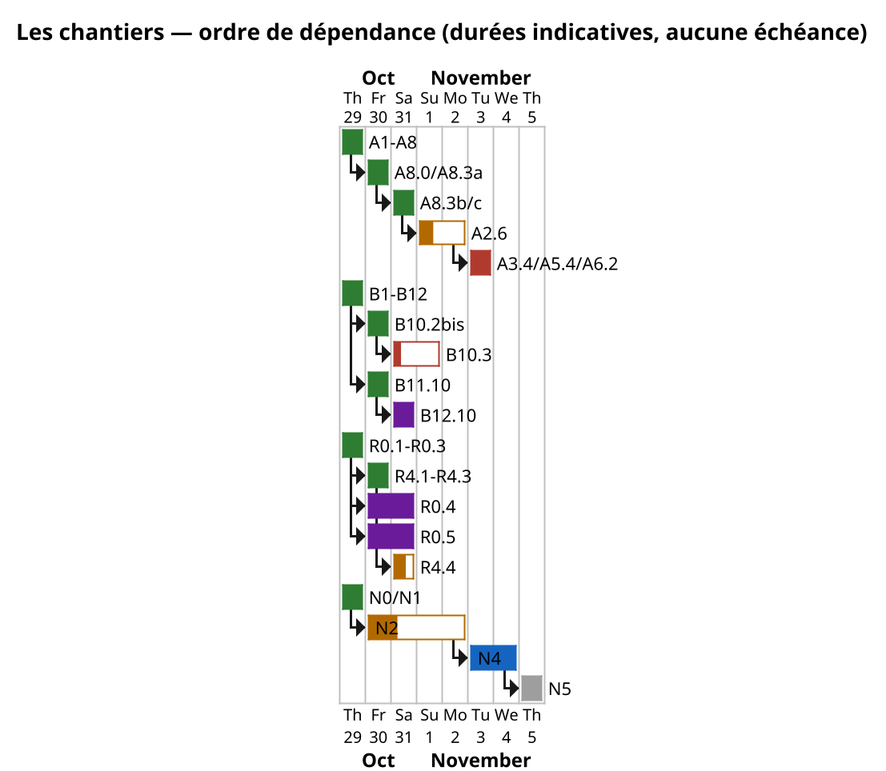

# La roadmap de [Drave](../theorie/glossaire/entrees/drave.md) — un seul plan, quatre chantiers

> **Un seul document de plan.** Le **moteur** (A), l'**intelligence** (B), le **natif** (N) et le **lecteur** (R).
> L'ordre se décide par la **valeur** et les **dépendances**, jamais par une date. Les chiffres, les séries et les
> contrôles vivent dans [`reports/`](../../reports/) ; ici : l'[état](../theorie/glossaire/entrees/etat.md), la prochaine action, et ce qui bloque.
>
> **Détail et histoire** : l'ancien plan [A/B](../theorie/glossaire/entrees/a-b.md) est archivé dans
> [`roadmap-detail-2026-10-29.md`](../archive/roadmap-detail-2026-10-29.md), le détail N dans
> [`roadmap-native-2026-10-29.md`](../archive/roadmap-native-2026-10-29.md). Les **fiches de fonctionnalité** sont
> dans [`backlog/index.md`](backlog/index.md) ; le **graphe des dépendances** est dans
> [`backlog/dependances.md`](backlog/dependances.md). La **page vivante** est [`en-cours.md`](en-cours.md).

## Comment lire cette roadmap

- **Les états** : ✅ mesuré et écrit · 🔬 en cours · ⏳ à faire · 🧱 bloqué par une infra absente.
- **Le carpe diem** : pas d'échéance. Un chantier est **[fait](../theorie/glossaire/entrees/fait-mesure-projete-deduit.md)** quand il est **mesuré**, **écrit** (fiche + docs) et
  **committé** ; tant qu'il ne l'est pas, il reste dans la liste — et on ne l'annonce pas avant.
- **DSH ne reste jamais en attente** : chaque ligne a une **prochaine action** ; si elle est bloquée, on prend la
  suivante. La file d'attente n'existe pas : il y a toujours un chantier non bloqué à faire avancer.
- **Un chiffre sans [contrôle négatif](../theorie/glossaire/entrees/controle-negatif.md) n'est pas un résultat** : chaque critère de succès nomme son contrôle.
- **Un seul plan, quatre chantiers** : les **deux programmes de la vision** (moteur, intelligence) se découpent en
  **A** (moteur), **B** (intelligence), **N** (natif) et **R** (lecteur). A et B sont l'existant ; N est la ligne
  native ; R est la **nouvelle ligne lecteur**, qui donne une cible mesurable aux deux autres. On [charge](../theorie/glossaire/entrees/charge-flux-chargeflux.md) **un**
  chantier, pas le document entier.

## En un coup d'œil

| chantier | ce qu'il couvre | état | prochaine action |
|---|---|---|---|
| **A — le moteur** | formats, placement, transport, [rejeu](../theorie/glossaire/entrees/rejeu.md), matériels, ordonnanceur | ✅ A1–A8 ; **A3.4, A5.4, A6.2 bloqués** ; A2.6 partiel ; A3.2/A3.3 mesurées ; **A8.3c/d expliqués** ; **A2.6/A8.3 : le [lot](../theorie/glossaire/entrees/lot.md) ne divise pas les lectures denses (+27 % calcul, PPL −0,006 %)** | **A2.6** (experts : A6.2 bloqué) ; le lot ≥ 2 assumé |
| **B — l'intelligence** | langue, pensée, jeux, maîtres, [banc externe](../theorie/glossaire/entrees/banc-externe.md), sémantique, modules | ✅ B1–B12 ; **B1.5 [corpus](../theorie/glossaire/entrees/corpus.md)**, **B12.10, B10.2bis et B11.10 closes** ; le **décodeur** est levé (objectif mot : 32,5 ; JW 26,7), le `z` reste ; **B13** (moteur de pensée) : state store v0 + **AC-3/alpha-bêta** + **[DRVF](../theorie/glossaire/entrees/drvf.md) `thought`** + **[banc](../theorie/glossaire/entrees/banc.md) anytime** + **opérateurs hétérogènes** + **nécessaire** + **labyrinthe** + **[porte](../theorie/glossaire/entrees/porte.md)** + **apprise** + **courbe** + **seule** + **stochastique** + **sto seule** + **ferme** + **minute** + **minute apprise** + **minute seule** + **minute entraînée** + **shaping** + **réseau** + **MLP** + **[professeur](../theorie/glossaire/entrees/professeur.md)** + **sans None** + **correction** + **audit** + **ouverte** + **graines** + **mobile** + **mobile graines** + **bruit** + **bouge** + **bouge graines** + **période** + **phase** + **phase graines** + **aléatoire** + **hasard** + **partielle** + **croyance** + **curiosité** + **observatrice** + **bruitée** + **votante** + **trois looks** + **bayésien** + **bayésien 2** + **vraisemblance** + **dérive** + **adaptative** + **glisse** + **rupture** + **alternance** + **chaotique** + **fréquent** + **rapide** + **limite** + **hasard 2** + **intra** + **asym** + **rare** + **très rare** + **ultra-rare** + **un look** + **look tardif** + **oubli** + **oubli fort** + **oubli total** + **seuil** + **seuil fin** + **seuil graines** + **bord** + **seuil bas** + **courbe** + **vérité** + **concurrentes** + **phase dans l'état** + **phase devinée** + **vote** + **cycle** + **courbe20** + **bord fin** + **gold 200** + **sous-ensembles** + **complexes** + **20 complexes** + **50 complexes** + **100 complexes** + **discours** + **anaphore** + **pièges anaphore** + **anaphore corrigée** + **pronoms objets** + **chaînes longues** + **rôles** + **hybride** + **sémantique** + **[plafond](../theorie/glossaire/entrees/plafond.md)** + **kappa** + **méta** + **pondéré** + **CV** + **CV graines** + **bilan anaphore**, **183/183 portes** (6 S fixés ; T132/T133 2/5) | B10.3 attend un **encodeur qui porte** ; **B13** : **gold neuronal** (POS **0,9415** ; **cascade vrai modèle** : syntagmes **0,6130**, tête **0,7574**, acte **1,0** ; **gold réel 432 : 0,9065 / 0,4598 / 0,5633 / 0,9954, verdict `false`**) ; **politique DRVM/native** (cadenas **3 nœuds** avec règle, minimal **0** ; labyrinthe **2 sonde** ; porte **27 nœuds** avec la règle (200 sans)) ; **pragmatique neuronale 130 : acte 1,0, négation 1,0, modalité 0,9846, double sens 0,9769** ; elle qualifie ; **[DRVM](../theorie/glossaire/entrees/drvm.md)/native** (poids et tagger présents) ; **gold 432 réel true** ; **T132/T133** ; **gold 200+** ; **porte 183/183** ; **minute 26 nœuds** ; **sto 5/5** ; **fenêtre solvable (BFS 228) mais non discriminante** (oracle 228, aveugle 215, 7B 238) |
| **N — le natif** | DRVM, `drave-n0`, [distillation](../theorie/glossaire/entrees/distillation.md), usage, échelle | 🔬 N0/N1 mesurés ; **N0.3b close** ; **N0.1 6/6** ; N2.h : 3,0904 domaine, 3,85 hors dépôt ; **N2.ac (1 Go) : 3,49 / 6,03 / 8,34 — production** ; **200 k pas : val_fr 3,16, littérature 5,61, anglais 7,28, wikitext2 8,00** ; **fenêtre 1 024 : 2,4759 / 2,4373 au grand corpus — sous 2,5** ; porte propre **2,7856** ; **N3 couvert** (17 portes, inventaire ; deux conditions) ; N4 partiel | **N2** : **clôturée** le 03/11 11 h 25, la **fenêtre est la recette de production** ; **paire propre de distillation** (04/11) ; puis la **porte propre (0,29)** ; **N4** |
| **R — le lecteur** | document, politique de [lecture](../theorie/glossaire/entrees/lecture.md), fenêtre, mémoire, restitution | ✅ R0.1–R0.3 **mesurés** ; **R0.4 et R0.5 closes (négatifs nommés)** ; **R4.1–R4.4 mesurées** (R4.4 : 4/5 familles ≥ 90 % de parité) ; **R0.7 — bloc linguistique** (398 langues, 0,9687) | **R4.4 close** (limites nommées) ; **R1.1/R1.2 mesurées** (RoPE **3,2545** à 1 000 octets, fenêtre **−0,244**) ; la suite : **1 024 octets entraînés** ; **`rope2048`** **fini** (2×10 000 pas, deux drvm) ; R2/R3 attendent N5/N4 |
| **S — les structures** | coloration, rôles, validation humaine, banque d'interprétations | ✅ **v7** : **61/61** types, **144/144** rôles, **56 tests** ; le fait divers tranché (la tête du GN arrête le verbe) ; [fiche](../../reports/rapport-s-fait-divers.md). **v6** : h050, h053 et « si fort que » **fermés**, gold **60** (vague 5) ; **60/60** types, **142/142** rôles, **50/50** compléments, couverture 1,00 ; corpus 65,5 %/9,1 %, 596/1 184 homographes ; **55 tests**. **v5** : arbre parent/enfant (**99 candidats à ≥3**, 37 à 1) et **référents proposés** (294/371 formes, 77 sans contexte) ; **SVG** d'Alice, page **`/paragraphes`** (arbre, référents, verdict), **traduction** 14/14 référents ; gold **55**, analyseur **54/55** types, **131/131** rôles ; corpus **55** (SHA `76accf9d…`) ; banque partielle **142/71**, **81/65** ; **50 tests** | **poursuivre la validation sur `/paragraphes`** (a001–a003 faits), rétro-traduction API |
| **L — le bloc langue** | surface, heuristique CPU + neuronal, [contrat](../theorie/glossaire/entrees/contrat.md), cascade, pragmatique | 🔬 **R0.7** : 9 niveaux, **398 langues à 0,9687**, script 1,0000 ; analyse heuristique (5 schémas) ; **contrat de substitution écrit** ([`contrat-bloc-langue.md`](../theorie/contrat-bloc-langue.md)) ; **frontière : script 1,0, langue 0,137 (libellés) / 0,9687 (texte long)** ; **porte des quatre modes : neuronal 0,9309/0,8226/0,8784 ; fusion 0,928/0,802/0,857** ; **fusion réparée par niveau : 0,9309/0,8226/0,8784/0,9954 (le max)** ([fiche](../../reports/rapport-pensee-fusion-reparee.md)) | la **pragmatique neuronale** ; le **refus r353** |
| **D — les données** | inventaire, corpus 10 langues, texte intégral, PDF/[OCR](../theorie/glossaire/entrees/ocr.md), documents, genres | ✅ inventaire ; **10 corpus texte intégral** (20,53 M art., 67,73 G car., 81,2 Go, **8 Ko 0**) ; **PDF** (1 927 doc., 322 Mo) ; **documents** (3 384 doc., 872 M car., 8 Ko 2,07 %) ; **OCR** (20 livres, 7 381 p, 15,36 M, 8 Ko 0 ; [CEGEP](../theorie/glossaire/entrees/cegep.md) **91 scans uniques**, 60 documents, 1 982 p, 4,41 M car., 8 Ko 0) ; **genres** mesurés | **l'OCR est clos** (limite : 8 scans `.PDF`, 58 p) ; la préparation **R1.1/R1.2** (N2) et **A2.6** (A) |

**État au 05/11 19 h 20.** B13 est à **183/183** ; **l'attachement est juste 187/187 (1,0000)** sur les 187 segments dont le span est prédit — fr 1,0, en 1,0, verbes 131/131, noms 56/56, dev 126/126, test 61/61 ; le **rendement global** est **187/239 = 0,7824** et les **52 spans non prédits** (24 REL, 12 SUB, 16 GP) sont la frontière ; F1 **0,513** ; top-k 161/239 ; le **cache du chunker** est appliqué (×139) ; le **classement appris est rejeté** (+5, p=0,18) ;
la **cascade vrai modèle** tient sur **180 phrases** (POS **0,9415**, syntagmes **0,6130**, tête
**0,7574**, acte **1,0**) mais sur le **gold réel 432** elle donne **0,9065 / 0,4598 / 0,5633 /
0,9954** — **verdict `false`** ; la **fenêtre B13** est **solvable** (BFS **228** nœuds, FIFO) mais **non
discriminante** (oracle 228, aveugle 215, 7B 238 : tout passe) — c'est le banc qu'il faut réparer ;
la **politique DRVM/native** ouvre le cadenas (**3 nœuds** avec la règle, **0** sans) ; la
**pragmatique neuronale** qualifie sur 130 phrases (**1,0 / 1,0 / 0,9846 / 0,9769**) ; sur le gold 432 l'**acte** vaut **0,9954** mais la négation (**0,9630**) et la modalité (**0,9722**) restent sous l'heuristique (**0,9676 / 0,9861**) : la fusion par niveau **garde l'heuristique**. **N2** : la **loi de la fenêtre** à octets constants donne **3,2545 → 3,0107
→ 2,9950** (256/512/1 024 à 1 000 octets), **2,9449** à 2 000 pour 1 024, et la **2 048** s'arrête à
1 024 ; la **production** (N2.ac + RoPE 512) **bat les 200 k pas** (littérature 5,52, anglais 7,05,
wikitext2 7,90) ; le run **20 k** de la 2 048 finit à **2,6609** de PPL val ; la **fenêtre 1 024** passe **sous 2,5** au grand corpus (**2,4759 / 2,4373**), la porte **propre** reste **2,7856** ; **R1.1/R1.2** mesurées.
**S** : **54/55** types, **131/131** rôles, **47/47** compléments, gold **55**. **D/R/A** close (OCR
CEGEP **91 scans uniques**, 1 982 p). **Passe** : 81 portes, **76/5**, 1 h 52 ; la **82e**
(`porte-ressources`) est validée ; compteurs **574 fiches / 660 JSON**.

**La vue d'ensemble des chantiers** — huit chantiers (A, B, N, R, **S**, **L**, **D**, B13), leurs relations, leurs chemins critiques et les tensions à trancher — est dans [`chantiers.md`](chantiers.md) ; la carte est [`chantiers-vision.svg`](../schemas/chantiers-vision.svg) ; le **plan de travail multi-sessions** (qui fait quoi, où, à quelle cadence) est dans [`plan-travail.md`](plan-travail.md). Les demandes des 48 h y sont reliées à ce qu'elles ont déplacé.

## L'ordre du jour (carpe diem)

L'ordre est **la valeur / le coût**, pas la date. La dernière mise à jour est le **2026-11-03 13 h 30**.

1. **R0 — le lecteur v0** : **R0.1, R0.2 et R0.3 sont mesurés** (51 pages ; récupération **1,000** à
   30 % sur 5 types et **249 questions**) ; **R0.4** ([tête](../theorie/glossaire/entrees/tete.md) de survol) et **R0.5** ([routeur](../theorie/glossaire/entrees/routeur.md)) sont
   **closes en négatif** — 0,540 contre BM25 0,720 sur le corpus gelé, et un signal qui prédit
   ([AUC](../theorie/glossaire/entrees/auc.md) 0,839) sans règle qui transfère.
   **R4.1 — le bloc tableaux** est **mesurée** (996 cellules, **802** exactes, texte plat **0/3**),
   **R4.2 — le bloc code** aussi (294 fichiers, 24/24 extraits, texte seul **0/3**) et **R4.3 —
   le bloc maths** (32 formules, 10/10 dérivées, surface **0/3**) ; **R4.4 est mesurée** sur
   **100 scans simulés** : la photo passe de **55,9 %** à **6,7 %** de [WER](../theorie/glossaire/entrees/wer.md) (test **5,7 %**) et la
   **préservation** du lecteur atteint **90–97 %** sur **4 familles sur 5** (propre **96,7 %** ;
   fax **56,7 %**, la limite d'information) ; les **colonnes** tombent de **89,4 %** à **0,5 %**,
   les **tableaux** donnent **92,6 %** de cellules exactes, et **trois vrais scans** s'accordent à
   **7,10 %** et **88,4 %** de mots, l'**ordre des colonnes** prouvé (**15,3 %** contre **98,0 %**
   en ordre inverse) — les **scans réels de bout en bout** restent ouverts.
2. **N2 — la fenêtre est la recette** (clôturée le 03/11) : **N2.ac** (1,02 Go, 60 k pas) donnait
   **3,49 / 6,03 / 8,34 / 9,05** ; **200 k pas** font **3,16 / 5,61 / 7,28 / 8,00**, sans 2,5. La
   **fenêtre 1 024** change la donne : **2,4759 / 2,4373** au grand corpus (**sous 2,5**), la porte
   **propre** reste à **2,7856** ; 512 paie hors domaine, **2 048 ne paie pas**. Suite : la porte
   propre, puis **N4** ; les **positions aléatoires** restent le levier à 256 octets (**14,11 → 3,25**).
3. ~~N0.3b — la parité de [perplexité](../theorie/glossaire/entrees/perplexite.md) DRVM ↔ [GGUF](../theorie/glossaire/entrees/gguf.md)~~ **close** : conversion **68,1917 / 92,1875**, natif **4,6585 / 18,6394**.
4. **N4 — l'usage** : la **consigne courte** tenue à l'[écart](../theorie/glossaire/entrees/ecart.md) ; [SFT](../theorie/glossaire/entrees/sft.md) **24/24 vus, 0/4 tenus** ; service 69 octets /
   611 ms. La restitution depuis un document lu est **R31**.
5. **R11/R12 — la fenêtre** : après N2 ; PPL à 1 000 octets et aiguille native.
6. **R21/R31 — la mémoire et la restitution** : après R0.3 ; la restitution attend le [gist](../theorie/glossaire/entrees/gist.md).
7. **N3** — les opérations natives restantes, qui remplissent la file « jamais en attente ».
8. **Les bloqués** : A3.4 ([Colab](../theorie/glossaire/entrees/colab-notebook-tunnel.md)), A5.4 ([FPGA](../theorie/glossaire/entrees/fpga.md)), A6.2 ([MoE](../theorie/glossaire/entrees/moe.md) local), B1.5 (corpus scientifique) — on prend la ligne
   suivante, jamais l'attente. **N5 est gelé** jusqu'au verdict de R11 sur le contexte ; B10.3 attend un **z qui porte** : l'objectif mot a levé le décodeur (32,5 ; **26,7 sur JW, au-dessus du plancher 17,1**), le contrôle `z` montre qu'il ne lit que ~7 % du sens.

## Le Gantt indicatif

> **Échelle.** Un Gantt se lit en **jours**, pas en heures : c'est un affichage **indicatif** du plan, pas une
> échéance. L'état courant, à l'heure, est dans [`en-cours.md`](en-cours.md) ; la source est **dans cette page**
> et docwatch la rend en SVG (hors docwatch, on voit le code).

*Lecture : vert = mesuré/close, orange = en cours/partiel, rouge = bloqué, violet = négatif, gris = gelé.
Les durées sont des ordres de grandeur ; les dépendances réelles sont dans le [graphe du backlog](backlog/dependances.md).*

---

## Programme A — Le moteur (la drave, les flux)

Le moteur est **mature** : les six axes de la vision ont leurs mesures. Les lignes restantes sont des **lignes
ouvertes**, des **bloqués nommés** ou des **opt-in** à passer par défaut. Le détail chiffré et les fiches sont dans l'archive A/B.

| # | chantier | état | prochaine action |
|---|---|---|---|
| **A1** | observer et régler : [trace](../theorie/glossaire/entrees/trace.md) v3, [diff par couche](../theorie/glossaire/entrees/diff-par-couche.md), profilage, décision par [couche](../theorie/glossaire/entrees/couche.md) | ✅ | aucune — la table est faite, la [quantification](../theorie/glossaire/entrees/quantification.md) testée |
| **A2** | placer sur une machine : [KV](../theorie/glossaire/entrees/kv.md) paginé, [GPU](../theorie/glossaire/entrees/gpu-quadro-rtx-5000-miroir-vram-deport.md), [top-k](../theorie/glossaire/entrees/top-k.md), ordonnanceur | ✅ / ⚠️ | **partielle** — tête 4 bits refusée (+10 % PPL), experts bloqués par **A6.2** ; [`bilan`](../../reports/rapport-a26-bilan.md) |
| **A3** | répartir : [protocole v5](../theorie/glossaire/entrees/protocole-v5.md), granularité, seuil, Colab | ✅ / 🧱 | **A3.2/A3.3 mesurées** ; **A3.4 bloqué** (compte Colab) |
| **A4** | rejouer, comparer : portes, références indépendantes, diff | ✅ | aucune |
| **A5** | formats, matériels, énergie : SIMD, PTX, FPGA, KV | ✅ / 🧱 | **A5.4 bloqué** (FPGA) ; le 8 bits tardif est gratuit (+0,03 %) |
| **A6** | apprendre des flux : capteur hebbien, routage MoE, [élagage](../theorie/glossaire/entrees/elagage.md) | ✅ / ⏳ | **A6.2 bloqué** (pas de MoE local) ; A6.1/A6.3 ont rendu leurs négatifs |
| **A7** | la [grappe](../theorie/glossaire/entrees/grappe.md) déportée : relais, grappe intra-couche, format sparse | ✅ | la suite (WAN) est **hors plan** |
| **A8** | l'ordonnanceur place **et** perte : `choisir_avec_perte` | ✅ **opt-in** ; 6 portes épinglées, A8.3 **échoue** (−5,9 % … +19,5 %) | **A8.3c/d** : le lot change la PPL, pas les threads ; réduire le lot ou l'assumer |

**Ce qui compte pour R** : le moteur sait déjà exécuter un modèle externe (Qwen 0,5 B à 12 288 jetons), tracer,
rejouer et payer le calcul au prorata de l'activité. C'est le support de R0.

---

## Programme B — L'intelligence (les deux étages)

L'étage 1 (langue) est mesuré ; l'étage 2 (pensée) est mesuré dans ses opérations, avec des négatifs nommés.
La ligne ouverte est **B10.3** (décodeur) ; **B12.10** et **B10.2bis** sont **closes** (négatif) ; **B1.5** est bloquée par le corpus.

| # | chantier | état | prochaine action |
|---|---|---|---|
| **B1** | l'entrée-sortie linguistique : juge, [chrF](../theorie/glossaire/entrees/chrf.md), registres, 24 langues, dialogue | ✅ | **B1.5 bloquée** (aucun corpus parallèle humain d'articles) |
| **B2** | représentation et raisonnement : RSN, composition, XNLI, 32 B | ✅ | aucune — l'échelle et la profondeur sont tracées |
| **B3** | le plan et la dynamique | ✅ **close** | aucune — le plan résiste (0,43), la ligne est close |
| **B4** | les opérateurs abstraits : négation, composition, [LoRA](../theorie/glossaire/entrees/lora.md) | ✅ **close** | aucune — six mesures, le LoRA **inverse** la lecture |
| **B5** | la sémantique des jeux : contrat [RSN-jeu](../theorie/glossaire/entrees/rsn-jeu.md), cinq niveaux, bruit | ✅ | aucune — 112 items, **100 %** au niveau 4 |
| **B6** | la logique dans la pensée : règles, recherche, cartes, invariance | ✅ | aucune — perft, **3/3** mats, dames **20/20**, cartes **79,7 %** |
| **B7** | les langues : 71 langues, 1 433 couples, 449 surfaces | ✅ | aucune — **449/449**, **11/11** paires invariantes |
| **B8** | les maîtres : 17 principes, 9 sources, livre, parties | ✅ | aucune — livre **10/10**, go 9×9 **10/10** contre 3/10, cartes **44,7 %** |
| **B9** | le banc externe et l'[élève](../theorie/glossaire/entrees/eleve.md) natif : DeepSeek, 610/910 prompts | ✅ | resserrer la transition **9,23–9,96 M** ; porter le masque dans le trainer |
| **B10** | le protocole sémantique : encodeur `z`, décodeur, raisonnement | ✅ / ❌ / ⏳ | **B10.3 bloqué** ; 5 leviers : l'**objectif mot** lève le décodeur (**32,5** UDHR, **26,7** JW > plancher 17,1) mais le `z` ne porte que **1,5–2,6** points ; le **contrastif** ne le fait pas lire — le verrou est l'encodeur |
| **B11** | la base d'universaux typés : schéma, [parseur](../theorie/glossaire/entrees/parseur.md), codec, contexte | ✅ | **B11.10 close** (cartes, ambiguïtés refusées) ; le codec lit **100 %** |
| **B12** | les modules cerveau-langage M1–M9 | ⚠️ / ❌ | **B12.10 close** (négatif : [oracle](../theorie/glossaire/entrees/oracle.md) = M8, M4 seul = 0) ; seul M1 est solide |
| **B13** | le **moteur de pensée** : RSN plurielle, arbre d'états, anytime | ✅ **state store v0** + moteur + **AC-3/alpha-bêta** + **DRVF `thought`** + **banc anytime** + **opérateurs hétérogènes** + **nécessaire** + **labyrinthe** + **porte** + **apprise** + **courbe** + **seule** + **stochastique** + **sto seule** + **ferme** + **minute** + **minute apprise** + **minute seule** + **minute entraînée** + **shaping** + **réseau** + **MLP** + **professeur** + **sans None** + **correction** + **audit** + **ouverte** + **graines** + **mobile** + **mobile graines** + **bruit** + **bouge** + **bouge graines** + **période** + **phase** + **phase graines** + **aléatoire** + **hasard** + **partielle** + **croyance** + **curiosité** + **observatrice** + **bruitée** + **votante** + **trois looks** + **bayésien** + **bayésien 2** + **vraisemblance** + **dérive** + **adaptative** + **glisse** + **rupture** + **alternance** + **chaotique** + **fréquent** + **rapide** + **limite** + **hasard 2** + **intra** + **asym** + **rare** + **très rare** + **ultra-rare** + **un look** + **look tardif** + **oubli** + **oubli fort** + **oubli total** + **seuil** + **seuil fin** + **seuil graines** + **bord** + **seuil bas** + **courbe** + **vérité** + **concurrentes** + **phase dans l'état** + **phase devinée** + **vote** + **cycle** + **courbe20** + **bord fin** + **gold 200** + **sous-ensembles** + **complexes** + **20 complexes** + **50 complexes** + **100 complexes** + **discours** + **anaphore** + **pièges anaphore** + **anaphore corrigée** + **pronoms objets** + **chaînes longues** + **rôles** + **hybride** + **sémantique** + **plafond** + **kappa** + **méta** + **pondéré** + **CV** + **CV graines** + **bilan anaphore**, **183/183 portes** T0–T178 (6 S fixés ; T132/T133 2/5) | ~~le **gold neuronal**~~ (fait : **cascade complète** — POS **0,9415**, syntagmes **0,7539**, acte **1,0** ; ablations exactes) ; **politique DRVM/native** (cadenas 3 nœuds avec règle ; porte **27 nœuds** avec la règle, 200 sans) ; **pragmatique 130 : 1,0 / 1,0 / 0,9846 / 0,9769** (elle qualifie) ; **gold 432 : acte 0,9954** (négation/modalité sous l'heuristique, la fusion la garde) ; **variance du sous-type : 0,9838 à 0,3 (le gain tient)** ; **tirages à 0,3 : 0,9838 ×3 (le cache était inactif : le modèle est déterministe sur ces invites ; variance non mesurable)** ; **attachement v2 : exact 0,9448, top-k strict 0,9724 (137/145, 141/145)** ; **cibles : 1863 segments, 1624 sans cible (87,2 %), couverture réelle 239/1863 = 0,1283** ; **cibles 500 : 294 GN / 206 GV** ; **relation GN → GV : 221/637 = 0,3469** ; **rôles par position : 301/322, relation 0,8195 (522/637) surévaluée (passifs 5/5 faux)** ; **correctif `par` → agent (partiel : le générateur S garde `moyen`)** ; **sans `par` : le chunker 3/3, le générateur S ignore** ; **cible par proximité : exact 0,0042 → 0,0544 (×13)** ; **candidats verbes : top-k 0,4686 → 0,9724 avec les têtes** ; **échecs v2 : 94 spans (48 REL/33 SUB/13 GP) + 8 cibles** ; **gold 200+** ; **porte 183/183** ; **minute 26 nœuds** ; **sto 5/5** ; **fenêtre solvable (BFS 228) mais non discriminante** (oracle 228, aveugle 215, 7B 238) |
| **C3.2** | les modules par famille de langues | ✅ | aucune — **7/9 > 30 %**, moyenne **69,5 %**, contrôle **≤ 0,5 %** |

**Ce qui compte pour R** : le **codec classique** lit **100 %** des surfaces ; c'est la preuve qu'un bloc
classique peut être le meilleur lecteur d'un domaine. Le décodeur neuronal, lui, reste **sous le plancher** :
la restitution n'est pas acquise.

---

## Programme N — Le natif (DRVM, `drave-n0`, distillation)

**Repartir à neuf, pas à zéro.** On garde le moteur, le bus, DRVF, les portes et l'outillage ; on remplace la base
(GGUF, Qwen3-MoE, le modèle monolithique) par un **format** (DRVM) et un **modèle** (`drave-n0`) conçus pour les
mécanismes Drave. Détail complet : [`roadmap-native-2026-10-29.md`](../archive/roadmap-native-2026-10-29.md).

| # | chantier | état | prochaine action |
|---|---|---|---|
| **N0** | le format DRVM : [manifeste](../theorie/glossaire/entrees/manifeste.md), payload, lecture, convertisseurs, trace/rejeu, refus | ✅ | aucune — N0.3b est **close** (conversion et natif) ; **N0.1 6/6** (lecture vérifiée, payload corrompu refusé) |
| **N1** | `drave-n0` : 11,47 M, 6 blocs, octets, [attention](../theorie/glossaire/entrees/attention.md) locale, [FFN](../theorie/glossaire/entrees/ffn.md) creux, 3 têtes précoces | ✅ | aucune — PPL **3,465** avec [pont](../theorie/glossaire/entrees/pont.md) (**4,080** sans) ; têtes **57,6 / 61,6 / 62,1 %** contre **62,7 %** ; réflexe **−24,05 %** de temps pour **−1,61** point ; pensée **λ = 0,709** ; cache **19,25×** |
| **N2** | la distillation : corpus, professeur, [curriculum](../theorie/glossaire/entrees/curriculum.md) | 🔬 | **N2.h** — corpus dédupliqué (**0 %** de fuite) : la chaîne propre vaut **3,0904**, pas 2,85 ; **la diversité française divise la PPL hors dépôt par 4,3** (16,70 → 3,85) pour **+0,17** en domaine ; **positions aléatoires : 14,11 → 3,25** à 256 octets ; les deux leviers **se composent** (DR : 3,47 / 4,10 / 3,49 à 256) ; la **capacité** (21,65 M) paie **−0,06** en domaine mais ne couvre pas. le **corpus élargi** (N2.i, 4,84 Mo) **généralise** (littérature −22 %, anglais −40 %) ; le **corpus réel** (N2.j, 186 Mo de Wikipédia) donne **7,42** en littérature et **12,41** en anglais (×1,7 à ×2,6) ; le **multilingue** (N2.k, 10 langues, 237 Mo) paie **+57 %** en français et gagne **−42 à −91 %** ailleurs ; les **positions aléatoires** (N2.j2) font tomber le verrou de longueur sur le corpus réel (256 octets 9,28 → 4,49, 512 13,37 → 5,67) ; la **capacité** sur 186 Mo (N2.j3, 21,65 M) paie **−0,19** (contre **−0,06** sur 3,24 Mo) : **données × capacité** ; le **canal de structure** (N2.l) donne **4,17** contre **4,39** (placebo **4,52**) sans rendre le modèle robuste au mélange ; la **distillation sur le corpus réel** (N2.j4) donne **3,88** en domaine (base 4,39), **7,18** en littérature et **12,30** en anglais ; l'**anglais seul** (N2.m, 204,6 Mo) donne **4,42** contre **6,12** pour les 10 langues (−1,7 PPL) ; la **distillation anglaise** (N2.n) suit la française : 4,42 → **3,94** ; la **distillation multilingue** (N2.o) améliore les dix langues de −0,25 mais **ne récupère pas la dilution** (fr 5,41 contre 3,88 en français seul) ; la **capacité** continue de payer en français (N2.p, 34,3 M : **4,00**, 512 octets **4,19** contre 5,67) et en multilingue (N2.q, 21,65 M : **5,89** contre 6,68 à recette égale ; N2.t, 34,3 M : **5,58**, le rendement décroît). La note de passage [N2 → R1](../../reports/rapport-n2-fenetre-r1.md) fixe ce que R1.1/R1.2 doivent tester (position relative, fenêtre entraînée, capacité) ; le **34,3 M distillé** (N2.r) donne **3,69** en domaine, **6,78** en littérature, **4,10** à 512 octets. Prochaine action : la **fenêtre** (R1.1/R1.2, note de passage écrite), la **loi d'échelle multilingue à 21,65 M**, et la **restitution R31** ; le canal est tranché à 11,47 M (N2.x) mais **revit à 34,3 M** (N2.z : **3,53** sur deux graines, **3,66** à 512, le meilleur modèle de la nuit) ; l'**anglais 34,3 M distillé** (N2.w) suit : **3,77** en domaine, **4,18** à 512 ; le **multilingue 34,3 M distillé** (N2.v) : **4,79** ; canal + KD **ne s'additionnent pas** (N2.y : +0,12 à 512) ; le **corpus de 831 Mo** à compute constant (N2.aa) ne fait pas mieux que 186 Mo — **un autre domaine, pas plus de savoir** (3,70 contre 3,53 sur la validation de N2.z, 3,46 sur la sienne) : la donnée demande **plus de pas**, pas plus de texte. le **mélange** des deux corpus (N2.ac, 1,02 Go) donne le meilleur compromis : **3,49** en domaine, **6,03** en littérature, **8,34** en anglais, **9,05** sur wikitext2 — c'est le modèle de production. Prochaine action : **200 000 pas sur le mélange**, puis la **fenêtre (R1.1/R1.2)**. **Erratum 04/11** : la distillation native ne gagne rien à parité stricte (−0,03/−0,01/−0,004 ; le +0,14–0,18 était une repondération) ; la §4 de la production est sous contrôle. |
| **N3** | les opérations natives : [k-WTA](../theorie/glossaire/entrees/k-wta.md), routes, sortie précoce, pont, rejeu, placement | ✅ **couvert** (17 portes vertes, 04/11 ; `porte-n3-inventaire`) | **N3.2a/b0/b1/b2 · N3.3a/b/c · N3.4a/b/c · N3.4d · N3.5a/b/c/d/e/f · N3.6 service ✅** (pont actif, placement métadonnée ; saut de calcul conditionnel) |
| **N4** | l'usage : génération, service, SFT, sûreté | ✅ / ⚠️ | **N4** — la **consigne courte** tenue à l'écart (**24/24 vus, 0/4 tenus**) ; la lecture est **R31** |
| **N5** | l'échelle : 50–100 M, corpus élargi | ⏸ **gelé** | après le verdict de **R11** sur le contexte ; R13 close — **octets**, le [BPE](../theorie/glossaire/entrees/bpe.md) n'est pas un prérequis |

**Les trois leçons N qui contraignent R** :

1. **Le contexte est le verrou.** 129 octets est le meilleur point (**PPL 2,6998**, mesurée sur un
   jeu **contaminé à 32,8 %** — voir [N2.d](../../reports/rapport-n2-budget.md)) ; **N2.h3** montre que le
   verrou est la **position apprise** jusqu'à 256 octets (PPL de 256 : **14,11 → 3,25** avec des
   positions aléatoires) et la **fenêtre locale** au-delà (**5,93** à 512) ; **130** est négatif
   (**2,7149**), **136** (**2,974**), **160** (**3,804**), **256** (**5,675**). À **2 000 octets**, la PPL native
   est **54,04**. Le modèle **surapprend sa longueur** : allonger le contexte demande un **autre schéma**, pas un
   curriculum de plus.
2. **Le saut de calcul existe, le saut de contenu n'existe pas.** La sortie précoce gagne **24,05 %** de temps en
   perdant **1,61 point** ; c'est une décision sur la **confiance du prochain octet**, pas sur la **pertinence**.
3. **La mémoire manque.** Le signal courant est lisible (R² **0,992**), celui d'il y a 8 pas ne l'est pas
   (**−0,681**), et l'entraînement l'aggrave (**−1,091 → −2,773**). Le tampon gelé lit **+0,879**, mais le réseau
   ne s'en sert pas.

---

## Programme R

**Charte : [le programme R](programme-r.md)** — les six phases, ce qui tient, ce qui ne tient pas, les trois lois. — Le lecteur (la nouvelle cible)

**La cible** : lire un document **comme un humain lit vite** — survoler, balayer, lire sélectivement, revenir — en
payant le calcul au prorata de ce qui est lu, et **prouver** la compréhension par la restitution. Le concept, les
14 techniques et les six couches manquantes sont dans [`lecture-rapide.md`](../theorie/lecture-rapide.md).

**La métrique** n'est pas le [débit](../theorie/glossaire/entrees/debit-latence-aller-retour-ttft.md) : c'est **la compréhension par [unité](../theorie/glossaire/entrees/unite.md) de calcul** — une courbe
vitesse-compréhension, avec un **contrôle négatif** (ce qu'on perd quand on saute). Un « lecteur rapide » qui ne
sait pas dire ce qu'il a sauté n'est pas un lecteur, c'est un filtre.

### Les six phases

| phase | livrable | ce qui est mesuré | dépend de |
|---|---|---|---|
| **R0 — le lecteur v0** | [graphe de document](../theorie/glossaire/entrees/graphe-de-document.md), contrôleur classique, banc | exactitude, citation, événements, octets, secondes ; courbe par type | **rien** (modèle externe) |
| **R1 — la fenêtre native** | contexte hiérarchique, curriculum, tokenisation | PPL à 1 000 octets, aiguille native, stabilité | R0, N1 ; plafonné par N2 |
| **R2 — la mémoire** | gist, entités, store épisodique, [relecture](../theorie/glossaire/entrees/relecture.md) | réponse multi-sections, citation, relecture | R1, et le négatif de mémoire (acquis) |
| **R3 — la restitution** | SFT de lecture, réponse/résumé/extraction, citations | exactitude tenue à l'écart, [fidélité](../theorie/glossaire/entrees/fidelite.md) | R0, R2 ; plafonné par N4 |
| **R4 — les blocs structurels** | tableaux ✅, code ✅, maths ✅, vision/OCR 🧱 | extraction exacte, exécution, [layout](../theorie/glossaire/entrees/layout.md) | R0 |
| **R5 — la lecture croisée** | multi-documents, [retrieval](../theorie/glossaire/entrees/retrieval.md), multilingue | comparaison, provenance, traduction | R3 ; encodeur exécutable (manque M4) |

### R0 — le lecteur v0 (système, sans entraînement)

C'est la **priorité** : un lecteur au niveau **système**, avec le moteur existant et un modèle externe, pour
établir la cible avant de la porter dans le natif.

| # | fonctionnalité | état | porte |
|---|---|---|---|
| **R0.1** | **graphe de document** : régions typées (titre, section, paragraphe, [tableau](../theorie/glossaire/entrees/tableau.md), code, maths, figure), offsets, provenance ; parseurs PDF/HTML/DOCX/Markdown ; sans modèle | ✅ **51 pages**, fidélité **1,000** | 50 pages découpées, provenance exacte, rejeu identique |
| **R0.2** | **[contrôleur de lecture](../theorie/glossaire/entrees/controleur-de-lecture.md)** : `survol`, `balayage`, `lecture`, `relecture`, `arrêt` ; budget en octets ; classique d'abord (TOC, titres, premières/dernières phrases, BM25/regex) | ✅ **1,000** à 30 % sur **5 types** | à 30 % du budget, **≥ 90 %** de la réponse de la lecture intégrale sur **3 types** |
| **R0.3** | **[banc de lecture rapide](../theorie/glossaire/entrees/banc-de-lecture-rapide.md)** : 30 documents, 5 types, 10 questions/spans gold, modes intégral/écrémage/balayage/sélectif, contrôles [closed-book](../theorie/glossaire/entrees/closed-book.md), régions aléatoires, sections mélangées | ✅ **249 questions** : extractif **1,000** à 30 % ; modèle **0,231** contre début **0,042**. **Durci** (84 paraphrases) : modèle **0,375**, lexical **0,269** | une courbe vitesse-compréhension par type ; le contrôle négatif **échoue** |
| **R0.6** | **[pipeline](../theorie/glossaire/entrees/pipeline.md) de lecture** : l'assemblage R0.1–R0.3 — budget, provenance, refus, rejeu ; extractif par défaut, modèle sur demande | ✅ **12/20** au pilote, **9/10** refusés, **7/8** au modèle, porte 7/7 ; **voie auto** : +0,109 sur les valeurs, −0,150 sur le mixte | — (livré) |
| **R0.7** | **la couche linguistique** : neuf niveaux (graphème → pragmatique), heuristique CPU + neuronal de contrat, substitution/parallèle/cascade, activation sémantique 51–76 % | ✅ **398 langues** à **0,9687** ; **gold 360** : POS **0,765**, syntagmes exacts **0,190**/**tête 0,510**, **attachement tête 1,0/0,966/0,932** (59 ambiguës), pragmatique **1,0/1,0/0,994/0,889** ; le neuronal réel est **qualifié** (tagger 7B, POS **0,9440** ; **syntagmes 0,7606** ; **cascade complète 0,9415/0,7539/1,0**) | — (livré ; B13 neuronal : POS, syntagmes, cascade complète) |
| **R0.5** | **routeur extractif / génératif** : choisir le lecteur selon la question (signal BM25), parce qu'aucun des deux ne gagne partout | ❌ **close (négatif)** : signal AUC **0,839** (331 questions, corpus gelé) ; z-score transfère **0,819 / 0,313**, sous le choix fixe (**0,871 / 0,373**) | non atteinte — condition nommée : calibration apprise par document, banc de plusieurs centaines de paraphrases |
| **R0.4** | **têtes de lecture** : `survol` (pertinence d'une région), `balayage` (requête → spans), `relecture` (confiance/contradiction), greffées sur les têtes précoces | ❌ **survol** : v1 0,601/0,836, v2 0,448/0,811, v3 0,575/0,745, **v4 (corpus gelé) 0,540/0,720** ; **balayage** : classique ✅ rappel@10 0,984/0,702 ; **relecture** : [relire](../theorie/glossaire/entrees/relire-relecture-adverse-relecture-deleguee.md) plus ne change rien (0/249), mais la **cascade à confiance calibrée = oracle** (0,894, publiée) | la tête bat le contrôle classique à budget égal : **non atteinte** pour le survol ; le balayage et le déclencheur sont livrés |

**Ordre arrêté** : **R0.1**, puis **R0.2**, puis **R0.3** (la courbe de R0.3 est la mesure jointe de R0.2) ; R0.4
seulement après la ligne de base.
**Contrôles négatifs** : régions aléatoires au même budget, sections mélangées, questions dont la réponse est dans le
titre, **closed-book**. **Ce qui pourrait le rendre faux** : spans gold dans les titres, contrôleur réglé sur le
test, modèle qui répond de mémoire, petit N, temps mesuré à chaud.

### R1 — la fenêtre native

| # | fonctionnalité | état | porte |
|---|---|---|---|
| **R1.1** | **contexte hiérarchique** : [span](../theorie/glossaire/entrees/span.md) → paragraphe → section → document, avec un **état de section** ; le modèle n'a pas besoin de voir toute la page | ⏳ | PPL à 1 000 octets dans un facteur **1,5** de celle à 129 ; aiguille **native** ≥ 15/18 à 4 000 octets |
| **R1.2** | **curriculum de contexte** : une recette qui ne refait pas les négatifs 130/136/160/256 ; piste : états de résumé, pas seulement des positions | ⏳ | 1 000 octets **stable**, pas un point isolé |
| **R1.3** | **tokenisation** : octets ou BPE ; la décision est **mesurée**, pas doctrinale | ✅ **décidée : octets** (R13 close) | à octets égaux, français 2 graines BPE512 **+0,39 %** (bruit), BPE1024 **+4,09 %** ; anglais **+4,22 / +6,59 %** ; réouverture conditionnée à un modèle 50–100 M ou à un contexte égal |

**Ce qui bloque** : les 130–256 sont **tous négatifs** — mais N2.h3 en donne le mécanisme : la
**position apprise** verrouille jusqu'à 256 octets (la randomiser fait tomber la PPL de 256 de
**14,11** à **3,25**), et au-delà c'est l'**entraînement** qui verrouille, pas le masque (élargir
la fenêtre à l'inférence ne récupère rien : 6,13 → 6,37 à 512). R1.1 doit être tenté **avant**
R1.2, sur un jeu **décontaminé** (N2.h1).

### R2 — la mémoire

| # | fonctionnalité | état | porte |
|---|---|---|---|
| **R2.1** | **mémoire de travail / gist** : état de résumé par section, table d'entités et de faits, tampon en entrée | ⏳ | réponse dont l'indice est en section 2 après lecture de la section 5, **avec citation** ; closed-book échoue |
| **R2.2** | **mémoire épisodique / relecture** : store de régions (offsets), KV avec éviction, déclencheur de relecture | ⏳ | la relecture récupère une information que le gist a perdue ; contrôle : sans le store, échec |

**Ce qui bloque** : le négatif de mémoire est établi — le réseau ne retient pas le signal à 8 pas. R2.1 doit donc commencer par
le **tampon en entrée** (qui lit déjà **+0,879**), pas par un entraînement de mémoire.

### R3 — la restitution

| # | fonctionnalité | état | porte |
|---|---|---|---|
| **R3.1** | **SFT de lecture** : réponse, résumé, extraction, refus ; jeux tenus à l'écart | ⏳ | **≥ 80 %** des instructions tenues à l'écart ; le contrôle 24/24 vus ne compte pas |
| **R3.2** | **citations et provenance** : chaque réponse cite la région et l'offset | ⏳ | exactitude de citation ; le contrôle sans citation est plus bas |

**Ce qui bloque** : N4.6 est **24/24 vus, 0/4 tenus** ; le décodeur sémantique est **sous le plancher chrF**
(12,7 / 5,3 contre 39,6). La restitution est le **chantier le plus dur** après le contexte.

### R4 — les blocs structurels

| # | fonctionnalité | état | porte |
|---|---|---|---|
| **R4.1** | **tableaux** : parseur 2D, en-têtes, cellules, opérations classiques (filtre, jointure, agrégat) | ✅ **996 cellules**, **802** exactes, texte plat **0/3** | extraction exacte sur 100 cellules ; contrôle : texte plat |
| **R4.2** | **code** : [AST](../theorie/glossaire/entrees/ast.md), portée, flux de données, exécuteur/interpréteur bloc | ✅ **294 fichiers**, **24/24** extraits, texte seul **0/3** | réponse par exécution exacte ; contrôle : lecture du texte seul |
| **R4.3** | **maths** : LaTeX/MathML, définitions, preuve ; [CAS](../theorie/glossaire/entrees/cas.md) bloc | ✅ **32 formules**, **10/10** dérivées, surface **0/3** | évaluation symbolique exacte ; contrôle : surface |
| **R4.4** | **vision/OCR** : scans, figures, layout | 🔬 **mesuré sur scans simulés ; ouvert sur les scans réels** : 5 familles (photo **55,9 → 6,7 %** de WER, test **5,7 %**), **préservation 90–97 %** (4 familles, propre 96,7), **colonnes 89,4 → 0,5 %**, **tableaux 92,6 %** de cellules, **trois vrais scans** (7,10 % ; et l'**ordre des colonnes** prouvé : 15,3 % contre 98,0 % en ordre inverse) | 10 pages **scannées réelles** avec vérité humaine — **non atteinte** ; le fax 1 bit et l'exposant fusionné restent des limites nommées |

**Principe** : ces blocs sont **classiques d'abord**. Le bus les accepte comme les blocs neuronaux ; un parseur
de tableaux n'a pas besoin d'être appris.

### R5 — la lecture croisée et le multilingue

| # | fonctionnalité | état | porte |
|---|---|---|---|
| **R5.1** | **multi-documents** : index, retrieval, comparaison, provenance, contradictions | ⏳ après R3 | réponse comparative avec deux sources citées ; contrôle : une seule source |
| **R5.2** | **lecture en traduction** : décodeur au-dessus du plancher chrF, puis lecture multilingue | ⏳ après B10.3 | chrF > **39,6** ; la réponse ne dépend pas de la langue source |

### Ce que R ne fait pas

- **Ce n'est pas « lire à 1 000 mots/minute »** : la revue de Rayner et al. (2016) montre que la vitesse élevée
  avec compréhension pleine n'est pas au rendez-vous ; le levier est l'**allocation**, pas le débit.
- **Ce n'est pas « ajouter des paramètres »** : à 20 000 pas, le student 21,63 M fait **3,381** contre **3,123**
  pour 11,47 M ; la capacité à budget égal donne **−8,1 %**, mais le prior domine. La structure d'abord.
- **Ce n'est pas « la vision avant le texte »** : la plupart des documents sont du texte structuré ; les parseurs
  classiques sont moins chers et mesurables. R4.4 vient après R4.1–R4.3.
- **Ce n'est pas « un résumeur avant un lecteur »** : le décodeur est sous le plancher ; on mesurerait le plancher.

**Les fiches de fonctionnalité** : [`backlog/index.md`](backlog/index.md) — une fiche par fonctionnalité R, avec le
contrat, la porte, les contrôles négatifs et ce qui pourrait la rendre fausse.
**Les termes** : [glossaire, famille 12](../theorie/glossaire/12-la-lecture-le-document-et-ses-mesures.md) — lecture
rapide, graphe de document, gist, mesures et blocs structurels.

---

## La file « jamais en attente »

Quand une ligne est bloquée (corpus, compte, matériel), on prend la suivante — et le travail ne s'arrête pas :

- **non bloqué, à faire** : **N2** (200 k pas sur le mélange 1 Go, puis R1) ; **N4** (consigne courte) ;
  **N3** (opérations natives) ; **A8.3b** (mode de lot) ; **R4.4** (les scans réels) ;
  **S** (frontière du GN, gold plus large) ;
- **gelé** : **N5** (50–100 M) — après le verdict de R11 sur le schéma ;
- **bloqué, nommé** : B1.5 (corpus d'articles), A3.4 (compte Colab), A5.4 (FPGA), A6.2 (pas de MoE local),
  B10.3 (B10.2bis mesurée, fiche au backlog) ;
- **clos** : B2.6 (le plan multi-tâches), B3 (le plan résiste), B4 (les opérateurs), B5/B6 (les jeux), B7/B8
  (langues et maîtres), C3.2 (familles), N0.3b (parité DRVM ↔ GGUF), B12.10 (intégration, négatif).

## Ce qui est bloqué, et par quoi

| ligne | bloqué par | ce qu'il faudrait |
|---|---|---|
| B1.5 prose scientifique | aucun corpus parallèle humain d'articles FR/EN | un corpus (revue, actes, manuel) traduit par des humains |
| A3.4 Colab | le compte et le runtime Colab | un compte (la recette est dans `docs/archive/colab-reparti.md`) |
| A5.4 FPGA | l'accès au matériel Stratix V | la carte (le design existe) |
| A6.2 MoE local | aucun MoE local ne tient dans 16 Go de VRAM | un MoE qui tient, ou une machine plus grande |
| B10.3 raisonnement sur `z` | le décodeur est sous le plancher chrF | une attention croisée, 20–30 articles, 3 graines |
| R4.4 les scans | pas de **vérité humaine** sur les scans réels : trois vrais scans (Internet Archive) donnent des **accords**, pas des vérités | 10 pages **scannées** avec vérité humaine ; le fax 1 bit reste une limite d'information |
| S — la banque validée | aucun verdict humain : `donnees/validations.jsonl` n'existe pas | la validation humaine des candidats via l'outil web (mode `banque`) |

## Les questions ouvertes

- **R0** : un contrôleur **classique** + un modèle externe atteint-il **90 %** de la compréhension à **30 %** du
  coût sur trois types de documents ?
- **R1** : quel schéma lit **1 000 octets** sans refaire les négatifs 130–256 ? **R1.1** (état de section)
  puis **R1.2** (curriculum) tranchent ; la hiérarchie portée par N2 est écartée deux fois.
- **R2** : un **gist** explicite bat-il le **closed-book** sur une question dont l'indice est loin ?
- **N2** : le student peut-il descendre sous **2,5** de PPL — et **sur quel jeu** ? Sur le mélange
  **N2.ac** il est à **3,49** en domaine et **6,03** en littérature : le levier est **200 k pas** sur
  le 1 Go, pas le budget.
- **B10.3** : un décodeur à attention croisée dépasse-t-il le plancher **39,6** de chrF ?

## Le détail et l'histoire

- **A/B — détail mesuré** : [`roadmap-detail-2026-10-29.md`](../archive/roadmap-detail-2026-10-29.md) (473 lignes,
  archive).
- **N — détail mesuré** : [`roadmap-native-2026-10-29.md`](../archive/roadmap-native-2026-10-29.md) (176 lignes,
  archive).
- **Les fiches** : [`reports/README.md`](../../reports/README.md) et [`reports/INDEX.md`](../../reports/INDEX.md).
- **Le graphe des dépendances** : [`backlog/dependances.md`](backlog/dependances.md) — 43 arêtes dures,
  3 plafonds, la [frontière](../theorie/glossaire/entrees/frontiere.md) et les sous-items.
- **Le récit daté** : [`journal/`](../../journal/README.md) ; le journal des décisions de la roadmap est dans
  [`journal/2026-10-27/decisions-roadmap.md`](../../journal/2026-10-27/decisions-roadmap.md).
- **Le concept du lecteur** : [`lecture-rapide.md`](../theorie/lecture-rapide.md) ; le **backlog** :
  [`backlog/index.md`](backlog/index.md).
