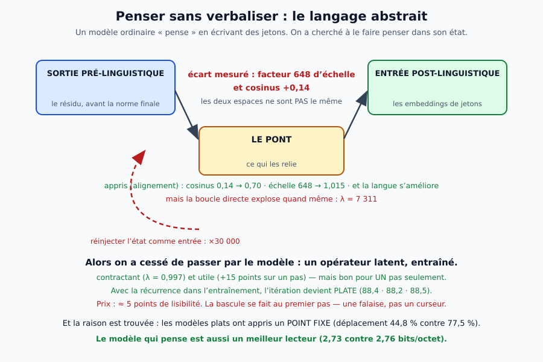

# 5. La pensée sans verbaliser — le travail de la nuit du 16 octobre

## La question, et pourquoi elle n'est pas abstraite

Un modèle de langue « réfléchit » en **écrivant** : chaque pas de pensée est un jeton, qu'il relit ensuite.
Un cerveau d'expert fait l'inverse — il pense **sans dialogue intérieur**. Peut-on obtenir la même chose
d'un modèle ?

C'est une question **exécutable** avec Drave, parce que le moteur sait déjà **écrire et relire un état** :
on peut faire évoluer la pensée **sans qu'aucun jeton ne soit émis**.

## Ce que la nuit a mesuré, dans l'ordre

| étape | le résultat | ce qui a été appris |
|---|---|---|
| **réinjecter l'état brut** | la prédiction détruit de 5 ordres de grandeur (×30 000) | et **normer n'y change rien** : ce n'est pas l'échelle |
| **apprendre un pont** | l'état mappé bat le mot (68,6 % contre 122,9 %) | la sortie prélinguistique **dit mieux** que le **jeton de sortie** |
| **mesurer l'écart** | facteur **648** d'échelle, cosinus **+0,14** | les deux espaces ne sont pas le même |
| **aligner** | cosinus **0,70**, échelle **1,015** — et la langue **s'améliore** | l'alignement est un régularisant, pas un coût |
| **boucler quand même** | λ = **7 311**, contenu détruit | aligner les espaces ne suffit pas : il faut la **dynamique** |
| **opérateur post-hoc** | λ = **0,997** (le premier pas contractant) et +15 points… sur **un** pas | l'itération n'accumule pas |
| **récurrence à l'entraînement** | itération **plate** (88,4 · 88,2 · 88,5) | l'état devient **habitable** — au prix de 5 points |
| **la falaise** | **pas de premier pas linéaire** : l'opérateur prédit la **moyenne** (mesure 113) | l'état d'une phrase ne porte pas la suivante ; il faut un état qui porte le **plan** |
| **la cause** | déplacement 44,8 % contre 77,5 % | les modèles plats ont appris un **point fixe** |

## Les trois piliers, et ce qu'ils valent

Après avoir **réparé l'instrument** (un λ de ridge choisi par validation croisée, et une batterie de
longueurs), trois conclusions **survivent** :

1. **l'état porte le sens** : 16 jetons d'avance à **80,3 %**, quand le mot est à **118,4 %** — 38 points
   d'écart ; et l'empreinte de copie à **49,3 % contre 76,9 %** en lecture (trois exécutions) ;
2. **l'itération s'obtient et se paie** : plate, contre **+3,2** points de lisibilité à 2,43 M et **+2,4** à
   9,57 M — le prix **baisse** avec la capacité, lentement ;
3. **la récurrence n'est pas qu'un coût** : elle **améliore** le modèle de langue (2,73 contre 2,76
   bits/octet). *Le modèle qui pense est aussi un meilleur lecteur.*

**Mesure 77 (20 octobre)** : sur **Qwen2.5-3B** et **139 paragraphes en 12 langues** (corpus JW 2026), un **pont
linéaire** par langue atteint un **cosinus de 0,78-0,92** et retrouve la bonne traduction dans **28-67 %** des cas
(hasard 0,7 %), le contrôle négatif restant à ~0 — *la représentation neutre existe mais doit être alignée*, comme
le pont de la nuit du 16, retrouvé ici à plus grande échelle. **Mesure 78** : le passage du 3 B au 7 B ne change
presque rien (+3,7 en lecture, +1,4 en écriture), **lire ≈ écrire**, et la meilleure couche est **la couche 4** pour
cinq langues — *le sens partagé est tôt et stable ; c'est une base d'architecture, pas un effet de taille*.
**Mesure 79** : la **composition** n'est pas démontrée — seuls les paragraphes **complets** s'alignent (0,2-0,78),
les préfixes de caractères restent près du hasard et la trajectoire est plate ; le test est **confondu** (les
préfixes ne sont pas des unités de sens). **Mesure 80** : sur des phrases **alignées** (Verne FR/EN, 200 phrases),
la composition **est là** — retrieval **0,61** (hasard 0,5 %), **ordre 0,84** (hasard 25 %) à la **couche 18** ; le
pont est inutile (0,42) et la dernière couche s'effondre (0,09) : *le sens est au milieu, la langue à la fin*.
**Mesure 81** : la composition **profite de la taille** — 0,76 / 0,865 au 7 B (couche 14 sur 28, soit 50 % de la
profondeur) contre 0,61 / 0,84 au 3 B (couche 18 sur 36) ; la fin s'effondre encore plus (0,125). *Le sens neutre
vit à mi-profondeur, et la composition est un levier de taille, pas un plafond.* **Mesure 87** : la courbe **plafonne** entre 7 et 14 B
(0,68 / 0,855 au 14 B contre 0,76 / 0,865 au 7 B, avec un OOM de répartition) — *le levier de la composition est la
profondeur et la taille **jusqu'à 7 B**, pas les paramètres au-delà*.
**Le pas de pensée linéaire n'existe pas** (mesure 113, après l'**erratum 6**) : les mesures 82-85, 88 et 108
lisaient les états Verne avec 200 noms pour 400 lignes — les « séries de quatre phrases » étaient en réalité
`fr0, en0, fr1, en1`, des paires de **traduction** ✗✗. Sur la carte correcte, l'opérateur ridge **prédit la moyenne** :
son cosinus est celui du prédicteur constant à ±0,03 près, ses sorties sont **effondrées** (cosinus moyen 0,89-0,99),
et le retrieval de la phrase suivante reste au **hasard** (0-8,9 % contre 2,2 %), aux trois tailles ; un opérateur
**contrastif** (InfoNCE) ne fait pas mieux (2,2-11,1 %) — *l'objectif n'est pas la cause* ✗✓. Un MLP contrastif
**mémorise** les transitions (perte 0,03) mais ne **généralise** pas (mesures 114-115) ; avec **630 séries** et
**1 323 transitions** (mesure 115), ni le linéaire — qui reste la moyenne (cos 0,827-0,940 contre 0,821-0,939,
effondrement 0,933-0,995) — ni le MLP (retrieval 0-1,15 %, dans la série 14-27 % contre 25 %) ne retrouvent la
phrase suivante : *ce n'est ni l'échantillon, ni la forme, ni l'objectif* ✗✗. **En revanche**, l'**état latent
entraîné avec la tâche** (mesure 109) **collapse** bel et bien en **point fixe** : le pas 3 monte à 0,60-0,67, mais
le pas 1 tombe à 0,00 ; la pénalité de point fixe (mesure 110) ne le débloque pas ✗✗. *Ce n'est donc pas le modèle ni
la forme de l'opérateur : c'est le **pas** qui n'est pas une fonction de l'état d'une phrase — il manque le **plan**
de la série.*

## Ce qui reste à construire

Une **dynamique qui avance d'un pas à la fois** suppose un état qui porte le **plan** de la série, pas seulement la
phrase courante. Trois mesures l'ont tranché : l'état d'une **phrase** ne porte pas la suivante, même avec
**1 323 transitions** et un MLP (mesure 115) ; le **contexte** (moyenne du préfixe + ridge, GRU) ne porte pas le
**contenu** de la suite — 0,14 contre 0,125 (mesure 116) ✓✗ ; et un **code de 32 dimensions** reconstruit la
trajectoire à 0,86-0,89, à peine au-dessus de la **moyenne** (0,83-0,88) : le plan est un **mince résidu** (mesure 117)
✗✗. Une **dissociation** le résume (mesure 118) : la **langue** est parfaitement décodable (1,00) alors que la
**position** dans la série ne l'est pas (0,13 contre 0,125) — *l'état porte la langue, pas la structure*. *Le plan
n'est pas extractible des états figés — il n'y est même pas un objet de faible dimension : il faut l'entraîner dans
le modèle.* C'est fait (mesure 119) : un LoRA contrastif entraîné à retrouver la 5ᵉ phrase depuis les 4 premières
monte le retrieval de contenu de **0,239 à 0,443** (hasard 0,125 ; contrôle à cibles mélangées : 0,227) — **le plan
s'entraîne**, premier résultat positif de l'étage 2. Deux chantiers, dans l'ordre : **(1)** le plan **multi-pas**
(t+2, t+3) — c'est la **dynamique** ; **(2)** le passage à l'échelle (plus de séries, plusieurs romans, un modèle
plus grand) avec le **gain sur la moyenne** comme critère. L'outillage est en place :
`tools/pas_de_pensee_corrige.py`, `tools/pas_de_pensee_non_lineaire.py`, `tools/etat_de_plan.py`,
`tools/plan_entrainement.py` et `tools/composition_latente.py`.
