# Synthèse — l'introduction à Drave

> **Ce que ce dossier est.** L'**introduction tenue à jour** à Drave : ce que le projet cherche, comment
> le moteur fonctionne, ce que l'intelligence mesure, et comment on sait qu'une affirmation est vraie.
> Elle se lit **seule** ; les chiffres, les protocoles et les erratums vivent dans
> [`reports/`](../../reports/).
>
> **Dernière mise à jour : 2026-10-28.** **Huit chapitres**, **quatorze schémas** sont à jour ;
> B10–B12 sont dans les « hors chapitres ».
>
> **Ce qu'elle n'est pas.** Un journal de mesures, ni une fiche de résultats : une **porte d'entrée**.
> Chaque fois qu'un concept est introduit, une **fiche concept** donne sa définition, ses liens vers le
> [glossaire](../glossaire.md) et une illustration. Le détail mesuré est toujours dans `reports/`.

## En une page

**Drave est un bus d'événements pour l'IA.** Les activations d'un réseau sont des **faits** — « le neurone
2 539 de la couche 23 a valu 27,8 » — regroupés en **listes valuées poussées** vers leurs lecteurs. Le coût
du calcul suit l'**activité**, pas la taille du modèle ; le modèle devient **observable**, **décomposable**,
**répartissable** et **rejouable**.

**Le moteur** coupe le modèle en **régions**, les relie par un **bus**, et un **cerveau logiciel** les
organise : horloges, budgets, mémoire, sommeil, pannes. La mesure fondatrice : **huit coupes, une seule
perplexité** — à condition de couper **tard**. Le calcul ne change pas ; c'est la **mise en scène** qui change.

**L'intelligence** se lit dans l'**état**, pas seulement dans le texte : l'état porte le raisonnement, un
**pont linéaire** l'aligne d'une langue à l'autre, et les **opérations** (négation, composition) sont des
géométries apprises, pas une algèbre. La thèse : **la structure bat la taille**.

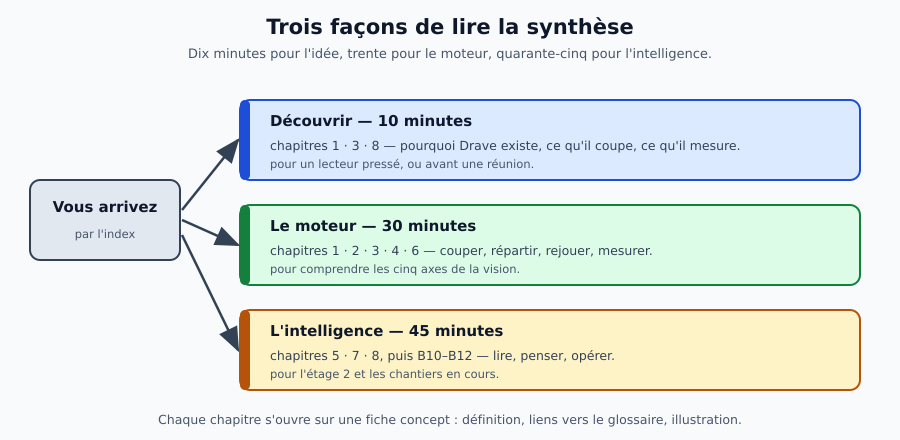

## Comment lire ce dossier

| si vous voulez… | prenez | le temps |
|---|---|---|
| **comprendre l'idée** | chapitres [1](01-le-cerveau-drave.md) · [3](03-les-modes-et-les-portes.md) · [8](08-les-operations.md) | 10 minutes |
| **comprendre le moteur** | chapitres [1](01-le-cerveau-drave.md) · [2](02-anatomie-interne.md) · [3](03-les-modes-et-les-portes.md) · [4](04-les-facultes-et-la-biologie.md) · [6](06-comment-savoir.md) | 30 minutes |
| **comprendre l'intelligence** | chapitres [5](05-la-pensee-sans-verbaliser.md) · [7](07-modeles-alternatifs-entree-sortie.md) · [8](08-les-operations.md), puis **B10–B12** | 45 minutes |
| **voir les preuves** | [`reports/INDEX.md`](../../reports/INDEX.md) et les fiches citées | au cas par cas |
| **chercher un mot** | le [glossaire](../glossaire.md), puis la famille | 1 minute |
| **utiliser le dépôt** | [`docs/utilisation.md`](../utilisation.md) | 10 minutes |

## La fiche concept

Chaque chapitre s'ouvre sur une **fiche** : le **nom**, la **définition** en deux ou trois lignes, les
**liens vers le glossaire**, et une **illustration**. C'est la même fiche dans cet index et au début du
chapitre : on peut la lire seule, puis suivre le lien qui correspond à son besoin.

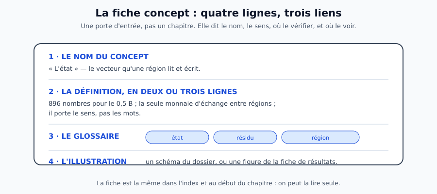

> **Exemple — fiche concept de l'état.**
> Un **état** est le vecteur qu'une région lit, calcule et écrit : 896 nombres pour le 0,5 B.
> C'est la seule monnaie d'échange entre régions ; il porte le **sens**, pas les mots.
> **Glossaire :** [état](../glossaire/02-modeles-et-architectures.md) · [résidu](../glossaire/04-le-moteur-drave-execution-structures-out.md) · [région](../glossaire/04-le-moteur-drave-execution-structures-out.md)
> **Illustration :** 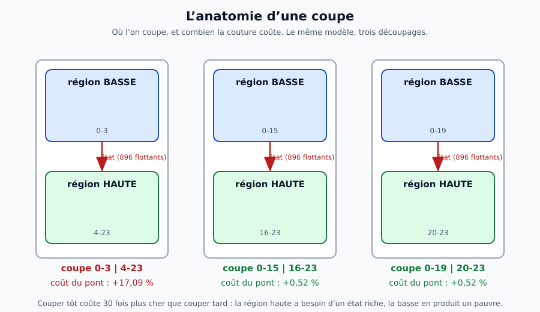

## Les huit chapitres

| # | chapitre | la fiche concept | ce qu'on y apprend | illustration |
|---|---|---|---|---|
| 1 | [le cerveau Drave](01-le-cerveau-drave.md) | région · coupe tardive | l'idée fondatrice, et pourquoi couper un modèle ne le casse pas | 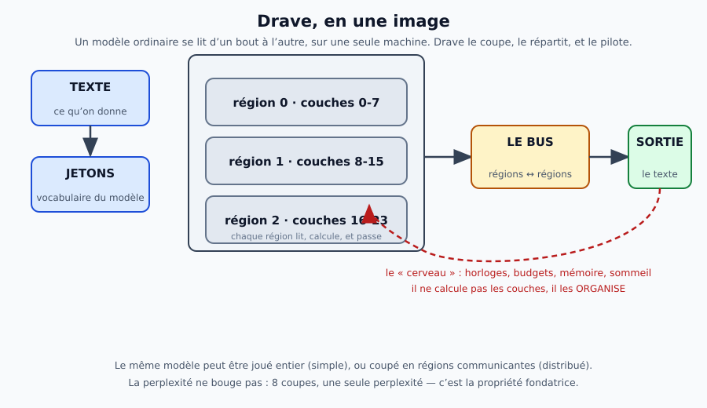 |
| 2 | [l'anatomie interne](02-anatomie-interne.md) | état · bus | régions, liens, bus, horloges : ce qui circule et où |  |
| 3 | [les modes et les portes](03-les-modes-et-les-portes.md) | mode · porte | les six façons de faire tourner le modèle, et les **49** vérifications | 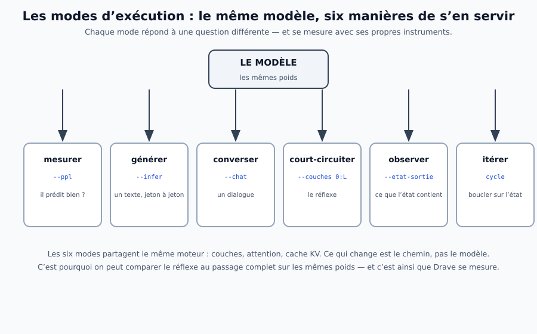 |
| 4 | [les douze facultés](04-les-facultes-et-la-biologie.md) | faculté (C1–C12) | ce qu'on cherche à donner à un modèle, et à quoi on le reconnaît | 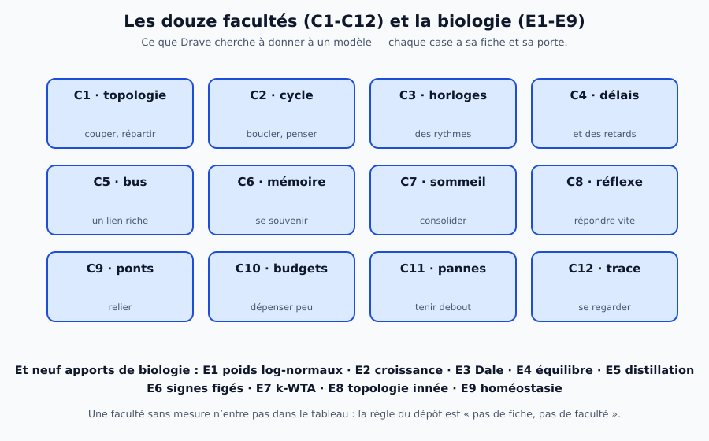 |
| 5 | [la pensée sans verbaliser](05-la-pensee-sans-verbaliser.md) | pont · plan | lire le sens, l'aligner, et pourquoi le plan résiste | 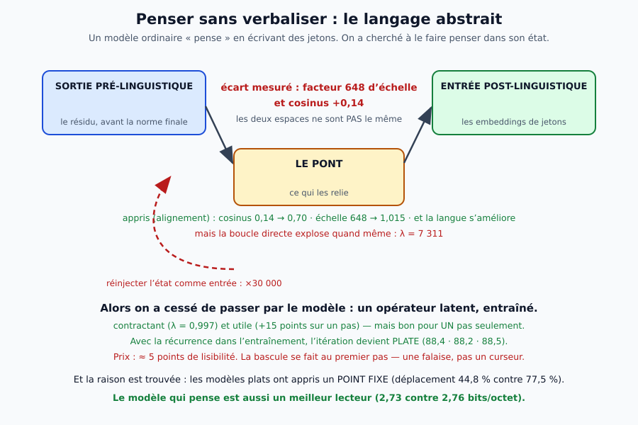 |
| 6 | [comment savoir qu'on a raison](06-comment-savoir.md) | contrôle négatif | les portes, le registre, et les cinq pièges d'instrument | 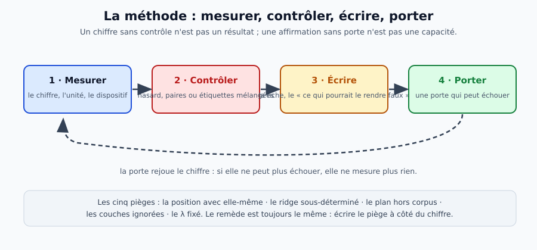 |
| 7 | [les modèles alternatifs pour l'entrée et la sortie](07-modeles-alternatifs-entree-sortie.md) | RSN · unité de sens | la théorie de l'étage entrée-sortie : cinq familles, ce qu'on sait, ce qui reste ouvert | 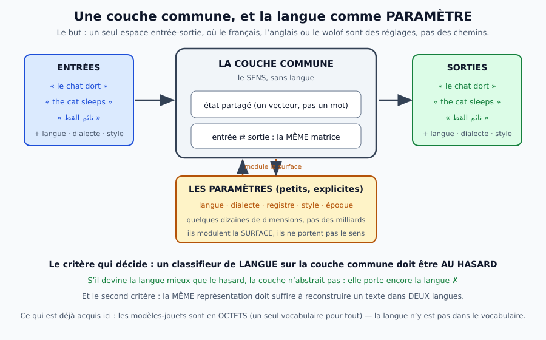 |
| 8 | [les opérations](08-les-operations.md) | opérateur · grappe | les six mesures de B4 et la grappe du moteur (top-1024 exact à 21 %) | 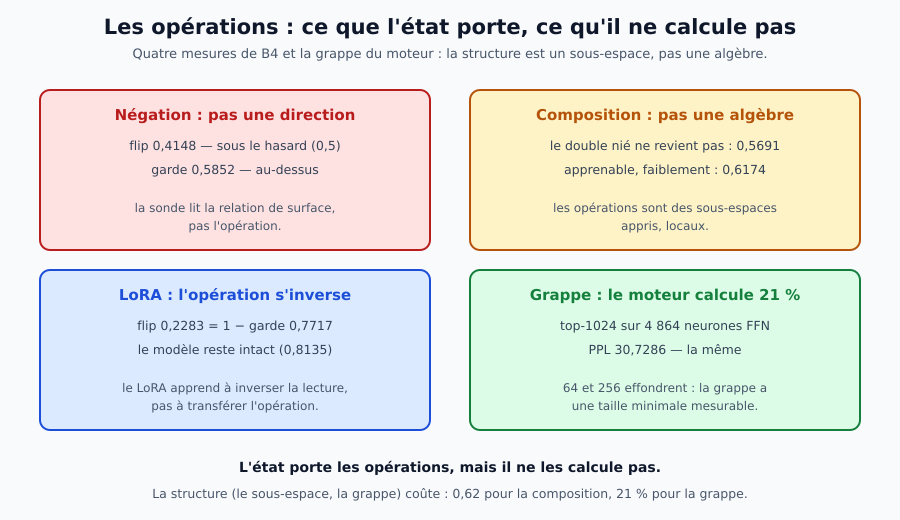 |

## Les concepts, et où ils sont définis

| concept | chapitre | glossaire |
|---|---|---|
| **le cerveau Drave** | [1](01-le-cerveau-drave.md) | [le projet, ses noms, sa méthode](../glossaire/01-le-projet-ses-noms-sa-methode.md) |
| **la région** | [1](01-le-cerveau-drave.md) · [2](02-anatomie-interne.md) | [le moteur Drave](../glossaire/04-le-moteur-drave-execution-structures-out.md) |
| **l'état** | [2](02-anatomie-interne.md) · [5](05-la-pensee-sans-verbaliser.md) | [modèles et architectures](../glossaire/02-modeles-et-architectures.md) |
| **le bus** | [1](01-le-cerveau-drave.md) · [2](02-anatomie-interne.md) | [flux, protocole, transport](../glossaire/05-flux-protocole-et-transport.md) |
| **le mode** | [3](03-les-modes-et-les-portes.md) | [le moteur Drave](../glossaire/04-le-moteur-drave-execution-structures-out.md) |
| **la porte** | [3](03-les-modes-et-les-portes.md) · [6](06-comment-savoir.md) | [mesure et méthode](../glossaire/07-mesure-qualite-et-methode-experimentale.md) |
| **la faculté** | [4](04-les-facultes-et-la-biologie.md) | [le moteur Drave](../glossaire/04-le-moteur-drave-execution-structures-out.md) |
| **le pont** | [5](05-la-pensee-sans-verbaliser.md) | [le pont linguistico-sémantique](../glossaire/10-le-pont-linguistico-semantique-le-vocabu.md) |
| **le plan** | [5](05-la-pensee-sans-verbaliser.md) | [modèles et architectures](../glossaire/02-modeles-et-architectures.md) |
| **le contrôle négatif** | [6](06-comment-savoir.md) | [mesure et méthode](../glossaire/07-mesure-qualite-et-methode-experimentale.md) |
| **la RSN** | [7](07-modeles-alternatifs-entree-sortie.md) | [le pont linguistico-sémantique](../glossaire/10-le-pont-linguistico-semantique-le-vocabu.md) |
| **l'opérateur** | [8](08-les-operations.md) | [modèles et architectures](../glossaire/02-modeles-et-architectures.md) |
| **la grappe** | [8](08-les-operations.md) | [le moteur Drave](../glossaire/04-le-moteur-drave-execution-structures-out.md) |

## Le glossaire en carte

Le [glossaire](../glossaire.md) est le vocabulaire **non négociable** du dépôt : *couche* vs *étage*,
*unité de sens* vs *jeton*, *RSN* vs *tokeniseur*. Chaque fiche ci-dessus pointe vers une famille ; la
famille pointe vers le fichier qui définit le terme.

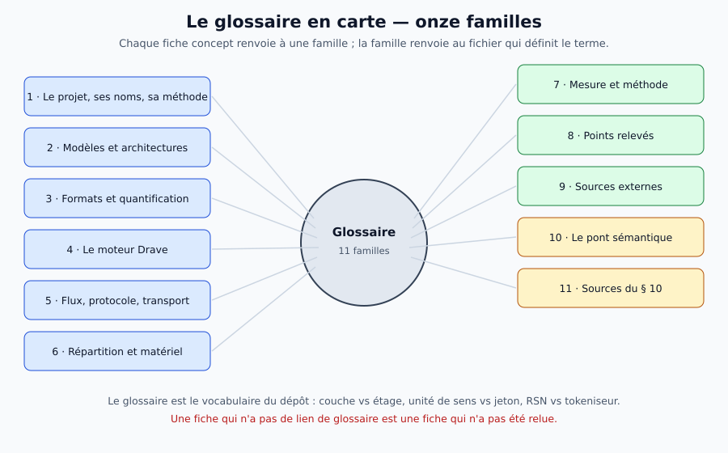

| famille | ce qu'on y trouve | lien |
|---|---|---|
| **1** | le projet, ses noms, sa méthode | [lire](../glossaire/01-le-projet-ses-noms-sa-methode.md) |
| **2** | les modèles et les architectures | [lire](../glossaire/02-modeles-et-architectures.md) |
| **3** | les formats et la quantification | [lire](../glossaire/03-formats-quantification-encodage.md) |
| **4** | le moteur Drave : exécution, structures, outils | [lire](../glossaire/04-le-moteur-drave-execution-structures-out.md) |
| **5** | les flux, le protocole et le transport | [lire](../glossaire/05-flux-protocole-et-transport.md) |
| **6** | la répartition, le matériel et l'énergie | [lire](../glossaire/06-repartition-materiel-et-energie.md) |
| **7** | la mesure, la qualité et la méthode | [lire](../glossaire/07-mesure-qualite-et-methode-experimentale.md) |
| **8** | les points relevés, non corrigés | [lire](../glossaire/08-points-releves-non-corriges.md) |
| **9** | les sources externes citées | [lire](../glossaire/09-sources-externes-citees.md) |
| **10** | le pont linguistico-sémantique | [lire](../glossaire/10-le-pont-linguistico-semantique-le-vocabu.md) |
| **11** | les sources externes du § 10 | [lire](../glossaire/11-sources-externes-ajoutees-par-le-10.md) |

## Les deux étages

L'**étage 1** va de la surface à la **RSN** (des unités de sens) et revient ; l'**étage 2** lit la RSN et
y applique des **opérations**. Le **miroir** est la règle de mesure : toute mesure d'entrée se double d'une
mesure de sortie — *la fluidité n'est pas la fidélité*.

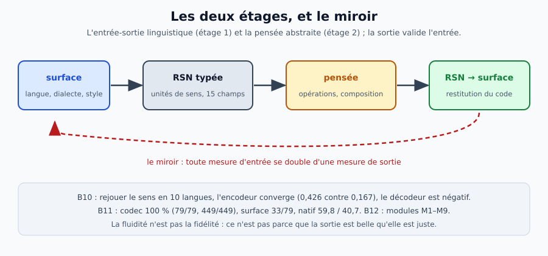

## Hors chapitres — les jeux symboliques

| le sujet | où il vit |
|---|---|
| **B5/B6 — la surface, la RSN-jeu, la pensée** : cinq jeux (morpion, échecs, dames, go, cartes), les couches 0→4, l'invariance, le perft et la logique | [le concept](../jeux-symboliques.md) · [la fiche](../../reports/rapport-jeux-symboliques.md) · [la porte](../../tools/porte-jeux.sh) |
| **B7/B8 — les langues et les maîtres** : 71 langues, 449 surfaces, la permutation, la notation ; 17 principes, le livre, le go 9×9, les cartes | [le concept](../jeux-symboliques.md) · [la fiche](../../reports/rapport-langues-maitres.md) |
| **B9 — le banc externe** : DeepSeek pour le langage, les GPU pour le natif ; 310/610/910 prompts, **31,63 M / 610 : 4,40 %**, fenêtre et négatif 910/30 | [le concept](../llm-externe.md) · [la fiche](../../reports/rapport-deepseek.md) |

## Hors chapitres — la sémantique et le cerveau (B10–B12)

| le sujet | où il vit |
|---|---|
| **B10 — le protocole sémantique** : rejouer le sens en 10 langues, `z` partagé ; l'encodeur converge (0,426 contre 0,167), le décodeur est **négatif** (14,0 / 5,4 contre 38,8 en référence tronquée ; 12,7 / 5,3 contre 39,6 en référence complète) | [le protocole](../protocole-semantique.md) · [la fiche](../../reports/rapport-semantique.md) |
| **B11 — la base d'universaux typés** : 15 champs, 502 classes ; le codec lit **100 %** (79/79, 449/449) et la **restitution du code** fait **100 %** d'aller-retour, mais la **surface originale** reste à **33/79** ; le natif normalisé + contexte est à **59,8 % / 40,7 %** | [les universaux](../semantique-universaux.md) · [la fiche](../../reports/rapport-universaux.md) · [le bilan](../../reports/bilan-b11.md) |
| **B12 — les modules cerveau-langage M1–M9** : bus réel, **M1 528/528**, **M2 98,6 / 93,2** (double dissociation), **M8 96,48 %** hors stock ; **M5/M6/M7** négatifs ou faibles ; **M9** table de lésions | [les modules](../modules-cerveau-langage.md) · [la fiche](../../reports/rapport-cerveau-modules.md) |

## Trois principes, qui reviennent partout

1. **Le modèle n'est pas le cerveau.** Le modèle calcule des couches ; le cerveau **organise** : il décide
   qui parle à qui, quand, avec quel budget, et ce qu'on garde en mémoire. Drave est cet **étage**-là.
2. **Couper un modèle ne le casse pas** — à condition de couper **tard** : c'est mesuré, huit coupes
   donnent la même perplexité. Tout le reste (répartir, réveiller une région, court-circuiter) découle de
   cette propriété.
3. **Pas de fiche, pas de faculté.** Chaque capacité a un rapport dans `reports/` et une **porte** qui peut
   échouer. Une capacité qui n'est pas vérifiable n'est pas annoncée.

## La règle de mise à jour

- **Chaque chapitre est une introduction** : la fiche concept en tête, le détail renvoyé aux fiches.
- **Chaque concept a une fiche** : définition, lien vers le glossaire, illustration ; la même fiche est
  reprise dans cet index.
- **Les liens sont relatifs** (`schemas/…`, `../glossaire/…`, `../../reports/…`) et sont vérifiés par
  [`tools/porte-tableaux.sh`](../../tools/porte-tableaux.sh) et
  [`tools/revue_documentation.py`](../../tools/revue_documentation.py).
- **Les chiffres ne sont pas recopiés** : l'index cite la fiche ou le bilan ; la source de l'état est
  [`docs/en-cours.md`](../en-cours.md), la théorie est ici.
- **La date de mise à jour** est celle du dernier passage de revue ; on la change quand un chapitre, une
  fiche ou un schéma change.
