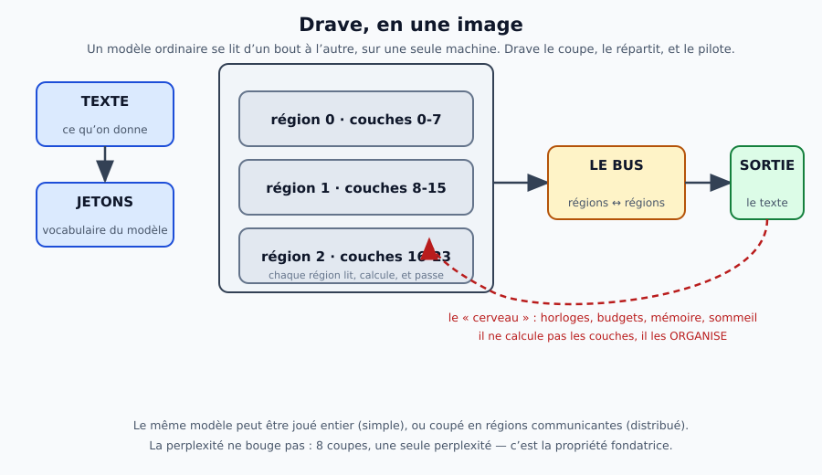
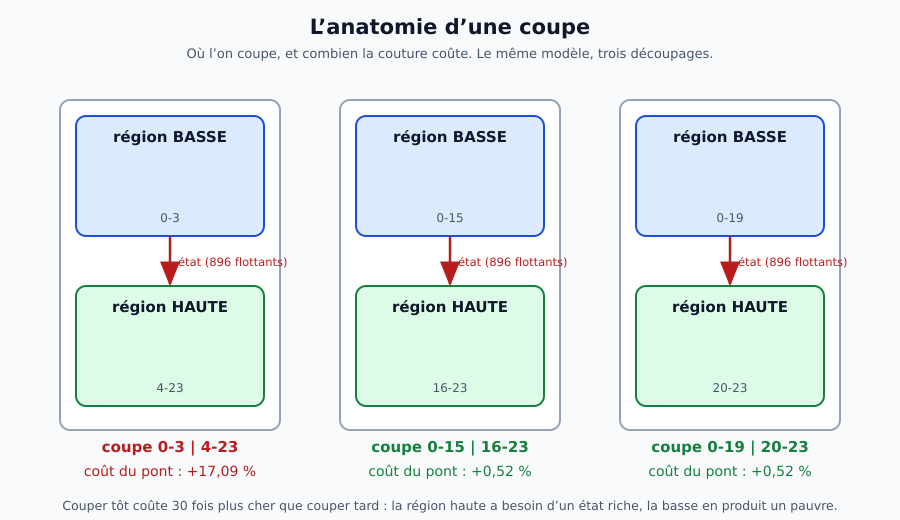
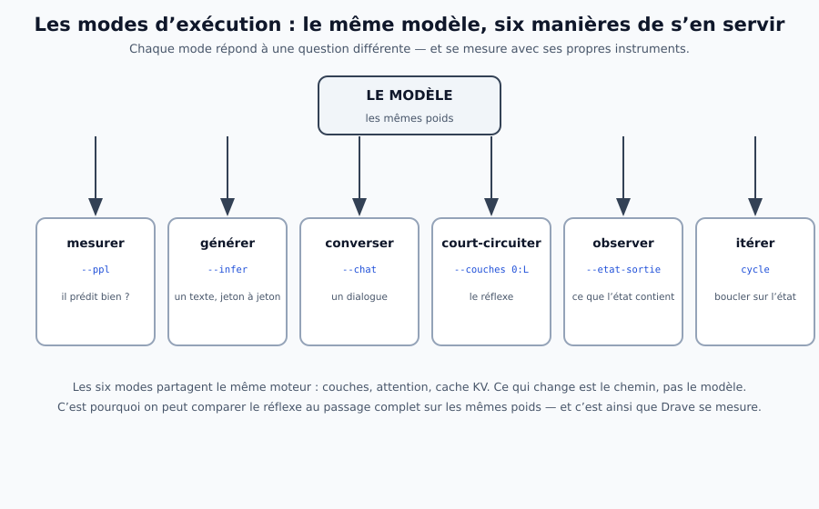
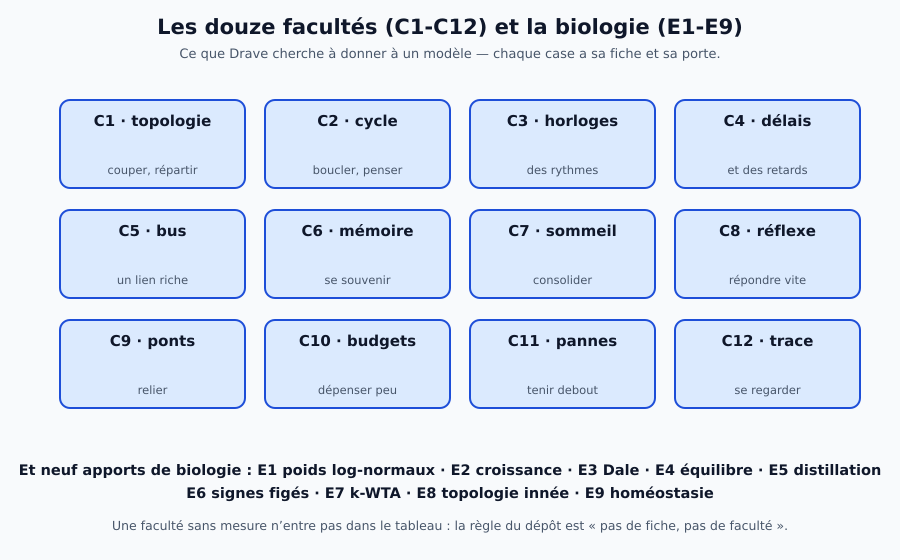
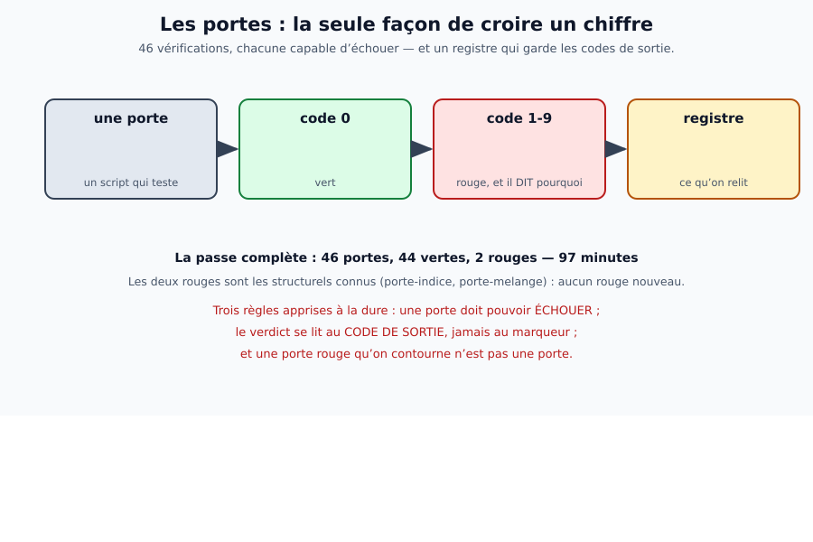

# Synthèse théorique de Drave

> **Ce que ce dossier est.** Une explication **complète et vulgarisée** de ce que Drave sait faire, de
> son fonctionnement interne, et des idées qui le gouvernent. Sept chapitres, sept schémas, et à la fin de
> chacun la même question : *« comment sait-on que c'est vrai ? »* — parce que dans ce dépôt, une idée
> qui n'est pas mesurée n'est pas une idée, c'est une intention.

## Par où commencer

| si vous voulez… | lisez |
|---|---|
| comprendre **l'idée** en cinq minutes | [chapitre 1 — le cerveau Drave](01-le-cerveau-drave.md) |
| comprendre **ce que le moteur fait vraiment** | [chapitre 3 — les modes et les portes](03-les-modes-et-les-portes.md) |
| savoir **ce qui marche et ce qui ne marche pas** | [chapitre 5 — la pensée sans verbaliser](05-la-pensee-sans-verbaliser.md) |
| **utiliser** le dépôt ce soir | [`docs/utilisation.md`](../utilisation.md) |
| la **vision** et la **roadmap** | [`docs/vision.md`](../vision.md) · [`docs/roadmap.md`](../roadmap.md) |

## Les sept chapitres

| # | chapitre | ce qu'il explique | schéma |
|---|---|---|---|
| 1 | [le cerveau Drave](01-le-cerveau-drave.md) | l'idée fondatrice, et pourquoi couper un modèle ne le casse pas |  |
| 2 | [l'anatomie interne](02-anatomie-interne.md) | régions, liens, bus, horloges : ce qui circule et où |  |
| 3 | [les modes et les portes](03-les-modes-et-les-portes.md) | les six façons de faire tourner le modèle, et les **47** vérifications |  |
| 4 | [les douze facultés](04-les-facultes-et-la-biologie.md) | C1-C12 : ce qu'on cherche à donner à un modèle, et à quoi on le reconnaît |  |
| 5 | [la pensée sans verbaliser](05-la-pensee-sans-verbaliser.md) | le travail de la nuit du 16/10 : lire le sens, itérer, et le prix |  |
| 6 | [comment savoir qu'on a raison](06-comment-savoir.md) | les portes, le registre, et les cinq pièges d'instrument |  |
| 7 | [les modèles alternatifs pour l'entrée et la sortie](07-modeles-alternatifs-entree-sortie.md) | **la théorie** de l'étage entrée-sortie (nom historique : couche commune) : cinq familles, ce qu'on sait, ce qui reste ouvert — les **mesures** sont dans [reports/07-mesures-couche-commune.md](../../reports/07-mesures-couche-commune.md) |  |

## Trois principes, qui reviennent partout

1. **Le modèle n'est pas le cerveau.** Le modèle calcule des couches ; le cerveau **organise** : il décide
   qui parle à qui, quand, avec quel budget, et ce qu'on garde en mémoire. Drave est cet **étage**-là.
2. **Couper un modèle ne le casse pas** — à condition de couper **tard** : c'est mesuré, huit coupes
   donnent la même perplexité. Tout le reste (répartir, réveiller une région, court-circuiter) découle de
   cette propriété.
3. **Pas de fiche, pas de faculté.** Chaque capacité a un rapport dans `reports/` et une **porte** qui peut
   échouer. Une capacité qui n'est pas vérifiable n'est pas annoncée.
