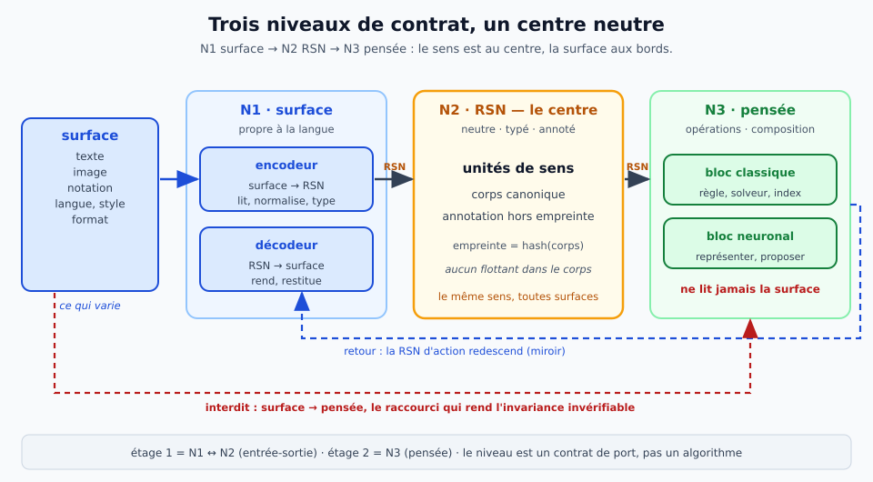
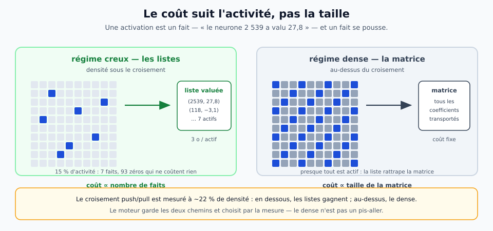
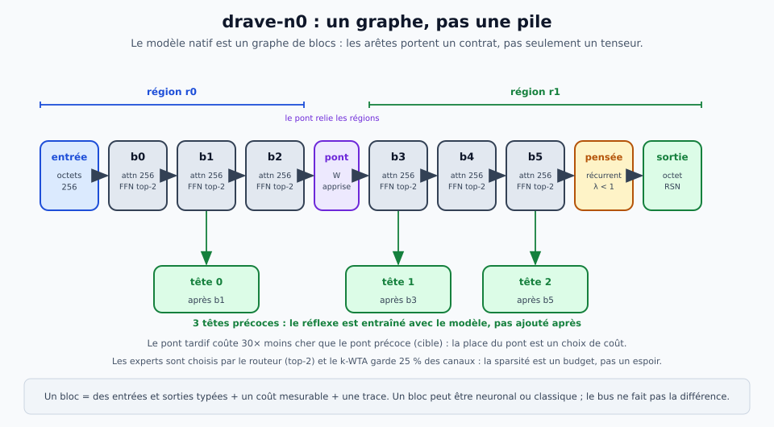
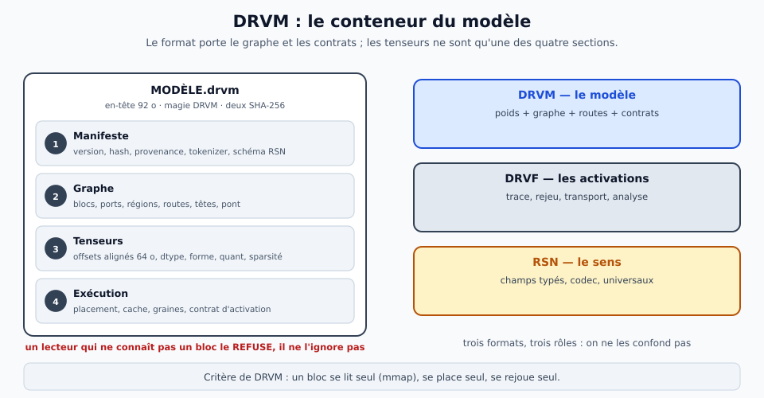
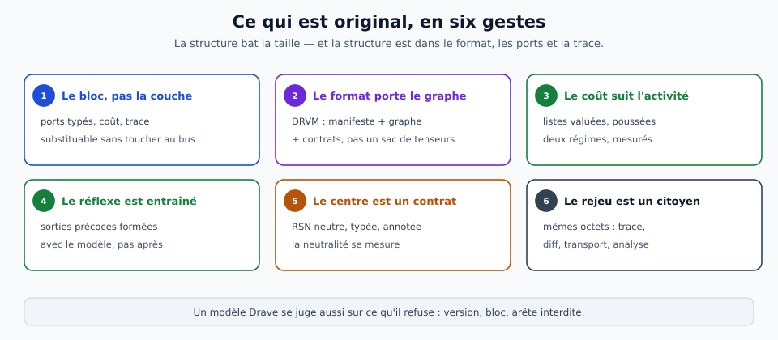
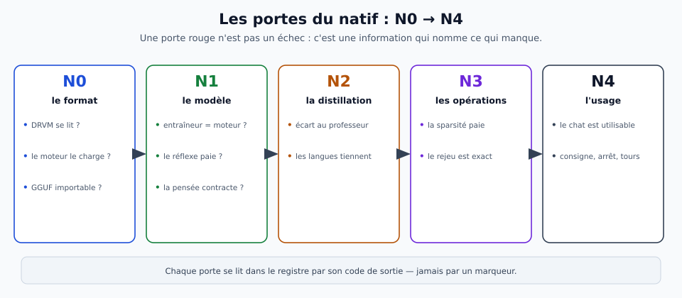

# Le modèle Drave natif — un graphe, un flux, trois niveaux

> **Ce que ce document est.** La **théorie** du modèle natif : ce qu'il est (un **graphe de blocs** exécuté sur un
> **bus de faits**), ce qui le distingue d'un transformeur monolithique, et le **principe de séparation à trois
> niveaux** — surface, RSN, pensée — qui rend la neutralité **mesurable** au lieu de la promettre. Les **chiffres**
> de `drave-n0` et des campagnes N sont dans [`reports/`](../../reports/) ; le **format** dans
> [`architecture-native.md`](architecture-native.md) et [`format-flux.md`](../implantation/format-flux.md) ;
> l'**implémentation d'un bloc impulsionnel** dans [`diehl-cook.md`](../implantation/diehl-cook.md).

> **Fiche concept — le modèle natif.**
> Un modèle Drave n'est pas un fichier de tenseurs : c'est un **graphe de blocs** dont les arêtes portent des
> **contrats typés**, exécuté par un **bus de listes valuées**, et **rejouable** à l'octet. `drave-n0` en est la
> première instance : 6 blocs, des octets, une attention locale, un FFN creux routé, 3 têtes précoces, une cellule
> de pensée et un pont.
> **Glossaire :** [couche / étage](glossaire/entrees/couche-etage.md) · [RSN](glossaire/entrees/representation-semantique-neutre.md) ·
> [fait · mesuré · projeté · déduit](glossaire/entrees/fait-mesure-projete-deduit.md)
> **Illustration :** 

## 1. Ce qu'on appelle « natif »

**Natif** veut dire **conçu pour le régime Drave**, pas « adapté après coup ». Le régime tient en quatre
propriétés : le modèle est **décomposable** (un bloc se lit et s'exécute seul), **répartissable** (un bloc va là
où son entrée est déjà), **observable** (chaque activation est un fait daté) et **rejouable** (la même trace
redonne le même résultat). Un modèle qui n'a pas ces quatre propriétés n'est pas natif, même s'il est écrit dans
un fichier qui s'appelle DRVM.

**Trois choses, et il faut les distinguer** :

| le mot | ce qu'il désigne | où il vit |
|---|---|---|
| **DRVM** | le **conteneur** : manifeste, graphe, tenseurs, exécution | [`architecture-native.md`](architecture-native.md) |
| **`drave-n0`** | le **modèle** : l'instance de 6 blocs qui remplit ce conteneur | [`roadmap.md`](../pilotage/roadmap.md) § N |
| **le régime** | la **manière d'exécuter** : listes valuées, sorties précoces, routes, rejeu | [`format-flux.md`](../implantation/format-flux.md) |

**Ce que le natif n'est pas** : un consommateur de GGUF, un petit Qwen3-MoE, un transformeur dans une boîte
neuve. GGUF est un **conteneur de tenseurs** ; Qwen3-MoE est une **architecture générique** ; les deux supposent
un modèle **monolithique, dense, exécuté d'un bloc**. Drave est un **graphe de blocs événementiels**, avec des
sorties précoces, des routes, des contrats d'activation et du rejeu. La différence n'est pas cosmétique : elle
change ce qu'on peut mesurer.

**La thèse** : *la structure bat la taille*. Un pont linéaire, une grille de conversion, un routage de blocs
valent mieux que des paramètres ajoutés. Le natif est l'endroit où cette thèse devient un format.

## 2. Les trois niveaux — surface, RSN, pensée

### Le problème

Une même chose a **beaucoup de surfaces** : un chiffre est un tracé de pixels, un glyphe Unicode, un mot dans
trois langues ; une position d'échecs est une FEN, un diagramme, une suite SAN. Si le raisonnement lit la
surface, deux écritures de la même chose peuvent produire deux décisions différentes. L'invariance devient alors
invérifiable — et un modèle qui ne peut pas prouver son invariance n'a pas de centre, seulement des couches.

La séparation est **volontaire** et **ordonnée** :


| niveau | ce qu'il porte | ce qu'il a le droit de lire | ce qu'il rend |
|---|---|---|---|
| **N1 — surface** | texte, image, notation, langue, style | la surface | une **RSN** |
| **N2 — RSN** | les **unités de sens**, le corps canonique, l'annotation | une RSN (ou `φ(RSN)`) | une RSN |
| **N3 — pensée** | les opérations : composer, inférer, planifier, décider | une RSN **seulement** | une RSN d'action |

**La règle** : *le niveau est un contrat de port, pas un algorithme*. Un même code — un réseau, un solveur, un
index — peut être N1, N2 ou N3 selon ce qu'il **reçoit** et ce qu'il **rend**. Un bloc qui reçoit la surface est
N1 ; un bloc qui rend une décision sans RSN n'est ni N2 ni N3 : il **fuit** la surface vers le raisonnement, et
c'est cette fuite que le format doit refuser.

### Ce que la RSN est, et ce qu'elle n'est pas

La RSN est une **structure multi-niveaux** (graphémique/phonologique, morphologique, syntaxique, sémantique,
discursif/pragmatique), **indépendante de la langue de surface**, **annotée de son bruit** (confiance,
ambiguïtés, langues probables, format d'origine). Ses éléments sont des **unités de sens**, jamais des **jetons**
de tokeniseur : le jeton est le porteur technique du modèle, pas l'unité du contrat.

Trois propriétés la rendent vérifiable :

1. **canonique** — deux surfaces qui disent la même chose donnent le même **corps**, donc la même **empreinte** ;
2. **séparable** — l'**annotation** (le bruit, la langue, le format) est **hors de l'empreinte** ; elle est
   transportée, pas confondue avec le sens ;
3. **typée et réversible** — le corps est un arbre de `null`, `bool`, `int`, `str`, listes et dictionnaires,
   **sans flottant** ; tout corps encodé se décode à l'identique.

C'est le contrat déjà utilisé par les jeux symboliques : voir [`jeux-symboliques.md`](jeux-symboliques.md). Ce
qui est **original** ici n'est pas l'idée d'une interlingua — elle est ancienne — mais le fait que le contrat soit
**porté par le format** (ports typés, graphe, refus) et **mesuré** (sonde de format, invariance, restitution).

### Niveau, étage, couche — ne pas confondre

> **Note de vocabulaire.** Un **niveau** est un **contrat de port** : N1 surface, N2 RSN, N3 pensée. Un **étage**
> est une **étape d'architecture** : l'étage 1 est l'entrée-sortie (N1 ↔ N2), l'étage 2 est la pensée (N3). Une
> **couche** est une **couche de neurones**. Les « niveaux 0–4 » de [`jeux-symboliques.md`](jeux-symboliques.md)
> sont autre chose : les couches de lecture d'une surface. Voir [couche / étage](glossaire/entrees/couche-etage.md).

**Deux étages, trois niveaux** : l'étage 1 contient N1 et N2 ; l'étage 2 est N3. C'est pour cela que la vision
parle de **deux étages** sans contredire la séparation à **trois niveaux** : le niveau du milieu est le contrat
qui sépare les deux étages.

### Le miroir

Toute mesure d'entrée se double d'une mesure de **sortie**. Un encodeur sans décodeur n'est pas un bloc de
langue, c'est un classifieur : il peut être juste sans être **fidèle**. Le miroir impose trois choses :

1. **la sortie valide l'entrée** — ce que N1 a compris doit pouvoir être redit par le décodeur, à l'identique ou
   en boucle ;
2. **le sens se découple du bruit** — la sortie sert de référence ; on mesure l'écart entre ce que l'entrée a
   extrait et ce que la sortie sait reconstruire ;
3. **le bruit voyage avec le sens** — le module de pensée reçoit une RSN **annotée**, pas une RSN « propre » qui
   ferait croire à une vérité.

La formule du dépôt : **la fluidité n'est pas la fidélité**. Une sortie belle peut être fausse ; c'est la
restitution qui tranche. Voir [`miroir.md`](../methode/miroir.md).

## 3. Le bus — des faits, pas des matrices

Une activation n'est pas une case dans un tenseur : c'est un **fait** — « le neurone 2 539 de la couche 23 a valu
27,8 ». Les faits d'une même source sont regroupés en une **liste valuée** `(indices, valeurs, échelle)`, et la
liste est **poussée** vers ses lecteurs. Le coût du calcul devient proportionnel à l'**activité**, pas à la
taille du modèle.



**Deux régimes, et le moteur garde les deux.** Le croisement push/pull est mesuré à **~22 % de densité** : en
dessous, les listes gagnent ; au-dessus, le dense reste meilleur. Ce n'est pas un aveu de faiblesse, c'est la
condition d'une mesure honnête : le dense est un **chemin de première classe**, pas un pis-aller. La fiche est
dans [`rapport-croisement-push-pull.md`](../../reports/rapport-croisement-push-pull.md) ; le format et ses
mesures dans [`format-flux.md`](../implantation/format-flux.md).

**Le même format sert quatre choses** : la **trace** (`--trace-flux`), le **rejeu** (`--flux-forcer`), le
**transport** (`--flux-serveur`) et l'**analyse** (`profil_flux.py`, `analyse_flux.py`, `diff_flux.py`). Une liste
d'activation est une liste d'activation, qu'elle aille sur le disque ou sur le réseau. C'est ce qui rend le
modèle **observable** : le flux n'est pas un sous-produit du calcul, c'est l'instrument de réglage.

**Le rejeu est exact, et il a un piège nommé.** Le champ `jeton` de DRVF est un **compteur global**, pas la
position dans la fenêtre : avec `--depuis`, un même jeton traité dans deux fenêtres consomme **deux** clés. Une
trace ne se rejoue donc qu'avec la même configuration de fenêtres. Le format le dit, parce qu'une trace qui se
rejoue en silence avec une perplexité fausse est pire qu'une trace qui refuse.

## 4. Le graphe — blocs, régions, routes, têtes

L'unité de conception n'est pas la couche, c'est le **bloc**. Un bloc a des entrées et des sorties **typées**, un
**coût mesurable**, et une **trace**. Il peut être **neuronal** (l'intuition, la langue, la perception) ou
**classique** (une règle, un solveur, un index, un compilateur) : le bus ne fait pas la différence.



**`drave-n0` en une ligne** : 11,47 M de paramètres, **6 blocs**, un vocabulaire d'**octets** (256), une
attention locale (fenêtre 256), un **FFN creux routé** (8 experts, top-2, k-WTA 25 %), **3 têtes précoces**
(après les blocs 2, 4, 6), une **cellule de pensée** récurrente et un **pont** entre deux régions. Les chiffres
et l'état sont dans [`roadmap.md`](../pilotage/roadmap.md) § N ; la décision de conception dans
[`architecture-native.md`](architecture-native.md).

**Les huit types de blocs de DRVM v0** :

| kind | rôle | ce qu'il porte |
|---|---|---|
| `input` | l'entrée | octets + positions |
| `local_mixer` | le mélange local | attention fenêtrée |
| `sparse_ffn` | le FFN creux | routeur, experts, k-WTA |
| `state` | l'état | récurrence, mémoire de travail |
| `early_head` | la sortie précoce | une tête par profondeur |
| `thought` | la pensée | cellule contractante, λ < 1 |
| `bridge` | le pont | projection entre régions |
| `output` | la sortie | tête octet + tête RSN typée |

**Le manifeste porte le graphe**, pas seulement une liste de tenseurs. Un fragment réel, réduit :

```json
{
  "format": "DRVM",
  "version": 0,
  "model": {"name": "drave-n0", "tokenizer": {"kind": "bytes", "vocab": 256}},
  "graph": {
    "blocks": [
      {"id": "input", "kind": "input", "inputs": [], "outputs": ["h"]},
      {"id": "b0", "kind": "local_mixer", "inputs": ["h"], "outputs": ["h"]},
      {"id": "early0", "kind": "early_head", "inputs": ["h"], "outputs": ["y0"]}
    ],
    "regions": [{"id": "r0", "blocks": ["input", "b0", "early0"]}],
    "heads": ["early0"],
    "routes": [],
    "thought": {"steps": 1}
  }
}
```

**Un bloc inconnu est refusé**, pas ignoré : `BLOCS_CONNUS` est une liste fermée, et le lecteur rend une erreur
qui nomme le type. C'est une **fonctionnalité** : un modèle à moitié compris qui s'exécute quand même est un
modèle qui ment. Le même principe vaut pour la version et pour une section absente.

**Pourquoi un graphe plutôt qu'une pile** : parce que les mécanismes de Drave sont des **arêtes**, pas des
couches. Une **sortie précoce** est une arête qui court-circuite la fin ; un **pont** est une arête entre deux
régions ; une **route** est une arête conditionnelle ; la **pensée** est une arête qui boucle. Une pile ne sait
pas dire ces choses ; un graphe, si.

## 5. DRVM — le conteneur

**DRVM** (Drave Model) est un conteneur **versionné**, **mmap-able**, **par bloc**, avec quatre sections :



| section | ce qu'elle porte | ce que ça permet |
|---|---|---|
| **Manifeste** | version, hash, provenance, tokenizer, schéma RSN | refuser, dater, reproduire |
| **Graphe** | blocs, ports, régions, routes, têtes, pont | lire, router, placer |
| **Tenseurs** | offsets alignés, dtype, forme, quantification, masque de sparsité | mmap par bloc, quantifier |
| **Exécution** | placement, cache, graines, contrat d'activation, tolérances de rejeu | rejouer, répartir |

**Le critère de DRVM n'est pas « il contient tout », c'est « un bloc se lit seul »** : `mmap`, placement
indépendant, rejeu indépendant. Le hash du manifeste couvre le graphe et les poids ; un lecteur qui ne connaît
pas un bloc le **refuse**. C'est la différence avec un conteneur qui tolère l'inconnu : ici, l'inconnu est une
erreur, pas une extension.

**Trois formats, trois rôles, à ne pas confondre** :

| format | porte | rôle |
|---|---|---|
| **DRVM** | le **modèle** | poids + graphe + routes + contrats |
| **DRVF** | les **activations** | trace, rejeu, transport, analyse |
| **RSN** | le **sens** | champs typés, codec, universaux |

**GGUF reste un format d'import/export**, pas le format natif. Un GGUF Qwen se convertit en DRVM et doit rendre
la même perplexité ([`rapport-drvm-ppl.md`](../../reports/rapport-drvm-ppl.md)) ; l'inverse n'est pas vrai : un
DRVM n'a pas à être un GGUF qui s'ignore.

## 6. Le régime d'exécution

Le graphe ne sert à rien s'il n'est pas **exécuté autrement**. Cinq mécanismes font le régime :

| mécanisme | ce qu'il change | où il se mesure |
|---|---|---|
| **sortie précoce** | on répond avant la fin quand la confiance suffit | [`rapport-deepseek.md`](../../reports/rapport-deepseek.md) |
| **pensée contractante** | λ < 1, contenu conservé après k pas | [`rapport-deepseek.md`](../../reports/rapport-deepseek.md) |
| **pont tardif** | une projection entre régions, 30× moins chère que le pont précoce (cible) | [`architecture-native.md`](architecture-native.md) |
| **FFN creux routé** | 8 experts, top-2, k-WTA 25 % : la sparsité est un budget | [`roadmap.md`](../pilotage/roadmap.md) § N |
| **cache et placement** | le cache KV natif, le placement par bloc | [`rapport-native-cache.md`](../../reports/rapport-native-cache.md) |

**Ce que la mesure a déjà tranché** — et qui contraint la suite :

- **le contexte est le verrou** : 129 octets est le meilleur point, 130 est négatif, 2 000 octets font
  s'effondrer la perplexité. Allonger le contexte demande **un autre schéma**, pas un curriculum de plus ;
- **le saut de calcul existe, le saut de contenu n'existe pas** : la sortie précoce gagne du temps en perdant des
  points ; c'est une décision sur la **confiance du prochain octet**, pas sur la **pertinence** ;
- **la mémoire manque** : le signal courant est lisible, celui d'il y a 8 pas ne l'est pas ; le tampon gelé lit,
  mais le réseau ne s'en sert pas.

Les trois leçons sont écrites dans [`roadmap.md`](../pilotage/roadmap.md) § N, avec leurs fiches. Elles ne
condamnent pas le natif : elles disent **où** il faut changer de schéma, ce qui est plus utile qu'un score.

## 7. L'objectif d'entraînement

**Le prochain octet ne suffit pas** : il n'apprend ni à sortir tôt, ni à penser, ni à se décomposer. Le natif a
donc **sept pertes**, et chacune a une porte :


| # | perte | ce qu'elle installe | contrôle |
|---:|---|---|---|
| 1 | **prochain octet** | le socle : prédire | perplexité, jeu tenu à l'écart |
| 2 | **distillation** | la distribution du professeur | écart au professeur, permutation |
| 3 | **pertes locales par bloc** | chaque région reste utile seule | ablation d'une région |
| 4 | **têtes précoces** | la bonne réponse à la profondeur *k* | tête précoce contre témoin sans tête |
| 5 | **contraction de la pensée** | λ < 1, contenu conservé | λ et contenu après *k* pas |
| 6 | **cohérence du pont** | la sortie d'une région reste lisible | pont contre sans pont |
| 7 | **budget de sparsité** | k-WTA 25 %, pas plus | qualité à budget égal |

**Les données sont le second verrou.** 610 exemples sont un **banc**, pas un corpus : la cible v0 est
**50 000 séquences**, avec un jeu **tenu à l'écart** et un **contrôle par permutation**. La capacité ne paie
qu'avec les données — c'est la leçon de B9, et elle n'a pas changé.

## 8. Ce qui est original



**1. Le bloc, pas la couche.** L'unité de conception a des ports, un coût et une trace ; deux implémentations du
même contrat se remplacent **sans toucher au bus**. C'est ce qui rend la comparaison honnête : même entrée, même
sortie attendue, même trace.

**2. Le format porte le graphe.** DRVM ne stocke pas seulement des tenseurs : il stocke des **blocs**, des
**régions**, des **routes**, des **têtes** et un **contrat d'activation**. Un format qui ne sait pas dire ces
choses ne peut pas exécuter le régime.

**3. Le coût suit l'activité.** Les listes valuées, poussées, font que le calcul paie les **faits**, pas les
zéros. Le dense reste un chemin de première classe : le moteur choisit par la mesure, pas par doctrine.

**4. Le réflexe est entraîné.** Les têtes précoces ne sont pas un ajout après coup : elles ont leur perte, leur
porte et leur contrôle. Une sortie précoce qui n'est pas entraînée est une sortie fausse plus rapide.

**5. Le centre est un contrat.** La RSN n'est pas un espace latent de plus : c'est un **objet typé, canonique,
annoté**, avec une empreinte qui ne dépend pas de la surface. C'est ce qui rend la **neutralité mesurable** — et
c'est ce qui permet de brancher un réseau impulsionnel, un solveur ou un index au même endroit.

**6. Le rejeu est un citoyen.** La trace n'est pas un log de débogage : c'est le même format que le transport et
l'analyse, avec un **diff** qui dit *où* le calcul diverge. Un modèle qu'on ne peut pas rejouer n'est pas
observable ; il est seulement reproductible par chance.

**Ce qui n'est pas original** : le transformeur, le MoE, le spike, l'interlingua, la sparsité. Drave ne prétend
pas les inventer. Ce qui est original, c'est **l'assemblage contraint** : un format qui refuse, un bus qui pousse,
un centre qui type, un rejeu qui compare.

| critère | GGUF + transformeur | DRVM + `drave-n0` |
|---|---|---|
| unité de conception | la couche | le **bloc** |
| format | un sac de tenseurs | un **graphe** + des contrats |
| exécution | dense, d'un bloc | listes, **sorties précoces**, routes |
| coût | ∝ taille | ∝ **activité** |
| sortie | une tête finale | têtes précoces + **réflexe** |
| centre | pas de contrat de sens | **RSN** typée, neutre, annotée |
| rejeu | non | **DRVF** + diff |
| substitution | architecture figée | bloc **substituable** |
| inconnu | toléré | **refusé** |

## 9. Les portes N



| porte | question | critère |
|---|---|---|
| **N0.1** | DRVM se lit-il ? | aller-retour octet-à-octet, `mmap`, hash, refus de version |
| **N0.2** | le moteur le charge-t-il ? | `drave-core` lit DRVM sans conversion |
| **N0.3** | GGUF reste-t-il importable ? | un GGUF Qwen se convertit et rend la même perplexité |
| **N1.1** | l'entraîneur et le moteur sont-ils d'accord ? | même perplexité à 1e-4 près |
| **N1.2** | le réflexe paie-t-il ? | accord de la tête précoce > témoin sans tête |
| **N1.3** | la pensée est-elle contractante ? | λ < 1 et contenu > baseline |
| **N2.1** | la distillation paie-t-elle ? | écart au professeur ≤ 4,40 % (B9) |
| **N2.2** | les langues tiennent-elles ? | pas de chute > 5 pts sur 30 langues |
| **N3.1** | la sparsité paie-t-elle ? | même qualité, moins d'octets |
| **N3.2** | le rejeu est-il exact ? | trace identique, mêmes logits |
| **N4.1** | le chat est-il utilisable ? | suivi d'instructions, arrêt, multi-tours |

**Une porte rouge n'est pas un échec** : c'est une information qui nomme ce qui manque. Le registre se lit par
le **code de sortie**, jamais par un marqueur. Voir [`portes.md`](../methode/portes.md).

## 10. Ce qui pourrait rendre ce document faux

- **Trop petit** : 12 M ne parle pas ; `drave-n0` est un **banc de mécanismes**, pas un assistant. Si on le juge
  comme un chat, il échoue — et ce n'est pas une information sur le régime.
- **DRVM devient un second GGUF** : si le graphe n'est qu'un décor et que les routes ne sont pas exécutées, le
  critère « un bloc se lit seul » est perdu. Le test est un bloc chargé et exécuté **sans** le reste.
- **La distillation plafonne** : si l'élève ne fait que copier le professeur, les pertes locales et les têtes
  précoces ne servent à rien. Le contrôle par permutation et le jeu tenu à l'écart sont obligatoires.
- **Les octets ne paient pas** : les séquences sont 3–4× plus longues ; le BPE a été mesuré et écarté à budget
  égal (R13), mais il reste une **condition de réouverture** à 50–100 M, pas un dogme.
- **Le centre n'est pas neutre** : si une sonde de format retrouve la langue ou la notation dans le **corps** de la
  RSN, la séparation est décorative. La sonde est le contrôle ; sans elle, « neutre » est un mot.
- **Le graphe n'est pas utilisé** : si retirer le pont, les routes ou les têtes précoces ne change rien, alors le
  modèle est une pile qui s'ignore. Chaque arête doit avoir une ablation.

## 11. Où lire la suite

- **Le format** : [`architecture-native.md`](architecture-native.md) · [`format-flux.md`](../implantation/format-flux.md) ·
  [`format-clusters.md`](../implantation/format-clusters.md)
- **Le sens** : [`protocole-semantique.md`](protocole-semantique.md) · [`jeux-symboliques.md`](jeux-symboliques.md) ·
  [`semantique-universaux.md`](semantique-universaux.md)
- **Le plan et l'état** : [`roadmap.md`](../pilotage/roadmap.md) § N · [`en-cours.md`](../pilotage/en-cours.md) ·
  [`reports/README.md`](../../reports/README.md)
- **Un bloc impulsionnel concret** : [`diehl-cook.md`](../implantation/diehl-cook.md) — comment un réseau de type
  Diehl & Cook (2015) devient un bloc Drave sans franchir les niveaux.
