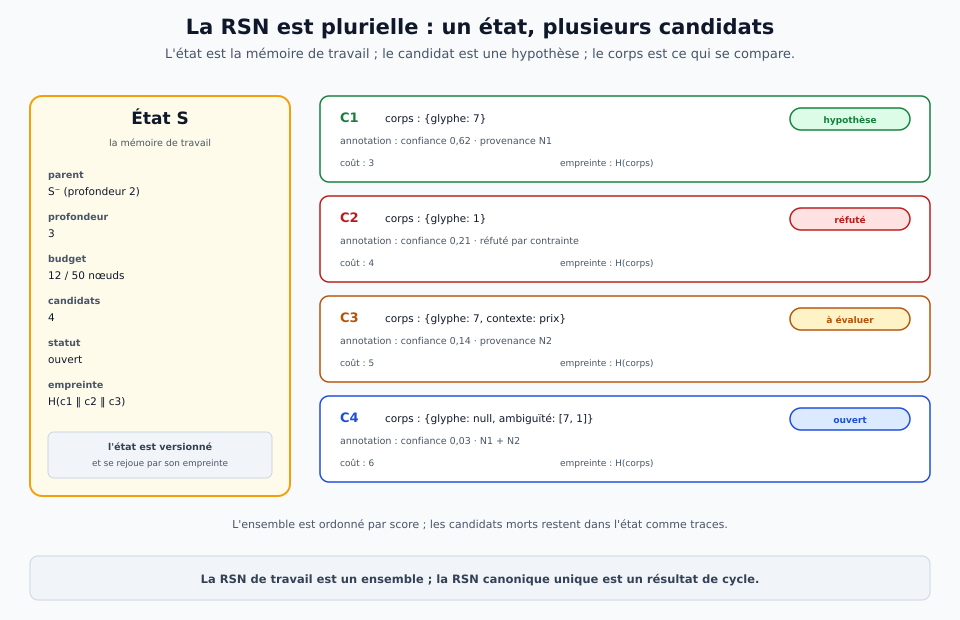
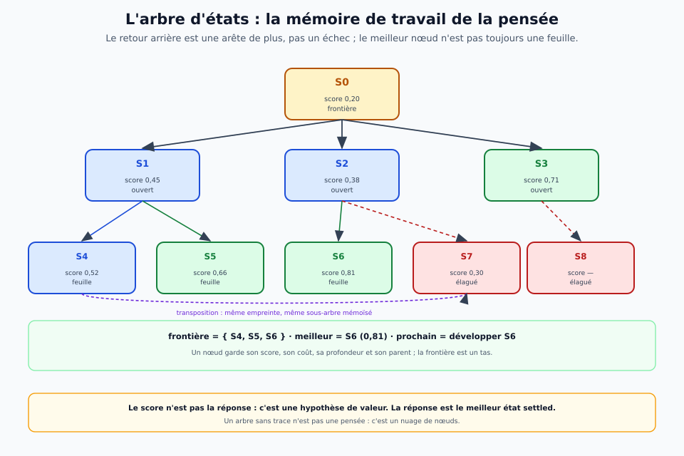
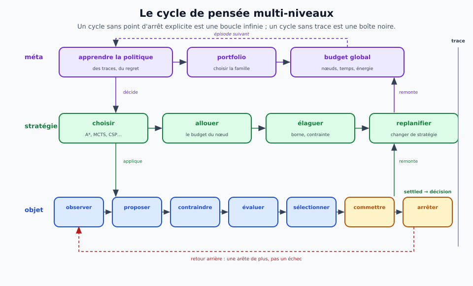
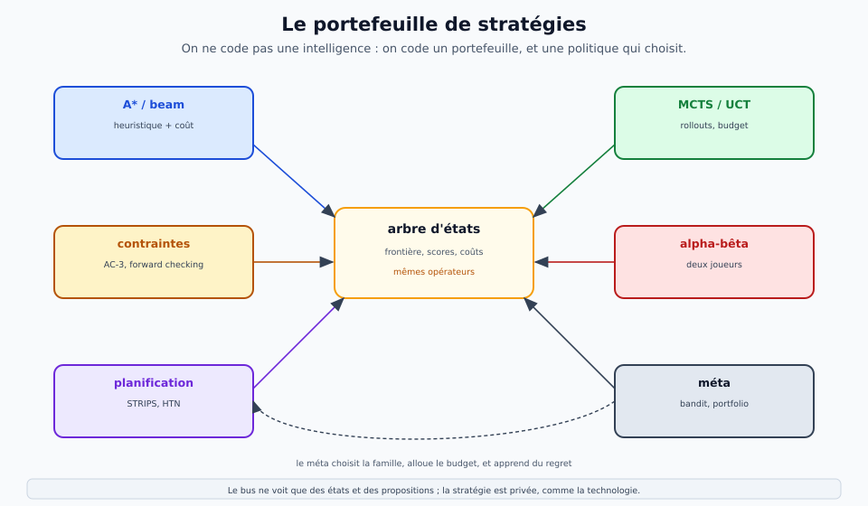
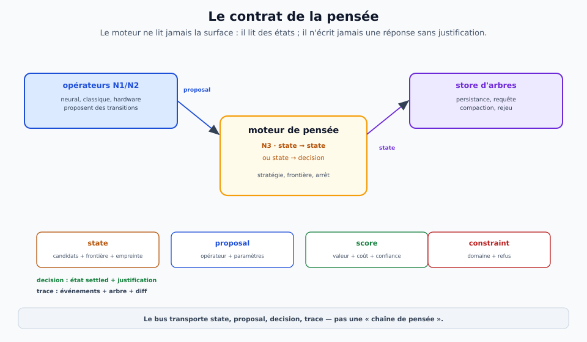
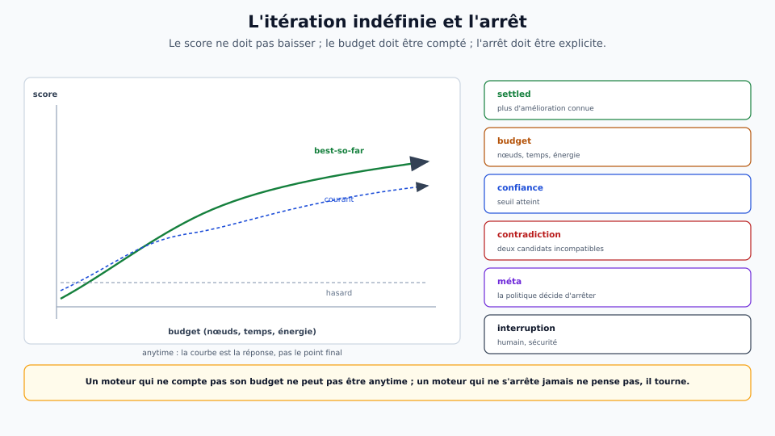
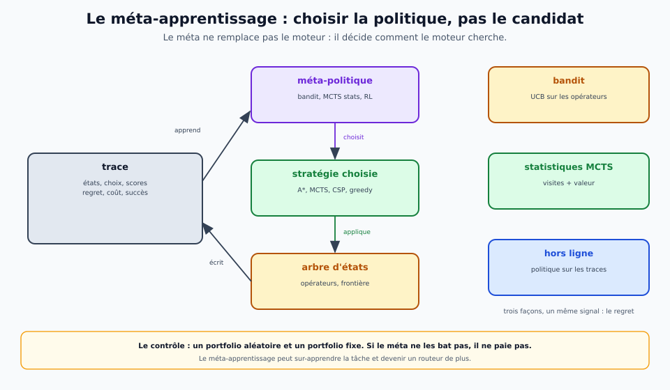
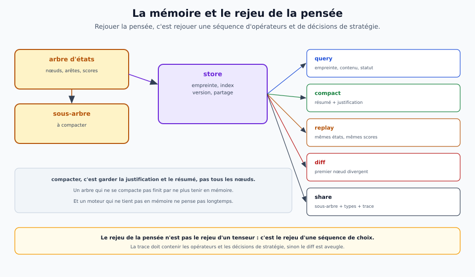
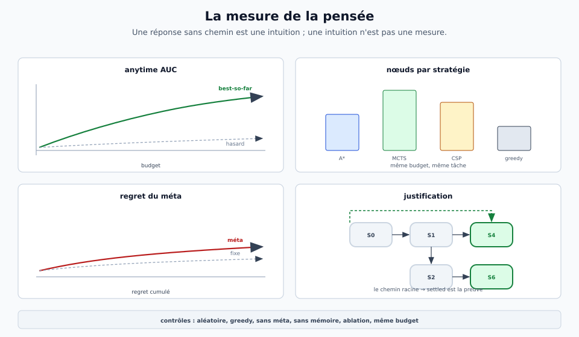

# La pensée itérative — la RSN plurielle, l'arbre d'états et les stratégies

> **Ce que ce document est.** La **théorie du moteur de pensée** de Drave. La RSN n'est pas un objet canonique
> unique : c'est une **représentation plurielle**, un **ensemble de candidats** qui sert de **mémoire de travail**
> à des **cycles de pensée** multi-niveaux. Penser, c'est **chercher** dans un **arbre d'états**, avec un
> **portefeuille de stratégies** d'IA classique et des **opérateurs** neuronaux ou classiques. Le bus ne transporte
> pas des réponses : il transporte des **états** et des **propositions** typés, tracés et rejouables.
> Les **chiffres** sont dans [`reports/`](../../reports/) ; la **séparation à trois niveaux** dans
> [`modele-natif.md`](modele-natif.md) ; l'**implémentation** dans [`moteur-de-pensee.md`](../implantation/moteur-de-pensee.md).

> **Fiche concept — la RSN plurielle.**
> Un **état** est un ensemble de **candidats**. Chaque candidat a un **corps canonique**, une **annotation**
> (confiance, ambiguïté, provenance), un **statut** (hypothèse, retenu, réfuté, ouvert), un **coût** et un
> **score**. L'état a un **parent**, une **profondeur**, un **budget** et une **empreinte** (Merkle des candidats
> triés). La RSN canonique unique est le **résultat d'un cycle**, pas la représentation de travail.
> **Glossaire :** [RSN](glossaire/entrees/representation-semantique-neutre.md) · [couche / étage](glossaire/entrees/couche-etage.md) ·
> [rejeu](glossaire/entrees/rejeu.md)
> **Illustration :** 

## 1. Le diagnostic : la RSN unique était un résultat, pas une représentation

La version précédente de l'architecture a fait de la RSN un **quotient canonique** : un corps, une annotation,
une empreinte. C'est **juste pour un candidat** — et c'est **faux pour la pensée**. Un corps unique ne peut pas
porter ce que la pensée exige :

| ce que la pensée exige | ce qu'un corps unique fait |
|---|---|
| **l'ambiguïté** : plusieurs lectures concurrentes | il choisit, ou il met `null` |
| **l'incomplétude** : des champs inconnus, à remplir plus tard | il remplit, ou il échoue |
| **la contradiction** : deux hypothèses incompatibles | il en garde une, ou il plante |
| **le plan** : des futurs alternatifs, des branches | il n'a pas de futur |
| **la provenance** : pourquoi ce candidat, par quel chemin | il a un hash, pas une raison |
| **la révision** : un candidat réfuté, puis restauré | il n'a pas de statut |

**La correction** : la RSN de travail est un **ensemble de candidats** ; le corps canonique est **par candidat** ;
l'état est un **nœud d'arbre**. La RSN canonique unique est le **résultat d'un cycle**, pas la représentation.

**Ce qui ne change pas** : le quotient, l'empreinte, le miroir, la neutralité. Ils s'appliquent **à un candidat**.
Ce qui change, c'est que l'état n'est pas un candidat : c'est un **ensemble ordonné, versionné, hashé**, avec une
frontière et des statuts.

**Ce que ça change pour les trois niveaux** :

- **N1** ne produit pas « la » RSN : il produit des **candidats** (plusieurs lectures, plusieurs formats) ;
- **N2** ne transforme pas « la » RSN : il **filtre, contraint, enrichit** un **état** ;
- **N3** ne répond pas en un pas : il **cherche** dans l'arbre, avec des stratégies, et rend un état **settled**
  ou une **décision**.

## 2. La RSN plurielle

### Le candidat

Un **candidat** est un quotient local, avec un état de recherche :

```json
{
  "id": "c1",
  "corps": {"modalite": "vision", "glyphe": 7},
  "annotation": {"confiance_pm": 620, "format": "mnist", "langue": null, "source": "sha256:…"},
  "statut": "hypothese",
  "provenance": {"operateur": "N1.vision", "parent": "s0", "pas": 3},
  "cout": {"noeuds": 3, "ms": 12, "evenements": 1840},
  "score": 0.62
}
```

Le **corps** reste canonique : deux candidats qui disent la même chose ont le même `H(corps)`. L'**annotation**
reste hors de l'empreinte. Ce qui s'ajoute, c'est le **statut**, la **provenance**, le **coût** et le **score** —
c'est-à-dire la **traçabilité de la recherche**.

### L'état

Un **état** est un ensemble de candidats, plus les métadonnées de la recherche :

```json
{
  "id": "s3",
  "parent": "s1",
  "profondeur": 3,
  "budget": {"noeuds": 12, "max": 50},
  "statut": "ouvert",
  "candidats": ["c1", "c2", "c3", "c4"],
  "frontiere": ["s3", "s5", "s6"],
  "empreinte": "H(c1 ‖ c2 ‖ c3 ‖ c4)"
}
```

**Trois propriétés, et chacune est mesurable** :

1. **canonique** : l'empreinte de l'état est le hash des empreintes de ses candidats, **triées** ; deux états
   identiques ont la même empreinte, même si l'ordre d'insertion diffère ;
2. **versionné** : chaque état a un parent ; la chaîne des parents est la **justification** ;
3. **ouvert** : un état peut être `ouvert`, `settled`, `contradictoire` ou `épuisé` ; le statut est une donnée,
   pas une impression.


**Le quotient reste local.** Le quotient `S/~` décrit **un** candidat ; l'état est un **ensemble de quotients**,
pas le quotient d'un ensemble. C'est la distinction qui manquait : on ne compare pas des états par leur corps,
on les compare par leur **empreinte** et par leur **contenu** (les candidats, leurs statuts, leurs scores).

### Les statuts

| statut | sens | ce qu'il autorise |
|---|---|---|
| `hypothese` | candidat proposé, pas encore évalué | être développé, réfuté, promu |
| `retenu` | candidat qui passe les contraintes | être raffiné, comparé |
| `refute` | candidat contredit par une contrainte ou une preuve | rester dans l'état comme trace |
| `ambigu` | deux candidats non départageables | être tranché par un opérateur ou un budget |
| `ouvert` | ni retenu ni réfuté | attendre |
| `settled` | état stable, plus d'amélioration connue | être rendu comme réponse |

**Un candidat réfuté n'est pas supprimé.** Il reste dans l'état, avec sa raison ; c'est ce qui permet de
**rejouer** la recherche et d'expliquer pourquoi on ne l'a pas choisi.

## 3. L'arbre d'états

**Un nœud est un état.** Une **arête** est l'application d'un **opérateur** (un bloc N1, N2 ou N3, neuronal ou
classique). La **frontière** est l'ensemble des nœuds ouverts. Le **score** est une hypothèse de valeur, pas la
vérité. Le **coût** est mesuré. La **profondeur** est le nombre d'opérateurs depuis la racine.



**Quatre mécanismes, et ils sont tous dans le format** :

1. **transposition** : deux états de même empreinte sont le même nœud ; on mémoïse le sous-arbre, et l'arbre
   devient un **DAG** ;
2. **élagage** : un nœud peut être coupé par une contrainte, un budget, une borne ; il reste dans la trace ;
3. **frontière** : une file de priorité (tas) des nœuds ouverts, ordonnée par score, coût ou une politique ;
4. **justification** : le chemin racine → nœud est la **preuve** de l'état ; il se rejoue.

**Le retour arrière n'est pas un échec** : c'est une arête de plus. Un moteur qui ne sait pas revenir sur un
choix ne pense pas ; il exécute un plan.

**La persistance** : l'arbre est la **mémoire épisodique** de la pensée. Il se stocke, se requête, s'élague, se
compacte ; il se rejoue par l'empreinte de ses nœuds. Un arbre sans trace n'est pas une pensée : c'est un nuage
de nœuds.

## 4. Le cycle de pensée multi-niveaux

Un cycle n'est pas une passe : c'est une **boucle** avec un point d'arrêt explicite.

**Les sept gestes** :

1. **observer** : N1 transforme une surface en candidats (plusieurs lectures) ;
2. **proposer** : N2/N3 génèrent des transitions (raffiner, contraindre, planifier) ;
3. **contraindre** : les contraintes éliminent ou marquent des candidats ;
4. **évaluer** : un score, une preuve, une simulation ;
5. **sélectionner** : une stratégie choisit le prochain nœud/opérateur ;
6. **commettre ou revenir** : on développe, on élague, on backtracke ;
7. **arrêter** : settled, budget, contradiction, méta-décision.

**Trois niveaux de boucle** :

| niveau | ce qu'il choisit | exemple |
|---|---|---|
| **objet** | le prochain candidat/opérateur | raffiner le glyphe 7 |
| **stratégie** | la stratégie de recherche | passer de greedy à MCTS |
| **méta** | la politique de sélection des stratégies | apprendre que MCTS paie sur ce jeu |

**Le cycle est indenté, pas plat** : le niveau stratégie peut suspendre le niveau objet, changer de stratégie,
puis reprendre. La trace garde les deux.



**La règle** : un cycle sans **point d'arrêt explicite** est une boucle infinie ; un cycle sans **trace** est une
boîte noire. Les deux sont des bugs, pas des fonctionnalités.

## 5. Le portefeuille de stratégies

Une stratégie n'est pas un algorithme codé en dur : c'est une **politique de choix** sur l'arbre. Le moteur
embarque un **portefeuille**, et le méta-niveau choisit.



| famille | stratégies | ce qu'elles demandent | quand |
|---|---|---|---|
| **non informée** | BFS, DFS, IDDFS | une frontière, un coût | arbre petit, pas d'heuristique |
| **informée** | A*, IDA*, best-first, beam | une heuristique, un coût | heuristique disponible |
| **adversariale** | minimax, alpha-bêta | une alternance, une évaluation | deux joueurs |
| **stochastique** | MCTS/UCT, rollouts | un simulateur, un budget | grand arbre, incertitude |
| **contraintes** | AC-3, forward checking, backtracking | des domaines, des contraintes | CSP |
| **SAT/SMT** | DPLL, CDCL, théories | des clauses, un modèle | preuve, cohérence |
| **planification** | STRIPS/PDDL, HTN, means-ends | des opérateurs, des préconditions | plans |
| **probabiliste** | belief propagation, particle filter | des croyances, des observations | incertitude |
| **locale** | hill climbing, recuit, génétique | un voisinage, un score | optimisation |
| **cas-based** | analogie, réutilisation | des cas, une similarité | expérience |
| **méta** | bandit, portfolio, RL | un historique, une récompense | choisir |

**Le point** : ces stratégies ne sont pas des blocs neufs ; ce sont des **politiques** qui appellent les mêmes
**opérateurs** sur le même **arbre**, avec les mêmes **types**. Le bus ne voit que des états et des propositions.

**Le portefeuille est un bloc N3.** Il a la signature `state → stratégie` (ou `state → décision`), il est tracé,
et il peut être classique (une règle) ou appris (un bandit). La stratégie choisie est un **paramètre** de la
trace, pas un nouveau type de données.

## 6. Le contrat de la pensée

| type | contenu | producteur | consommateur |
|---|---|---|---|
| `state` | candidats + frontière + parent + empreinte | N1/N2/N3 | N2/N3 |
| `proposal` | transition candidate (opérateur, paramètres) | N3 | N3 |
| `score` | valeur, coût, confiance | N3 / classique | stratégie |
| `constraint` | domaine, clause, refus | N2 / classique | N2/N3 |
| `decision` | état `settled` + justification | N3 | N1/N3 |
| `trace` | événements, arbre, diff | tous | rejeu |



**Les six invariants** :

1. tout état a un **parent** (sauf la racine) et une **empreinte** ;
2. tout candidat a une **provenance** et un **statut** ;
3. toute transition est **tracée** (opérateur, entrée, sortie, coût) ;
4. tout score est une **hypothèse**, pas une vérité ;
5. tout arrêt est **explicite** (statut, budget, contradiction, méta) ;
6. tout état `settled` a une **justification** (le chemin racine → état).

**Le moteur** est un bloc N3 `state → state` ou `state → decision`. Il peut appeler des opérateurs N1/N2/N3 ;
il ne les remplace pas. Il ne lit **jamais** la surface : il lit des états.

**Le store** est un bloc `state ↔ store` : persistance, requête, compaction, rejeu. Il peut être local, distribué,
versionné. C'est un bloc comme un autre : contrat, coût, trace.

**Le bus** transporte des `state` et des `proposal`, pas des « chaînes de pensée ». Une chaîne de pensée est une
**vue** sur l'arbre, pas un type de plus.

## 7. L'itération indéfinie et l'arrêt

**Anytime** : à tout moment, le moteur a un **meilleur état courant** ; il peut s'arrêter et le rendre. La
qualité est une **courbe**, pas un point.

**Le score ne doit pas baisser** : si la stratégie est anytime, le meilleur score est non décroissant ; sinon,
on garde le **best-so-far** et on le trace. Un moteur qui perd son meilleur état en cours de route ne pense pas :
il repart.



| critère d'arrêt | quand | ce qui est tracé |
|---|---|---|
| **settled** | plus d'amélioration connue | le statut, la justification |
| **budget** | nœuds, temps, énergie | le budget consommé |
| **confiance** | seuil atteint | la confiance, l'incertitude |
| **contradiction** | deux candidats incompatibles | la contradiction, les deux branches |
| **méta** | la politique décide d'arrêter | la décision, le regret |
| **interruption** | humain, sécurité | l'état, le best-so-far |

**Le budget** : chaque opérateur a un coût mesuré ; le scheduler alloue ; le store compte. Un moteur qui ne
compte pas son budget ne peut pas être anytime.

**Le piège** : l'itération indéfinie n'est pas l'absence d'arrêt. Un moteur qui ne s'arrête jamais ne pense pas ;
il tourne. L'arrêt est une **décision** de plus, tracée.

## 8. Le méta-apprentissage

Le méta-niveau ne choisit pas un candidat : il choisit une **politique**. Trois façons, et elles se composent :

| mode | ce qu'il apprend | signal | exemple |
|---|---|---|---|
| **bandit** | quelle stratégie/opérateur paie | récompense = score / coût | UCB sur les opérateurs |
| **statistiques MCTS** | quelles branches méritent d'être développées | visites + valeur | UCT sur l'arbre |
| **hors ligne** | une politique sur les traces | regret, succès | apprentissage supervisé ou RL |



**Le signal** : le **regret** (ce qu'on aurait gagné avec la meilleure stratégie), le **coût** (nœuds, temps),
le **succès** (`settled`, preuve). Le méta-apprentissage est un bloc N3 qui lit la trace et écrit une politique.

**La difficulté** : le méta-apprentissage peut **sur-apprendre la tâche** et devenir un routeur de plus. Le
contrôle est un **portfolio aléatoire** et un **portfolio fixe** ; si le méta ne bat pas le fixe, il ne paie pas.

**Le lien avec le bus** : la politique est un bloc ; elle a un contrat, un coût, une trace. Elle ne change pas
les types ; elle change l'**ordre des choix**.

## 9. La mémoire et le rejeu

L'arbre est la **mémoire épisodique** de la pensée. Il ne suffit pas de le garder : il faut pouvoir le
**requêter**, le **compacter**, le **rejouer** et le **partager**.



| opération | ce qu'elle fait | invariant |
|---|---|---|
| **store** | persiste les nœuds et les arêtes | empreinte stable |
| **query** | retrouve un état par empreinte, contenu, statut | index canonique |
| **compact** | remplace un sous-arbre par son résumé | justification conservée |
| **replay** | rejoue la recherche depuis la racine | mêmes états, mêmes scores |
| **diff** | compare deux recherches | premier nœud divergent |
| **share** | envoie un sous-arbre à un autre nœud | types et traces |

**Le rejeu de la pensée** n'est pas le rejeu d'un tenseur : c'est le rejeu d'une **séquence d'opérateurs** et de
**décisions de stratégie**. La trace doit contenir les deux, sinon le diff est aveugle.

**Le compactage** est le seul moyen de tenir indéfiniment : on garde la **justification** et le **résumé**, pas
tous les nœuds. Un arbre qui ne se compacte pas finit par ne plus tenir en mémoire — et un moteur qui ne tient
pas en mémoire ne pense pas longtemps.

## 10. La mesure de la pensée

On ne mesure pas la pensée par la seule réponse finale. On mesure la **recherche** :



| métrique | ce qu'elle dit | contrôle |
|---|---|---|
| **anytime AUC** | la qualité intégrée sur le budget | recherche aléatoire |
| **taux de solution** | combien de problèmes atteignent `settled` | greedy |
| **gap** | distance à l'optimum connu | oracle / exhaustive |
| **nœuds** | le coût de la solution | même budget |
| **regret de stratégie** | ce qu'on perd en choisissant | portfolio fixe |
| **justification** | le chemin est-il valide ? | vérificateur indépendant |
| **rejeu** | la recherche est-elle reproductible ? | deux runs |
| **invariance** | même sens, même décision | permutations de surface |

**Les contrôles** : recherche aléatoire, greedy, sans méta, sans mémoire, ablation d'une stratégie, budget
constant. Un résultat qui ne bat pas le greedy au même budget n'est pas un résultat de pensée.

**Le miroir de la pensée** : la sortie doit pouvoir être **justifiée** par un chemin, et le chemin doit pouvoir
être **rejoué**. Une réponse sans chemin est une intuition ; une intuition n'est pas une mesure.

## 11. Les dix tours

| tour | question | artefact |
|---:|---|---|
| **1** | la RSN unique était-elle la bonne représentation ? | le diagnostic, la RSN plurielle |
| **2** | comment ordonner les candidats ? | l'arbre d'états |
| **3** | comment penser en boucle ? | le cycle multi-niveaux |
| **4** | avec quelles stratégies ? | le portefeuille |
| **5** | quel contrat ? | les types et le moteur N3 |
| **6** | quand s'arrêter ? | l'anytime et les critères |
| **7** | comment choisir la stratégie ? | le méta-apprentissage |
| **8** | comment garder et rejouer ? | la mémoire et le rejeu |
| **9** | comment mesurer ? | les métriques et les contrôles |
| **10** | que change-t-on aux documents ? | la révision, l'index, les portes |

**Ce qui ne changera pas** : la RSN est un **type**, pas un bloc ; le niveau est un **contrat** ; le bus ne voit
pas des neurones, il voit des types ; la pensée est une **recherche tracée**, pas un forward pass.
