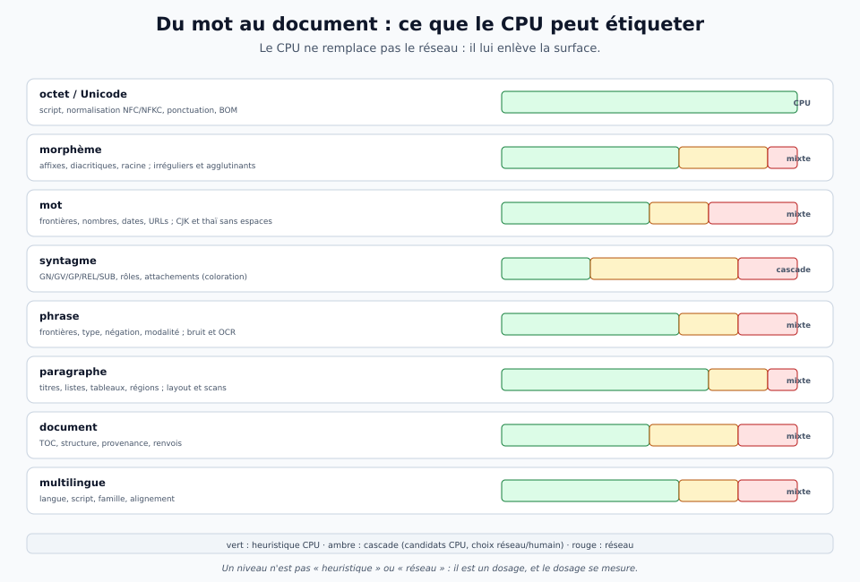
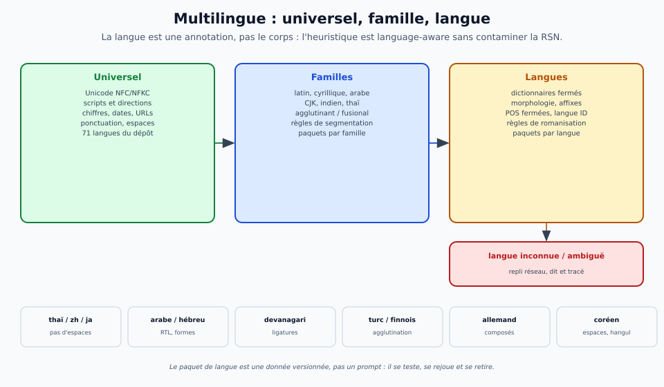
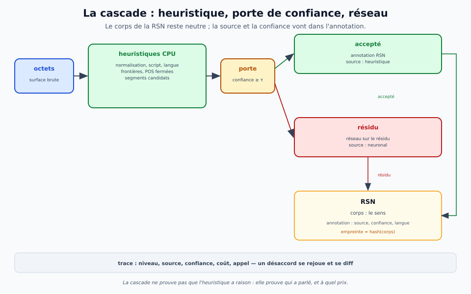
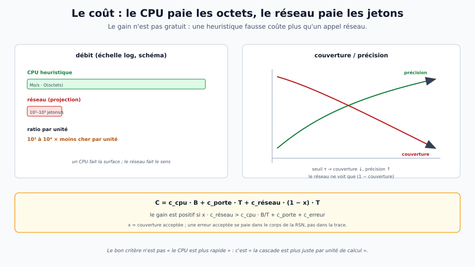

# La couche heuristique — ce que le CPU étiquette avant le réseau

> **Rôle.** Cette note analyse une **couche linguistique de prétraitement par heuristiques** : ce
> qu'elle peut étiqueter, du mot au document, en plusieurs langues, et ce qu'elle **retire au
> réseau de neurones**. Elle ne remplace pas une mesure : elle fixe les niveaux, la cascade, le
> coût et le protocole. Les chiffres cités viennent des fiches ; les **projections** sont dites
> comme telles.
>
> **Ce qu'elle n'est pas.** Un plaidoyer « le CPU remplace le réseau ». Le CPU étiquette la
> **surface** ; le réseau tranche l'**ambiguïté** et le **sens**. La cascade se juge sur sa
> **précision par unité de calcul**, pas sur son débit brut.

## 1. La thèse en trois idées

1. **Le réseau paie la surface.** Une part du travail d'un modèle de langue n'est pas du sens :
   c'est de la normalisation Unicode, de la détection de script et de langue, des frontières de
   mots et de phrases, des classes fermées, des régions de document. Ces opérations sont
   **locales, déterministes et bon marché** : un CPU les fait à des ordres de grandeur qui n'ont
   rien à voir avec un passage dans un transformer.
2. **L'heuristique ne décide pas l'ambigu.** Elle **énumère le plausible** et **étiquette le sûr**
   avec une confiance et une source. Le réseau (ou l'humain) ne reçoit que le **résidu** : les cas
   où l'heuristique hésite. C'est la différence entre un **étiqueteur** et un **générateur de
   candidats** — et c'est exactement le contrat de la coloration.
3. **Le gain se mesure, il ne se proclame pas.** La cascade paie si la **couverture × la
   précision** des étiquettes acceptées dépasse le coût de la **porte** et le coût des
   **erreurs**. Une heuristique rapide mais fausse coûte plus qu'un appel réseau : c'est le
   contrôle négatif obligatoire.

Le schéma ci-dessous donne la carte des niveaux : chaque niveau n'est pas « heuristique » ou
« réseau », il est un **dosage**, et ce dosage se mesure.

## 2. Les niveaux : ce que le CPU peut étiqueter

| niveau | ce qu'on étiquette | heuristique CPU | résidu réseau | ce que ça change |
|---|---|---|---|---|
| **octet / Unicode** | script, normalisation NFC/NFKC, ponctuation, BOM | très forte : tables Unicode, automates | nul | le réseau ne voit jamais deux fois le même texte sous deux formes |
| **morphème** | affixes, diacritiques, racine, lemmes réguliers | forte sur le régulier ; faible sur l'irrégulier et l'agglutinant | irréguliers, allomorphes, langues agglutinantes | moins de formes à apprendre, un lemme typé |
| **mot** | frontières, nombres, dates, URLs, emoji | forte sur les scripts à espaces ; faible sur CJK, thaï, khmer | segmentation statistique ou neuronale | des frontières **explicites** au lieu d'un BPE implicite |
| **syntagme** | GN, GV, GP, REL, SUB ; rôles ; attachements | **candidats** : classes fermées, prépositions, attachements plausibles | choix de l'attachement, rôle final | le réseau ne fait que **ranker** un petit ensemble |
| **phrase** | frontières, type, négation, modalité | forte sur la ponctuation et les abréviations | bruit OCR, phrases sans ponctuation, portée | des unités de sens stables pour la RSN |
| **paragraphe** | titres, listes, tableaux, régions, code | forte : parseurs, layout, règles typographiques | scans, mises en page inédites | le document devient un **graphe de régions** |
| **document** | TOC, structure, provenance, renvois | forte : parseurs PDF/HTML/DOCX/Markdown | compréhension, résumé, questions | la lecture cesse d'être un flux d'octets |
| **multilingue** | langue, script, famille, alignement | forte sur texte long ; faible sur texte court et langues proches | langues proches, codes mêlés, translittération | la langue devient une **annotation**, pas un prompt |

### 2.1 Octet et morphème : l'invariant

Le niveau octet est le plus rentable et le moins discuté. Unicode, les scripts, les directions
d'écriture, les chiffres, les dates et les URLs sont des **invariants** : la même page doit
produire les mêmes étiquettes, quel que soit le normaliseur du jour. Un CPU le fait en O(octets),
sans contexte, sans paramètres. C'est déjà ce que fait une partie de la chaîne R4.4 : le
prétraitement d'image (éclairage, rotation, colonnes) est un **bloc classique** qui a fait passer
la photo de **55,9 % à 6,7 %** de WER et les colonnes de **89,4 % à 0,5 %** ; le réseau n'y est
pour rien. Le même raisonnement vaut pour le texte : la surface se traite en surface.

Le morphème est plus contrasté. Les affixes réguliers, les diacritiques, les pluriels, les
dérivations productives se prêtent à des règles ; les irréguliers, les allomorphes, les langues
agglutinantes (turc, finnois, hongrois) ou à racines non concaténatives (arabe, hébreu) demandent
un lexique et, souvent, un modèle. La règle honnête : **l'heuristique donne un lemme candidat avec
une confiance ; le réseau corrige les cas hors règles**. Le lemme n'entre dans le corps de la RSN
que s'il est validé.

### 2.2 Mot : frontières explicites contre BPE implicite

Drave travaille en **octets**, pas en BPE : c'est une décision mesurée (R13, la tokenisation
octets gagne). Mais travailler en octets ne veut pas dire **ignorer les mots**. Une couche
heuristique peut poser des frontières explicites — espaces, ponctuation, chiffres, URLs, emoji —
et les publier comme **annotation** : le modèle d'octets garde sa finesse, et le reste de la
chaîne dispose d'unités lisibles. Sur les scripts à espaces (latin, cyrillique, grec, arabe,
hébreu, devanagari), la frontière est quasi gratuite ; sur les scripts sans espaces (chinois,
japonais, thaï, khmer), elle demande un dictionnaire ou un modèle. La même couche doit donc dire
**ce qu'elle ne sait pas** : « segmentation non fiable » est une étiquette, pas un silence.

### 2.3 Syntagme : la coloration comme générateur de candidats

C'est le niveau où l'analyse est la plus intéressante — et le plus facile à surestimer. Le
générateur de la coloration (`tools/structures/generateur.py`, session S) ne produit pas **un**
étiquetage : il produit **plusieurs structures candidates**. Il reconnaît les classes fermées
(déterminants, prépositions, relatifs, conjonctions, pronoms, auxiliaires), segmente en GN, GV,
GP, REL, SUB, devine les rôles par la préposition (`dans` → lieu, `pour` → but, `avec` → moyen),
puis **varie l'attachement** du segment ambigu : le GN le plus proche ou le GV le plus proche.
Sur « Le chat de la voisine qui dort sur le toit se réveille. », il rend deux candidats — « qui
dort » sur le chat, ou sur la voisine — et un humain (ou un réseau) tranche.

C'est le bon contrat pour une heuristique : **énumérer le plausible, ne pas décider l'ambigu**.
Le CPU fait la segmentation et les classes fermées ; le réseau ou l'humain fait le choix. La
coloration n'est donc pas un étiqueteur concurrent du réseau : c'est une **pré-annotation
vérifiable** qui réduit l'espace de sortie du réseau à un petit ensemble de candidats. Le jour où
le réseau doit choisir entre deux attachements, il ne génère pas la structure : il **classe**.

Le prototype est français, petit (7 phrases, 11 tests), et assumé comme tel. Ses limites sont
celles de toute heuristique lexicale : les ensembles de mots sont finis, les attachements sont
des heuristiques de proximité, et la précision à l'échelle n'est pas mesurée. C'est pourquoi la
coloration est un **banc**, pas une revendication.

### 2.4 Phrase, paragraphe, document : la structure avant le sens

La phrase est le niveau où la ponctuation offre un signal fort, et où le bruit (OCR, réseaux
sociaux, code) le détruit. Une heuristique de frontières doit être **conservatrice** : couper
trop est réparable, couper au milieu d'une citation ne l'est pas. Le paragraphe et le document
sont les parents pauvres de Drave : la lecture rapide le dit, le niveau **L2 — document** est
absent, alors qu'il est fait de **régions typées** (titre, section, paragraphe, tableau, code,
figure) et de provenance — exactement ce qu'un parseur CPU peut produire sans entraînement. Le
bloc `document` est donc le premier bénéfice **structurel** de la couche heuristique : il donne
au réseau des unités de sens et au lecteur un graphe à parcourir, au lieu d'un flux de 129
octets.

### 2.5 Multilingue : universel, famille, langue

La couche heuristique ne peut pas être un seul jeu de règles françaises traduit en 71 langues.
Elle a trois étages :

- **universel** : Unicode, scripts, directions, chiffres, dates, URLs, ponctuation — indépendant
  de la langue ;
- **famille** : latin, cyrillique, arabe, CJK, indien, agglutinant vs fusional — les règles de
  segmentation et de morphologie qui se partagent ;
- **langue** : dictionnaires de classes fermées, morphologie, romanisation, exceptions — un
  **paquet versionné** par langue.

Le dépôt a déjà les deux bouts : **71 langues** et **449/449** au banc des maîtres pour le
codec, **15 champs / 502 classes** pour les universaux, et un `z` de 128 dimensions mesuré sur
10 langues. Mais la coloration actuelle est **française** : ses ensembles `DET`, `PREP`,
`RELATIFS` sont des listes françaises. Passer à 71 langues, ce n'est pas traduire ces listes,
c'est **découper** la couche en universel / famille / langue et mesurer ce que chaque étage
couvre. Le risque est réel : 71 paquets de règles sont une maintenance ; la réponse n'est pas
« tout au réseau », c'est **le paquet le plus petit possible** et un **repli réseau** explicite
pour la langue inconnue.

## 3. La cascade et la RSN : où vont les étiquettes

La cascade est simple à décrire et difficile à calibrer :

1. la **surface** entre (octets) ;
2. les **heuristiques CPU** produisent des étiquettes et des candidats, avec une **confiance** ;
3. une **porte** accepte ce qui est sûr et envoie le reste au réseau ;
4. les deux chemins écrivent dans la **RSN** : le **corps** (le sens) et l'**annotation**
   (source, confiance, niveau, langue, script, candidats) ;
5. la **trace** enregistre qui a décidé, à quel coût, et ce qui a été appelé.

Le point architectural est que **rien de tout cela n'entre dans le corps par la surface**. La RSN
a un corps neutre et une annotation extérieure à l'empreinte ; la langue, le script, la source et
la confiance sont des **annotations**. Une heuristique peut donc être **language-aware** sans
contaminer le sens : elle étiquette `langue = fr`, `script = latin`, `source = heuristique`, et
le corps reste le même. C'est le théorème de non-fuite de la surface, appliqué à la couche
linguistique : le `code` interne ne traverse pas ; l'annotation, elle, peut porter la surface.

La cascade a deux qualités que le réseau seul n'a pas :

- **le déterminisme** : mêmes octets, mêmes étiquettes, même trace ; la couche est versionnée,
  rejouable, et une règle retirée se voit dans le diff ;
- **l'auditabilité** : un désaccord se lit — l'heuristique a accepté, le réseau a corrigé, ou
  l'inverse. Le coût de chaque chemin est dans la trace, pas dans une moyenne.

Elle a un défaut qu'il faut nommer : **la porte est elle-même un classifieur**. Mal calibrée, elle
envoie les cas faciles au réseau (coût) ou les cas ambigus à l'heuristique (erreur). La porte doit
être mesurée comme un modèle : couverture, précision, calibration, et un **contrôle aléatoire**
qui accepte la même proportion de cas.

## 4. Le coût : ce que « le CPU est plus rapide » veut dire

Le débit n'est pas la bonne métrique : un CPU qui étiquette des millions d'octets par seconde
mais se trompe une fois sur trois ne fait pas gagner un réseau. La bonne métrique est le **coût
par unité de calcul juste**. Le modèle de coût est simple :

**C = c_cpu · B + c_porte · T + c_réseau · (1 − x) · T**

où \(B\) est le nombre d'octets, \(T\) le nombre de jetons, \(x\) la couverture acceptée par la
porte. Le gain par rapport au réseau seul est positif si :

**x · c_réseau > c_cpu · B/T + c_porte + c_erreur**

Autrement dit : **il ne suffit pas que le CPU soit rapide ; il faut que la couverture soit
grande, la précision bonne, et la porte bon marché**. C'est pourquoi les niveaux faciles
(Unicode, script, langue longue, classes fermées, frontières) sont les premiers candidats, et
les niveaux ambigus (rôles, attachements, coréférence) les derniers.

Les ordres de grandeur sont volontairement donnés comme **projection** : un CPU traite des
Mo/s en O(octets) ; un réseau traite des dizaines à des milliers de jetons/s selon le matériel.
Le rapport par unité est de plusieurs ordres de grandeur — mais il ne devient un **gain** que
si l'étiquette est juste. Le contrôle négatif est donc obligatoire : une heuristique **rapide et
fausse** doit être rejetée par la porte, sinon la cascade est plus chère qu'un appel réseau.

## 5. Les bénéfices, nommés

### 5.1 Coût et latence

Le CPU paie les octets, le réseau paie les jetons. Une couche heuristique qui traite 90 % de la
surface en O(octets) enlève au réseau ces 90 % de jetons **si** la porte les accepte. Le gain
n'est pas linéaire : il dépend de la couverture et de la précision. C'est le premier chiffre à
mesurer, et il se mesure **par niveau**, pas en moyenne.

### 5.2 Contexte du réseau

Le contexte natif de `drave-n0` est de **129 octets** (PPL 2,6998) ; à 2 000 octets, la PPL
explose à **54,04**. Une page est 23× trop longue. La couche heuristique ne résout pas le
problème du contexte long, mais elle **réduit la matière** : le réseau peut recevoir des unités
typées (phrases, régions, segments) au lieu d'un flux d'octets, et le document peut être parcouru
par régions. C'est un bénéfice **structurel**, pas une augmentation de la fenêtre.

### 5.3 Typage et séparation des préoccupations

Le réseau reçoit `langue`, `script`, `segments`, `candidats` comme **annotation**, et le corps
RSN reste le lieu du sens. Le réseau peut donc se concentrer sur ce qu'il fait bien : choisir,
comparer, inférer, désambiguïser. Le CPU fait ce qu'il fait mieux : normaliser, segmenter,
énumérer. C'est la thèse de la vision — « blocs neuronaux là où l'intuition est un avantage,
blocs classiques là où l'informatique classique est plus fiable ».

### 5.4 Déterminisme, rejeu, audit

Une règle versionnée, une trace, un diff : la couche heuristique est **rejouable** au sens DRVF.
Si une étiquette change, on sait quelle règle a changé et quel corpus a été affecté. Un réseau
seul ne donne pas cette prise : la même entrée peut produire une sortie différente, et le
pourquoi n'est pas dans la trace.

### 5.5 Document et lecture

Le niveau **L2 — document** manque à Drave. Un bloc CPU `document` — régions, titres, tableaux,
provenance — est un **prérequis** de la lecture rapide : sans lui, il n'y a rien à survoler, rien
à sauter, rien à citer. C'est un bénéfice qui ne demande **aucun entraînement**, seulement des
parseurs et un modèle de régions.

### 5.6 Souveraineté et offline

Un CPU, pas de GPU, pas d'API : la couche heuristique tourne sur la machine, dans les 71 langues
du corpus, sans envoyer le texte à un service. Ce n'est pas un argument de performance, c'est un
argument de **déploiement** : le prétraitement peut vivre à côté du corpus, dans le même bloc
DRVM, et se substituer sans changer le contrat.

## 6. Les coûts et les risques

- **Propagation d'erreur** : une frontière fausse change la phrase, donc le sens ; une langue
  mal détectée applique le mauvais paquet. La confiance et le repli ne sont pas optionnels.
- **Couverture** : les heuristiques sont excellentes sur les cas faciles et mauvaises sur les
  cas intéressants. Un taux de couverture élevé sur un corpus propre ne dit rien d'un corpus
  bruité.
- **Maintenance** : 71 paquets de règles sont un fardeau ; chaque paquet doit avoir ses tests,
  sa version, son propriétaire. La réponse est de **maximiser l'universel** et de **minimiser le
  paquet**.
- **Biais de langue** : les règles françaises ne sont pas un universal ; les catégories
  (GN, GV, GP, REL) sont utiles mais ne couvrent pas toutes les familles. Le paquet doit être
  une **donnée**, pas un prompt.
- **La porte** : mal calibrée, elle coûte plus qu'elle ne rapporte. Elle doit être mesurée avec
  un contrôle aléatoire et un contrôle « heuristique corrompue ».
- **La dépendance** : un réseau entraîné avec la couche peut s'y appuyer et échouer quand elle
  manque. Il faut tester le réseau **avec et sans** la couche, et garder la couche
  **retirable**.
- **Le confond** : si l'heuristique et le réseau sont évalués sur le même corpus, on ne sait pas
  qui a gagné. Il faut des corpus tenus à l'écart et des ablations.
- **La fuite** : une étiquette de surface qui entre dans le corps de la RSN est une
  contamination. La règle est stricte : la surface va dans l'**annotation**, jamais dans le
  corps.

## 7. Le protocole de mesure

Une analyse sans protocole est une opinion. Le protocole proposé :

| ce qu'on mesure | comment | contrôle |
|---|---|---|
| **couverture** | fraction des unités acceptées par la porte à seuil τ | seuil aléatoire de même couverture |
| **précision** | accord avec un gold par niveau et par langue | heuristique corrompue ; langue tenue à l'écart |
| **rappel de l'ensemble** | la bonne étiquette est-elle dans les candidats ? | candidats aléatoires de même taille |
| **réduction d'appels réseau** | fraction des unités non envoyées au réseau | réseau seul, même corpus |
| **qualité de bout en bout** | réponse / extraction / parité | réseau seul ; heuristique seule |
| **coût** | secondes CPU, secondes réseau, octets, jetons | mesure des deux chemins |
| **trace** | taille, source, confiance, rejeu | rejeu identique |

Les corpus :

- **71 langues** du banc des maîtres (`rapport-langues-maitres.md`) pour la langue, le script,
  les frontières et la couverture des paquets ;
- **UDHR** et les textes du dépôt pour les niveaux phrase/paragraphe ;
- **les 7 phrases de la coloration** (`tools/structures/`) pour le niveau syntagme — un pilote,
  pas une généralité ;
- **les scans R4.4** pour le bruit et le document ;
- **la typoglycémie** pour la robustesse de la surface : le modèle lit les lettres, pas les
  formes (×17,8 au mélange intérieur, ×62,7 tout mélangé) ; une couche de formes (E2) est un
  levier, pas une conclusion.

Le protocole est **pré-enregistré** : seuils, split, gold, avant de mesurer. Le test ne sert
jamais à régler la porte. Et le **contrôle négatif** est explicite : une heuristique rapide mais
fausse doit être **rejetée**, pas célébrée.

## 8. La décision : heuristique, cascade ou réseau

| niveau | heuristique | cascade | réseau / humain | raison |
|---|---|---|---|---|
| Unicode, script, normalisation | **oui** | — | — | invariant, O(octets) |
| langue (texte long) | **oui** | texte court | langues proches, codes mêlés | n-grammes suffisants |
| frontières de phrase | **oui** | bruit, OCR | ponctuation absente | signal fort, réparable |
| frontières de mot | scripts à espaces | CJK, thaï | segmentation statistique | dictionnaire vs modèle |
| classes fermées (DET, PREP, PRON) | **oui** | — | — | listes finies |
| POS ouvertes, lemme | dictionnaire | **oui** | irréguliers, agglutinants | ambiguïté locale |
| syntagmes, rôles, attachements | candidats | **oui** | choix final | énumérer, pas décider |
| document (régions, TOC, tables) | **oui** | scans | layout inédit | parseurs, pas d'entraînement |
| coréférence, discours, pragmatique | — | — | **oui** | global, sémantique |
| traduction, sens, inférence | — | — | **oui** | le cœur du réseau |

La règle tient en une phrase : **le CPU fait ce qui est invariant, local et énumérable ; le
réseau fait ce qui est ambigu, global et sémantique.**

## 9. Ce qui pourrait rendre cette analyse fausse

- la précision de l'heuristique sur les langues cibles est **sous la porte** ;
- la cascade est **plus chère** de bout en bout que le réseau seul (porte, erreurs, sérialisation) ;
- les 71 paquets sont **impossibles à maintenir** et l'universel ne couvre pas assez ;
- le réseau **déjà** traite la surface à coût négligeable, et la couche ne fait que déplacer le
  problème ;
- les étiquettes de surface **fuient** dans le corps de la RSN ;
- le corpus de mesure n'est pas représentatif (propre, français, court) ;
- la coloration **ne passe pas** du jouet à l'échelle : 7 phrases ne font pas un banc.

Chacune de ces objections a un test. C'est pour cela que la première expérience doit être
**petite, tenue à l'écart et négative** : langue + frontières sur les 71 langues, coloration sur
les 7 phrases, avec un contrôle aléatoire et une heuristique corrompue.

## 10. Conclusion

La couche heuristique n'est pas un cerveau : c'est un **débarras de surface**. Elle enlève au
réseau ce qui n'a pas besoin d'être appris — normalisation, scripts, frontières, classes fermées,
régions — et elle lui laisse ce qui demande du contexte : le choix, le sens, l'ambiguïté. Son
bénéfice ne se lit pas en Mo/s ; il se lit en **couverture × précision par unité de calcul**, et
il se prouve par une cascade mesurée, avec une porte calibrée et un contrôle négatif.

Le premier pas n'est pas un modèle : c'est un **bloc `lang`** (Unicode, script, langue,
frontières) et un **bloc `document`** (régions, provenance), tous deux CPU, tous deux annotés
dans la RSN. Le deuxième est la **coloration** — un générateur de candidats, pas un étiqueteur —
mesuré sur les 7 phrases, puis étendu par paquets de langue. Le réseau, lui, garde le sens. Et
la question qui tranche reste la même : **la cascade est-elle plus juste par unité de calcul que
le réseau seul ?** Tant qu'on ne l'a pas mesuré, la réponse est « peut-être » — pas « oui ».

## Sources

- [le banc des maîtres : 71 langues, 449/449](../../reports/rapport-langues-maitres.md) ;
- [les universaux : 15 champs, 502 classes](../../reports/rapport-universaux.md) ;
- [le `z` et le décodeur négatif](../../reports/rapport-semantique.md) ;
- [la typoglycémie : ×17,8 au mélange intérieur](../../reports/rapport-typoglycemie.md) ;
- [les scans R4.4 : photo 55,9 → 6,7 %, colonnes 89,4 → 0,5 %](../../reports/rapport-r44-scans.md) ;
- [la lecture rapide : 129 octets, L2 manquant](lecture-rapide.md) ;
- [les jeux symboliques : surface → RSN](jeux-symboliques.md) ;
- [le protocole sémantique](protocole-semantique.md) et [le modèle natif](modele-natif.md) ;
- [le banc de structures : générateur, coloration, 11 tests](../../tools/structures/README.md) et
  [`generateur.py`](../../tools/structures/generateur.py).
