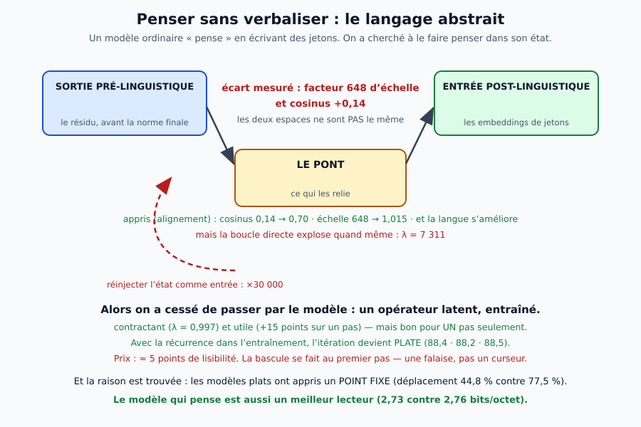
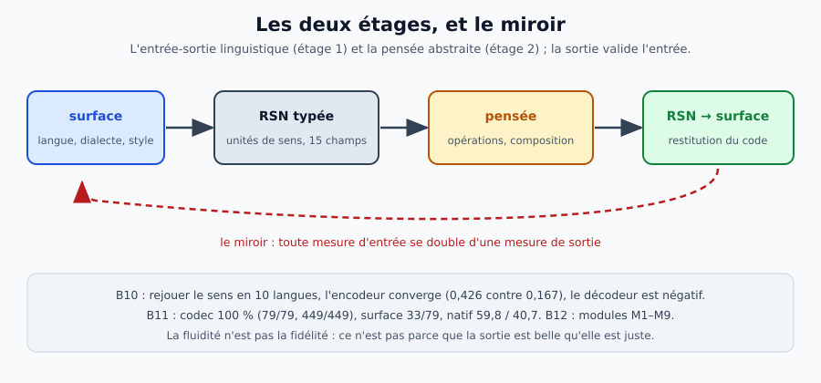

# 5. La pensée sans verbaliser — le travail de la nuit du 16 octobre

> **Périmètre** : ce chapitre relève du programme **intelligence** ; la vision est dans [`docs/theorie/vision.md`](../vision.md), la roadmap dans [`docs/pilotage/roadmap.md`](../../pilotage/roadmap.md) ; l'introduction dans [`index.md`](index.md).

> **Fiche concept — le pont.**
> Un **pont** est une petite carte **linéaire** entre les états de deux langues : il aligne la structure du
> raisonnement (1,00 / 0,91 / 0,68 / 0,52 / 0,46 pour 2 à 6 entités), pas les mots. Il doit rester linéaire ;
> un MLP sur-apprend.
> **Glossaire :** [pont](../glossaire/10-le-pont-linguistico-semantique-le-vocabu.md) · [état](../glossaire/02-modeles-et-architectures.md) · [sonde](../glossaire/07-mesure-qualite-et-methode-experimentale.md)
> **Illustration :** 

> **Fiche concept — le plan.**
> Le **plan** est l'état qui porterait la suite d'une série (la 5ᵉ phrase après les 4 premières). C'est le
> **contre-exemple** : ni les ponts, ni le bilinguisme, ni le contraste ne l'alignent ; il s'entraîne dans le
> modèle, et sa géométrie reste ancrée dans la langue.
> **Glossaire :** [plan](../glossaire/02-modeles-et-architectures.md) · [contraste](../glossaire/10-le-pont-linguistico-semantique-le-vocabu.md) · [contrôle négatif](../glossaire/07-mesure-qualite-et-methode-experimentale.md)
> **Illustration :** 

## En trois idées

1. **L'état porte le sens** : 16 jetons d'avance à **80,3 %**, quand le mot est à **118,4 %**.
2. **L'itération s'obtient et se paie** : plate, **+3,2** points à 2,43 M et **+2,4** à 9,57 M.
3. **La récurrence n'est pas qu'un coût** : **2,73** contre **2,76** bits/octet.

**Le contre-exemple** : le **plan** ne s'aligne pas — ni pont, ni bilinguisme, ni contraste. *Le détail des
mesures est dans la suite ; la carte du raisonnement est dans
[`rapport-carte-raisonnement-naturel.md`](../../../reports/rapport-carte-raisonnement-naturel.md).*

## La question, et pourquoi elle n'est pas abstraite

Un modèle de langue « réfléchit » en **écrivant** : chaque pas de pensée est un jeton, qu'il relit ensuite.
Un cerveau d'expert fait l'inverse — il pense **sans dialogue intérieur**. Peut-on obtenir la même chose
d'un modèle ?

C'est une question **exécutable** avec Drave, parce que le moteur sait déjà **écrire et relire un état** :
on peut faire évoluer la pensée **sans qu'aucun jeton ne soit émis**.

## Ce que la nuit a mesuré, dans l'ordre

| étape | le résultat | ce qui a été appris |
|---|---|---|
| **réinjecter l'état brut** | la prédiction détruit de 5 ordres de grandeur (×30 000) | et **normer n'y change rien** : ce n'est pas l'échelle |
| **apprendre un pont** | l'état mappé bat le mot (68,6 % contre 122,9 %) | la sortie prélinguistique **dit mieux** que le **jeton de sortie** |
| **mesurer l'écart** | facteur **648** d'échelle, cosinus **+0,14** | les deux espaces ne sont pas le même |
| **aligner** | cosinus **0,70**, échelle **1,015** — et la langue **s'améliore** | l'alignement est un régularisant, pas un coût |
| **boucler quand même** | λ = **7 311**, contenu détruit | aligner les espaces ne suffit pas : il faut la **dynamique** |
| **opérateur post-hoc** | λ = **0,997** (le premier pas contractant) et +15 points… sur **un** pas | l'itération n'accumule pas |
| **récurrence à l'entraînement** | itération **plate** (88,4 · 88,2 · 88,5) | l'état devient **habitable** — au prix de 5 points |
| **la falaise** | **pas de premier pas linéaire** : l'opérateur prédit la **moyenne** (mesure 113) | l'état d'une phrase ne porte pas la suivante ; il faut un état qui porte le **plan** |
| **la cause** | déplacement 44,8 % contre 77,5 % | les modèles plats ont appris un **point fixe** |

## Les trois piliers, et ce qu'ils valent

Après avoir **réparé l'instrument** (un λ de ridge choisi par validation croisée, et une batterie de
longueurs), trois conclusions **survivent** :

1. **l'état porte le sens** : 16 jetons d'avance à **80,3 %**, quand le mot est à **118,4 %** — 38 points
   d'écart ; et l'empreinte de copie à **49,3 % contre 76,9 %** en lecture (trois exécutions) ;
2. **l'itération s'obtient et se paie** : plate, contre **+3,2** points de lisibilité à 2,43 M et **+2,4** à
   9,57 M — le prix **baisse** avec la capacité, lentement ;
3. **la récurrence n'est pas qu'un coût** : elle **améliore** le modèle de langue (2,73 contre 2,76
   bits/octet). *Le modèle qui pense est aussi un meilleur lecteur.*

> **Le journal des mesures 77–168** — le détail, les chiffres et les contrôles — est dans
> [`rapport-pensee-sans-verbaliser.md`](../../../reports/rapport-pensee-sans-verbaliser.md).

## Ce qui reste à construire

Une **dynamique qui avance d'un pas à la fois** suppose un état qui porte le **plan** de la série, pas seulement la
phrase courante. Trois mesures l'ont tranché : l'état d'une **phrase** ne porte pas la suivante, même avec
**1 323 transitions** et un MLP (mesure 115) ; le **contexte** (moyenne du préfixe + ridge, GRU) ne porte pas le
**contenu** de la suite — 0,14 contre 0,125 (mesure 116) ✓✗ ; et un **code de 32 dimensions** reconstruit la
trajectoire à 0,86-0,89, à peine au-dessus de la **moyenne** (0,83-0,88) : le plan est un **mince résidu** (mesure 117)
✗✗. Une **dissociation** le résume (mesure 118) : la **langue** est parfaitement décodable (1,00) alors que la
**position** dans la série ne l'est pas (0,13 contre 0,125) — *l'état porte la langue, pas la structure*. *Le plan
n'est pas extractible des états figés — il n'y est même pas un objet de faible dimension : il faut l'entraîner dans
le modèle.* C'est fait (mesure 119) : un LoRA contrastif entraîné à retrouver la 5ᵉ phrase depuis les 4 premières
monte le retrieval de contenu de **0,239 à 0,443** (hasard 0,125 ; contrôle à cibles mélangées : 0,227) — **le plan
s'entraîne**, premier résultat positif de l'étage 2. Mieux : le **même** état de plan porte **trois pas** (mesure 120 :
0,443 / 0,295 / 0,341 pour les 5ᵉ, 6ᵉ et 7ᵉ phrases) — *la dynamique n'est plus bloquée à un pas*. Mais les contrôles **tempèrent** : le
transfert aux cibles figées est de +0,05 à +0,08 selon la graine (mesures 121 et 123), et **nul à 16 phrases**
(0,193 contre 0,189, mesure 122) ; *le gain principal est donc l'adaptation de l'espace cible, pas un plan
transférable*. **La correction marche** (mesure 124) : entraîné **contre des cibles figées**, le plan transfère —
**0,324 / 0,273 / 0,216** en moyenne de deux graines (hasard 0,125 ; avant 0,205 / 0,216 / 0,165), même signe aux
deux découpages ; mais seul **h1** est solide (z ≈ 2,0), h2/h3 restent dans le bruit de 88 items. *Ce n'était pas
l'information qui manquait, c'était la cible qui bougeait.* La suite : plus de séries de test, horizons au-delà de 3,
et un état de plan **récurrent**.

### La carte du raisonnement (mesures 125-173)

*La **synthèse** de ces mesures — quatre mesures, trois courbes, deux axes, quatre limites — est dans
[`rapport-carte-raisonnement-naturel.md`](../../../reports/rapport-carte-raisonnement-naturel.md).*

| question | mesures | réponse |
|---|---|---|
| le raisonnement synthétique est-il dans l'état ? | 125 | oui : 1,00 → 0,51 (FR), 1,00 → 0,53 (EN), hasard 5 % |
| un pont linéaire l'aligne-t-il ? | 126 | oui : 1,00 / 0,91 / 0,68 / 0,52 / 0,46 (2-6 entités) |
| est-ce structurel et langue-général ? | 127-128, 131, 133 | oui : « taille », FR/ES, FR/DE, **arabe** |
| le pont doit-il rester linéaire ? | 129 | oui : le MLP échoue (0,04-0,17) |
| à quelle couche ? | 130 | 12, 18 et 24 ; la 12 est la meilleure aux longues chaînes |
| un seul pont pour toutes les longueurs ? | 135 | oui, poolé : 0,94 / 0,91 / 0,81 |
| jusqu'à quelle profondeur ? | 157-158 | 12 entités : 0,47 (3 B), **0,70** (14 B) |
| à quelle échelle ? | 137, 141 | 3 B, 7 B, 14 B : 0,81-0,97 |
| l'alignement s'apprend-il ? | 142-152 | oui : bilingue **0,656**, + contraste **0,742**, sature **0,753** |
| le plan s'aligne-t-il ? | 132, 134, 153, 155-156 | **non** : ponts, bilinguisme et contraste échouent |
| le raisonnement naturel ? | 160-168 | oui : inférence 0,41-0,87 selon le point de mesure, pont 0,49 → **0,83** ; **pics tardifs** (1,5 B 0,810, 3 B 0,865 — le 3 B meilleur à son pic) |

**Les trois leçons.** 1. L'état porte le raisonnement — synthétique et naturel — **sans verbaliser**. 2. Un petit
pont **linéaire** l'aligne, à toutes les échelles et sur les deux tâches ; l'alignement **s'apprend** par
l'entraînement bilingue, et **sature** autour de 0,75. 3. Le **plan** est le contre-exemple : sa géométrie est
**ancrée dans la langue** ; ni les ponts, ni le bilinguisme, ni le contraste ne l'alignent — il faut l'entraîner
autrement.

L'outillage est en place :
`tools/pas_de_pensee_corrige.py`, `tools/pas_de_pensee_non_lineaire.py`, `tools/etat_de_plan.py`,
`tools/plan_entrainement.py` et `tools/composition_latente.py`.
