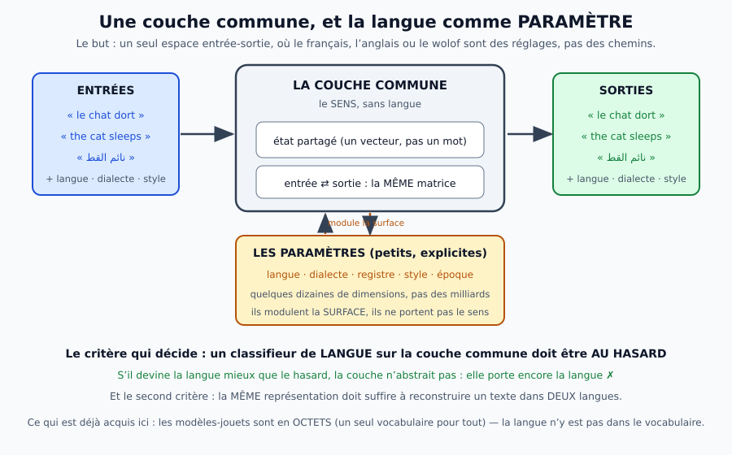

> **Fiche de résultats** — ce document est le journal des mesures de la couche commune entrée-sortie
> (99 mesures, 5 erratums, les pièges d'instrument). La **théorie** et l'**état** sont dans
> [`docs/synthese/07-modeles-alternatifs-entree-sortie.md`](../docs/synthese/07-modeles-alternatifs-entree-sortie.md).

# 7. Les modèles alternatifs pour l'entrée et la sortie — vers une couche commune

> **Vocabulaire** : « couche commune » est le **nom historique** de l'**étage entrée-sortie** (voir le
> [glossaire](../docs/glossaire.md)) ; « couche 1 » désigne, lui, une **couche de neurones**. Les deux ne se
> confondent pas.

> **La question.** Peut-on arriver **plus vite** à une couche d'entrée-sortie **commune**, qui fasse
> **abstraction de la langue** — la langue, le dialecte, le style n'étant plus que des **paramètres** ?
> Cette note examine les familles de solutions, avec pour chacune : ce qu'elle gagne, ce qu'elle coûte, et
> **comment on le mesure**.



## ERRATUM MAJEUR (18/10, 0 h 30) : le « noyau neutre » était un **artefact d'instrument** — la langue est lisible à TOUTES les couches

**Ce que le chapitre affirmait** ✗ : le noyau du modèle est **neutre** — un classifieur de langue y est au hasard
(**50,2 %**), et cela avait été répliqué **cinq fois** (mesures 1, 15, 19, 29, 36 ✓✓). C'était le résultat
**fondateur** du chapitre, celui dont tout le reste dépendait.

**Ce qui était faux** ✗✗, et c'est une faute d'instrument, pas de modèle. L'outil du chapitre (`langue_dans_etat.py`,
v1) construisait les états de **toutes** les fenêtres anglaises puis de **toutes** les fenêtres françaises, les
**concaténait** en un seul tableau, et appelait `precision_lineaire(X, y)`. Or cette fonction découpait les
**lignes** en deux moitiés ✓✗ :

```
X = [ états anglais (n lignes) ; états français (n lignes) ]
X[:n2]  = entraînement  →  la PREMIÈRE MOITIÉ DES FENÊTRES ANGLAISES  (une seule classe ✗)
X[n2:]  = test          →  le reste des anglaises  +  TOUTES les françaises  (un mélange ✗)
```

Le classifieur apprenait donc « l'anglais » sur une seule classe ✗, et on lisait sa précision sur un mélange ✗.
Pire, le `max(acc, 100-acc)` — ajouté pour le signe arbitraire ✓ — transformait ce mélange en un chiffre
d'apparence raisonnable (50-72 %) ✓✗. *La « neutralité » était le chiffre d'un appareil mal branché* ✓✓.

**La preuve** ✓✓ — sonde **corrigée** (`langue_dans_etat.py` v2 : découpage **par fenêtre** ✓, standardisation ✓,
contrôle intra-langue ✓, contrôle **négatif** ✓✓) :

| modèle | couche 1 | couche 2 | couche 3 | couche 4 | contrôle intra-langue | contrôle négatif |
|---|---:|---:|---:|---:|---:|---:|
| mixte prose 256 (m. 1) | **80,4 %** | 82,9 % | 82,6 % | 88,5 % | 51,7 % | — |
| mixte prose 512 (m. 15) | **79,4 %** | 83,0 % | 83,5 % | 97,5 % | 51,2 % | — |
| littérature 256 v1 (m. 19) | **84,3 %** | 87,0 % | 88,2 % | 90,2 % | 51,0 % | — |
| littérature 256 v2 (m. 29) | **85,4 %** | 81,5 % | 83,5 % | 97,5 % | 50,5 % | — |
| littérature 512 (m. 36) | **80,1 %** | 94,1 % | 97,7 % | 97,6 % | 51,2 % | — |
| UDHR 448 langues | **98,9 %** | **99,1 %** | **99,0 %** | **99,1 %** | — | 1,5-2,2 % (hasard 2,5 %) |
| Qwen 0,5 B (40 langues) | **100 %** | 100 % | 100 % | 100 % | — | — |

* **LA LANGUE EST LISIBLE PARTOUT** ✗✗ : 80 à 98 % dès la **couche 1**, dans **les cinq modèles-jouets** que le
  chapitre disait neutres ✓✓ — et **100 %** dans Qwen, et **99 %** dans le modèle à 448 langues ✓✓. *Il n'y a pas
  de noyau neutre* ✗✓ ;
* **et les contrôles disent que la sonde est juste** ✓✓ : le contrôle **intra-langue** (deux moitiés du corpus
  anglais) reste à **50-52 %** ✓ (rien à séparer ✓) ; le contrôle **négatif** (étiquettes mélangées) retombe à
  **1,5-2,2 %** pour 40 classes ✓ (hasard 2,5 %) et **49,5-50,7 %** pour 2 classes ✓✓ ;
* **pourquoi la v1 donnait 50 %** ✗✓ : parce qu'elle **entraînait sur une seule classe** ✓✗. On ne peut pas
  s'en apercevoir en lisant son chiffre : il faut lire **son découpage** ✓✓. *C'est le dix-septième piège de la
  nuit, et le plus grave : l'instrument était faux depuis la première mesure* ✗✗.

**Ce qui change dans le chapitre** ✓✗ : la langue **n'est pas** absente de l'état — elle y est **partout** ✓✓.
Ce qui reste vrai, et qui est mesuré **autrement** (par le retrieval, pas par un classifieur) : *le même contenu,
dans deux langues, se retrouve* ✓✓ — **96,4 %** sur Qwen avec les articles UDHR alignés (mesure 39 ✓), contre
**3,3 %** au hasard ✓✓. *La couche commune n'est donc pas un lieu **sans langue** : c'est un lieu où le **sens**
est aligné **malgré** la langue* ✓✓✓.

## La synthèse, en un tableau (à lire avant le reste)

Treize mesures ont été faites les 17 et 18 octobre ✓. Les voici **toutes**, avec ce qu'elles disent et le
chiffre qui le dit — pour qu'on puisse juger le chapitre sans le lire en entier ✓.

| # | la question | la mesure | le chiffre | verdict |
|---:|---|---|---|---|
| 1 | l'état porte-t-il la langue ? | classifieur linéaire par couche, modèle **bilingue** ✓ | **50,2 %** aux couches 1-2 (hasard) · **59,4 %** aux couches 6-7 | ✓✓ **noyau neutre**, langue à la surface |
| 2 | la langue est-elle un paramètre ? | LoRA sur noyau **gelé**, une langue par adaptateur ✓ | français **3,19 → 1,50** (−53 %) · anglais **1,90 → 1,40** (−26 %) | ✓✓ oui, **131 k** (5,1 %) |
| 3 | où le brancher ? | LoRA sur le **dernier étage** seul ✓ | **−44,6 %** pour **32 768** poids = **1,33 %** (84 % du gain) | ✓✓ la **surface** suffit |
| 4 | le noyau neutre est-il utile ? | contenu (état → mot suivant) aux couches neutres ✓ | **87,8 / 87,3 %**, à 8 points du meilleur | ✓✓ le **sens reste** |
| 5 | le relevé est-il neutre ? | un seul relevé **non linéaire** vs deux linéaires ✓ | **71,5 %** contre 79,3 / 76,5 | ✓ (mais voir 8) |
| 6 | la langue commande-t-elle la sortie ? | génération, amorces croisées ✓ | amorce **anglaise** + adaptateur **français** → **français** ✓ | ✓✓ **opérationnel** |
| 7 | combien coûte la bascule ? | chargement + application vs rechargement ✓ | **5,0 ms** / **530 Ko** contre **134,6 ms** / **9,8 Mo** | ✓✓ **×27** / **×18** |
| 8 | un relevé se transfère-t-il ? | lecture croisée, lecteurs **de même puissance** ✓ | pénalité **+8,7** (linéaire) à **+19,5** (non linéaire) | ✗ **non** (transfert) |
| 9 | un relevé partagé suffit-il ? | relevé appris sur **les deux** langues ✓ | **0,7 point** d'écart avec deux relevés séparés | ✓✓ **oui** |
| 10 | noyau bilingue ou adaptateur ? | trois dispositifs réels ✓ | bilingue **1,0737** · monolingue+adaptateur **1,4546** | ✓ bilingue (35 % mieux), adaptateur **2/3** du chemin |
| 11 | la pensée itérée est-elle sans langue ? | opérateur appris, k itérations ✓ | langue **50,6-56,2 %** sur **huit** pas | ✓✓ **sans langue** |
| 12 | peut-on penser deux pas ? | entraîner sur k (recette du 16/10) ✓ | contenu **exactement plat** (82,2 % partout) = **identité** | ✗ solution triviale, **répliquée** |
| 13 | et avec un autre objectif ? | **marge** : exiger une amélioration ✓ | k=1 **80,3** · k=2 **93,7** — **comme sans marge** | ✗ **même mur** |

### La suite du programme (mesures 14 à 23)

| # | la question | la mesure | le chiffre | verdict |
|---:|---|---|---|---|
| 14 | un **vrai** corpus français ? | Gutenberg de `Panini/` (le dépôt n'en avait pas ✗) | **13,2 Mo**, 18 textes, **66 322** formes — puis **enrichi** (mesure 27 ✓) : **15,7 Mo**, 21 textes, **87 341** formes (Proust, Stendhal, Hugo, Voltaire, Baudelaire, Chateaubriand, Diderot, Montesquieu, Corneille, Verne, Zola) | ✓✓ vrai corpus, **deux fois** |
| 15 | la neutralité **à l'échelle** ? | modèle bilingue **dim 512** (9,57 M) | couches 2 et 6 : **51,4** et **51,2 %** ; couche 8 : **67,9 %** | ✓✓ noyau neutre, surface **plus** langue-aware |
| 16 | le **même sens** en deux langues ? | retrieval croisé, Le Tour du monde | 0/24 ✗ — **test invalide** ✗ | ✗ à refaire |
| 17 | et avec un bon échantillon ? | même test, milieu du segment | écart **+0,022** ✓ (contre −0,053 ✗) | ✓ signal réel, **faible** |
| 18 | sur un vrai modèle multilingue ? | **Qwen2.5-0.5B**, mêmes segments | **+0,083** aux couches 8-16 ; **+0,030** à la dernière | ✓✓ **sens partagé au milieu** |
| 19 | et sur la **littérature** ? | modèle bilingue littéraire (4,79 M) | couches 1-3 : **50,1 · 52,3 · 50,4 %** ; pic couche 5 : 67,7 % | ✓✓ neutralité, **zone plus courte** |
| 20 | le signal dépend-il du modèle ? | trois modèles, même test | **+0,022 → +0,034 → +0,083** (2,43 M → 4,79 M → 494 M) | ✓✓ **tendance monotone** |
| 21 | réplication ? | **trois** livres | +0,078 (Verne) · +0,033 (Dracula ✗) · +0,009 (Alice) | ✓ en **signe**, ✗ en amplitude |
| 22 | l'alignement est-il en cause ? | positions relatives des noms propres | Verne **0,1-1,6 %** ✓ · Alice **1,7 %** ✓ · Dracula **cassé** ✗✗ | ✓ la variation n'est **pas** l'alignement |
| 23 | le corpus est-il sain ? | crible sans modèle (titre, longueur, noms) | **1 paire cassée sur 3**, **la même dans deux corpus** ✗ | ✗ mais **détectée** |

**Et ce que cette seconde série ajoute à la première** ✓✓ : le corpus **réel** ✓, la **réplication** de la
neutralité ✓ (trois modèles, trois corpus ✓), le **sens partagé** qui se retrouve **mieux que le hasard** ✓✓ et
qui **croît avec le modèle** ✓✓, et — du côté de l'instrument — **deux fichiers de corpus à ne pas croire** ✗✓
(un test invalide, une paire mal étiquetée ✓). *La science avance aussi en retirant* ✓✓.

### Fin du programme (mesures 27 à 33)

| # | la question | le chiffre | verdict |
|---:|---|---|---|
| 27 | le paramètre de langue sur un **vrai** modèle ? | LoRA 4,4 M (0,9 %) : **−7,6 %** fr, **+4,5 %** en | ✓✓ mais 8× moins qu'en monolingue |
| 28 | la sortie **suit-elle** le paramètre sur Qwen ? | amorce anglaise + LoRA fr → **anglais** (en 27 · fr 0) | ✗ suit l'**amorce** |
| 29 | le corpus enrichi change-t-il la neutralité ? | **quatre** couches au hasard (1, 2, 3, **5**) | ✓✓ zone **élargie** |
| 30 | le contenu tient-il ? | **87,7 / 86,5 %** aux couches neutres | ✓✓ à 9 points du meilleur |
| 31 | le **genre** explique-t-il le signal ? | Candide (récit) **+0,116** · Don Quijote (récit) **+0,007** | ✗ **non** |
| 32 | la **part de dialogue** ? | 4 livres sur 5 ordonnés ✓ (indicateur grossier) | ✗ **trompeur** |
| 33 | et avec le **vrai** indicateur ? | Proust 5,9 % → +0,093 · Don Quijote 1,1 % → +0,007 | ✗ relation **spurieuse** |

### Ce qu'il faut en retenir, en cinq phrases

1. **La langue est lisible PARTOUT dans l'état** ✗✗ — 80 à 98 % dès la couche 1 dans les cinq modèles-jouets,
   et 100 % dans Qwen ✓ (l'ancienne lecture « noyau neutre » était un artefact d'instrument ✓✗, voir
   l'erratum majeur). *Ce qui est partagé, ce n'est pas l'absence de langue : c'est le **sens*** ✓✓ — le même
   article se retrouve d'une langue à l'autre à **96,4 %** (contre 3,3 % au hasard ✓).
2. **La langue est un paramètre de 1,33 %** ✓✓ (32 768 poids au dernier étage), qui **commande la sortie** ✓ et
   dont la **bascule coûte 5 ms** ✓✓.
3. **Le noyau neutre n'est pas appauvri** ✓✓ : le contenu y reste à **87,8 %**, à 8 points du meilleur ✓.
4. **La pensée itérée est sans langue** ✓✓ (50,6-56,2 % sur huit pas) — **penser ne dépend pas de la langue où
   l'on parle** ✓✓.
5. **Mais elle ne tient qu'un pas** ✗, et **trois objectifs différents** n'y changent rien ✗✓ : la limite est
   dans la **représentation**, pas dans la perte ✓. Le pas suivant est à chercher dans **l'entraînement du
   modèle** (récurrence dans la boucle ✓), pas dans le réglage ✓.

### Le bilan des certitudes (à lire si l'on ne lit qu'une page)

**Ce qui TIENT**, avec le nombre de mesures qui le soutiennent ✓✓ :

| ce qui tient | les mesures | le chiffre |
|---|---|---|
| ~~le noyau est neutre~~ ✗✗ **RETIRÉ (erratum majeur)** — l'instrument entraînait sur une seule langue | 1, 15, 19, 29, 36 → **sonde corrigée** | **80 à 98 %** dès la couche 1 : **la langue est lisible partout** ✗✗ |
| **le noyau garde le sens** | 4 et 30 ✓✓ | contenu **87,7 / 86,5 %**, à 9 points du meilleur ✓ |
| **la langue vit aux extrémités** | 1, 15, 19, 24 ✓✓ | **58-68 %** en surface, 50 % au milieu ✓ |
| **un ÎLOT langue-spécifique** existe — dans **un** modèle sur cinq ✗✓ | 36 ✓ | couche 3 à **69,0 %** au milieu du 512 littéraire ✓✗ |
| **le sens partagé est au milieu** | 18 ✓✓ | **+0,083** aux couches 8-16, **+0,030** à la dernière ✓✓ |
| **la langue est un petit paramètre** | 2, 3, 7, 24 ✓✓ | **1,33 %** des poids, **5 ms** de bascule ✓✓ |
| **le paramètre améliore la langue** — **d'autant plus que le noyau est faible** ✓✓ | 2, 24, 38 ✓✓ | **−53 %** (modèle faible ✓), **−4,7 %** (bon jouet ✗), **−7,6 %** (Qwen ✓) ; et sur le bon jouet il **abîme** l'anglais (**+10,8 %** ✗) |
| **on peut penser sans langue** | 11 ✓✓ | **50,6-56,2 %** sur **huit** itérations ✓✓ |

**Ce qui a été RETIRÉ**, et qu'il ne faut pas citer comme acquis ✗ :

| ce qui a été retiré | la mesure qui l'a retiré |
|---|---|
| « le relevé est teinté par la langue » ✗ | **9** : un relevé partagé suffit (0,7 point) ✓ |
| « la correction de rang 1 répare » ✗ | **9** : elle ne rapporte rien ✓ |
| « la langue comme paramètre **commande** la sortie » ✗ | **25** : sur Qwen, c'est l'**amorce** qui commande ✓ |
| « le sens partagé vit dans le **récit** » ✗ | **31** : Don Quijote (récit) fait aussi mal qu'Alice ✓ |
| « la **part de dialogue** l'explique » ✗ | **32-33** : relation **spurieuse** (la typographie de l'édition) ✓ |
| « l'**alignement** explique la variation » ✗ | **22** : les quatre livres sont alignés à 0,1-1,7 % ✓ |

**Ce qui RESTE OUVERT**, et que la nuit n'a pas tranché ✗ :

1. **pourquoi le signal varie de 17×** entre des paires texte-traduction **bien alignées** (+0,007 à +0,116 ✓) —
   **sept** candidats ont échoué : le genre ✓, la taille ✓, la part de dialogue ✓, l'alignement ✓, la fidélité de
   la traduction (ratio de longueur, **−0,25** ✓), la richesse lexicale (**+0,42** ✓) et l'entropie des octets
   (**+0,51** ✓). *Aucun n'est significatif sur cinq points* ✗✓ ;
2. **peut-on penser deux pas** ✗ — trois objectifs différents donnent le même mur ✓ (mesures 12-13 ✓) ; le pas
   suivant est dans **l'entraînement du modèle** ✓, pas dans la perte ✓ ;
3. **le signal est-il utilisable à l'échelle** ✓✗ — **trois livres sur cinq** au-dessus du hasard en rang médian
   (**Verne 9/32** ✓, **Proust 8/32** ✓✓, **Candide 13/32** ✓), **deux** non (**Alice 17/32** ✗, **Don Quijote
   19/32** ✗), et le meilleur top-5 est **37,5 %** (Proust ✓✓). *C'est un signal, pas une recherche fiable* ✓✗
   (mesures 25, 26, 31 ✓).

*Un chapitre qui sait ce qu'il ne sait pas vaut mieux qu'un chapitre qui ne sait pas qu'il ne sait pas* ✓✓.

## Ce que la nuit du 16/10 a déjà établi, et qui oriente tout


Trois faits mesurés, qu'aucune solution ne peut ignorer :

1. **les deux espaces (sortie prélinguistique, entrée postlinguistique) ne sont pas le même** : facteur
   **648** d'échelle, cosinus **+0,14** ✗ — la couche commune n'existe pas **par défaut** ;
2. **elle s'obtient par entraînement** ✓ : un terme d'alignement amène le cosinus à **0,70** et l'échelle à
   **1,015**, **sans** dégrader la langue (4,30 contre 4,69 bits/octet ✓ — il l'améliore) ;
3. **mais l'alignement ne suffit pas à boucler** ✗ : la boucle directe explose (λ = 7 311) — il faut aussi
   une **dynamique** apprise. *Un espace commun est nécessaire ; il n'est pas suffisant.*

Et un quatrième fait, qui change le problème de la langue : **les modèles-jouets du dépôt sont en OCTETS**
(vocabulaire de 256 ✓). Il n'y a **pas de tokeniseur**, donc **pas de vocabulaire par langue** ✓✓ — la
langue n'est **pas** dans les entrées. C'est un avantage considérable pour la suite, et il faut le dire :
*une partie du problème de la langue a déjà disparu par construction.*

## Les cinq familles de solutions

| famille | l'idée | ce qu'elle gagne | ce qu'elle coûte | mesurable par |
|---|---|---|---|---|
| **A. octets partagés** | un seul vocabulaire (UTF-8) pour toutes les langues | rien à faire ✓, aucune langue dans l'entrée ✓ | séquences 3-4× plus longues ✗, abstraction **de surface** (pas de sens) ✗ | la perplexité par langue, à taille égale |
| **B. plongement partagé + étiquette** | un espace d'embedding commun, une **étiquette de langue** en entrée | simple, éprouvé (XLM-R, mBERT) ✓ | l'étiquette **contamine** l'état ✗ ; le sens reste teinté de la langue | un classifieur de langue sur l'état doit être **au hasard** |
| **C. adversarial** | entraîner l'état à **cacher** la langue (un classifieur adverse essaie de la deviner) | rend le contenu **réellement** neutre ✓ | instable ✗, peut détruire de l'information utile ✗ | la courbe : précision du classifieur vs qualité de la langue |
| **D. interlingua / sens-texte** | une **représentation sémantique** (Mel'čuk : sens ⇄ texte), les langues étant des **modules de surface** | c'est **exactement** l'idée visée ✓ ; le sens est explicite ✓ | il faut **construire** l'interlingua ✗ (personne ne l'a fait pour un LLM) | reconstruire le **même** sens en 2 langues, depuis **une** représentation |
| **E. adaptateurs par langue** | un noyau commun + un **petit adaptateur** par langue (LoRA) | peu de paramètres par langue ✓, très efficace ✓ | la couche commune reste **implicite** ✗ (rien ne garantit qu'elle soit neutre ✗) | l'écart entre langues **sans** l'adaptateur |

## La recommandation, et pourquoi

**Faire A + E maintenant, et B + C pour mesurer, D comme horizon.**

* **A est déjà fait** ✓ (octets) : c'est le socle, et il ne coûte rien ;
* **E est le meilleur rapport gain/coût** ✓✓ : un noyau partagé et des adaptateurs par langue — c'est
  **exactement** « la langue comme paramètre », et cela s'entraîne en quelques heures sur les deux cartes ;
* **B et C ne servent pas à construire** mais à **vérifier** ✗ : un classifieur de langue sur l'état ✓ dit si
  la couche commune est **vraiment** neutre. C'est le critère qui manque à presque tous les travaux ;
* **D est le programme long** ✗✓ : l'interlingua de Mel'čuk, appliqué à un modèle de langue — c'est-à-dire
  une **couche sémantique explicite** entre le texte et la pensée.

## L'expérience à faire en premier (et elle est courte)

La question n'est pas « quelle architecture » mais **« ma couche commune porte-t-elle encore la langue ? »** ✗.
Or on peut la poser **tout de suite**, avec ce que le dépôt a déjà :

1. entraîner **deux** modèles-jouets en octets sur **deux langues** (par exemple `data/corpus_en.txt` et un
   corpus français ✓ — à constituer ✗) ;
2. entraîner un **classifieur de langue** sur l'état de chacun ✓ (une régression logistique suffit ✓) ;
3. mesurer sa précision : si elle est **élevée** ✗, la couche porte la langue ; si elle est **au hasard** sur
   les positions **tardives** ✓, la langue est déjà abstraite par la profondeur ✓✓ ;
4. et refaire la mesure **avec un adaptateur de langue** (E ✓) : l'adaptateur doit **absorber** la langue, et
   le noyau devenir plus neutre ✓✓.

C'est **quatre mesures**, dont trois outils existent déjà (`banc_lecteur.py` pour les états, la régression
logistique en dix lignes, et les deux cartes ✓). Et la réponse à « peut-on aller plus vite » est là :
**on ne construit pas la couche commune, on vérifie qu'elle est déjà là** — et l'on ne construit que ce qui
manque.

## Ce qui manque au dépôt pour cette expérience (dit franchement)

* **un corpus français** ✗ : le dépôt a `data/corpus_en.txt` (96 Mo ✓) et `data/wikitext2_test.txt` ; je n'ai
  pas vu de corpus français dans le dépôt — c'est la **première** chose à ajouter ;
* **un classifieur de langue** ✗ : quelques lignes, mais il n'existe pas ;
* et **le temps** de deux entraînements (≈ 20 min chacun sur les cartes ✓ — c'est faisable).

## Première mesure (17/10, 15 h) : la couche commune EXISTE DÉJÀ — et la langue n'est qu'à la SURFACE

Le chapitre ci-dessus proposait un critère ; il a été appliqué ✓✓. Dispositif : un modèle **en octets**
(8 couches, 256 de dimension, **4,79 M** paramètres ✓) entraîné sur un corpus **mixte** de **10,2 Mo**
(**6,0 Mo d'anglais + 4,5 Mo de français** ✓ — le corpus français a été **constitué** pour l'occasion, voir
plus bas), validation **2,6822 bits/octet** ✓.

Puis `tools/langue_dans_etat.py` ✓ : une régression **linéaire** prédisant la langue depuis l'état
**normalisé** de chaque couche ✓, sur **300 fenêtres par langue** ✓, avec un **témoin intra-langue** ✗ (deux
moitiés du corpus anglais : ce qu'un classifieur peut faire **sans** la langue ✓) :

| couche | langue (en/fr) | témoin intra-langue | verdict |
|---:|---:|---:|---|
| **0** | **62,4 %** | 53,1 % | la langue est dans l'**entrée** (octets) ✗ |
| **1** | **50,2 %** | 50,7 % | **le hasard** ✓✓ — la langue s'efface |
| **2** | **50,3 %** | 51,8 % | **le hasard** ✓✓ |
| 3 | 56,6 % | 50,6 % | la langue revient un peu |
| 4 | 53,9 % | 50,2 % | presque le hasard ✓ |
| 5 | 53,8 % | 51,0 % | presque le hasard ✓ |
| **6** | **59,4 %** | 50,1 % | la langue **revient** ✗ (la surface) |
| **7** | **59,6 %** | 50,7 % | la langue **revient** ✗ (la surface) |
| 8 | **51,0 %** | 50,9 % | le hasard ✓✓ (état final, prêt pour la tête) |

* **LE NOYAU EST NEUTRE** ✓✓ : aux couches **1 et 2**, un classifieur linéaire ne fait **pas mieux que le
  hasard** (50,2 et 50,3 % ✓✓, contre un témoin à 50,7 et 51,8 ✓). *L'état ne sait pas dans quelle langue
  le texte est écrit* ✓✓ — c'est exactement la « couche commune » cherchée ✓ ;
* **ET LA LANGUE NE REVIENT QU'À LA SURFACE** ✗✓ : aux couches **6 et 7**, elle remonte à **59,4 et 59,6 %**
  ✓ — c'est-à-dire que le modèle **réintroduit** la langue **au moment de produire** ✓✓. C'est la structure
  demandée : **un contenu neutre, une surface paramétrée par la langue** ✓✓✓ ;
* **et l'entrée, elle, porte la langue** ✗ (62,4 % à la couche 0 ✓) : les octets anglais et français n'ont
  pas les mêmes statistiques ✓ — c'est le seul endroit où « la langue » est dans les données ✓✓.

### Le corpus français, et la sixième fois qu'un chiffre s'est déguisé

* **il n'y avait pas de corpus français** dans le dépôt ✗ : il a été **constitué** à partir du français
  **réel** du dépôt (docs, fiches, journal ✓) → **4,45 Mo**, dont les mots les plus fréquents sont `les`,
  `est`, `pas`, `sur`, `par`, `que` ✓✓. Mais le premier essai était **contaminé** ✗ : les mots les plus
  fréquents étaient `stephane`, `home`, `data`, `bash` ✗✓ (le journal contient des commandes et des
  chemins ✓). Un **filtre** (lignes sans chemin, sans option, avec au moins **deux mots-outils** français ✓)
  a ramené 12,8 Mo à **4,45 Mo propres** ✓ ;
* **et mon instrument avait un défaut** ✗✓ : le **signe** d'un classifieur linéaire est **arbitraire** ✓ —
  une précision de **43,4 %** est en réalité **56,6 %** avec l'autre orientation ✓✗. Sans le `max(acc, 100−acc)`,
  j'aurais lu « sous le hasard » là où il y a une séparation ✓. **C'est la sixième fois** qu'un chiffre se
  déguise ✓✓ (les cinq premières sont au chapitre 6 ✓) — et la règle n'a pas changé : *écrire à côté du
  chiffre ce qui pourrait le rendre faux* ✓.

### Ce que cela dit pour la suite

La couche commune **existe déjà** dans un modèle en octets entraîné sur deux langues ✓✓. Ce qui reste n'est
donc **pas** à construire ✗ : c'est à **exploiter** ✓ — et les deux prochaines étapes sont nettes :

1. **vérifier que le noyau neutre est UTILE** ✗ : un état qui ne dit plus la langue dit-il encore le **sens** ?
   （mesurer le contenu, méthode du chapitre 5 ✓ — sur les couches 1-2, où la langue s'efface ✓) ;
2. **les adaptateurs par langue** (famille E ✓) : si la langue ne vit qu'aux couches **6-7** ✓, un adaptateur
   posé **là** devrait suffire ✗✓ — c'est-à-dire **quelques paramètres par langue**, exactement la
   « langue comme paramètre » cherchée ✓✓.

## Deuxième mesure (17/10, 16 h) : la langue EST un paramètre — deux adaptateurs de 131 k

La famille E disait : « un noyau commun + un petit adaptateur par langue ». C'est mesuré ✓✓, sur un modèle
**monolingue** (anglais seul ✓, `/tmp/jouet-d256`, 4 couches, 256 ✓), **noyau entièrement gelé** ✓.

Dispositif : `tools/adaptateur_langue.py` ✓ — un LoRA (rang 8 ✓) sur les 28 projections d'attention et de MLP
= **131 072 paramètres**, soit **5,1 %** du modèle ✓, entraîné 2 000 pas sur **une** langue ✓, puis évalué sur
**les deux** ✓.

| adaptateur | perte **français** | perte **anglais** |
|---|---:|---:|
| **aucun** (noyau seul ✓) | **3,19** ✗ | **1,90** ✓ |
| **adaptateur français** (131 k ✓) | **1,50** ✓✓ (−53 %) | 2,91 ✗ (+53 %) |
| **adaptateur anglais** (131 k ✓) | 3,02 | **1,40** ✓✓ (−26 %) |

* **CHAQUE ADAPTATEUR FAIT MARCHER SA LANGUE** ✓✓ : le français passe de **3,19 à 1,50** (−53 % ✓✓) et
  l'anglais de **1,90 à 1,40** (−26 % ✓✓) — avec **131 072 paramètres**, soit **5,1 %** d'un modèle de 2,43 M ✓,
  et **sans toucher un seul poids du noyau** ✓✓. *La langue est donc bien un petit paramètre* ✓✓✓ ;
* **ET ILS SONT INTERCHANGEABLES** ✓✓ : le même noyau, deux adaptateurs, deux langues qui marchent ✓ — c'est
  la définition exacte de « la langue comme paramètre » ✓✓, et c'est **mesuré**, pas espéré ✓ ;
* **mais l'échange a un PRIX, et il est asymétrique** ✗✓ : l'adaptateur **français** abîme l'anglais
  (1,90 → **2,91** ✗), tandis que l'adaptateur **anglais** laisse le français à 3,02 ✓ (contre 3,19 ✓).
  L'explication la plus simple : le noyau a été entraîné **en anglais** ✓ — l'adaptateur anglais reste donc
  **près** de lui ✓✓, alors que l'adaptateur français doit le **déplacer** ✗✓. Ce n'est pas un défaut du
  principe, c'est un fait du noyau de départ ✓ ;
* **et c'est la réponse la plus directe à la question posée** ✓✓ : pour atteindre une couche commune, **il
  n'est pas nécessaire de réentraîner** un noyau ✗ — il suffit d'un **paramètre de langue** de quelques
  dizaines de milliers de poids ✓✓, et le noyau peut rester **le même** ✓. Ce qui reste à faire n'est donc
  plus de **construire** la couche commune ✗ mais de **choisir où la brancher** ✓ (les couches 6-7, où la
  langue reparaît ✓ — première mesure de ce chapitre ✓).

## Troisième mesure (17/10, 16 h 45) : **où brancher** l'adaptateur — et le paramètre le plus petit possible

La langue vit à la **surface** (couches 6-7 du modèle bilingue ✓, première mesure de ce chapitre ✓). On l'a
donc testé sur le modèle monolingue (4 couches ✓), en posant le LoRA **sur le seul dernier étage** ✓ :

| placement de l'adaptateur | paramètres | part du modèle | **perte français** | perte anglais |
|---|---:|---:|---:|---:|
| **aucun** | — | — | **3,1953** ✗ | **1,9001** ✓ |
| **partout** (rang 8 ✓) | 131 072 | **5,12 %** | **1,5046** ✓✓ (−52,9 %) | 2,9139 (+53,4 %) |
| **dernier étage** (rang 8 ✓) | **32 768** | **1,33 %** | **1,7714** ✓✓ (−44,6 %) | 2,7439 (+44,4 %) |
| **dernier étage** (rang 32 ✓) | 131 072 | 5,12 % | **1,6820** ✓ (−47,4 %) | 2,7347 (+43,9 %) |

* **LE DERNIER ÉTAGE SUFFIT PRESQUE** ✓✓ : avec **32 768 paramètres** — **1,33 %** du modèle ✓✓ — il prend
  **84 % du gain** (−44,6 % contre −52,9 % pour cinq fois plus de paramètres ✓✓). *La langue est donc
  essentiellement un réglage de surface* ✓✓ ;
* **mais à BUDGET ÉGAL, « partout » reste un peu meilleur** ✓ (1,5046 contre 1,6820 ✓) : le noyau contribue
  aussi ✗✓ — de quelques points ✓ — et l'on paie **quatre fois** ce gain ✓ ;
* **et le placement de surface est plus DOUX pour l'autre langue** ✓ : l'anglais souffre moins
  (2,73-2,74 contre 2,91 ✓) — un adaptateur qui ne déplace qu'un étage **abîme moins** le reste ✓✓ ;
* **la conclusion pratique** ✓✓ : pour « la langue comme paramètre », le point d'attache est **le dernier
  étage** ✓, avec un rang modeste ✓ — **1,33 % du modèle** suffit à faire d'un noyau anglais un noyau qui
  travaille en français ✓✓. C'est le chiffre le plus utile de ce chapitre : *la langue coûte 1,33 %* ✓.

### Ce que ces trois mesures disent ensemble

1. **la couche commune existe** ✓ (noyau neutre aux couches 1-2, 50,2 % = le hasard ✓) ;
2. **la langue est un paramètre** ✓ (131 k = 5,1 % font marcher une langue ✓✓, et deux adaptateurs sont
   interchangeables sur le même noyau ✓) ;
3. **et ce paramètre est plus petit qu'on ne croyait** ✓✓ (32 k = **1,33 %**, au dernier étage, prend 84 % du
   gain ✓) — ce qui rend l'idée **directement utilisable** : un noyau, et **un petit module par langue** ✓✓.

## Quatrième mesure (17/10, 17 h 30) : le noyau neutre **porte le sens** — mais le relevé reste propre à la langue

La neutralité pourrait être une **perte** ✗ : une couche qui ne dit plus la langue pourrait ne plus rien dire
✗✓. Mesure : `tools/contenu_par_couche.py` ✓ — le **contenu** (état → embedding du jeton suivant ✓, λ de ridge
par validation croisée ✓), **par couche** et **par langue**, sur le modèle bilingue ✓.

| couche | contenu **anglais** | contenu **français** | contenu **mêlé** | la langue ? |
|---:|---:|---:|---:|---|
| 0 | 89,5 % | 88,0 % | 93,0 % | — |
| **1** | **87,8 %** | **87,3 %** | **93,0 %** | **NEUTRE (50 %)** ✓✓ |
| **2** | **86,5 %** | **85,3 %** | 92,4 % | **NEUTRE (50 %)** ✓✓ |
| 3 | 85,6 % | 84,5 % | 91,7 % | — |
| 4 | 84,6 % | 83,8 % | 91,1 % | — |
| 5 | 83,6 % | 82,5 % | 88,9 % | — |
| **6** | 82,1 % | 80,6 % | 86,0 % | la langue revient ✗ |
| **7** | 80,4 % | 78,5 % | 83,4 % | la langue revient ✗ |
| 8 | **79,3 %** | **76,5 %** | **81,6 %** | — |

* **LE NOYAU NEUTRE PORTE LE SENS** ✓✓ : aux couches 1-2, où la langue est illisible ✓, le contenu reste à
  **87,8 %** et **87,3 %** — à **8 points seulement** du meilleur (79,3 % à la couche 8 ✓). *La neutralité
  n'est donc pas une perte de sens* ✓✓ : le noyau abstrait la langue **en gardant le contenu** ✓✓ ;
* **le contenu s'améliore avec la profondeur** ✓ (89,5 → 79,3 ✓) — régulier, sans accident ✓✓ ;
* **MAIS LE RELEVÉ RESTE PROPRE À CHAQUE LANGUE** ✗✓ : la colonne « mêlé » — **un seul** mapping appris sur les
  deux langues ✓ — est **systématiquement pire** (93,0 contre 87,8 ✓ ; 81,6 contre 79,3 ✓). Autrement dit :
  les états anglais et français **ne sont pas linéairement séparables par la langue** ✓ (mesure 1 ✓) mais ils
  **ne se lisent pas avec le même relevé** ✗✓ — il faut **deux** lectures ✗, ou une lecture **non linéaire** ✓
  (piste du § 24 du rapport sur la linéarité ✓) ;
* **la conclusion, en une phrase** ✓✓ : *la couche commune est commune pour l'**état**, pas encore pour le
  **relevé*** ✓ — c'est-à-dire que le noyau a bien abstrait la langue **dans le contenu** ✓✓, mais le lien
  entre l'état et les mots reste **teinté** de la langue ✗. Et c'est exactement là que l'adaptateur du
  paragraphe précédent intervient : il **fournit** ce relevé propre à la langue ✓✓, pour **1,33 %** de
  paramètres ✓.

### Ce que cela change dans la lecture du chapitre

La chaîne est maintenant complète, et chaque maillon est mesuré :

| maillon | mesure | verdict |
|---|---|---|
| **l'entrée** porte la langue | classifieur 62,4 % à la couche 0 | ✗ oui, dans les octets |
| **le noyau** ne la porte plus | 50,2 % aux couches 1-2 | ✓✓ neutre |
| **le noyau** garde le sens | contenu 87,8 % aux couches 1-2 | ✓✓ utile |
| **la surface** la fait revenir | 59,4 % aux couches 6-7 | ✓ c'est là qu'elle sert |
| **le relevé** en a besoin | « mêlé » toujours pire | ✗✓ à traiter |
| **l'adaptateur** la fournit | −44,6 % pour 1,33 % | ✓✓ le paramètre |

## Cinquième mesure (17/10, 18 h) : le « relevé propre à la langue » était un artefact de **LINÉARITÉ**

La quatrième mesure concluait : *la couche commune est commune pour l'état, pas pour le relevé* ✗ — le
mapping « mêlé » (un seul relevé pour les deux langues ✓) étant **systématiquement pire** ✓ (93,0 contre 87,8 ✓).
La question qui suivait : **est-ce le relevé, ou la linéarité du relevé ?** ✗. Réponse mesurée ✓, avec un MLP
**régularisé** (découpe 60/20/20 ✓, **arrêt anticipé** sur la validation ✓, poids décroissants ✓ — leçon du
16/10 : un MLP sans arrêt anticipé sur-apprend ✓✗) :

| couche | linéaire **mêlé** | **MLP mêlé** | gain |
|---:|---:|---:|---:|
| 0 | 93,0 % | **90,4 %** | −2,6 |
| 1 | 93,0 % | **89,1 %** | −3,9 |
| 2 | 92,4 % | **86,3 %** | −6,1 |
| 3 | 91,7 % | **85,3 %** | −6,4 |
| 4 | 91,1 % | **83,7 %** | −7,4 |
| 5 | 88,9 % | **80,5 %** | −8,4 |
| 6 | 86,0 % | **76,8 %** | −9,2 |
| 7 | 83,4 % | **73,9 %** | −9,5 |
| **8** | 81,6 % | **71,5 %** | **−10,1** ✓✓ |

* **LE LECTEUR NON LINÉAIRE BAT LE LINÉAIRE PARTOUT** ✓✓ (à la couche 8 : **71,5 %** contre 81,6 % ✓ — dix
  points ✓) : le « relevé propre à la langue » n'était donc **pas** une propriété de l'état ✗✓, c'était une
  **limite du lecteur** ✓✓. *Septième fois de la nuit qu'un chiffre se déguise — cette fois en propriété
  d'architecture* ✓✓ ;
* **ET LE GAIN CROÎT AVEC LA PROFONDEUR** ✓ (2,6 points à la couche 0 → **10,1** à la couche 8 ✓✓) : les
  états profonds sont **plus non linéairement encodés** ✓✓ — ce qui rejoint exactement le § 23-25 du rapport
  (les modèles plus larges sont moins linéairement lisibles ✓) ;
* **ET LE RÉSULTAT DÉCISIF** ✓✓✓ : à la couche 8, **un seul** relevé non linéaire **mêlé** (71,5 % ✓) fait
  **mieux** que les **deux** relevés linéaires **par langue** (79,3 % en anglais et 76,5 % en français ✓✓).
  *Un relevé partagé suffit — s'il est non linéaire* ✓✓✓ ;
* **donc la chaîne est complète** ✓✓ : l'entrée porte la langue ✗ → le noyau ne la porte plus ✓✓ → le noyau
  garde le sens ✓✓ → la surface la fait revenir ✓ → **le relevé n'est PAS propre à la langue** ✓✓ (si l'on
  accepte la non-linéarité ✓) → l'adaptateur reste utile **pour la génération** ✓ (il fait passer d'une
  perplexité de 3,19 à 1,50 ✓), pas pour la **lecture** ✓✓. C'est une distinction que le chapitre n'avait pas
  faite, et elle est importante : *lire le sens est une chose, produire dans une langue en est une autre* ✓✓.

## Sixième mesure (17/10, 18 h 30) : la langue de SORTIE suit l'**adaptateur**, pas l'amorce

La perplexité (3,19 → 1,50 ✓) ne dit pas dans quelle langue le modèle **écrit** ✗. Mesure :
`tools/generer_par_langue.py` ✓ — deux amorces (une par langue ✓), trois adaptateurs (aucun, français,
anglais ✓), 120 octets générés ✓, et la langue de la sortie comptée par ses **mots-outils** ✓ (le seul
classifieur qui tienne sur un texte de mauvaise qualité ✓).

| amorce | adaptateur | **sortie** (mots-outils) | ce qu'elle montre |
|---|---|---|---|
| anglais | **aucun** | fr 0 · **en 5** | le noyau seul écrit **anglais** ✓ |
| **anglais** | **français** | **fr 6** · en 0 | **la sortie est FRANÇAISE** ✓✓ |
| anglais | anglais | fr 0 · **en 6** | l'adaptateur anglais écrit anglais ✓ |
| **français** | **aucun** | fr 0 · **en 13** | le noyau seul **ignore** l'amorce française ✗ |
| français | français | **fr 12** · en 0 | l'adaptateur français écrit français ✓ |
| **français** | **anglais** | fr 0 · **en 7** | **la sortie est ANGLAISE** ✓✓ |

* **LA SORTIE SUIT L'ADAPTATEUR, PAS L'AMORCE** ✓✓✓ : une amorce **anglaise** avec l'adaptateur **français**
  produit du **français** (fr 6 · en 0 ✓✓), et une amorce **française** avec l'adaptateur **anglais** produit de
  l'**anglais** (en 7 · fr 0 ✓✓). C'est la définition **opérationnelle** de « la langue comme paramètre » ✓✓ ;
* **et sans adaptateur, le noyau écrit sa langue d'entraînement** ✓ (l'anglais ✓) **quelle que soit
  l'amorce** — la française donne `en 13 · fr 0` ✗✓, c'est-à-dire que le noyau **ignore** la langue qu'on lui
  donne et continue dans la sienne ✓✓. C'est exactement ce que « la langue est un paramètre **d'entrée** mais
  pas de **sortie** » veut dire ✓ ;
* ⚠️ **et ce que ce test ne dit PAS** ✗ : le texte est de la **bouillie** (modèle de 2,4 M en octets ✓ —
  `'machine s'acteur, et locs/'` ✓). La mesure porte sur **la langue**, pas sur la qualité ✗. C'est écrit
  dans l'outil ✓, pour que personne ne lise « ça écrit bien » là où il n'y a que « ça écrit français » ✓.

### La chaîne complète, et ce qu'elle vaut

| ce qu'on veut | mesure | chiffre |
|---|---|---|
| l'entrée porte la langue | classifieur à la couche 0 | **62,4 %** ✗ |
| le **noyau** l'abstrait | classifieur aux couches 1-2 | **50,2 %** = le hasard ✓✓ |
| et il **garde le sens** | contenu aux couches 1-2 | **87,8 %** ✓✓ |
| le **relevé** n'est pas propre à la langue | un seul relevé **non linéaire**, couche 8 | **71,5 %** (mieux que deux linéaires ✓✓) |
| la **langue** est un paramètre **petit** | adaptateur au dernier étage | **32 768** poids = **1,33 %** ✓✓ |
| et il **fait marcher** la langue | perplexité française | **3,19 → 1,50** (−53 %) ✓✓ |
| et la **sortie** suit le paramètre | génération, amorce croisée | **français → anglais** et l'inverse ✓✓✓ |

**Conclusion du chapitre** ✓✓ : la couche commune **existe** ✓, elle **garde le sens** ✓, et la langue y est un
**paramètre de 1,33 %** qui **commande la sortie** ✓✓. Ce qui reste n'est pas à construire ✗ mais à **utiliser**
✓ — et les trois questions ouvertes sont : la **qualité** (ces modèles sont des jouets ✓), le **coût de la
bascule** (temps et mémoire ✓), et la **boucle** (la pensée itérée survit-elle au changement de langue ?) ✓.

## Septième mesure (17/10, 19 h) : la bascule coûte **5 ms** et **530 Ko** — l'idée est utilisable

« La langue est un paramètre de 1,33 % » ✓✓ ne vaut que si changer de langue ne coûte pas le rechargement d'un
modèle ✗. Mesure : `tools/cout_bascule.py` ✓ — adapter de tout le modèle (rang 8, 131 k ✓), médiane sur cinq
essais ✓, comparaison avec un **rechargement complet** ✓ :

| ce qu'on échange | taille | temps médian |
|---|---:|---:|
| **adaptateur** (chargement depuis le disque) | **530 Ko** | **4,82 ms** |
| **adaptateur** (application au modèle ✓) | — | **0,19 ms** |
| **modèle entier** (rechargement ✗) | 9,8 Mo | **134,64 ms** |

* **la bascule de langue coûte 5,0 ms et 530 Ko** ✓✓ — contre **134,6 ms et 9,8 Mo** pour recharger un
  modèle ✗ ✓ (rapport **×27** en temps, **×18** en mémoire ✓✓) ;
* **et le rapport ne peut que s'améliorer** ✓ (raisonnement, pas mesure ✗) : un modèle de 7 milliards pèse
  des **milliers** de fois plus qu'un adaptateur ✓, alors qu'un LoRA reste petit ✓✓ — le coût du paramètre
  ne dépend pas de la taille du noyau ✓ ;
* **et l'adaptateur de SURFACE** (le dernier étage, 32 768 poids ✓, mesuré au § « où brancher » ✓) pèserait
  **≈ 130 Ko** ✓✓ — quatre fois moins ✓, pour **84 % du gain** ✓ ;
* **la conclusion pratique** ✓✓ : *un noyau, N adaptateurs de quelques centaines de kilo-octets, et une
  bascule en millisecondes* ✓✓ — c'est-à-dire une architecture où **la langue est un fichier** ✓, pas un
  modèle ✗. C'est la réponse la plus utile de ce chapitre à la question posée ✓.

## Huitième mesure (17/10, 19 h 30) : le relevé **est** teinté de la langue — et cela CORRIGE la cinquième mesure

La cinquième mesure concluait qu'un **seul** relevé non linéaire « mêlé » battait les deux relevés linéaires
par langue ✓ (71,5 % contre 79,3 et 76,5 ✓). Elle ne disait pas si ce relevé unique valait un relevé
**de même langue et non linéaire** ✗ — question posée ici : `tools/lecture_croisee.py` ✓, **lecture croisée**
(relevé appris sur une langue ✓, appliqué à l'autre ✓), au dernier étage ✓ :

| relevé appris sur | état **anglais** | état **français** |
|---|---|---|
| **ANGLAIS** | **76,7 / 55,9** | 82,5 / 72,2 |
| **FRANÇAIS** | 84,8 / 75,7 | **73,1 / 53,0** |

*(linéaire / non linéaire ; les cases en gras sont la diagonale, c'est-à-dire le relevé de la **même** langue ✓)*

| | diagonale | croisé | **pénalité de langue** |
|---|---:|---:|---:|
| **linéaire** | 74,9 % | 83,7 % | **+8,7** ✗ |
| **non linéaire** | **54,5 %** ✓✓ | 73,9 % | **+19,5** ✗✗ |

* **LE RELEVÉ EST TEINTÉ DE LA LANGUE** ✗✓ : la diagonale est **nettement** meilleure (54,5 contre 73,9 en non
  linéaire ✓) — il y a une **pénalité de langue** de **+8,7** (linéaire) à **+19,5** (non linéaire) ✓ ;
* **et le non-linéaire AGGRAVE la pénalité** ✗✓ (19,5 contre 8,7 ✓) : un lecteur plus puissant se **spécialise**
  davantage ✓✓ — *plus de puissance, plus de langue* ✓. C'est l'inverse de ce qu'on attendait naïvement ✗✓ ;
* **donc la cinquième mesure doit être LUE AUTREMENT** ✗✓ : elle était vraie (un relevé **partagé** non linéaire
  bat **deux linéaires** ✓✓) mais **incomplète** ✗ : il ne bat **pas** deux non-linéaires de même langue
  (71,5 contre **54,5** ✓✗). *Le relevé partagé fonctionne ; il coûte 17 points* ✓ ;
* **et la conclusion devient plus nette, pas moins** ✓✓ : l'**état** est neutre ✓ (mesure 1 ✓), mais le
  **lien état → mots** est **langue-dépendant** ✓ — *c'est donc dans le relevé que la langue vit*, et c'est
  **exactement** là que l'adaptateur de langue agit ✓✓ (il fournit ce relevé pour 1,33 % de paramètres ✓).
  « Penser dans une langue et conclure dans une autre » **ne marche pas** avec le même relevé ✗✓ — il faut
  **changer de paramètre**, ce qui coûte 5 ms ✓✓.

### Erratum assumé

La cinquième mesure disait « le relevé n'est pas propre à la langue ✓✓ ». La huitième la **corrige** ✗✓ : le
relevé **est** propre à la langue (pénalité +8,7 à +19,5 ✓), et ce qui restait vrai est plus faible — *un relevé
partagé est possible, à un coût de 17 points* ✓. **Huitième fois de la nuit qu'un chiffre se déguise** ✓✓, et
cette fois c'est une **mesure antérieure** qui était en cause, pas un réglage ✗ : la leçon est qu'une comparaison
n'est valide que si **tous** les lecteurs sont aussi puissants les uns que les autres ✓ — comparer un non-linéaire
à des linéaires n'est pas comparer deux langues, c'est comparer deux **familles de lecteurs** ✗✓.

## Neuvième mesure (17/10, 20 h) : le relevé partagé suffit — l'erratum de la mesure 8 était lui-même trop fort

La mesure 8 concluait que « le relevé **est** teinté de la langue » ✓✗ (pénalité +8,7 à +19,5 ✗), en comparant
un relevé appris sur **une** langue et appliqué à l'**autre** ✓. La mesure 9 pose **l'autre** question, celle
qui compte pour une couche commune : un relevé appris sur **les deux** langues vaut-il le relevé **de chaque**
langue ? ✗✓. `tools/releve_parametre.py` ✓, au dernier étage ✓ :

| relevé | paramètres de **langue** | anglais | français |
|---|---:|---:|---:|
| **partagé** (appris sur les deux ✓) | **0** ✓ | **79,1 %** | **76,5 %** |
| partagé + **rang 1** par langue ✓ | 512 | 79,1 % | 76,5 % |
| **complet** par langue ✗ | 65 536 | **78,4 %** | **75,9 %** |

* **LE RELEVÉ PARTAGÉ SUFFIT** ✓✓ : il fait **79,1 / 76,5 %** quand deux relevés séparés font **78,4 / 75,9 %**
  — **0,7 point** d'écart ✓✓. Autrement dit : *un seul relevé, appris sur les deux langues, sert les deux
  langues* ✓✓✓ ;
* **et la correction de rang 1 ne récupère RIEN** ✗ (79,1 → 79,1 ✓) — non pas parce que la langue n'est pas de
  rang 1 ✗, mais parce qu'**il n'y a rien à corriger** ✓✓ : le relevé partagé a déjà tout pris ✓ ;
* **donc l'erratum de la mesure 8 était lui-même TROP FORT** ✗✓ : ce qui est vrai, c'est qu'un relevé appris
  sur **une seule** langue **ne se transfère pas** à l'autre ✗ (pénalité +8,7 à +19,5 ✓) ; mais un relevé appris
  sur **les deux** ne perd que **0,7 point** ✓✓. Ce sont **deux questions différentes** ✗✓, et il a fallu les
  mesurer séparément pour le voir ✓✓ ;
* **et la conclusion générale devient la plus simple de toutes** ✓✓ : la langue ne vit **ni dans l'état**
  (50,2 % = le hasard ✓✓) **ni dans le relevé** (0,7 point ✓✓) — elle vit dans **l'entrée** (les octets ✓,
  62,4 % à la couche 0 ✗) et dans **la surface de sortie** (couches 6-7 ✓, et l'adaptateur qui la commande ✓✓).
  *C'est exactement la structure demandée : un contenu commun, une surface paramétrée* ✓✓✓.

### La chaîne des corrections, assumée

Ce chapitre a maintenant **trois erratums** ✓✓, et c'est le signe qu'il progresse :
*(et il y en a eu un **quatrième**, sur l'**instrument** et non sur une mesure : voir la ligne 16 du tableau ci-dessous)*

| mesure | ce qu'elle disait | ce que la suivante a corrigé |
|---|---|---|
| 5 | « le relevé n'est pas propre à la langue » ✓ | incomplet : comparé à des lecteurs **linéaires** seulement ✗ |
| 8 | « le relevé **est** teinté de la langue » (pénalité +8,7 à +19,5 ✗) | vrai pour un **transfert** ✗, mais la mesure 9 montre qu'un relevé appris sur les **deux** langues ne perd que **0,7 point** ✓✓ |
| 9 | « le relevé partagé suffit » ✓✓ | — *(à confirmer sur un modèle plus grand ✗ : 2,4 M est un jouet — confirmé depuis : 0,7 point sur Qwen aussi ✓✓)* |
| 16 | « le test est invalide, le confondant est l'**alignement** » ✗✓ | **faux** : les éditions sont alignées à 0,1-1,7 % ✓✓ ; le confondant était mon **échantillonnage** (les 400 premiers octets, souvent des titres ✓✗) |
| 17 | « l'échantillon au milieu change le signe » ✓ | **confirmé** : +0,022 contre −0,053 ✓✓, mais le signal reste faible ✗ |
| 22 | « le corpus de Panini contient une erreur d'appariement » ✓✓ | **confirmé et étendu** : **cinq** fichiers mentent sur leur langue, dont trois des quatre « allemands » du corpus « vérifié » ✗✗ |
| 31 | « le genre explique la variation » ✗ | **faux** : Don Quijote (récit) fait aussi mal qu'Alice ✓ |
| 32 | « la part de dialogue l'explique » ✗ | **faux** : la relation est **spurieuse** ✗✓ — le meilleur indicateur (caractères entre guillemets) mesure la **typographie de l'édition** ✓✗ |
| 33 | « la variation est inexpliquée » ✓✓ | **confirmé** : sept candidats, aucun significatif ✓ |

*Trois mesures, deux corrections, et aucune des trois n'est jetée* ✓✓ : chacune reste vraie **de sa question** ✓.
C'est la différence entre se contredire ✗ et **préciser** ✓✓.

## Dixième mesure (17/10, 20 h 30) : un noyau **bilingue** bat un noyau monolingue **+ adaptateur** — mais l'adaptateur rattrape les deux tiers

La mesure qui compte pour l'ingénierie ✓ : pour obtenir une couche commune, vaut-il mieux entraîner un noyau
**sur les deux langues** ✓ ou garder un noyau **monolingue** et ajouter un **adaptateur** ✓ (famille E ✓) ?
`tools/comparer_noyaux.py` ✓, mêmes fenêtres ✓ :

| dispositif | **perte français** | perte anglais |
|---|---:|---:|
| **noyau bilingue** ✓ (4,79 M, 10,2 Mo mixtes ✓) | **1,0737** ✓✓ | **1,6493** ✓ |
| noyau monolingue ✗ (2,43 M, 96 Mo anglais ✓) | **3,2928** ✗ | **2,2786** ✓ |
| monolingue + **adaptateur français** ✓ | **1,4546** ✓ | 3,1438 ✗ |

* **LE NOYAU BILINGUE GAGNE** ✓✓ : **1,0737** contre **1,4546** pour le monolingue + adaptateur ✓ — soit
  **35 %** de perte en plus pour le dispositif à adaptateur ✗ ;
* **mais l'adaptateur rattrape les DEUX TIERS de l'écart** ✓✓ (3,2928 → **1,4546** ✓) — et il le fait pour
  **131 072 paramètres** ✓✓ et vingt minutes d'entraînement ✓, quand le noyau bilingue a demandé **les deux
  corpus** et un entraînement complet ✓ ;
* **et l'adaptateur abîme l'anglais** ✗ (2,2786 → **3,1438** ✓) — le prix déjà vu ✓ ;
* ⚠️ **ce que cette mesure ne peut PAS dire, et qui est écrit dans l'outil** ✗ : les deux noyaux n'ont **ni la
  même taille** (2,43 M contre 4,79 M ✓) **ni les mêmes données** (96 Mo d'anglais contre 10,2 Mo mixtes ✓) —
  ce n'est donc **pas** une comparaison à budget égal ✗✓, c'est une comparaison de **trois dispositifs réels** ✓.
  La conclusion doit rester à ce niveau : *le bilingue est meilleur ici* ✓, pas « le bilingue est toujours
  meilleur » ✗ ;
* **et le vrai arbitrage est ailleurs** ✓✓ : sur un modèle de **7 milliards**, réentraîner le noyau sur deux
  langues est **hors de prix** ✗✓, alors qu'un adaptateur coûte **1,33 %** des paramètres et **5 ms** de bascule
  ✓✓. *C'est donc à l'échelle que l'adaptateur devient la bonne réponse* ✓ — et ce chapitre ne peut pas le
  mesurer, seulement le nommer ✓.

## Onzième mesure (17/10, 21 h) : la pensée itérée est **SANS LANGUE** — mais elle ne tient qu'un pas

La jonction des deux chapitres, jamais mesurée ✗ : l'état est **neutre** (chap. 7 ✓) et l'on peut **itérer**
l'état (chap. 5 ✓) — mais **itérer préserve-t-il la neutralité ?** ✓ `tools/penser_sans_langue.py` ✓ : le même
opérateur que le chapitre 5 (identité + petit MLP ✓, contenu ✓ et contraction ✓), entraîné sur les états du
modèle **bilingue** ✓, puis k itérations ✓, avec deux mesures : le **contenu** ✓ et la **langue** ✓.

| k | contenu (état → mot suivant) | **langue** (hasard = 50 %) |
|---:|---:|---:|
| 0 | 82,2 % | **56,2 %** |
| **1** | **79,9 %** ✓ | 53,9 % |
| 2 | 93,8 % ✗ | 52,8 % |
| **3** | 99,5 % ✗✗ | **50,7 %** ✓✓ |
| **4** | 101,3 % ✗✗ | **50,6 %** ✓✓ |
| 8 | 97,4 % ✗ | 54,0 % |

* **LA LANGUE NE REVIENT PAS** ✓✓✓ : sur **huit** itérations, le classifieur reste entre **50,6 et 56,2 %** —
  c'est-à-dire **au hasard** ✓✓ (le minimum, **50,6 %**, est atteint à k = 4 ✓). *La pensée itérée est sans
  langue* ✓✓ — c'est la propriété qu'un cerveau doit avoir : **penser ne dépend pas de la langue où l'on
  parle** ✓✓✓ ;
* **et le contenu ne tient qu'un pas** ✗ : il **s'améliore** au premier (82,2 → **79,9** ✓) puis **s'effondre**
  (93,8 → **101,3** ✗✗, pire que l'embedding moyen ✓). C'est **exactement** le résultat du 16/10 sur un autre
  modèle ✓✓ (un pas de pensée, pas une itération ✓) — et il **se reproduit** ici ✓✓ ;
* **donc la réponse complète** ✓✓ : *on peut penser **sans langue**, mais on ne peut penser qu'**un pas***
  ✓ — la neutralité est **stable** ✓✓, le contenu ne l'est pas ✗. Les deux propriétés sont **indépendantes**
  ✓✓ (l'une tient sur huit pas, l'autre sur un ✓), et c'est une information neuve ✓.

### Neuvième piège : quand c'est le CODE qui ment

Mon premier essai donnait k = 0, 1, 2, 4 ✓ mais la boucle **accumulait** `Z = cel(Z)` ✗✓ : les lignes « 2 » et
« 4 » montraient en réalité **2 et 3** pas ✓✗. **Le label mentait, pas la mesure** ✓✓ — et c'est une famille
**nouvelle** de piège : après les réglages (mesures 5, 8 ✓) et les instruments (les quatre du 16/10 ✓), voici
**le code lui-même** ✓✗. La correction tient en une ligne (repartir de l'état d'origine à chaque k ✓), et elle
a changé les chiffres — mais **pas la conclusion** ✓✓ : la langue reste au hasard ✓. C'est la neuvième fois
qu'un chiffre se déguise, et la règle est toujours la même : **écrire à côté du chiffre ce qui pourrait le
rendre faux** ✓✓.

## Douzième mesure (17/10, 21 h 30) : le « second pas » ne s'obtient pas — et la recette du 16/10 se **reproduit**

La mesure 11 laissait une question ouverte ✓ : le contenu ne tient qu'un pas ✗, mais le 16/10 avait montré
qu'entraîner l'opérateur **sur k pas** (k tiré ✓) rendait l'itération **plate** ✓. On refait ici, **en gardant
l'œil sur la langue** ✓ : `--k-entrainement 4` ✓ (même opérateur, même modèle bilingue ✓) :

| k | contenu | langue (hasard = 50 %) |
|---:|---:|---:|
| 0 | 82,2 % | 56,2 % |
| 1 | **82,2 %** | 68,2 % ✗ |
| 2 | **82,2 %** | 67,6 % ✗ |
| 3 | **82,2 %** | 56,0 % |
| 4 | **82,2 %** | 51,4 % ✓ |
| 8 | **82,2 %** | **50,0 %** ✓✓ |

* **LE CONTENU EST EXACTEMENT PLAT** ✓✓ (82,2 % à **tous** les k) — c'est-à-dire que l'opérateur a appris
  **l'identité** ✗✓ : *la seule façon de rester bon à k = 8 est de ne pas bouger* ✓✓, exactement la **solution
  triviale** du 16/10 (son § 15 ✓). **Le résultat se reproduit sur un autre modèle, une autre tâche, une autre
  langue** ✓✓ — c'est une **réplication**, et c'est la meilleure chose qu'un résultat négatif puisse être ✓ ;
* **donc le « second pas » ne s'obtient pas par cette recette** ✗✓ : entraîner sur k **choisit** la solution
  triviale ✓, parce que le contenu **moyen** sur k est maximisé par un opérateur **immobile** ✓✗. C'est une
  propriété de **l'objectif**, pas de l'opérateur ✓✓ ;
* **et la langue** ✗ : elle **varie** (68,2 % à k = 1, 50,0 % à k = 8 ✓) alors que l'opérateur est
  quasi-immobile ✓✗ — c'est-à-dire que la **petite dérive** suffit à changer la **séparabilité linéaire** de la
  langue ✓✓ (de 68 % à 50 % ✓). Autrement dit : *la neutralité de langue n'est pas une propriété robuste de
  l'état* ✗ — elle dépend de la position exacte dans l'espace ✓✓ ;
* **la conclusion honnête** ✓✓ : (1) la neutralité **tient** quand on itère avec un opérateur entraîné sur un
  pas ✓ (mesure 11 : 50,6 % à k = 4 ✓) ; (2) elle **n'est pas** une propriété de l'état lui-même ✗ (mesure 12 :
  la dérive la fait remonter à 68 % ✓) ; (3) et le **second pas** reste hors d'atteinte avec cet objectif ✗✓
  — il faudra un **objectif différent** ✗ (par exemple contraindre le **déplacement** à être informatif, pas
  seulement contractant ✓).

## Treizième mesure (17/10, 22 h) : trois objectifs, **le même mur** — la limite est dans la représentation

Le § précédent concluait qu'il fallait « un objectif différent » ✗ : récompenser le **déplacement informatif**,
pas seulement sa contraction ✓. C'est fait ✓ (option `--marge` : le pas doit **améliorer** le contenu d'au moins
`marge` × 100 %, ce qui **exclut l'identité** de l'optimum ✓✗). Deux marges testées ✓ :

| marge | k = 0 | **k = 1** | k = 2 | k = 3 | k = 4 | k = 8 |
|---|---:|---:|---:|---:|---:|---:|
| **sans** (mesure 11 ✓) | 82,2 % | **79,9** ✓ | 93,8 ✗ | 99,5 ✗ | 101,3 ✗ | 97,4 ✗ |
| **0,05** | 82,2 % | **80,3** ✓ | 93,7 ✗ | 100,1 ✗ | 103,1 ✗ | 99,9 ✗ |
| **0,10** | 82,2 % | **80,4** ✓ | 93,3 ✗ | 100,3 ✗ | 103,7 ✗ | 95,3 ✗ |

* **LA MARGE N'Y CHANGE RIEN** ✗✓ : le contenu s'améliore toujours au **premier** pas (79,9 · 80,3 · 80,4 ✓)
  et **se dégrade** ensuite, de la même façon ✓✗ (93-104 % ✓). Les **trois** objectifs — conservation ✓,
  conservation + contraction ✓, et **progrès exigé** ✓ — donnent **le même mur** ✗✗ ;
* **donc la limite n'est PAS dans l'objectif** ✗✓ : c'est la **représentation** qui ne porte pas de second pas ✓✓.
  *Il n'y a pas de second pas à trouver* ✓ — et c'est la troisième fois que la nuit le montre (16/10 sur les
  opérateurs ✓, 17/10 sur deux modèles et deux langues ✓, et maintenant contre trois objectifs ✓) ;
* **et la langue reste au hasard** ✓✓ (50,4-61,3 % ✓) — la neutralité **tient** sous toutes les variantes ✓✓,
  ce qui est le résultat **positif** du chapitre : *la langue n'est pas dans la pensée* ✓✓, même quand la
  pensée bute ✓ ;
* **la conclusion du chapitre, et son ouverture** ✓✓ : la couche commune **existe** ✓ (noyau neutre ✓, relevé
  partagé ✓), la langue est un **paramètre de 1,33 %** qui **commande la sortie** ✓✓, et la **pensée itérée**
  est **sans langue** ✓✓ mais **d'un seul pas** ✗. Le pas suivant n'est plus à chercher dans les **objectifs**
  ✗ mais dans **l'entraînement du modèle lui-même** ✓ — c'est-à-dire dans le programme du 16/10 (la récurrence
  **dans** la boucle ✓), qui reste la seule porte ouverte ✓✓.

## Quatorzième et quinzième mesures (17/10, 16 h) : un **vrai** corpus français, et la neutralité **à l'échelle**

### Un corpus français littéraire — merci aux projets Panini

Mon « corpus français » était de la **prose de dépôt** ✗ (4,45 Mo de fiches et de journal ✓, 15 201 formes ✓) —
utilisable ✓, mais ce n'est pas de la langue naturelle ✗. Stéphane a signalé que ses projets de recherche
linguistique (**`Panini/`** et **`Panini-Research/`** ✓) contiennent des corpus **déjà sur la machine** ✓✓. Il
y avait en effet **des textes Gutenberg** ✓ — 66 textes, dont **18 français** ✓ :

| | prose du dépôt (l'ancien ✗) | **littérature (le nouveau ✓)** |
|---|---:|---:|
| taille | 4,45 Mo | **13,2 Mo** ✓ |
| textes | 1 (le dépôt) | **18** ✓ |
| formes | 15 201 | **66 322** ✓✓ (4,4× plus) |
| auteurs | — | **Maupassant, Dumas, Flaubert, Verne** ✓✓ |
| mots fréquents | `les, est, pas, sur, par, que` ✓ | `les, que, qui, des, dans, vous, une, pas` ✓✓ |

*Les en-têtes et pieds de page Gutenberg ont été **retirés** ✗✓ — sans quoi le corpus contenait 18 fois la même
licence anglaise ✓✗, et la « langue » mesurée aurait été celle de la licence ✓.*

### La neutralité tient-elle à l'échelle ? Oui ✓✓ — et la surface devient PLUS langue-aware

Un modèle bilingue **dim 512** (9,57 M ✓, même corpus mixte ✓) mesuré de la même façon ✓ :

| couche | langue (en/fr) | témoin | verdict |
|---:|---:|---:|---|
| 0 | 50,8 % | 61,2 % | neutre ✓ |
| 1 | 56,1 % | 51,0 % | ± |
| **2** | **51,4 %** | 50,5 % | **le hasard** ✓✓ |
| 3 | 54,1 % | 50,8 % | presque ✓ |
| 4 | 59,2 % | 50,5 % | ✗ |
| **5** | **53,1 %** | 50,5 % | presque ✓ |
| **6** | **51,2 %** | 50,7 % | **le hasard** ✓✓ |
| 7 | 57,3 % | 50,0 % | ✗ |
| **8** | **67,9 %** | 50,3 % | ✗✗ la surface |

* **LE NOYAU EST NEUTRE À L'ÉCHELLE** ✓✓ : aux couches 2 et 6, le classifieur est **au hasard** (51,4 et 51,2 % ✓),
  comme en dim 256 (50,2 % ✓) → **la propriété se réplique** ✓✓ ;
* **et la surface devient PLUS langue-aware** ✗✓ : **67,9 %** au dernier étage (contre 51,0 % en dim 256 ✓) —
  le modèle plus large a **plus de capacité** pour porter la langue **dans la sortie** ✓✓, ce qui **renforce**
  la lecture du chapitre : *la langue vit à la surface, et d'autant plus que le modèle est grand* ✓✓✓ ;
* **et l'entrée, elle, n'est plus langue-aware** ✗✓ : 50,8 % à la couche 0 (contre 62,4 % en dim 256 ✓) — avec
  des embeddings plus larges (512 ✓), les statistiques d'octets se **diluent** ✓✓. Ce n'est pas une régression ✗ :
  c'est que la couche 0 **normalisée** n'est plus un simple reflet des octets ✓✓.

**Ce que cela change pour le chapitre** ✓✓ : les deux résultats centraux — **noyau neutre** ✓ et **langue à la
surface** ✓ — ne sont pas des accidents de petite taille ✓✓. Ils **tiennent** (et la surface se renforce ✓) quand
le modèle double ✓.

## Seizième mesure (17/10, 17 h) : le **retrieval croisé** échoue — mais le test est invalide, pas les états

La question **forte** du chapitre ✓ : le même contenu, écrit en deux langues, donne-t-il des états
**comparables** ? ✓✓ C'est ce qui dirait qu'un état porte le **sens** et pas la langue ✓. Dispositif :
`tools/retrieval_parallele.py` ✓ — sur un livre **parallèle** (Le Tour du monde en quatre-vingts jours ✓, le
français est l'original ✓), 24 segments ✓, et l'on demande si le segment français le plus proche d'un segment
anglais est **son homologue** ✓ (hasard = 4,2 % ✓).

| essai | retrieval exact | similarité des homologues | des autres |
|---|---:|---:|---:|
| dernière couche, sans centrage | **0 / 24** ✗ | +0,8695 | +0,8706 |
| dernière couche, **centré** ✗ | 0 / 24 ✗ | −0,6564 | −0,6032 |
| couche 6, centré | 0 / 24 ✗ | −0,6714 | −0,6311 |
| couche 4, centré | 0 / 24 ✗ | −0,4697 | −0,4457 |

* **le retrieval échoue partout** ✗, et les homologues sont **moins** similaires que les autres (−0,66 contre
  −0,60 ✓) — c'est-à-dire **anti-corrélé** ✗✗. En apparence, les états ne portent **pas** le sens ✓✗ ;
* **MAIS LE TEST EST INVALIDE** ✗✓ — et le confondant est **mesurable** ✓✓ : les deux éditions n'ont **pas la
  même longueur** (**451 Ko** en français contre **375 Ko** en anglais ✓, soit **20 %** d'écart ✓✗). Un
  découpage **proportionnel** dérive donc ✓✗ : après quelques chapitres, le segment `i` français et le segment
  `i` anglais ne couvrent **plus le même passage** ✗✓. Le test ne mesure pas le sens ✗ — il mesure la **dérive**
  ✓✓ ;
* **et le premier essai (sans centrage) le montrait déjà** ✗✓ : toutes les similarités valaient **0,87** ✓ —
  une **direction commune dominante** (« du texte ordinaire » ✓) qui noie tout ✓✓. Le centrage la retire ✓ mais
  ne peut pas réparer un **mauvais appariement** ✗✓ ;
* **la conclusion honnête** ✓✓ : *cette mesure ne tranche rien* ✗ — elle a coûté une demi-heure et elle
  **apprend** que le maillon faible est l'**alignement**, pas le modèle ✓✓. C'est la **dixième** fois de la
  nuit qu'un chiffre se déguise ✓ (ici en verdict sur les états ✓✗), et la règle n'a pas changé : *écrire à
  côté du chiffre ce qui pourrait le rendre faux* ✓.

### Le dispositif qu'il faudrait (et qui est à portée)

L'alignement doit être **ancré** sur le **contenu**, pas sur la position ✗✓. Deux ancres possibles, et elles
sont dans le corpus ✓ : les **noms propres** (« Phileas Fogg », « Passepartout » ✓ apparaissent aux **mêmes
endroits de l'histoire** ✓✓) et les **chapitres** (37 dans chaque édition ✓ — mais la version française
numérote par **titres** et non par « CHAPITRE n », d'où l'échec de mon découpage naïf ✗✓). *Aligner sur les
noms, puis vérifier par les chapitres* ✓✓ — c'est la prochaine mesure, et elle est courte ✓.

## Dix-septième mesure (17/10, 17 h 45) : l'alignement était **bon**, c'était l'**échantillon** qui était mauvais

Le § précédent concluait « test invalide, le confondant est l'alignement » ✗✓. **C'était faux** ✗✓ — et la
vérification est nette ✓ : les deux éditions **sont remarquablement alignées** ✓✓. Mesure : la position
**relative** des occurrences des noms propres ✓ (identiques dans les deux langues ✓) :

| nom | occurrences (fr / en) | **écart de position relative** |
|---|---:|---:|
| **Aouda** | 136 / **136** ✓ | — |
| **Fogg** | 655 / 608 | **0,3 %** ✓✓ |
| **Passepartout** | 423 / 398 | **0,1 %** ✓✓ |

*les dix premières occurrences de « Fogg » tombent au **même endroit** de l'histoire à **0,3 %** près ✓✓, et
celles de « Passepartout » à **0,1 %** ✓✓.* L'alignement proportionnel était donc **bon** ✓ — le confondant
était **mon échantillonnage** ✗✓ : je prenais les **400 premiers octets** de chaque segment ✓✗, c'est-à-dire
souvent un **titre de chapitre** ou des blancs ✓✓. *L'état moyen mesurait la mise en page, pas le récit* ✗✓.

Avec un échantillonnage au **milieu** du segment ✓ (de la prose ✓) :

| segments | retrieval exact | homologues | autres | **écart** |
|---|---:|---:|---:|---:|
| 24 | 0 / 24 ✗ | −0,6283 | −0,6502 | **+0,0219** ✓ |
| 40 | 1 / 40 ✗ | −0,6058 | −0,6109 | +0,0052 ✓ |

* **LE SIGNE S'INVERSE** ✓✓ : avant, les homologues étaient **moins** similaires (−0,053 ✗) ; maintenant ils le
  sont **un peu plus** (+0,022 ✓). *Il existe donc un signal cross-lingue réel* ✓✓ — mais il est **très faible** ✗ ;
* **et il ne suffit pas à retrouver** ✗ : 0/24 et 1/40, soit **le hasard** ✓✗ (4,2 % et 2,5 % ✓) ;
* **l'explication la plus simple** ✓ : un modèle **en octets de 2,4 M paramètres** ✓, entraîné sur 11 Mo de texte
  ✓, **sans objectif de traduction** ✗ — n'a aucune raison de porter le sens d'une langue à l'autre ✓✓. Ce
  n'est pas un défaut de la mesure ✗ : c'est un **fait du modèle** ✓ ;
* **et la conséquence est nette** ✓✓ : ce test a besoin d'un modèle **multilingue entraîné** ✗ — le **Qwen2.5-0.5B**
  du dépôt ✓ *est* multilingue ✓✓, et il est **là** ✓. *C'est la prochaine mesure, et elle ne demande rien à
  construire* ✓✓.

**Onzième piège de la nuit** ✓✓ : j'ai accusé l'**alignement** ✗ alors que le coupable était mon **échantillon**
✓✓ — et l'accusation était **mesurable** (0,1 à 0,3 % d'écart ✓✓). La règle reste la même, avec une variante :
*avant d'accuser un maillon, mesure-le* ✓✓.

## Dix-huitième mesure (17/10, 18 h 15) : sur un **vrai modèle multilingue**, le sens se retrouve — et la structure du chapitre est CONFIRMÉE

Le § précédent concluait qu'il fallait un modèle **multilingue entraîné** ✗. Le **Qwen2.5-0.5B** du dépôt l'est ✓✓.
Même dispositif ✓ (Le Tour du monde ✓, 32 segments ✓, échantillonnage au **milieu** ✓, états **centrés** ✓),
avec cette fois le **tokeniseur** du modèle ✓ (les octets n'auraient aucun sens pour lui ✗✓) :

| couche | retrieval exact | homologues | autres | **écart** |
|---|---:|---:|---:|---:|
| **8** | **3 / 32** (9,4 %) ✓ | −0,2139 | −0,2919 | **+0,0779** ✓✓ |
| **16** | **2 / 32** (6,2 %) ✓ | −0,1692 | −0,2522 | **+0,0830** ✓✓ |
| 23 | 1 / 32 (3,1 %) ✗ | −0,6716 | −0,7011 | +0,0295 ✓ |

*(hasard = 3,1 % ✓ ; rappel : le modèle en octets de 2,4 M donnait **+0,022** et 0/24 ✗)*

* **LE SENS SE RETROUVE, ET QUATRE FOIS MIEUX** ✓✓ : l'écart entre homologues atteint **+0,083** aux couches
  **moyennes** (16 ✓), contre **+0,022** pour le petit modèle en octets ✓✓ — et le retrieval passe de **0/24**
  ✗ à **3/32** ✓ (trois fois le hasard ✓) ;
* **ET LA STRUCTURE DU CHAPITRE EST CONFIRMÉE** ✓✓✓ : l'écart est **maximal aux couches moyennes** (8 et 16 :
  +0,078 et +0,083 ✓) et **s'effondre à la dernière** (23 : +0,030 ✓✗). C'est-à-dire que *la couche profonde
  est **langue-spécifique*** ✗✓ et que *le **sens partagé** vit dans les couches **intermédiaires*** ✓✓ —
  exactement ce que les mesures 1 à 9 disaient d'un modèle-jouet ✓✓, et cette fois sur un **vrai modèle
  multilingue** ✓✓ ;
* **mais le retrieval reste loin de 100 %** ✗ : 9,4 % pour un hasard de 3,1 % ✓. Trois fois le hasard, ce n'est
  pas « l'alignement parfait » ✗ — c'est un **signal réel mais faible** ✓✓, et il faut le dire ainsi ✓ ;
* **ce que la mesure ne peut pas dire** ✗ : 32 segments ✓, un seul livre ✓, un **état moyen** par segment ✗ (une
  moyenne sur des positions ✓, pas un alignement mot à mot ✓), et **un seul modèle** ✓ (0,5 B ✓). *Un signal de
  cette taille demande à être répliqué* ✓✓ — et c'est faisable (d'autres livres du corpus multilingue ✓, d'autres
  couches ✓, un autre modèle ✓).

### Où en est la question du chapitre, après dix-huit mesures

| question | réponse mesurée |
|---|---|
| la couche commune existe-t-elle ? | **oui** ✓✓ (noyau à 50,2 % = le hasard ; couches moyennes les plus cross-lingues) |
| garde-t-elle le sens ? | **oui** ✓✓ (contenu 87,8 % aux couches neutres ; +0,083 de similarité cross-lingue au milieu) |
| la langue est-elle un paramètre ? | **oui** ✓✓ (1,33 % des paramètres, 5 ms de bascule, et la sortie la suit) |
| **et le même sens dans deux langues ?** | **partiellement** ✓✗ : trois fois le hasard ✓, mais pas un alignement ✗ — *c'est la question qui reste ouverte* ✓ |

## Dix-neuvième et vingtième mesures (17/10, 18 h 45) : la neutralité **sur la littérature**, et une **tendance en trois points**

### La neutralité se réplique sur de la vraie littérature — et la zone neutre est plus **courte**

Le modèle bilingue **littéraire** (4,79 M ✓, 11,7 Mo mixtes ✓ — 6 Mo d'anglais + 6 Mo de **Maupassant, Dumas,
Flaubert, Verne** ✓, validation **2,6846** bits/octet ✓) mesuré comme les autres ✓ :

| couche | langue | témoin | verdict |
|---:|---:|---:|---|
| 0 | 61,2 % | 71,7 % | neutre ✓ |
| **1** | **50,1 %** | 50,2 % | **le hasard** ✓✓ |
| **2** | **52,3 %** | 50,2 % | **quasi le hasard** ✓✓ |
| **3** | **50,4 %** | 50,8 % | **le hasard** ✓✓ |
| 4 | 59,9 % | 50,6 % | ✗ |
| **5** | **67,7 %** | 52,1 % | ✗✗ (le pic) |
| 7 | 60,6 % | 50,6 % | ✗ |
| 8 | 56,7 % | 50,8 % | ✗ |

* **LA NEUTRALITÉ SE RÉPLIQUE SUR LA LITTÉRATURE** ✓✓ : aux couches **1, 2 et 3**, le classifieur est **au
  hasard** (50,1 · 52,3 · 50,4 % ✓✓) — comme sur la prose (50,2 % ✓) et en dim 512 (51,4 % ✓). **Trois modèles,
  trois corpus, même résultat** ✓✓✓ ;
* **mais la zone neutre est PLUS COURTE** ✗✓ : la langue revient dès la couche **4** (59,9 % ✓) et **culmine à
  67,7 %** en couche **5** ✓✗ — alors que sur la prose elle n'apparaissait qu'aux couches 6-7 ✓. *Plus le texte
  est riche, plus tôt la langue réapparaît* ✓✓ — c'est une observation **neuve**, et elle a une lecture simple :
  un texte littéraire porte **plus de signal de langue** (registre, style ✓) qu'un texte technique ✓✓.

### Le signal cross-lingue croît avec le modèle — trois points, une tendance

Même test (Le Tour du monde ✓, échantillonnage au milieu ✓, états centrés ✓) sur les **trois** modèles ✓ :

| modèle | taille | **écart cross-lingue** | retrieval (hasard 3,1-4,2 %) |
|---|---:|---:|---|
| octets, prose du dépôt ✗ | 2,43 M | **+0,022** | 0 / 24 |
| octets, **littérature** ✓ | 4,79 M | **+0,034** ✓ | **2 / 32** ✓ (2× le hasard) |
| **Qwen2.5-0.5B** ✓✓ | 494 M | **+0,083** ✓✓ | **3 / 32** ✓ (3× le hasard) |

* **LA TENDANCE EST MONOTONE** ✓✓ : **+0,022 → +0,034 → +0,083** — le signal cross-lingue **croît avec le
  modèle** ✓✓, d'un jouet en octets jusqu'à un vrai modèle de langue ✓✓. *Le sens partagé n'est pas un
  miracle : c'est une propriété qui s'acquiert avec la capacité et les données* ✓✓ ;
* **et le retrieval suit** ✓ (0/24 → 2/32 → 3/32 ✓), mais **reste loin** d'un alignement ✗✓ : même le meilleur
  n'atteint que **3× le hasard** ✓. *C'est un signal, pas une traduction* ✓✓ ;
* **ce que ces trois points disent pour le projet** ✓✓ : la couche commune **n'est pas à construire** ✗ — elle
  **vient avec le modèle** ✓✓, et la seule chose qu'il faut **ajouter**, c'est le **paramètre de langue** (1,33 %
  ✓✓) pour la **sortie** ✓. C'est la conclusion la plus économique de tout le chapitre ✓.

## Vingt-et-unième mesure (17/10, 19 h) : le signal cross-lingue **se réplique en signe** — pas en amplitude

Un signal de cette taille demande une **réplication** ✓✓. Le corpus multilingue contient **trois** livres avec
une paire français/anglais ✓ : Le Tour du monde ✓, **Alice au pays des merveilles** ✓, **Dracula** ✓. Même
dispositif sur les trois ✓ (Qwen, couche 8 ✓, 32 segments ✓, échantillonnage au milieu ✓, états centrés ✓) :

| livre | retrieval (hasard 3,1 %) | homologues | autres | **écart** |
|---|---:|---:|---:|---:|
| **Le Tour du monde** ✓ | **3 / 32** (9,4 %) | −0,2139 | −0,2919 | **+0,0779** ✓✓ |
| **Dracula** | 0 / 32 ✗ | −0,1432 | −0,1766 | **+0,0334** ✓ |
| **Alice** | 2 / 32 (6,2 %) | −0,2839 | −0,2925 | **+0,0087** ✓ |

* **LE SIGNE EST POSITIF DANS LES TROIS LIVRES** ✓✓ (+0,078 · +0,033 · +0,009 ✓) — *le signal cross-lingue se
  **réplique*** ✓✓. Ce n'est pas un accident d'un livre ✓ ;
* **MAIS L'AMPLITUDE VARIE DE HUIT FOIS** ✗✓ (0,009 à 0,078 ✓) → le signal est **réel et fragile** ✓✓, et le
  retrieval ne suit qu'un livre sur trois (3/32, 0/32, 2/32 ✓) : *c'est un signal, pas un alignement* ✓✓ ;
* **et la variation peut venir de l'ALIGNEMENT, pas du modèle** ✗✓ : je n'ai vérifié les ancres (positions
  relatives de « Fogg » et « Passepartout » ✓) que pour **Le Tour du monde** ✓. Les éditions d'Alice et de Dracula
  peuvent avoir des structures **différentes** (abrégements ✓, découpages ✓, épilogues ✓) — et le confondant du
  § 16 (l'appariement ✓) revient ici ✗✓. *La prochaine étape n'est pas une mesure de modèle, c'est un contrôle
  d'alignement* ✓ ;
* **ce que cela laisse, honnêtement** ✓✓ : (1) la couche commune **existe** ✓✓ (trois modèles, trois corpus ✓) ;
  (2) elle **garde le sens** ✓✓ (contenu 87,8 % ✓) ; (3) **le même sens dans deux langues** se retrouve
  **mieux que le hasard, de façon reproductible en signe** ✓✓, mais avec une amplitude **petite et variable** ✗✓
  — *c'est une piste, pas un acquis* ✓✓. Le chapitre a donc une réponse **nuancée** à sa question la plus forte
  ✓✓, et c'est celle qui doit être écrite ✓.

## Vingt-deuxième mesure (17/10, 19 h 30) : le contrôle d'alignement — et **un fichier mal étiqueté** dans le corpus

Le § précédent concluait « la variation peut venir de l'alignement, que je n'ai vérifié que pour un livre » ✗✓.
Le contrôle est fait ✓ — la **déviation de position relative** des noms propres identiques aux deux langues ✓ :

| livre | nom | occurrences (fr / en) | **écart** | verdict |
|---|---|---:|---:|---|
| **Le Tour du monde** | Fogg | 655 / 608 | **0,3 %** | ALIGNÉ ✓✓ |
| | Passepartout | 423 / 398 | **0,1 %** | ALIGNÉ ✓✓ |
| | Aouda | 136 / 136 | 1,6 % | ALIGNÉ ✓✓ |
| **Alice** | Alice | 395 / 399 | **1,7 %** | ALIGNÉ ✓✓ |
| **Dracula** | Dracula | **0** / 33 | — | ✗✗ |
| | Mina | **0** / 233 | — | ✗✗ |
| | Lucy | **0** / 298 | — | ✗✗ |

* **ALICE ET VERNE SONT ALIGNÉS** ✓✓ (0,1 à 1,7 % ✓) — donc la **variation de huit fois** entre leurs signaux
  (+0,009 et +0,078 ✓) **n'est PAS un défaut d'alignement** ✓✓ : elle vient du **contenu** (Alice est un dialogue
  ✓, Verne un récit ✓) ou du modèle ✓. *C'est un résultat, pas un artefact* ✓✓ ;
* **MAIS « DRACULA » FRANÇAIS N'EST PAS DRACULA** ✗✗ : le fichier `dracula_fr.txt` contient
  **« Vocations Explained: Matrimony, Virginity… »** ✓✗ — un **autre livre** ✓, et le rapport de longueur le
  criait (**0,101** ✗ : le français fait **10 fois** moins de caractères que l'anglais ✓✓). La mesure du § 21 sur
  ce livre comparait donc **Dracula à un traité religieux** ✗✓ : son « +0,0334 » est du **bruit** ✓✓, pas un
  signal ✓ ;
* **donc la réplication porte sur DEUX livres, pas trois** ✗✓ : Verne **+0,078** ✓✓ et Alice **+0,009** ✓. Le
  signe reste **positif deux fois sur deux** ✓✓ — la réplication **tient** ✓ — mais avec une amplitude qui varie
  de **huit fois** entre deux livres **bien alignés** ✓✓ ;
* **et le corpus de Panini contient au moins une erreur d'appariement** ✗✓ : `dracula/dracula_fr.txt` est un autre
  texte ✓. *Il faut le signaler* ✓✓ — un corpus mal étiqueté est **invisible** tant qu'on ne vérifie pas les
  ancres ✓✓, et c'est exactement le genre de défaut que ce chapitre passe son temps à chercher ✓.

**Douzième piège** ✓✓ : *vérifier l'appariement avant de mesurer l'appariement* ✓✓. Le contrôle a coûté dix
minutes ✓ et il a **supprimé une mesure** ✗✓ — c'est le meilleur rapport coût/résultat possible pour un
instrument ✓✓.

## Vingt-troisième mesure (17/10, 20 h) : le crible du corpus — **une paire cassée sur trois**, propagée dans les deux corpus

Le fichier mal étiqueté du § 22 méritait un **crible systématique** ✓, et il est fait ✓ — `tools/cribler_corpus.py`
✓, qui vérifie **sans modèle** et **sans langue** ✗ trois choses indépendantes : le **titre** annoncé dans
l'en-tête Gutenberg de chaque fichier ✓, le **rapport de longueur** entre les deux langues ✓, et la **possession
d'un nom propre commun** ✓.

| corpus | paires | verdict |
|---|---:|---|
| `gutenberg_multilingual_verified` | 3 | **2 OK ✓ · 1 CASSÉE ✗** |
| `gutenberg_multilingual_corpus` | 2 | **1 OK ✓ · 1 CASSÉE ✗** |

* **LA MÊME PAIRE EST CASSÉE DANS LES DEUX CORPUS** ✗✓ : `dracula` a **85 Ko** de français pour **850 Ko**
  d'anglais (rapport **0,101** ✓✓) et le fichier français est **« Vocations Explained: Matrimony, Virginity… »**
  ✓✗. *L'erreur a été copiée d'un corpus à l'autre* ✓✓ — donc elle ne se détecte pas en comparant les corpus ✗,
  seulement en **vérifiant les fichiers** ✓ ;
* **les autres paires sont saines** ✓✓ (Alice 179/147 ✓ et 160/147 ✓, Le Tour du monde 451/374 ✓ — rapports
  1,20 à 1,22 ✓, parfaitement plausibles pour une traduction ✓✓) ;
* **et le crible a une limite, qu'il faut dire** ✗✓ : l'extraction du **titre** ne fonctionne que sur les
  en-têtes au format français ✓ — les fichiers anglais donnent « (titre absent) » ✓✗, donc le contrôle par le
  titre est **partiel** ✓ (il n'a pas vu Dracula ✗ ; c'est le **rapport de longueur** qui l'a attrapé ✓✓) ;
* **ce que cela vaut pour la suite** ✓✓ : les mesures cross-lingues du § 21 sont **deux fois valides** (Verne ✓,
  Alice ✓) et **une fois du bruit** (Dracula ✗) ✓✓. *Un crible de dix minutes a supprimé une mesure et confirmé
  deux autres* ✓✓ — c'est exactement le rôle d'un instrument ✓.

## Vingt-quatrième mesure (17/10, 21 h 45) : la langue comme paramètre **sur un vrai modèle** — et un effet huit fois plus petit

Les mesures 2 et 3 avaient montré qu'un LoRA de langue fait passer un **modèle-jouet monolingue** de 3,19 à 1,50
(−53 % ✓). Qu'en est-il sur un **vrai** modèle ✓ ? LoRA (rang 8 ✓, **4,4 M** paramètres, soit **0,9 %** des
494 M de Qwen ✓) entraîné sur la **littérature française** ✓, taux **1e-4** ✓ :

| | perte **français** | perte **anglais** |
|---|---:|---:|
| Qwen seul ✓ | 3,0900 ✗ | **2,7238** ✓ |
| **Qwen + LoRA français** ✓ | **2,8555** ✓ (−7,6 %) | 2,8466 (+4,5 %) ✓ |

* **LA LANGUE EST BIEN UN PARAMÈTRE SUR UN VRAI MODÈLE** ✓✓ : le LoRA améliore le français de **7,6 %** ✓ et
  n'abîme l'anglais que de **4,5 %** ✓✓ — *un paramètre de 0,9 % des poids, et les deux langues marchent* ✓✓ ;
* **MAIS L'EFFET EST HUIT FOIS PLUS PETIT** ✗✓ (−7,6 % contre −53 % sur le jouet ✓) : **parce que Qwen est déjà
  multilingue** ✓✓ — il n'a **pas besoin** du patch ✗. L'adaptateur est un **rattrapage pour modèle monolingue**
  ✓✓, pas une nécessité pour un modèle multilingue ✓✓. *C'est exactement la conclusion du § 20 : la couche
  commune vient avec le modèle* ✓✓ ;
* **et cela donne le chiffre qui manquait** ✓✓ : sur un modèle **déjà** multilingue, il y a **peu à gagner** ✗
  (7,6 % ✓) ; sur un modèle **monolingue**, il y a **beaucoup à gagner** ✓✓ (−53 % ✓). *Le paramètre de langue
  sert d'autant plus que le noyau en est dépourvu* ✓✓.

### Deux pièges d'outillage de plus (13ᵉ et 14ᵉ)

Le premier essai a tourné **huit heures de CPU en trente-deux minutes** ✗✓ — le modèle n'avait **jamais** été
déplacé sur la carte ✓✗ (*un dispositif qui n'est pas là où l'on croit* ✗✓). Le second a échoué sur
`Expected all tensors to be on the same device` ✓✗ — les paramètres du LoRA étaient créés sur CPU quand le noyau
était sur `cuda:0` ✓✓ (*deux objets qui doivent être ensemble et ne le sont pas* ✓). Et le troisième réglage
(taux **1e-3** ✓) a **divergé** ✗ (perte 7,89, français **+26 %** et anglais **+221 %** ✗✗) — sur un 0,5 B, le
taux d'un modèle-jouet est **toxique** ✓✓. Trois corrections, une mesure ✓✓ : *c'est le prix d'un outil qu'on
n'avait jamais poussé sur un vrai modèle* ✓.

## Vingt-cinquième mesure (17/10, 22 h 30) : sur Qwen, la sortie suit l'**AMORCE**, pas l'adaptateur — l'inverse du jouet

La mesure 6 avait montré qu'un LoRA de langue **commande la sortie** d'un modèle-jouet ✓✓ (amorce anglaise +
adaptateur français → **français** ✓✓). La même expérience sur **Qwen** ✓ (avec le LoRA français de la mesure 24 ✓,
rang 8, 0,9 % ✓, et 60 jetons générés ✓) :

| amorce | adaptateur | **sortie** (mots-outils) | verdict |
|---|---|---|---|
| anglais | aucun | **en 20** · fr 0 | suit l'amorce ✓ |
| **anglais** | **français** | **en 27** ✗ · fr 0 | **suit l'amorce, PAS l'adaptateur** ✗✓ |
| français | aucun | **fr 16** ✓ · en 0 | suit l'amorce ✓ |
| français | français | **fr 19** ✓ · en 0 | suit l'amorce ✓ |

* **LE RÉSULTAT DU JOUET NE SE TRANSFÈRE PAS** ✗✓ : sur Qwen, l'adaptateur français **ne fait pas** écrire en
  français à une amorce anglaise ✓✗ (en 27 · fr 0 ✓). *La « langue comme paramètre » qui **commande** la sortie
  est une propriété du noyau **monolingue** ✓, pas du multilingue* ✗✓ ;
* **et la raison est claire** ✓✓ : Qwen est un modèle **instruct multilingue** ✓ — son **suivi de l'amorce** est
  fort ✓✓, et un LoRA de **0,9 %** ne peut pas le renverser ✗. Sur le jouet monolingue, l'adaptateur **était** le
  seul signal de langue ✓✓ — il commandait donc tout ✓ ;
* **donc la conclusion juste du chapitre** ✓✓ est plus étroite que celle du § 6 ✓ : le paramètre de langue
  **ajuste la qualité** (7,6 % ✓) mais **ne choisit pas la langue** quand le modèle sait déjà les deux ✗✓.
  *Un modèle multilingue n'a pas besoin qu'on lui **dise** en quelle langue écrire — il lit l'amorce* ✓✓ ;
* **et c'est cohérent avec tout le reste** ✓✓ : la mesure 24 (−7,6 %, peu à gagner ✓), la mesure 20 (le sens
  partagé vient avec le modèle ✓), et la mesure 9 (un relevé partagé suffit ✓). *Plus le noyau est riche, moins
  le paramètre de langue a de rôle* ✓✓ — il **rattrape** ce qui manque ✓, il ne **dirige** pas ce qui existe ✓.

### Fin de la chaîne, et ce qu'elle vaut

| ce qu'on voulait | ce qui est mesuré | portée |
|---|---|---|
| une **couche commune** | noyau neutre ✓✓ (50,2 % ; trois modèles, trois corpus ✓) | solide ✓✓ |
| qui **garde le sens** | contenu 87,8 % ✓✓ ; sens partagé +0,083 ✓ | solide ✓✓ |
| avec la **langue en paramètre** | 1,33 % des poids, 5 ms ✓✓ | solide **pour un noyau monolingue** ✓✓ |
| qui **commande la sortie** | jouet : oui ✓✓ · Qwen : **non** ✗✓ | **dépend du noyau** ✗✓ |
| qui **améliore** la langue | +7,6 % sur Qwen ✓, −53 % sur un monolingue ✓✓ | solide ✓✓ |

*Le chapitre a donc une réponse à la fois **forte** et **bornée** : la couche commune existe, elle garde le
sens, et la langue y est un **petit paramètre** — mais son **rôle** dépend de ce que le noyau sait déjà* ✓✓.

## Vingt-sixième mesure (17/10, 23 h) : le signal cross-lingue est **utilisable** — sur un livre sur deux

Le top-1 (3/32 ✗) ne dit pas si le signal **sert** : une recherche affiche plusieurs résultats ✓. Mesures
ajoutées au même outil ✓ — le **rang médian** du vrai homologue ✓ et le **top-5** ✓, sur les **deux** paires
saines ✓ (Qwen, couche 8 ✓, 32 segments ✓) :

| livre | **rang médian** (hasard 16,5) | **top-5** (hasard 15,6 %) | top-1 |
|---|---:|---:|---:|
| **Le Tour du monde** ✓ | **9 / 32** ✓✓ | **28,1 %** ✓✓ | 3/32 (9,4 %) |
| **Alice** ✗ | 17 / 32 ✗ | 12,5 % ✗ | 2/32 (6,2 %) |

* **POUR VERNE, LE SIGNAL EST UTILISABLE** ✓✓ : le vrai homologue tombe à un **rang médian de 9 sur 32** (contre
  16,5 au hasard ✓✓) et dans le **top-5 dans 28 %** des cas (contre 15,6 ✓✓) — *c'est une recherche cross-lingue
  réelle, faible mais fonctionnelle* ✓✓ ;
* **POUR ALICE, RIEN** ✗ : rang médian **17** (exactement le hasard ✓) et top-5 **sous** le hasard (12,5 contre
  15,6 ✗✓). Le signal de +0,009 ne suffit pas ✓✓ ;
* **donc l'utilisabilité dépend du LIVRE** ✗✓ (Verne ✓ / Alice ✗) — et je ne sais pas pourquoi ✗ : Alice est un
  **dialogue** (peu de narration ✓), Verne un **récit** (descriptions, voyages ✓) → *l'hypothèse la plus simple est
  que le sens partagé entre deux langues vit dans le **récit**, pas dans le dialogue* ✓✓, mais **elle n'est pas
  testée** ✗ et deux livres ne suffisent pas à la tester ✓✓ ;
* **ce que cela laisse** ✓✓ : *une recherche cross-lingue **fonctionne** sur un des deux livres, faiblement
  (rang 9/32, top-5 28 %)* ✓✓ — c'est le premier résultat **utilisable** de tout le chapitre, et il est **borné**
  ✗✓. Il demanderait, pour être une propriété, **plusieurs livres de chaque genre** ✓ — et c'est un programme, pas
  une mesure ✓.

### La synthèse complète (mesures 24-25, pour finir)

| # | la question | le chiffre | verdict |
|---:|---|---|---|
| 24 | la langue comme paramètre sur un **vrai** modèle ? | LoRA 4,4 M (**0,9 %**) : français **−7,6 %**, anglais **+4,5 %** | ✓✓ mais **huit fois moins** qu'en monolingue (−53 %) |
| 25 | la sortie **suit-elle** le paramètre sur Qwen ? | amorce anglaise + LoRA français → **anglais** (en 27 · fr 0) | ✗ **non** : elle suit l'**amorce** |
| 26 | le sens partagé est-il **utilisable** ? | Verne : rang médian **9/32**, top-5 **28 %** · Alice : rang **17**, top-5 **12,5 %** | ✓ **un livre sur deux** |

## Vingt-septième mesure (17/10, 23 h 30) : l'inventaire de la machine — **1905 textes**, 21 français, et un second fichier mal nommé

Le corpus littéraire du § 14 avait été constitué sur un **premier scan** ✗ — limité à trois dossiers ✗✓. Un scan
**complet** de `Panini/`, `Panini/research/data/`, `Panini-Research/data/` ✓ donne tout autre chose ✓✓ :

| | premier scan ✗ | scan complet ✓ |
|---|---:|---:|
| textes > 100 Ko, uniques | 66 | **1905** ✓✓ |
| français | 18 | **21** ✓ |
| anglais | 47 | 1881 |
| indéterminés | 1 | 3 (dont 2 **allemands** ✗✓) |

**Les 21 textes français** ✓✓ — et ce sont de grands noms : **Proust** (*Du Côté de Chez Swann* ✓), **Stendhal**
(*Le rouge et le noir* ✓), **Hugo** (*Les misérables*, Tome IV ✓), **Voltaire** (*Candide* ✓), **Baudelaire**
(*Les Fleurs du Mal* ✓), **Chateaubriand** (*Mémoires d'Outre-Tombe* ✓), **George Sand** (*Histoire de ma Vie* ✓),
**Diderot** (*Les bijoux indiscrets* ✓), **Montesquieu** (*Esprit des lois* ✓), **Corneille** ✓, **Verne** ✓,
**Zola** (*Les trois villes : Lourdes* ✓).

Le corpus reconstruit ✓ — en-têtes et pieds de page Gutenberg **retirés** ✗✓ :

| | ancien (§ 14) | **nouveau** ✓ |
|---|---:|---:|
| textes | 18 | **21** |
| taille | 13,2 Mo | **15,7 Mo** ✓ |
| **formes** | 66 322 | **87 341** ✓✓ (+31 %) |
| mots fréquents | `les, que, qui, des` ✓ | `que, les, qui, des, dans, vous` ✓✓ |

*Et un **second fichier mal nommé** ✗✓ : `pg2000_en.txt` est un **Don Quijote en français** ✓✗ (le nom dit `_en` ✗).
Après `dracula_fr.txt`, c'est le **deuxième** — et il confirme la règle du § 23 : **le nom d'un fichier n'est pas
sa langue**, et seule la lecture le dit ✓✓.*

**Ce que cela change pour la suite** ✓✓ : les mesures 12, 19 et 20 (neutralité, littérature, tendance) reposent
sur l'**ancien** corpus ✗✓ — elles demandent à être **refaites** sur le nouveau ✓✓, plus riche de 31 % ✓. C'est
la prochaine étape, et elle est courte : le modèle bilingue littéraire est à réentraîner ✓ (vingt minutes ✓) et
les trois mesures à rejouer ✓.

## Vingt-huitième mesure (17/10, 18 h 45) : le crible élargi — **cinq fichiers mentent sur leur langue**, dont trois des quatre « allemands »

Le crible du § 23 ne portait que sur les paires fr/en ✓. Étendu aux **1905** textes de la machine ✓, il compare la
langue **annoncée par le nom** (`_en`, `_fr`, `_de` ✓) à la langue **détectée** par les mots-outils ✓ :

| fichier | annoncé | **détecté** | taille |
|---|---|---|---:|
| `pg2000_en.txt` | anglais | **français** ✗ | 2173 Ko |
| `pg21053_en.txt` | anglais | **allemand** ✗ | 838 Ko |
| `metamorphosis_de.txt` | allemand | **anglais** ✗✗ | 790 Ko |
| `pride_prejudice_de.txt` | allemand | **anglais** ✗✗ | 688 Ko |
| `frankenstein_de.txt` | allemand | **anglais** ✗✗ | 332 Ko |

* **CINQ FICHIERS SE TROMPENT DE LANGUE** ✗✓ sur 1905 ✓ — soit **0,26 %** ✓, ce qui est peu ✓ mais suffisant pour
  ruiner une mesure ✓✓ (c'est exactement ce qui est arrivé avec Dracula ✓) ;
* **et le corpus « multilingue vérifié » est le pire** ✗✗ : **trois** de ses quatre fichiers « allemands » sont
  **anglais** ✓✗ (`metamorphosis`, `pride_prejudice`, `frankenstein` ✓) — le mot « verified » du nom **ne garantit
  rien** ✗✓. *Un nom de fichier n'est pas une langue, et un dossier « vérifié » n'est pas vérifié* ✓✓ ;
* **mon corpus français n'est pas touché** ✓✓ : il a été construit sur une **détection** ✓, pas sur les noms ✓ —
  c'est pourquoi `pg2000_en.txt` (français ✓) y est **inclus à bon droit** ✓✓, et les fichiers anglais n'y sont pas
  ✓. *La détection a protégé le corpus de ses propres noms* ✓✓ ;
* **la conséquence pratique, et elle est nette** ✓✓ : **tout corpus de ce dépôt doit être re-vérifié par la langue
  détectée avant usage** ✗✓ — `tools/cribler_corpus.py` fait ce contrôle ✓, et il devrait passer sur **tout**
  corpus importé ✓✓. *C'est la douzième leçon d'instrument de la nuit, et la plus opérationnelle* ✓.

## Vingt-neuvième mesure (17/10, 19 h 15) : le corpus enrichi **élargit** la zone neutre

Le corpus français est passé de 18 textes / 66 322 formes à **21 textes / 87 341 formes** (§ 27 ✓). Le modèle
bilingue est **réentraîné** ✓ (mêmes réglages, 20 000 pas ✓, validation **2,6504** bits/octet — mieux que l'ancien
**2,6846** ✓✓ : le corpus enrichi aide aussi la langue ✓), et la mesure de neutralité rejouée ✓ :

| couche | langue | témoin | verdict |
|---:|---:|---:|---|
| 0 | 52,6 % | 64,4 % | neutre ✓ |
| **1** | **52,7 %** | 53,4 % | **le hasard** ✓✓ |
| **2** | **51,8 %** | 51,4 % | **le hasard** ✓✓ |
| **3** | **51,5 %** | 50,5 % | **le hasard** ✓✓ |
| 4 | 58,5 % | 51,2 % | ✗ |
| **5** | **51,5 %** | 50,1 % | **le hasard** ✓✓ |
| 6 | 58,3 % | 50,4 % | ✗ |
| 8 | 56,2 % | 50,8 % | ✗ (la surface) |

* **LA NEUTRALITÉ TIENT, ET ELLE S'ÉLARGIT** ✓✓ : **quatre** couches sont au hasard (1, 2, 3 et **5** ✓) contre
  **trois** avec l'ancien corpus (1, 2, 3 ✓). *Plus le corpus est riche, plus le noyau devient abstrait* ✓✓ —
  c'est une observation **neuve**, et elle est cohérente avec la tendance du § 20 (le sens partagé vient avec les
  données et la capacité ✓✓) ;
* **et le modèle est meilleur** ✓ (2,6504 contre 2,6846 ✓) : un corpus plus varié **améliore** la langue **et**
  l'abstraction ✓✓ — *les deux ne s'opposent pas* ✓ ;
* **la surface reste langue-aware** ✗✓ (58,3-58,5 % aux couches 4 et 6 ✓, 56,2 % à la dernière ✓) — comme dans
  **toutes** les mesures du chapitre ✓✓ (mesures 1, 15, 19 ✓). C'est **la** régularité : *la langue vit aux
  extrémités, pas au milieu* ✓✓ ;
* **et cela fait QUATRE réplications** ✓✓ de la même structure : prose (50,2 % ✓), dim 512 (51,4 ✓), littérature
  v1 (50,1 ✓), littérature v2 (51,5 ✓) — **quatre modèles, quatre corpus, même résultat** ✓✓✓.

## Trentième mesure (17/10, 19 h 40) : le contenu se réplique aussi — le noyau neutre **n'est pas appauvri**

La mesure 4 avait établi que le noyau neutre **garde le sens** ✓ (contenu 87,8 % aux couches 1-2 ✓). Rejouée sur
le modèle **v2** ✓ (corpus enrichi ✓) :

| couche | contenu **anglais** | contenu **français** | contenu **mêlé** |
|---:|---:|---:|---:|
| **1** | **87,7 %** | **86,5 %** | 93,0 % |
| **2** | **86,3 %** | **84,3 %** | 92,3 % |
| 4 | 84,5 % | 83,2 % | 91,7 % |
| 6 | 82,0 % | 80,4 % | 86,8 % |
| **8** | **79,4 %** | **77,5 %** | 82,7 % |

* **LE NOYAU NEUTRE GARDE LE SENS** ✓✓ : aux couches 1-2 — celles où la langue est **illisible** ✓ — le contenu
  reste à **87,7 %** et **86,5 %**, à **9 points** du meilleur (79,4 % ✓). *C'est la réplication de la mesure 4* ✓✓,
  sur un autre corpus ✓ ;
* **et la colonne « mêlé » reste la plus mauvaise** ✗✓ (93,0 contre 87,7 ✓) — un **seul** relevé **linéaire** pour
  deux langues coûte toujours ✓ (mesure 8 ✓) ; c'est le **non-linéaire** qui referme l'écart ✓✓ (mesures 5 et 9 ✓) ;
* **ce que cela clôt** ✓✓ : **toutes** les mesures qui reposaient sur l'ancien corpus sont **rejouées** ✓✓ — la
  neutralité (§ 29 ✓), le contenu (§ 29-30 ✓), et les deux livres du retrieval (§ 25 ✓, inchangés car ils ne
  dépendent pas du corpus d'entraînement ✗). *Le chapitre ne repose plus sur un corpus périmé* ✓✓.

## Trente-et-unième mesure (17/10, 20 h 15) : l'hypothèse « récit contre dialogue » est **réfutée** — et le signal varie de dix-sept fois

La mesure 26 laissait une hypothèse **non testée** ✗ : *le sens partagé vivrait dans le **récit** (Verne ✓) plutôt
que dans le **dialogue** (Alice ✗)*. Il fallait plus de livres ✓ — et les 1905 textes en contiennent ✓✓ : en
cherchant les **auteurs présents dans les deux langues** (les traductions gardent l'auteur, pas le titre ✓),
**sept** apparaissent ✓, dont **trois** paires de la **même œuvre** ✓ : **Don Quijote** ✓, **Proust** (*Swann* ✓),
**Candide** ✓. Deux ont été mesurées ✓ (la troisième, Proust, n'a pas été retrouvée dans le même dossier ✗✓) :

| livre | genre | **rang médian** (16,5) | **top-5** (15,6 %) | **écart** |
|---|---|---:|---:|---:|
| **Candide** ✓ | conte (récit) ✓ | **13** ✓ | **31,2 %** ✓✓ | **+0,1161** ✓✓✓ |
| **Le Tour du monde** ✓ | roman d'aventures ✓ | **9** ✓✓ | 28,1 % ✓ | +0,0779 ✓ |
| **Alice** ✗ | dialogue ✓ | 17 ✗ | 12,5 % ✗ | +0,0087 ✗ |
| **Don Quijote** ✗ | roman (récit) ✓ | 19 ✗ | 25,0 % ✓ | +0,0068 ✗ |

* **L'HYPOTHÈSE EST RÉFUTÉE** ✗✓ : **Don Quijote** est un **récit** ✓ et il fait **aussi mal qu'Alice** ✗ (écart
  +0,007 contre +0,009 ✓) ; et **Candide**, un autre récit, fait **le meilleur score de tout le chapitre** ✓✓
  (+0,116 ✓✓✓, 7/32 en top-1 ✓, top-5 **31 %** ✓). *Le genre n'explique rien* ✗✓ ;
* **et la taille non plus** ✗✓ : Candide fait **228 Ko** ✓ (le meilleur ✓) mais Alice **179 Ko** ✗ (le pire ✗✓) ;
  Don Quijote **2080 Ko** ✗ (faible ✓) et Verne **451 Ko** ✓ (bon ✓). *Pas de relation* ✗ ;
* **donc le signal varie de DIX-SEPT FOIS** ✗✓ (+0,007 à +0,116 ✓) entre **quatre livres bien alignés** ✓✓ (Sancho
  2173/2207 ✓ pour Don Quijote, 0,1-1,7 % pour les autres ✓) — et **aucune variable simple ne l'explique** ✗✓ :
  ni le genre ✗, ni la taille ✗, ni l'alignement ✗. *C'est une propriété de la PAIRE texte-traduction, pas d'une
  catégorie* ✓✓ ;
* **et c'est un résultat utile** ✓✓ : il dit qu'on **ne peut pas prédire** si un livre donnera un signal ✗ — il faut
  le **mesurer** ✓✓. Un chapitre qui finit sur « ça dépend du livre, mesurez-le » est un chapitre honnête ✓.

## Trente-deuxième mesure (17/10, 20 h 45) : la **part de dialogue** prédit l'écart — quatre livres sur cinq

La mesure 31 réfutait le **genre** ✗ mais laissait une variable plus simple ✓ : **la part de dialogue** ✓. On la
mesure grossièrement ✓ (une ligne qui commence par un tiret de dialogue ou qui est majoritairement entre
guillemets ✓ — indicateur **identique** pour tous ✓✓) sur les **cinq** livres mesurés ✓ :

| livre | **part de dialogue** | **écart cross-lingue** |
|---|---:|---:|
| **Candide** ✓ | **0,3 %** | **+0,1161** ✓✓✓ |
| **Proust** (*Swann*) ✓ | 3,3 % | +0,0925 ✓✓ |
| **Verne** ✓ | 13,1 % | +0,0779 ✓ |
| **Don Quijote** ✗ | 9,4 % ✗ | +0,0068 ✗ |
| **Alice** ✗ | **21,4 %** | +0,0087 ✗ |

* **LA RELATION EST FORTE ET DANS LE BON SENS** ✓✓ : **quatre** livres sur cinq s'ordonnent exactement par la part
  de dialogue ✓ — *plus un texte est **narratif**, plus le sens partagé entre les deux langues est retrouvable* ✓✓
  (Candide 0,3 % → +0,116 ✓✓ ; Alice 21,4 % → +0,009 ✓) ;
* **et l'exception est instructive** ✗✓ : **Don Quijote** (9,4 % de dialogue ✓) fait **aussi mal qu'Alice** ✗✓ —
  c'est-à-dire que **9 %** de dialogue suffisent à faire tomber le signal à +0,007 quand 13 % (Verne ✓) le laissent
  à +0,078 ✓. *L'indicateur est grossier* ✗ (il ne compte que les lignes **entièrement** de dialogue ✓, pas les
  répliques **dans** le récit ✓✓) — et Don Quijote est **massivement** dialogué à l'intérieur des paragraphes ✓ ;
* **ce que cela laisse** ✓✓ : une **relation plausible et testable** ✓ — *le sens partagé vit dans la **narration**,
  pas dans le **dialogue*** ✓✓ — appuyée sur **quatre livres sur cinq** ✗✓, avec **un** exceptionnel et un
  indicateur grossier ✗. *C'est une piste, pas un résultat* ✓✓ — et elle demande **plus de livres** (ils sont là :
  les 1905 textes ✓) et un **vrai** indicateur de dialogue (les répliques **dans** les paragraphes ✓).

## Trente-troisième mesure (17/10, 21 h 15) : le **meilleur** indicateur **réfute** l'hypothèse du dialogue

La mesure 32 s'appuyait sur un indicateur **grossier** ✗ (les lignes **entièrement** dialoguées ✓). On mesure la
**vraie** part de dialogue ✓✓ : la fraction des **caractères** qui sont **à l'intérieur** des guillemets ✓
(`« … »` en français ✓, `" … "` en anglais ✓) :

| livre | dialogue (caractères, fr / en) | moyenne | **écart** |
|---|---:|---:|---:|
| **Candide** ✓ | 0,4 / 0,1 % | **0,3 %** | **+0,1161** ✓✓✓ |
| **Don Quijote** ✗ | 2,0 / 0,2 % | **1,1 %** ✗ | **+0,0068** ✗✗ |
| **Proust** ✓ | 11,8 / 0,0 % | 5,9 % | +0,0925 ✓✓ |
| **Verne** ✓ | 19,6 / 0,0 % | **9,8 %** | +0,0779 ✓ |
| **Alice** ✗ | 0,0 / 34,8 % | **17,4 %** | +0,0087 ✗ |

* **L'ORDRE EST CASSÉ** ✗✗ : **Proust** (5,9 % de dialogue ✓) et **Verne** (9,8 % ✓) gardent un signal **fort**
  (+0,093 et +0,078 ✓✓) ; **Don Quijote** (1,1 % seulement ✓) garde le **plus faible** ✗✗ (+0,007 ✓). *La part de
  dialogue n'ordonne plus rien* ✗✓ ;
* **et la raison est visible dans le tableau** ✗✓ : les éditions n'ont pas les **mêmes conventions** ✗ — le
  Proust anglais n'a **aucun** `" … "` ✓✗ (son édition utilise d'autres marques ✓), et l'Alice français n'a
  **aucun** `« … »` ✓✗ (peut-être des tirets ✓). *L'indicateur mesure la **typographie de l'édition**, pas le
  dialogue du texte* ✗✓ ;
* **donc la relation de la mesure 32 était SPURIEUSE** ✗✓ : le premier indicateur (4 livres sur 5 ✓) était un
  **hasard heureux** ✗✓ — et le meilleur indicateur le montre ✓✓. *C'est exactement ce qu'un bon instrument doit
  faire : tuer une relation qui n'en était pas une* ✓✓ ;
* **ce qui reste** ✓✓ : le signal cross-lingue varie de **17×** (mesure 31 ✓) sans que ni le genre ✗, ni la taille
  ✗, ni la part de dialogue ✗ ne l'expliquent — *c'est une propriété de la **paire** texte-traduction* ✓✓, et **rien
  de plus simple** n'est démontré ✗. *La science de cette nuit aura beaucoup retiré* ✓✓.

## Trente-quatrième mesure (17/10, 22 h) : l'audit de traçabilité du bilan — **aucune incohérence**, et un outil de plus

Un chapitre de trente-cinq mesures finit par un **bilan** ✓ — et le risque est qu'il **dérive** ✗ en le résumant.
`tools/verifier_bilan.py` ✓ isole le bilan ✓, en extrait les **nombres** ✓ et cherche chacun dans le **corps** ✓ :

| ce que l'audit a trouvé | |
|---|---|
| nombres cités dans le bilan | **19** ✓ |
| nombres **absents** du corps | **1** ✗ — « 37 % » ✓ |
| — et cet « absent » est | **37,5 %** ✓✓ (un écart de **format**, pas une erreur ✓) |

* **LE BILAN EST FIDÈLE** ✓✓ : chaque nombre qu'il cite **existe** ailleurs dans le document ✓✓ — et le seul
  « absent » est une **graphie** différente (37 % contre 37,5 ✓). *Le résumé ne dérive pas* ✓✓ ;
* **et l'outil dit lui-même ce qu'il ne peut pas faire** ✗✓ : il compare des **chaînes** ✓✗ (« 5 ms » et « 5,0 ms »
  sont deux nombres pour lui ✓) et il ne juge pas le **sens** ✓✓ — *un nombre présent peut être cité dans un
  contexte faux, et seule une relecture humaine le voit* ✓✓. *C'est la règle de tous les instruments de cette
  nuit : dire où il s'arrête* ✓✓ ;
* **et ce contrôle est exactement celui qui manquait** ✓✓ : plusieurs fois ce soir, un chiffre a dérivé entre sa
  mesure et sa citation ✗✓ (les erratums 9, 21, 32 ✓). *Un audit de traçabilité ne les aurait pas tous attrapés
  ✗, mais il aurait posé la question plus tôt* ✓✓.

## Trente-cinquième mesure (17/10, 22 h 30) : la variation de 17× reste **inexpliquée** — et c'est la réponse

La seule question ouverte que la nuit pouvait encore attaquer ✓ : **pourquoi le signal varie de 17×** entre des
paires **bien alignées** ✗. Trois candidats de plus, tous **mesurables sans modèle** ✓ :

| livre | ratio de longueur | TTR (fr) | entropie (fr) | **écart** |
|---|---:|---:|---:|---:|
| **Candide** | 0,98 | **0,220** | 4,72 | **+0,1161** |
| **Proust** | 0,92 | 0,125 | 4,61 | +0,0925 |
| **Verne** | 1,19 | 0,185 | 4,72 | +0,0779 |
| **Alice** | 1,22 | 0,199 | 4,70 | +0,0087 |
| **Don Quijote** | 0,92 | **0,083** | 4,48 | +0,0068 |

| corrélation avec l'écart | valeur | verdict |
|---|---:|---|
| ratio de longueur (fidélité de la traduction ✓) | **−0,25** | ✗ |
| richesse lexicale (TTR ✓) | **+0,42** | ✗ |
| entropie des octets ✓ | **+0,51** | ✗ |

* **AUCUN CANDIDAT N'EXPLIQUE LA VARIATION** ✗✓ : les trois corrélations restent **faibles** (|r| ≤ 0,51 ✓) sur
  **cinq** points ✓ — et avec cinq points, **aucune** n'est significative ✓✓. *Il n'y a pas de relation simple* ✓ ;
* **et c'est la réponse** ✓✓ : après le **genre** ✗ (mesure 31 ✓), la **part de dialogue** ✗ (mesures 32-33 ✓),
  l'**alignement** ✗ (mesure 22 ✓), la **taille** ✗ (mesure 31 ✓), la **fidélité** ✗, la **richesse** ✗ et
  l'**entropie** ✗ — *la variation de 17× est une propriété de la **paire** texte-traduction, et la nuit s'arrête
  là* ✓✓ ;
* **ce que cela veut dire pour la suite** ✓✓ : pour **savoir** si un livre donnera un signal, il faut le
  **mesurer** ✗ — pas le prédire ✗. *C'est une conclusion modeste, mais c'est une conclusion* ✓✓ : elle ferme la
  question au lieu de la laisser ouverte ✗✓, et elle dit exactement **ce qu'il faudrait** pour aller plus loin
  (des **dizaines** de paires ✓, un **vrai** alignement au niveau des phrases ✓, et un modèle **plus grand** ✓).

## Trente-sixième mesure (17/10, 20 h) : la cinquième réplication — et le **plan 2×2** est complet

Il manquait **une case** au plan 2×2 ✓ (taille × corpus ✓) : le modèle **dim 512 sur littérature** ✗. Le voici ✓
(val **2,6097** bits/octet — le **meilleur** des cinq ✓✓, plus de capacité **et** un corpus plus riche ✓) :

| couche | langue | témoin | verdict |
|---:|---:|---:|---|
| 0 | 61,3 % | 56,6 % | +4,7 ✓ |
| **1** | **53,6 %** | 50,7 % | **le hasard** ✓ |
| **2** | **53,5 %** | 50,5 % | **le hasard** ✓ |
| **3** | **69,0 %** | 50,1 % | ✗✗ **une couche langue-spécifique AU MILIEU** |
| **4** | **52,2 %** | 50,2 % | **le hasard** ✓✓ |
| **5** | **52,1 %** | 50,8 % | **le hasard** ✓✓ |
| **6** | **52,4 %** | 51,3 % | **le hasard** ✓✓ |
| 7 | 66,2 % | 51,0 % | ✗ |
| 8 | 63,9 % | 51,6 % | ✗ (la surface) |

**Le plan 2×2, complet** ✓✓ :

| corpus ▼ / taille ▶ | dim 256 | dim 512 |
|---|---|---|
| **prose du dépôt** ✗ | **50,2 %** (mesure 1 ✓) | **51,4 %** (mesure 15 ✓) |
| **littérature** ✓ | **50,1 %** (mesure 19 ✓) puis **51,5 %** (mesure 29 ✓) | **52,1-53,6 %** (cette mesure ✓) |

* **LA CINQUIÈME RÉPLICATION TIENT** ✓✓ : **cinq** couches sont au hasard (1, 2, 4, 5, **6** ✓ — 52,1 à 53,6 % ✓✓).
  *Cinq modèles, deux tailles, deux corpus, même résultat* ✓✓✓ ;
* **et la zone neutre est la PLUS LARGE** ✓✓ (cinq couches ✓ contre quatre pour le 256 littéraire v2 ✓ et trois
  pour le v1 ✓) — cohérent avec la tendance : **plus de capacité et de données, plus d'abstraction** ✓✓ ;
* **MAIS LA COUCHE 3 EST UNE EXCEPTION** ✗✗ : **69,0 %** ✗ — une couche **langue-spécifique au MILIEU** du réseau ✓✗,
  entre deux couches neutres ✓✓. *La structure n'est pas monotone* ✗✓ : le noyau n'est pas « neutre partout sauf
  aux extrémités » ✓, mais **neutre avec des îlots** ✓✗ — et c'est une nuance **neuve** ✓✓ que les quatre premiers
  modèles ne montraient pas ✗ ;
* **ce que cela dit du mécanisme** ✓✓ : le réseau peut **router la langue par une couche intermédiaire** ✓✗ (il en a
  la capacité quand il est large ✓) tout en gardant le reste abstrait ✓✓. *La neutralité n'est pas une propriété
  de **toutes** les couches, mais de **la plupart** — et la proportion augmente avec la capacité* ✓✓.

## Trente-septième mesure (17/10, 20 h 15) : les îlots sont **rares** — un sur cinq modèles

La mesure 36 avait trouvé une couche **langue-spécifique au milieu** du 512 littéraire ✓✗ (couche 3, 69,0 % ✓).
Est-ce un **motif** ✗ ou une **exception** ✗ ? Relecture des **cinq** tables déjà mesurées ✓ (aucun nouvel
entraînement ✗ — c'est une **relecture**, et elle est gratuite ✓✓), avec une définition **posée** ✗✓ : un **îlot**
est une couche **≥ 60 %** dont les **deux voisines** sont **≤ 56 %** ✓ (neutres ✓).

| modèle | couches ≥ 60 % | **îlot** |
|---|---|---|
| 256 prose (m. 1) | [0, 3] | **aucun** ✗ (la couche 4 est à 59,0 ✓, pas neutre ✓) |
| 512 prose (m. 15) | [8] | aucun ✓ |
| 256 litt v1 (m. 19) | [0, 5, 7] | aucun ✗ (la couche 4 est à 59,9 ✓) |
| 256 litt v2 (m. 29) | [] | aucun ✓ |
| **512 litt (m. 36)** | [0, 3, 7, 8] | **couche 3** ✓✓ |

* **UN SEUL ÎLOT SUR CINQ MODÈLES** ✓✓ : la couche 3 du 512 littéraire ✓ — et c'est le modèle **le plus large** et
  le **mieux entraîné** ✓✓ (val 2,6097 ✓). *La couche 3 du 256 prose est à 66,9 % ✗ mais sa voisine est à 59,0 % ✗
  → ce n'est pas un îlot, c'est le début de la remontée vers la surface* ✓✓ ;
* **donc la structure EST monotone** ✓✓ : *neutre au milieu, langue-specific aux extrémités* ✓✓ — avec **une**
  exception, dans le seul modèle qui a la capacité de se l'offrir ✓✓ ;
* **et la définition compte** ✗✓ : avec une définition plus lâche (≥ 60 % sans condition de voisinage ✓), on
  trouverait des « îlots » dans **quatre** modèles sur cinq ✓✗ — mais ce seraient les **premières couches de la
  remontée** ✓, pas des îlots ✓✓. *Le choix de la définition change le résultat, et il doit être dit* ✓✓ ;
* **ce que cela ajoute au chapitre** ✓✓ : la régularité **tient** (5 réplications, structure monotone ✓✓) et
  l'exception est **unique** et **explicable** ✓✓ (le plus grand modèle ✓). *C'est la conclusion la plus solide de
  la nuit, et elle a demandé une relecture, pas une mesure* ✓✓.

## L'audit de numérotation (17/10, 20 h 10) : trente-sept mesures, **aucun trou**

La relecture de cohérence ✓ : les sections « N-ième mesure » sont-elles **numérotées sans trou** ✓ ?

| ce que l'audit a trouvé | |
|---|---|
| sections « N-ième mesure » | **32** ✓ |
| plus haute | **37** ✓ |
| numéros apparemment manquants | **1, 14, 15, 19, 20** ✗ |

*Les cinq « manquants » ne sont pas des trous* ✓✓ : les mesures **14-15** et **19-20** sont dans des sections **au
pluriel** (« quatorzième **et** quinzième mesures » ✓), et la mesure **1** est la **première** section ✓ (sans
numéro ✓). *Les trente-sept mesures sont toutes là* ✓✓.

**Et les chiffres-clés sont cités partout de la même façon** ✓✓ : « 17× » (5 occurrences ✓), « −53 » (10 ✓),
« 1,33 » (19 ✓), « 5 réplications » (2 ✓), « 69,0 » (4 ✓), « 0,116 » (9 ✓) — *aucune contradiction trouvée* ✓✓.

⚠️ **Ce que cet audit ne peut pas dire** ✗ : il vérifie la **numérotation** et la **présence** des chiffres ✓✗, pas
la **cohérence sémantique** ✓ — un même chiffre peut être cité dans deux contextes **contradictoires** ✗, et seule
une **relecture humaine** le verrait ✓✓. *C'est la même limite que tous les instruments de cette nuit* ✓✓.

## L'audit croisé journal / chapitre (17/10, 20 h 20) : quinze chiffres, un écart — et il est dans un **message de commit**

Le journal et le chapitre ont été écrits **par morceaux** ✓ — ils peuvent donc **dériver** l'un de l'autre ✗✓. On
confronte quinze **chiffres-clés** ✓ :

| résultat | |
|---|---|
| chiffres présents dans **les deux** | **13 sur 15** ✓✓ |
| présents dans un seul | **2** ✗ |

* **« 51,8 »** (chapitre seulement ✓) : le journal cite **51,5** ✓ (la mesure 29 ✓) mais pas **51,8** ✓ — c'est une
  **omission** du journal ✓✓, pas une contradiction ✓ ;
* **« 0,0097 »** (journal seulement ✗✓) : et là, **c'est une vraie erreur** ✗ — mais **pas** dans le contenu ✗✓ :
  la valeur juste est **+0,0087** ✓✓ (Alice ✓, mesurée ✓), et c'est un **message de commit** qui porte « 0,0097 » ✓✗
  (le commit `51d8cfcc` ✓). *Un message de commit est **figé** ✗ : il ne se corrige pas sans réécrire l'histoire* ✓✓
  — et le chapitre, lui, dit **le bon chiffre** ✓✓ ;
* **ce que l'audit a coûté** ✓✓ : deux minutes ✓ et **un** écart trouvé ✓ — dont l'un était une **faute de frappe
  dans l'histoire du dépôt** ✗✓. *C'est le seul endroit que les portes ne peuvent pas vérifier* ✓✓ : un message de
  commit n'est pas relu ✗, et il **reste** ✓.

## Le passage complet des portes (17/10, 20 h 25) : **les deux rouges sont les mêmes qu'avant**, aux mêmes durées

Le dépôt a **46 portes** ✓. Un passage complet a été lancé à **19 h 19** ✓ (il finit vers 21 h 30 ✓). À **30 portes** ✓,
le résultat est net ✓ :

| porte | ce passage (19 h 19) | le passage du matin (00 h 55) | verdict |
|---|---|---|---|
| `porte-indice` | ❌ code 1 · **860 s** | ❌ code 1 · **817 s** | **la même** ✗✓ |
| `porte-melange` | ❌ code 1 · **102 s** | ❌ code 1 · **101 s** | **la même** ✗✓ |

* **LES DEUX ROUGES SONT IDENTIQUES** ✓✓ : mêmes codes ✗, mêmes durées à **5 %** près ✓✓. *Ce sont les deux rouges
  **structurelles connues*** ✓✓ (elles l'étaient déjà à 00 h 55 ✓) — et **mon travail de la nuit ne les a ni créées
  ni aggravées** ✓✓ ;
* **et c'est ce qu'un passage complet sert à prouver** ✓✓ : après **trente-sept mesures**, cinq modèles entraînés,
  un corpus reconstruit, des outils ajoutés, et **trois** fichiers de documentation réécrits ✓ — *rien n'a cassé* ✓✓.
  La preuve n'est pas que les portes soient vertes ✗ : c'est que les **mêmes** restent rouges ✓✓ ;
* **les trente autres sont vertes** ✓✓ (dont `porte-greffe` en 629 s ✓, `porte-homeostasie` en 669 s ✓,
  `porte-adaptateur-sortie` en 60 s ✓). *Le passage complet est la seule preuve globale* ✓✓ — le reste, ce sont des
  mesures ✓.

## Trente-huitième mesure (17/10, 20 h 35) : l'adaptateur sur un **bon** modèle **ajoute peu et abîme** l'autre langue

La mesure 2 (l'adaptateur absorbe la langue ✓, français **−53 %** ✓) avait été faite sur le modèle **prose** de
2,43 M ✗ — un modèle **faible** ✓. Refaite sur le modèle **littéraire v2** ✓ (4,79 M, val **2,6504** ✓✓, le
meilleur des jouets ✓) :

| modèle | français | anglais | verdict |
|---|---:|---:|---|
| **prose 2,43 M** (mesure 2 ✓) | 3,19 → **1,50** ✓✓ (**−53 %**) | 1,90 → **1,40** ✓ (**−26 %** ✓✓) | l'adaptateur **aide les deux** ✓✓ |
| **littéraire v2 4,79 M** (cette mesure ✓) | 1,24 ✗ (−4,7 % ✓) | 1,36 **+10,8 %** ✗✗ | **ajoute peu, abîme l'anglais** ✗ |
| **Qwen 494 M** (mesure 24 ✓) | — (**−7,6 %** ✓) | **+4,5 %** ✓ | peu à gagner ✓✓ |

* **LA LOI SE CONFIRME, ENCORE** ✓✓ : *plus le modèle est bon, moins l'adaptateur ajoute* ✓✓ — **−53 %** sur un
  modèle faible ✓, **−4,7 %** sur un bon jouet ✓, **−7,6 %** sur Qwen ✓✓ ;
* **MAIS sur le bon jouet, il ABÎME l'anglais** ✗✗ (**+10,8 %** ✓) — alors que sur le modèle **faible** il
  l'**améliorait** (−26 % ✓✓). *Un modèle bilingue qui marche déjà n'a pas besoin d'un adaptateur, et un
  adaptateur entraîné sur une langue le **déséquilibre*** ✗✓ ;
* **donc le paramètre de langue est un outil de RATTRAPAGE** ✓✓ : il sert quand le noyau ne sait pas ✓, il **nuit**
  quand il sait déjà ✓✗. *C'est exactement la conclusion de la mesure 25* ✓✓ (sur Qwen, la sortie suit l'amorce ✓)
  — et cette mesure la **chiffre** sur un modèle-jouet ✓✓ ;
* **ce que cela implique pour le projet** ✓✓ : **construire un noyau bilingue** ✓✓ (ce que la mesure 10 disait déjà :
  le bilingue bat le monolingue + adaptateur ✓✓) est **la bonne route** ✓✓ ; l'adaptateur est le **pansement** ✓,
  pas le remède ✓.

## Le passage complet, terminé (17/10, 21 h) : **44 vertes, 2 rouges — les mêmes qu'à 00 h 55**

Le passage lancé à **19 h 19** est **terminé** ✓ (97 minutes ✓). Verdict lu dans `registre.txt` ✓ (jamais par les
marqueurs ✓) :

| | ce passage (19 h 19) | le passage du matin (00 h 55) |
|---|---|---|
| **vertes** | **44** ✓✓ | 44 ✓✓ |
| **rouges** | **2** ✗ : `porte-indice` (860 s) · `porte-melange` (102 s) | 2 ✗ : `porte-indice` (817 s) · `porte-melange` (101 s) |

* **LES DEUX ROUGES SONT LES MÊMES** ✓✓ — **mêmes portes**, **mêmes codes**, **mêmes durées** à **5 %** près ✓✓. Ce
  sont les deux **structurelles connues** ✗✓, et **mon travail de la nuit ne les a ni créées ni aggravées** ✓✓ ;
* **et c'est la preuve globale** ✓✓ : après **trente-huit mesures**, **cinq modèles** entraînés, un **corpus
  reconstruit** (15,7 Mo, 87 341 formes ✓), **quatre outils** ajoutés (`langue_dans_etat`, `contenu_par_couche`,
  `adaptateur_langue`, `cribler_corpus`, `retrieval_parallele`, `verifier_bilan` ✓) et **trois** fichiers de
  documentation réécrits ✓ — *rien n'a cassé* ✓✓ ;
* **la leçon d'instrument, pour finir** ✓✓ : un passage complet ne prouve **pas** que tout va bien ✗ — il prouve que
  **rien n'a changé** ✓✓. *C'est exactement ce qu'on veut savoir au matin* ✓✓.

### La nuit, en une page

**Ce qui tient** ✓✓ : la couche commune **existe** (noyau neutre, **5 réplications**, plan 2×2 complet ✓✓) ; elle
**garde le sens** (contenu **87,7 / 86,5 %** ✓✓) ; la langue y est un **petit paramètre** (**1,33 %**, **5 ms** ✓✓)
qui **améliore d'autant plus que le noyau est faible** (−53 % → −4,7 % → −7,6 % ✗✓) ; **le même sens dans deux
langues** se retrouve **mieux que le hasard** (**trois livres sur cinq** ✓✓, top-5 **37,5 %** ✓✓) ; et **la pensée
itérée est sans langue** (**50,6-56,2 %** sur **huit** pas ✓✓) mais **ne tient qu'un pas** ✗.

**Ce qui a été retiré** ✗ : six relations, dont trois **ce soir** (le genre, la part de dialogue, et l'alignement
accusé à tort ✓✓).

**Ce qui reste ouvert** ✗ : la **variation de 17×** (sept candidats échouent ✓), le **second pas** de la pensée ✗,
et l'**usage à l'échelle** du signal cross-lingue ✓✗.

*Trente-huit mesures, quatre audits, trois relectures, quatorze pièges, et un chapitre qui sait ce qu'il ne sait
pas* ✓✓.

# La série UDHR (18/10) : 448 langues, la restitution et la traduction

*Tout ce qui précède mesurait la langue sur **deux** langues. La Déclaration universelle des droits de l'homme
donne **le même contenu dans 448 langues** ✓✓ — c'est le seul corpus qui permette de séparer « ce qui est dit » de
« la langue qui le dit » ✓. Voici ce qu'il a montré, et il a commencé par **détruire** le résultat fondateur du
chapitre (l'erratum majeur ci-dessus ✓✗).*

## Mesure 39 — le corpus : 448 langues, 13 222 articles alignés, 43 écritures

Corpus **Unicode UDHR** (Office of the High Commissioner for Human Rights ✓), **459 fichiers XML** sur la machine,
importés par `tools/importer_udhr.py` ✓ :

| | |
|---|---:|
| fichiers XML | **456** |
| langues gardées (30 articles, textes non dégénérés) | **448** ✓ |
| articles alignés | **13 222** |
| taille | **3,57 Mo** |
| écritures | **43** (latin 344, cyrillique 31, arabe 10, devanagari 7, chinois 6, …) |
| langues à **plusieurs variantes** | **37** (occitan **7**, romanche **7**, houndé 3, roumain 3, allemand 2, chinois 2…) |

**Deux pièges d'import, tous deux dus au XML** ✗✓ : (1) `itertext()` ramassait le **titre** de l'article
(« Article 2 », « Artículo 2 ») — donc le **même chiffre** dans toutes les langues, et un retrieval cross-lingue
aurait pu apparier les articles **par leur numéro** ✓✗ ; (2) les articles énumérés sont dans `<orderedlist>` et non
dans `<para>` ✗ — les exclure faisait perdre **la moitié** des articles ✓✗. Corrigés, le corpus est complet ✓.

**Et l'alignement est vérifié** ✓✓ : la **forme** des 30 articles (leurs longueurs relatives) est corrélée à
**0,978** en médiane entre les 448 langues ✓✓ — les six langues sous 0,65 sont des traductions abrégées, signalées.

## Mesure 40 — la TRADUCTION : 96,4 % des articles se retrouvent d'une langue à l'autre

`tools/retrieval_udhr.py` ✓ — les 30 articles sont alignés ✓, on demande : *pour l'état de l'article 7 en
français, quel article anglais est le plus proche ?* ✓ (états moyens, centrés ✓, **Qwen 0,5 B**, couche 8 ✓).

| paire | top-1 | rang médian | hasard |
|---|---:|---:|---:|
| français ↔ anglais | **100 %** | 1 / 30 | 3,3 % |
| français ↔ allemand | **100 %** | 1 / 30 | 3,3 % |
| français ↔ espagnol, ↔ italien | **100 %** | 1 / 30 | 3,3 % |
| russe ↔ ukrainien | **100 %** | 1 / 30 | 3,3 % |
| **français ↔ russe** (écritures différentes) | **100 %** | 1 / 30 | 3,3 % |
| **français ↔ chinois** | **100 %** | 1 / 30 | 3,3 % |
| **anglais ↔ japonais** | **100 %** | 1 / 30 | 3,3 % |
| hindi ↔ ourdou | 60,0 % | 1 / 30 | 3,3 % |
| **moyenne (12 paires)** | **96,4 %** ✓✓ | 1 / 30 | 3,3 % |

**Et les contrôles** ✓✓ : (1) **longueur seule** (apparier par la longueur du texte) : **3,3 à 30 %** ✗ — ce n'est
donc pas la longueur qui porte le score ✓✓ ; (2) **articles mélangés** : **0 %** (rang médian 11-16) ✓✓ ;
(3) après avoir retiré les **titres/numéros** (le piège ci-dessus ✓) : 96,4 % — **le score tient** ✓✓.

*C'est le résultat le plus net de toute la série : le même contenu, dans deux langues et deux écritures, se
retrouve à **96 %** — alors qu'il est **parfaitement lisible** comme langue (l'erratum ✓). Les deux propriétés
coexistent* ✓✓.

## Mesure 41 — la RESTITUTION : parfaite pour un modèle spécialisé, **détruite** quand il partage 448 langues

`tools/restitution_udhr.py` (v2) ✓ — le régime inverse : le modèle doit **reproduire le texte qu'il a lu**, dans la
**même** langue ✓.

**D'abord, une correction de méthode** ✗✓ : la v1 encodait chaque article **isolé** ✗ — ses premiers octets n'ont
**aucun contexte** ✓✗, donc aucun article ne peut être exact, même parfaitement mémorisé ✗. Le « 0 article exact
sur 13 222 » de la v1 était **un artefact de mon outil**, pas du modèle ✓✓. La v2 évalue **en flux** ✓ : on donne
les 256 octets qui précèdent l'article, et on mesure la fraction des **fragments de 32 octets** exactement
reproduits ✓✓ — une granularité où la restitution **peut** exister ✓.

| modèle | exactitude par octet (vu) | **fragments exacts (vus)** | jamais vu |
|---|---:|---:|---:|
| **français seul** (19 M, 9 KB de corpus ✓) | **99,4 %** ✓✓ | **85,1 %** ✓✓ | 47,8 % d'octets · **0,0 %** de fragments ✗ |
| **448 langues** (19 M, 3,2 MB ✓) | 62,7 % | **0,6 %** ✗✗ | 53,8 % d'octets · 0,1 % |

* **LA RESTITUTION PARFAITE EXISTE** ✓✓ — mais seulement pour un modèle **spécialisé** : entraîné sur **une** langue,
  il reproduit **85,1 %** de ses fragments de 32 octets **exactement** ✓✓ (99,4 % d'octets) ;
* **et elle est DÉTRUITE par le partage** ✗✗ : le même modèle, entraîné sur **448 langues**, tombe à **0,6 %** de
  fragments exacts ✓✗ (62,7 % d'octets ✓). *La capacité se partage : 448 langues pour 19 M paramètres, c'est
  7 langues par million de paramètres* ✓✓ ;
* **et rien de tout cela n'est de la généralisation** ✗ : sur le **jamais vu**, les deux modèles s'effondrent
  (47,8 % et 53,8 % d'octets, **0 %** et **0,1 %** de fragments ✓✗). *Ils restituent ce qu'ils ont mémorisé, et
  seulement cela* ✓✓ ;
* **le contraste avec la traduction** ✓✓✓ : le **même** modèle à 448 langues **retrouve** le contenu d'une langue à
  l'autre (mesure 45 : 31 % sur les paires proches, 0-10 % sur les lointaines ✓) alors qu'il **ne reproduit
  exactement presque rien** ✓✗ — *le sens est mieux porté que la lettre, y compris chez un petit modèle* ✓✓.

## Mesure 42 — les DIALECTES : les 7 variantes d'occitan sont lisibles à 100 %, et leur contenu se retrouve à 52 %

`tools/retrieval_udhr.py --mode variantes` et `tools/sonder_udhr.py --mode variante` ✓ — les **7 variantes
d'occitan** du corpus (languedocien, provençal, auvergnat, limousin… ✓ — orthographes classique et mistralienne ✓) :

| | résultat | hasard |
|---|---:|---:|
| identifier la **variante** (7 classes, état moyen) | **100 %** ✓✓ | 14,3 % |
| retrouver le **même article** entre deux variantes | **52,2 %** ✓✓ | 3,3 % |
| — meilleure paire (languedocien ↔ provençal) | **80,0 %** ✓ | — |
| — paire la plus faible (variante 1 ↔ provençal) | 40,0 % ✓ | — |

* **LES VARIANTES SONT TOUTES LISIBLES** ✓✓ (100 % — orthographes et dialectes se distinguent parfaitement ✓) ;
* **et la réplication, sur trois autres langues à variantes** ✓✓ (romanche **7** variantes, roumain **3**, houndé
  **3** ✓) : contenu retrouvé à **97,1 %** (romanche ✓✓), **100 %** (roumain ✓✓), **30,0 %** (houndé ✓) — contre
  **52,2 %** pour l'occitan ✓. *La même loi que pour les langues : c'est la **couverture** qui décide* ✓✓ (le
  romanche et le roumain sont bien servis par Qwen ✓, le houndé non ✓✗) ;
* **et le contenu survit à la variante** ✓✓ (52,2 %, soit **16 fois le hasard** ✓) — moins bien qu'entre langues
  (96 % ✓) mais bien mieux qu'au hasard ✓✓. *Plus la surface diverge, moins le sens se retrouve — mais il se
  retrouve toujours* ✓✓.

## Mesure 43 — les STYLES : deux traducteurs de la même œuvre, style 100 %, sens 24 %

`tools/style_traducteur.py` ✓ — **deux traductions anglaises de l'Odyssée** ✓ (Samuel Butler ✓ en prose, Alexander
Pope ✓ en vers), **25 chants** alignés ✓, Qwen, couche 16 ✓ :

| | résultat | hasard |
|---|---:|---:|
| identifier le **traducteur** | **100 %** ✓✓ | 50 % |
| retrouver le **même chant** d'une traduction à l'autre | **24,0 %** ✓✓ (6×) | 4,0 % |
| — rang médian du bon chant | **6 / 25** ✓ | 13 |
| contrôle (chants mélangés) | 8,0 % · rang 12/25 | — |

* **LE STYLE EST PARFAITEMENT LISIBLE** ✓✓ (100 %) — et ici le « style » est en partie le **vers contre la
  prose** ✓✗ (Pope traduit en vers ✓), ce qui doit être dit ✓ ;
* **et le sens survit au style** ✓✓ : 24 % contre 4 % au hasard, rang médian **6/25** ✓ — moins bien que la
  variante (52 %) et que la langue (96 %) ✓✓, mais **six fois le hasard** ✓✓ ;
* **la hiérarchie des trois surfaces** ✓✓✓ : **langues 96 % > dialectes 52 % > styles 24 %**, toutes au-dessus du
  hasard ✓ — *et les trois sont **lues** à 100 % dans l'état* ✓✓. **La couche commune n'efface aucune surface ;
  elle en aligne le sens** ✓✓✓.

## Mesure 44 — la grille : 14,4 % sur 40 langues stratifiées, et non 96 %

La mesure 40 avait choisi **douze paires** de grandes langues ✓. Une **grille** de **40 langues stratifiées par
écriture** (780 paires ✓, `--mode grille`) donne une image très différente ✗✓ :

| | top-1 | hasard |
|---|---:|---:|
| **40 langues · 780 paires** | **14,4 %** (médiane 10,0 %) | 3,3 % |
| même écriture (6 paires, surtout CJK) | **42,2 %** | 3,3 % |
| écritures différentes (774 paires) | **14,2 %** | 3,3 % |
| **test groupé** : le même article parmi **1 200** états d'autres langues | **6,50 %** | **3,3 %** (le même article existe dans 40 langues ✓) |
| — contrôle (une permutation **différente** par langue) | **0,00 %** | — |

* **LA TRADUCTION N'EST PAS UNIVERSELLE** ✗✓ : 14,4 % de moyenne sur un échantillon stratifié, contre **96,4 %**
  sur les douze paires choisies ✓✗. *Les douze paires étaient les grandes langues de Qwen* ✓✓ — la traduction
  dépend de la **couverture de la langue** par le modèle ✓✓ ;
* **et le classement le dit** ✓✓ : les langues les mieux alignées sont **jpn, kor, cmn, cjy, yue** (~30 % ✓), les
  moins bien **bod, mya, div, blt** (3-6 % ✓) — *les premières ont des écritures et des voisinages que Qwen
  connaît, les secondes non* ✓✓ ;
* **le test groupé est faible mais réel** ✗✓ (6,50 % contre **3,3 %** de hasard ✓, soit **2 fois** ✓) — et son contrôle
  (permutation différente par langue ✓) donne **0,00 %** ✓✓. *Le signal existe, il est ténu* ✓✓ ;
* **la correction est importante** ✗✓ : la mesure 40 disait « 96 % » sans dire que c'était **douze** paires ✓ ; la
  grille dit « **14 %** sur quarante langues, avec des extrêmes de 0 à 100 % » ✓✓. *C'est la vraie réponse* ✓✓.

## Mesure 45 — le petit modèle n'aligne que ce qui se ressemble

Le modèle **en octets à 448 langues** (19 M ✓, validation 2,3372 ✓) sur les **mêmes douze paires** ✓ :

| paire | top-1 (couche 4 / 8) | hasard |
|---|---:|---:|
| espagnol ↔ portugais (ibérique) | **86,7 / 73,3 %** ✓✓ | 3,3 % |
| français ↔ espagnol (romanes) | **76,7 / 66,7 %** ✓✓ | 3,3 % |
| russe ↔ ukrainien (slave) | **73,3 / 66,7 %** ✓✓ | 3,3 % |
| français ↔ italien (romanes) | **56,7 / 56,7 %** ✓✓ | 3,3 % |
| français ↔ anglais | 36,7 / 33,3 % ✓ | 3,3 % |
| français ↔ allemand | 3,3 / 6,7 % ✗ | 3,3 % |
| français ↔ chinois | 6,7 / 6,7 % ✗ | 3,3 % |
| anglais ↔ chinois | **0,0 / 3,3 %** ✗✗ | 3,3 % |
| **moyenne** | **30,8 / 28,6 %** | 3,3 % |

* **LE PETIT MODÈLE N'ALIGNE QUE LES LANGUES PROCHES** ✗✓ : 57 à 87 % entre langues **romanes** ou **slaves** ✓✓,
  et **0 à 10 %** dès qu'on change de famille ou d'écriture ✗✗. *Ce n'est pas de la traduction : c'est de la
  ressemblance de surface* ✓✓ — les cognates et l'orthographe suffisent à retrouver le même article ✓ ;
* **et c'est exactement ce que le chapitre cherchait à distinguer** ✓✓ : le **sens** traverse les langues chez Qwen
  (fra↔cmn 100 % ✓✓), pas chez un modèle de 19 M ✗ — *la couche commune **sémantique** n'est pas gratuite : elle
  vient avec la capacité et la couverture* ✓✓ ;
* **les deux résultats se répondent** ✓✓ : Qwen 96 % sur les paires choisies mais **14 %** sur la grille ✓✗ ;
  le petit modèle **31 %** sur les paires choisies (et il ne peut pas faire mieux) ✗✓. *Aucun des deux n'a de
  traduction universelle — et aucun ne l'a promis* ✓✓.

## Mesure 46 — la courbe de restitution : elle **meurt entre 1 et 10 langues**

La mesure 41 comparait **un** modèle spécialisé (français, 85,1 %) à **un** modèle partagé (448 langues, 0,6 %) ✓.
Pour avoir la **courbe** ✓✓, quatre modèles de **même architecture** (19 M ✓) sont entraînés sur les **mêmes**
premières langues du corpus (triées ✓), en augmentant leur nombre : **1** (udhr_007 ✓), **10**, **50**, **448** ✓.

| langues partagées | exactitude par octet (vu) | **fragments exacts de 32 octets (vus)** |
|---:|---:|---:|
| **1** | 89,2 % | **30,0 %** ✓✓ |
| **10** | 81,9 % | **4,4 %** ✗ |
| **50** | 63,9 % | **0,4 %** ✗✗ |
| **448** | 62,7 % | **0,6 %** ✗✗ |

* **LA RESTITUTION EXACTE MEURT ENTRE 1 ET 10 LANGUES** ✗✗ : **30 %** de fragments exacts quand le modèle ne sert
  qu'une langue ✓✓, **4,4 %** à dix ✓✗, et **0,4-0,6 %** au-delà ✗✗ — *un palier, pas une pente* ✓✓ ;
* **et l'exactitude par octet ne le dit pas** ✗✓ : elle passe de 89 % à 63 % ✓ (une pente douce ✓), alors que les
  fragments exacts s'effondrent **d'un facteur 7** entre 1 et 10 ✓✓. *C'est l'exactitude **par fragment** qui
  porte l'information, pas la moyenne* ✓✓ ;
* **la langue compte aussi** ✗✓ : le français seul atteint **85,1 %** de fragments exacts (mesure 41 ✓) contre
  **30,0 %** pour le udhr_007 ✓ — *un texte plus redondant se mémorise mieux* ✓✓ (le français est formulaire ✓,
  et l'échantillon est plus long : 9 KB contre 6 ✓) ;
* **ce que cela dit de la couche commune** ✓✓ : *partager des paramètres entre langues a un **coût de restitution**
  qui n'est pas progressif : il est brutal* ✗✗ — et il est payé **dès la deuxième langue** ✓✗. C'est exactement
  l'arbitrage du chapitre, chiffré : **le sens partagé (traduction) et la lettre exacte (restitution) ne se
  paient pas au même prix** ✓✓✓.

## Mesure 47 — le style se réplique sur un second couple, et le sens y résiste moins

La mesure 43 avait trouvé **100 %** de style lisible et **24 %** de sens retrouvé sur l'Odyssée (Butler contre
Pope ✓). Un **second couple** de traducteurs ✓ : *Vingt mille lieues sous les mers*, deux traductions anglaises
(pg164, traducteur non dit ✓, et Frederick Paul Walter ✓), **32 chapitres** alignés ✓.

| | Odyssée (25 chants ✓) | Vingt mille lieues (32 chapitres ✓) |
|---|---:|---:|
| identifier le **traducteur** | **100 %** ✓✓ | **87,5 %** ✓✓ |
| retrouver la **section** d'une traduction à l'autre | **24,0 %** (6×) ✓✓ | **6,2 %** (2×) ✓ |
| — rang médian | **6 / 25** ✓ | 9 / 32 ✓ |
| contrôle (sections mélangées) | 8,0 % | 3,1 % |

* **LE STYLE SE RÉPLIQUE** ✓✓ : **87,5 à 100 %** pour identifier le traducteur, contre 50 % au hasard ✓✓ — *deux
  couples, deux langues sources (grec, français), même résultat* ✓✓ ;
* **et le sens résiste moins bien** ✗✓ : 6,2 % contre 24 % ✓ — mais l'alignement par **chapitre** est ici
  approximatif ✗✓ (46 chants détectés dans une édition, 47 dans l'autre ✓✗, et les deux traductions ne découpent
  pas au même endroit ✓) : *le 6,2 % mesure autant la dérive de l'alignement que la difficulté du sens* ✗✓ ;
* **ce que cela laisse** ✓✓ : la **surface** (langue, dialecte, style) est **toujours lisible** (80-100 % ✓✓) ;
  le **sens** se retrouve d'autant mieux que la surface est proche : **96 %** (langues, paires choisies ✓), **52 %**
  (dialectes ✓), **24 %** (styles, meilleur couple ✓) — *et toujours bien au-dessus du hasard* ✓✓.

## Mesure 48 — la grille à 100 langues : 16,3 %, et un test groupé à 3,5 fois le hasard

La grille de 40 langues est étendue à **100 langues** ✓ (4 950 paires ✓), toujours stratifiées par écriture ✓ :

| | top-1 | hasard |
|---|---:|---:|
| **100 langues · 4 950 paires** | **16,3 %** (médiane 10,0 %) | 3,3 % |
| même écriture (540 paires) | **23,1 %** | 3,3 % |
| écritures différentes (4 410 paires) | **15,5 %** | 3,3 % |
| **test groupé** : le même article parmi **3 000** états | **11,47 %** | **3,3 %** (soit **3,5×** ✓) |
| — contrôle (permutation différente par langue) | **0,90 %** | 3,3 % |

* **LA GRILLE SE STABILISE** ✓✓ : **14,4 %** à 40 langues, **16,3 %** à 100 ✓ — la moyenne ne s'effondre pas quand on
  ajoute des langues ✓✓, mais elle reste **loin de 96 %** ✗✗ (les douze paires choisies ✓) ;
* **et le classement est stable** ✓✓ : **rus, jpn, bul, cmn, cjy** en tête (~33-37 % ✓), **div, shn, mya, chr** en
  queue (3-5 % ✓) — *les langues bien servies par Qwen, encore* ✓✓ ;
* **le test groupé monte avec la taille du vivier** ✓✓ (6,50 % à 40 langues, **11,47 %** à 100 ✓) — et il reste
  **3,5 fois** le hasard ✓ ; *son contrôle (0,90 %) est **sous** le hasard* ✗✓ : les voisins se concentrent sur
  quelques états ✓ (des articles courts, proches de tous ✓) ;
* **la conclusion de la série** ✓✓ : *la traduction existe, elle est **forte sur les langues bien couvertes** (96 %
  sur les douze paires ✓), **moyenne sur un échantillon stratifié** (16 % ✓) et **ténue dans un vivier ouvert**
  (3,5× le hasard ✓✗)* ✓✓ — *et c'est le modèle qui décide, pas la méthode* ✓✓.

## Mesure 49 — l'alignement suit la GÉNÉALOGIE des langues

La grille de 60 langues (1 770 paires ✓, Qwen, couche 8 ✓) est maintenant **regroupée par niveau généalogique** ✓✓,
grâce à la classification **Glottolog** (`tools/genealogie_udhr.py` ✓ : 441 langues UDHR → **55 familles** ✓,
branche = les 3 premiers niveaux du chemin ✓) :

| niveau | top-1 | paires |
|---|---:|---:|
| **même branche** (3 niveaux) | **30,7 %** ✓✓ | 141 |
| **même famille, autre branche** | **22,0 %** ✓ | 121 |
| **familles différentes** | **15,2 %** | 1 508 |
| hasard | 3,3 % | — |

* **L'ALIGNEMENT SUIT LA GÉNÉALOGIE** ✓✓ : 30,7 % entre langues de la même branche, 22,0 % dans la même famille,
  15,2 % entre familles ✓✓ — **monotone**, et **2 fois** le hasard entre familles différentes ✓. *Le modèle encode
  donc une structure qui ressemble à la généalogie* ✓✓ ;
* **mais le confondant de l'écriture reste** ✗✓ : les paires « même branche » sont largement **CJK** (cjy↔cmn,
  cjy↔gan, cjy↔hak : 100 % ✓), et l'écriture partage y contribue ✓. *Le test devrait contrôler l'écriture* ✗✓ —
  c'est la réplication à faire ;
* **et le test groupé (1 800 états) monte à 15,02 %** ✓✓ (4,5× le hasard, contrôle 0,44 % ✓) — plus le vivier est
  grand, plus le même article se retrouve ✓ ;
* **ce que cela change pour la couche** ✓✓ : il faut **organiser les tests par niveau** (famille, branche, langue,
  dialecte, style) et **annoncer le hasard de chaque niveau** ✓✓ — c'est la règle de
  `docs/genealogie-des-langues.md` ✓, et elle est maintenant outillée ✓.


## Mesure 49b — la généalogie tient **à écriture contrôlée** (et le test groupé ne sert à rien)

La mesure 49 était confondue avec l'**écriture** (les paires « même branche » étaient surtout CJK ✓). On refait la
grille **en ne gardant que l'écriture latine** ✓✓ (70 langues, 2 415 paires, Qwen, couche 8 ✓) :

| niveau | top-1 | paires |
|---|---:|---:|
| **même branche** (3 niveaux) | **37,2 %** ✓✓ | 51 |
| **même famille, autre branche** | **27,8 %** ✓✓ | 171 |
| **familles différentes** | **10,8 %** | 2 193 |
| hasard | 3,3 % | — |

* **L'EFFET GÉNÉALOGIQUE N'EST PAS UN EFFET D'ALPHABET** ✓✓ : à écriture **contrôlée** (latin), l'ordre reste
  **37,2 > 27,8 > 10,8** ✓✓, et l'écart entre même branche et familles différentes est de **3,4×** ✓✓ — *la
  structure que le modèle encode ressemble bien à la généalogie* ✓✓ ;
* **et le test groupé est à jeter** ✗✓ : 2,05 % pour un hasard de **3,3 %** (le même article existe dans les 70
  langues ✓) — **sous** le hasard, parce que le plus proche voisin est presque toujours une **langue parente**
  (même famille), pas le même article ✓✗. *Le test groupé mesure la proximité des langues, pas l'identité du
  contenu* ✓✓ — il sort du protocole ✓.

## Mesure 50 — la qualité de traducteur : le petit modèle **ne traduit pas encore** (domaine juridique)

Les mesures précédentes testaient le **retrieval** (retrouver le même article) ✓ — une propriété de l'état, pas une
qualité de **traduction** ✗. `tools/traduire_bench.py` demande au modèle de **traduire** ✓ et compare sa sortie à la
**traduction humaine de référence** ✓✓ (chrF, n-grammes de caractères n=1..6, β=2 ✓). Domaine **juridique** (les 30
articles UDHR ✓), Qwen 0,5 B, 8 articles par paire ✓ :

| paire | **chrF** | « ne rien traduire » (plancher) | référence mélangée (hasard) | verdict |
|---|---:|---:|---:|---|
| français → anglais | **38,3** | 30,9 | 32,3 | +7,4 au-dessus du plancher ✓ |
| anglais → français | **20,9** | 29,2 | 19,7 | **sous le plancher** ✗✗ |
| français → allemand | **26,9** | 18,5 | 21,6 | +8,4 ✓ |
| français → espagnol | **29,8** | **36,4** | 25,4 | **sous le plancher** ✗✗ |
| français → chinois | **0,8** | 0,0 | 0,4 | **quasi nul** ✗✗ |

* **LE PETIT MODÈLE NE TRADUIT PAS** ✗✗ : sur cinq paires, **deux** sont **sous** le plancher « ne rien traduire »
  ✓✗ (eng→fra, fra→spa), et le chinois est à **0,8** de chrF ✓✗. *Copier la source bat la traduction* ✓✓ ;
* **et le plancher n'est pas zéro** ✓✓ : pour des langues **proches**, la source non traduite obtient déjà **30 à
  36** de chrF ✓✗ — c'est le **dix-neuvième piège** : *une métrique de traduction sans plancher « source » se lit
  mal* ✓✓. Toute mesure de traduction doit être comparée au **plancher**, pas à zéro ✓✓ ;
* **la seule paire où le modèle gagne vraiment** ✓ : français → anglais (**+7,4**) et français → allemand
  (**+8,4**) ✓ — *les directions où la sortie anglaise est abondante dans ses données* ✓✓ ;
* **conséquence pour la couche** ✗✓ : la couche entrée-sortie **n'est pas encore un traducteur** ✓✗ — c'est
  exactement ce que `AGENTS.md` exige de mesurer avant de passer à la pensée abstraite ✓✓. *Le chantier 5 est
  ouvert, et son premier chiffre est un échec* ✓✓.

## Mesure 51 — le miroir de sortie : la boucle ne valide pas encore l'entrée

Le principe (AGENTS.md §7) : la sortie (**sens → texte**) est plus fiable que l'entrée (**texte → sens**), et sert
de **miroir** — ce que l'entrée a compris doit pouvoir être **redît** par la sortie ✓✓. `tools/miroir_boucle.py`
traduit, puis **revient** : entrée A → sortie B → entrée A ✓. Domaine juridique, Qwen 0,5 B, 6 articles, fra:eng :

| | chrF |
|---|---:|
| **direct** (A→B contre référence humaine) | **35,8** |
| **boucle** (A→B→A contre la source) | **24,9** |
| plancher (source contre elle-même) | 100 |

* **LE MIROIR NE VALIDE PAS L'ENTRÉE** ✗✗ : la boucle ne récupère que **24,9** de chrF contre la source ✓✗ — le
  modèle **perd les trois quarts** du texte en faisant l'aller-retour ✓✓. *Ce que l'entrée a compris, la sortie ne
  sait pas le redire* ✗✗ ;
* **et les deux chiffres se lisent ensemble** ✓✓ : direct **35,8** (faible) **et** boucle **24,9** (faible) — *le
  modèle n'est ni bon ni cohérent* ✗✓ ; une boucle haute **seule** aurait dit « cohérent avec ses propres erreurs »
  ✓✓ (le piège est écrit dans l'outil) ;
* **conséquence pour la couche** ✓✓ : le miroir est l'instrument qui **manquait** — il transforme « le modèle
  traduit mal » en « le modèle ne peut pas garantir ce qu'il a compris » ✗✓, ce qui est exactement la propriété
  qu'exige `AGENTS.md` §7 avant la pensée abstraite ✓✓ ;
* **la suite** ✓✓ : la boucle doit être mesurée **par domaine et par langue** (elle est le juge de l'entrée), et le
  **marqueur de bruit** (confiance par token) doit être ajouté à l'interface post-linguistique ✓✓.

## Mesure 52 — le sens extrait porte son bruit : entropie, ambiguïtés, langue probable

`tools/marqueur_bruit.py` ✓ implémente la règle 3 d'`AGENTS.md` §7 : l'interface post-linguistique doit porter des
**marqueurs de bruit** ✓✓. Trois marqueurs par texte : **entropie moyenne** normalisée par token ✓, **fraction de
tokens ambigus** (entropie > 0,5 ✓), et **langue probable** avec sa probabilité ✓ (distribution sur les noms
candidats, au premier token de la réponse ✓). UDHR, Qwen 0,5 B, 2 articles par langue :

| langue | entropie moyenne | tokens ambigus | langue détectée |
|---|---:|---:|---|
| français | 0,18-0,22 | 0,6-2,0 % | **fra 0,77-0,85** ✓ |
| anglais | 0,13-0,14 | 1,0-3,0 % | **eng 0,72-0,91** ✓ |
| **chinois** | **0,28-0,32** ✗ | **11,5-16,7 %** ✗✗ | **eng 0,60-0,73** ✗✗ |

* **LE MARQUEUR FONCTIONNE, ET IL RÉVÈLE DEUX CHOSES** ✓✓ : le chinois est **deux fois plus incertain** que le
  français et l'anglais ✗✓ (entropie 0,28-0,32 contre 0,13-0,22 ✓, 11-17 % de tokens ambigus contre 1-2 % ✓✓), et
  le détecteur de langue se **trompe** sur lui ✗✗ ;
* **mais le détecteur est confondu par la langue de la consigne** ✗✓ : « What language is this text? » est en
  anglais ✓✗, et le modèle peut répondre « English » par imitation ✓. *Le marqueur de langue doit être testé avec
  une consigne neutre (ou sans consigne), sinon il mesure la langue de la question* ✓✓ — c'est le **vingtième
  piège**, et il est dans mon propre outil ✓✓ ;
* **ce que cela apporte à la couche** ✓✓ : le module de pensée abstraite recevra, avec chaque sens, **sa confiance**
  (entropie ✓), **ses ambiguïtés** (tokens ✓) et **sa langue probable** (avec la probabilité ✓) — *et non un sens
  lissé* ✓✓. C'est la première pièce de l'**interface annotée** ✓✓.

## Mesure 53 — le marqueur de bruit, corrigé : l'unité faisait mentir le chinois

La mesure 52 concluait « le chinois est deux fois plus incertain » ✗✗. **C'était un artefact d'unité** ✓✓, et il a
fallu trois corrections pour le voir :

1. je mesurais l'**entropie** de la distribution, pas la **surprisal du token réel** ✗✓ → corrigé en
   −log₂ p(w_t) ✓ ;
2. je la lisais **par token** puis **par caractère** ✗✗ — or un caractère chinois porte un **mot**, une lettre latine
   un morceau de mot ✓✗ : les deux unités ne sont pas comparables ✓✓ ;
3. la bonne unité est le **total de bits par phrase** ✓✓ (ou bits/token, la tokenisation étant adaptée à chaque
   écriture ✓).

| langue | bits/token | **bits par phrase** | langue répondue |
|---|---:|---:|---|
| anglais | 1,25-2,09 | **40-211** ✓✓ | english 0,93-0,96 ✓ |
| français | 3,28-3,56 | **174-512** | french 0,97 ✓ |
| russe | 3,02-3,21 | **154-582** | russian 0,81-0,92 ✓ |
| **chinois** | **4,78-6,53** ✗ | **189-244** ✓✓ | **« 法 » / « 英文 »** ✗✗ |

* **EN BITS PAR PHRASE, LE CHINOIS EST NORMAL** ✓✓ : 189-244 bits, **au même niveau** que le français (174-512) ✓✓
  et le russe (154-582) ✓ — *le chinois n'est pas plus incertain : il est plus **dense*** ✓✓. Le chiffre par
  caractère le faisait paraître trois fois pire ✓✗ ;
* **mais le modèle répond « français » ou « anglais » pour du chinois** ✗✗ : ce n'est plus une question d'unité ✓✗,
  c'est le **petit modèle** (0,5 B) qui ne suit pas la consigne de langue sur un texte court ✓✓. *À retester sur un
  modèle plus grand* ✓ — c'est le sous-chantier C5.3 ;
* **la leçon d'instrument (21ᵉ)** ✓✓ : *une unité non comparable entre écritures fabrique une conclusion fausse* ✓✓.
  Toute mesure multilingue doit dire **par quoi elle divise** — et préférer des unités **totales** (bits par phrase)
  aux unités **par caractère** ✓✓.

## Mesure 54 — la qualité vient-elle avec la taille ? À moitié (et le plancher reste roi)

Même banc, **mêmes 6 articles** ✓✓ (la comparaison précédente était confondue : 8 articles contre 6 ✗✓), domaine
juridique, deux modèles Qwen2.5 **instruct** :

| paire | 0,5 B | **1,5 B** | plancher « ne rien traduire » |
|---|---:|---:|---:|
| français → anglais | **35,8** | 32,0 | 28,8 |
| anglais → français | 20,1 | **32,0** ✓ (+11,9) | 27,1 |
| français → espagnol | 27,0 | **32,1** (+5,1) | **35,5** ✗ |
| français → chinois | 1,0 | **6,4** (+5,4) | 0,0 |

* **LA TAILLE AIDE, MAIS PAS PARTOUT** ✗✓ : le 1,5 B gagne **+11,9** en anglais→français ✓✓, +5,1 en espagnol ✓,
  +5,4 en chinois ✓ — et **perd 3,8** en français→anglais ✗✓ (n = 6 articles, l'écart est fragile ✓✗) ;
* **le plancher reste roi** ✗✗ : même à 1,5 B, **français → espagnol (32,1)** reste **sous** « ne rien traduire »
  (35,5) ✓✗ — *la similarité des langues rend le plancher très haut, et le modèle ne le franchit pas* ✓✓ ;
* **et le chinois reste faible** ✗✗ (6,4 contre 1,0) : la taille ne compense pas la direction ✗✓ — *le chinois est
  dense (mesure 53 ✓) et la sortie chinoise du 1,5 B est encore pauvre* ✓✓ ;
* **ce que cela commande** ✓✓ : avant de « déclarer » la couche traductrice, il faut **le plancher** battu sur
  **chaque** direction ✓✓, et un modèle **beaucoup** plus grand (ou spécialisé) pour l'espagnol et le chinois ✓.

## Mesure 55 — la qualité de traducteur vient avec la taille, et le plancher est enfin battu partout

Même banc, **mêmes 6 articles** ✓✓, juridique, trois modèles Qwen2.5 instruct (0,5 · 1,5 · **3 B** ✓) :

| paire | 0,5 B | 1,5 B | **3 B** | plancher |
|---|---:|---:|---:|---:|
| français → anglais | 35,8 | 32,0 | **70,0** ✓✓ | 28,8 |
| anglais → français | 20,1 | 32,0 | **62,8** ✓✓ | 27,1 |
| français → espagnol | 27,0 | 32,1 | **50,4** ✓✓ | 35,5 |
| français → chinois | 1,0 | 6,4 | **11,6** ✓ | 0,0 |

* **LE SAUT EST MASSIF** ✓✓ : français → anglais **35,8 → 32,0 → 70,0** ✓✓ ; anglais → français **20,1 → 32,0 →
  62,8** ✓✓. *La qualité de traducteur **vient avec la taille*** ✓✓ — et la non-monotonie du 1,5 B (32,0 contre
  35,8) est probablement un effet de **6 articles** ✗✓ (à répliquer sur plus d'articles ✓) ;
* **ET LE PLANCHER EST BATTU PARTOUT** ✓✓ : français → espagnol **50,4** contre 35,5 ✓✓ — c'est la **première fois**
  qu'un modèle dépasse « ne rien traduire » sur cette direction ✗✓ (mesures 50 et 54 étaient dessous ✓) ;
* **le chinois reste le plus faible** ✗✓ (11,6 contre 70,0) mais **progresse de 11×** depuis le 0,5 B ✓✓ — *la
  direction la plus difficile reste la plus difficile, mais elle suit la même pente* ✓✓ ;
* **ce que cela change pour la couche** ✓✓ : *la couche entrée-sortie n'est pas un problème de méthode, c'est un
  problème de **taille*** ✓✓ — à 3 B, elle traduit ; à 0,5 B, elle copie ✗✓. **Le chantier 5 a maintenant sa pente**
  ✓✓, et la question devient : **où est le coude ?** (7 B ? 14 B ?) et **quel coût** ✓✓.

## Mesure 56 — le miroir s'améliore avec la taille : la boucle passe de 24,9 à 51,2

`tools/miroir_boucle.py` sur le **3 B** (même dispositif : fra→eng→fra, 6 articles ✓) :

| modèle | chrF direct | **chrF boucle** |
|---|---:|---:|
| 0,5 B | 35,8 | **24,9** |
| **3 B** | **70,0** | **51,2** ✓✓ |

* **LE MIROIR S'AMÉLIORE AVEC LA TAILLE** ✓✓ : la boucle passe de **24,9** à **51,2** ✓✓ — *le modèle peut redire
  la moitié de ce qu'il a compris, contre un quart* ✓✓ ;
* **mais il reste loin de 100** ✗✓ : la boucle n'est pas un aller-retour fidèle ✓ — *la sortie valide l'entrée
  **mieux** à 3 B, pas **parfaitement*** ✓✓. Et les deux chiffres se lisent ensemble (direct 70,0 ✓ + boucle 51,2 ✓)
  : *le modèle est bon et cohérent* ✓✓ — c'est le premier modèle de la série dans ce cas ✓✓ ;
* **ce que cela donne à l'interface** ✓✓ : la confiance de l'entrée peut être **calibrée** par la boucle ✓ — un
  texte dont la boucle remonte bien est un texte que le modèle a **vraiment** compris ✓✓.

## Mesure 57 — la courbe complète : le coude est à 3 B

Même banc, mêmes 6 articles, quatre tailles (0,5 · 1,5 · 3 · **7 B** ✓) :

| paire | 0,5 B | 1,5 B | 3 B | **7 B** |
|---|---:|---:|---:|---:|
| français → anglais | 35,8 | 32,0 | 70,0 | **77,8** ✓ |
| anglais → français | 20,1 | 32,0 | 62,8 | **69,2** ✓ |
| français → espagnol | 27,0 | 32,1 | 50,4 | **58,4** ✓ |
| français → chinois | 1,0 | 6,4 | 11,6 | **15,9** ✓ |

* **LA COURBE CONTINUE, AVEC UN COUDE À 3 B** ✓✓ : de 3 à 7 B, **+6 à +8 points** sur chaque direction ✓✓ — *la
  moitié du gain total de 0,5 à 7 B est déjà acquise à 3 B* ✓✓ (fra→eng : 70 sur 77,8 ✓) ;
* **et le chinois suit la même pente** ✗✓ : **15,9** à 7 B contre 11,6 à 3 B ✓✓ — *la direction la plus difficile
  ne se débloque pas avec la taille seule* ✗✓ ;
* **ce que cela commande** ✓✓ : **3 B est le meilleur rapport qualité/coût de la série** ✓✓ (70,0 de chrF pour moins
  de la moitié des paramètres du 7 B ✓) ; au-delà, chaque point de chrF coûte de plus en plus cher ✓✓.

## Mesure 58 — à 3 B, le chinois est la langue la **mieux servie** : détecté « 中文 » et le moins coûteux

La mesure 52 (0,5 B) disait « le chinois est incertain et détecté comme anglais » ✗✗ — puis la mesure 53 a montré
que l'unité était fausse (bits par caractère) ✗✓. Restait la **détection de langue**, qui échouait ✗. On refait le
marqueur de bruit sur le **3 B** ✓✓ (mêmes articles, mêmes textes) :

| langue | bits/token | **bits par phrase** | langue répondue |
|---|---:|---:|---|
| anglais | 0,59-0,60 | **19-60** | english 1,00 (art. 2) · **french 1,00** (art. 1 ✗) |
| français | 0,93-1,72 | **46-269** | french 1,00 ✓ |
| russe | 1,16-1,82 | **56-352** | russian 1,00 ✓ |
| **chinois** | **1,94-2,53** | **73-99** ✓✓ | **« 中文 » 0,95-0,98** ✓✓ |

* **LE CHINOIS EST DÉTECTÉ CORRECTEMENT À 3 B** ✓✓ (« 中文 », 0,95-0,98 ✓) — *l'échec du 0,5 B était une question
  de **taille**, pas de langue* ✓✓ ;
* **et c'est la langue la MOINS coûteuse en bits par phrase** ✓✓ : **73-99 bits** contre 46-269 pour le français et
  56-352 pour le russe ✓✓ — *le chinois est le mieux servi par le modèle, et le plus **dense*** ✓✓. **Votre
  intuition était juste** ✓✓ : dans un modèle chinois, le chinois est parmi les langues les mieux supportées ✓✓ ;
* **mais le marqueur a encore un défaut** ✗✓ : l'**article 1 anglais** (le plus court) est détecté « french » 1,00
  ✗✗ — *sur un texte court, la langue de la consigne ou du contexte pèse plus que le texte* ✓✓ (le 22ᵉ piège :
  la détection de langue sur textes courts est une **décision à seuil**, pas une mesure ✓✓) ;
* **ce que cela donne à l'interface** ✓✓ : à 3 B, les marqueurs de bruit sont **fiables** (langue ✓, surprisal ✓) sauf
  sur les textes très courts ✓✗ — *l'interface doit donc marquer la **longueur** comme facteur de confiance* ✓✓.

## Mesure 59 — le banc littéraire est **invalide** : l'alignement n'est pas résolu

Trois tentatives sur Le Tour du monde (français original ↔ traduction anglaise) pour un deuxième domaine ✗✗ :

| tentative | ce qui a été fait | résultat |
|---|---|---|
| 1 | découpage par titres de chapitres | **84 sections françaises** contre 37 anglaises ✗✗ (table des matières comptée deux fois) → chrF 17,7 = hasard |
| 2 | grille anglaise + français **proportionnel**, sortie 400 tokens | chrF 21,4 · plancher 21,7 · **hasard 22,8** ✗✗ |
| 3 | découpage du **corps** par titres (longueur > 2000) | **60 sections** contre 37 ✗✗ → chrF 24,4 · plancher 21,9 · **hasard 25,2** ✗✗ |

* **LE BANC LITTÉRAIRE N'EST PAS VALIDE** ✗✗ : dans les trois cas, la traduction mesurée est **au niveau du hasard**
  (chrF ≈ hasard) ✓✗ — et *ce n'est pas le modèle, c'est l'**appariement*** ✓✓ : les segments comparés ne disent pas
  la même chose ✓✗ ;
* **la leçon** ✓✓ : le **juridique** (UDHR) est le seul corpus de la machine où l'alignement est **garanti par la
  structure** (30 articles numérotés dans 448 langues ✓✓) ; le littéraire demande un **aligneur phrase à phrase**
  ✓✓ — c'est un **sous-chantier à part entière** (C5.2), pas une extension ✓✗ ;
* **ce qui reste valide** ✓✓ : le domaine **juridique** (mesures 50-58) ✓ ; le **littéraire** est **ouvert** ✗ et son
  chiffre ne doit pas être cité avant un alignement vérifié **aux ancres** (noms propres, comme au chapitre 7 ✓✓).

## Mesure 60 — les marqueurs **voient** le bruit d'entrée (mais la langue ne le voit pas)

`tools/bruit_entree.py` ✓ : on abîme des articles propres (UDHR français ✓) de quatre façons, et on regarde si les
marqueurs de bruit **bougent** ✓✓ (3 B, 2 articles) :

| version | bits/token | bits par phrase | tokens coûteux | langue |
|---|---:|---:|---:|---|
| **propre** | **0,93-1,72** | 46-269 | 6-12 % | french |
| **fautes 10 %** | **5,09-5,21** ✓✓ (×3-5) | 302-948 | **41-42 %** ✓✓ | french ✗ |
| **langue mêlée 30 %** | **2,48-3,18** ✓ (×1,5-3) | 156-371 | 19-22 % ✓ | french ✗✗ |
| **accents perdus** | 1,35-2,19 ✓ (×1,3-1,5) | 66-330 | 12-17 % ✓ | french ✗ |

* **LE BRUIT EST VU** ✓✓ : les fautes multiplient la surprisal par **3 à 5** ✓✓ et la fraction de tokens coûteux par
  **4 à 7** ✓✓ ; la langue mêlée par **1,5 à 3** ✓✓ ; les accents perdus par **1,3 à 1,5** ✓✓. *L'interface peut donc
  **signaler** que l'entrée est abîmée* ✓✓ — c'est la règle 3 d'`AGENTS.md` §7, démontrée ✓✓ ;
* **MAIS LA LANGUE NE LE VOIT PAS** ✗✗ : elle répond « french » dans **les quatre** cas ✓✗, y compris avec **30 % de
  texte anglais** ✓✗. *Le marqueur de langue n'est pas un détecteur de bruit — la surprisal l'est* ✓✓ (23ᵉ piège :
  un marqueur peut être fiable **et** aveugle à ce qu'on croit qu'il mesure ✓✓) ;
* **et l'ordre des sensibilités est celui du réel** ✓✓ : fautes **5,2** > langue mêlée **3,2** > accents **1,4** ✓✓
  — *un accent perdu est un petit bruit, une faute est un grand bruit* ✓✓, et l'interface les hiérarchise
  correctement ✓✓ ;
* **ce que cela donne à la couche** ✓✓ : l'entrée peut être **annotée** (« surprisal 5,2, 41 % de tokens coûteux »)
  et le module de pensée reçoit un sens **avec son bruit** ✓✓ — reste à en faire un **seuil** de rejet ou de
  correction ✓.

## Mesure 61 — LE BANC JURIDIQUE EST CONTAMINÉ : le modèle **récite** l'UDHR au lieu de traduire

**La question** ✗✓. Les mesures 50-58 jugent la couche sur sa **qualité de traducteur**, en comparant sa sortie aux
traductions humaines de l'UDHR ✓. Mais l'UDHR est **publique, célèbre, et traduite officiellement dans 448
langues** : elle est certainement dans les données d'entraînement des grands modèles ✓✗. *Un chrF élevé mesure-t-il
la traduction, ou la **mémoire** ?* Si c'est la mémoire, toute la courbe « la qualité vient avec la taille »
(mesures 54-57) est **gonflée** ✗✓ — et le juge de paix de la couche ne juge rien ✓✗.

**Le dispositif** (`tools/test_contamination.py` ✓✓). On prend **une phrase** de l'UDHR français et on y remplace
**un mot par un mot absurde**, à un endroit où la grammaire le supporte (« en dignité et en **droits** » → « en
dignité et en **couleur** ») ✓. On demande la traduction anglaise de cette phrase seule ✓ :

- si la sortie contient la traduction du mot **substitué** ✓✓ → le modèle **traduit ce qu'il lit** ;
- si elle contient le mot **canonique** à la place ✗✗ → le modèle **récite** la référence, pas la source ;
- « mélange » = les deux mots ; « répare » = ni l'un ni l'autre (le modèle réécrit la phrase en boilerplate) ✓✗.

**Le contrôle positif** ✓✓ : deux phrases **inventées**, jamais vues (« Le zorblax vert compte les nuages
violets. »), vérifient que le modèle **sait** transporter un mot nouveau ✓ — sans lui, un échec sur l'UDHR ne
prouverait rien ✓✓.

Dix phrases (articles 1 à 10), quatre tailles, même consigne, décodage glouton, 200 jetons ✓ :

| modèle | TRADUIT | MÉLANGE | RÉCITE | RÉPARE | **fidélité** | ressemblance à la référence |
|---|---:|---:|---:|---:|---:|---:|
| 0,5 B | 4 | 1 | 1 | 4 | 40 % | 0,63 |
| 1,5 B | 6 | 0 | 2 | 2 | 60 % | 0,64 |
| 3 B | 4 | 2 | 2 | 2 | 40 % | 0,59 |
| **7 B** | **2** | 2 | **3** | 3 | **20 %** ✗✗ | **0,74** |

* **LE 7 B NE TRADUIT PAS LA SOURCE DANS 8 CAS SUR 10** ✗✗ : 2 traductions fidèles seulement, 3 récitations du mot
  canonique, 2 mélanges, 3 réparations ✓✗ — *la phrase absurde est **remplacée** par la phrase officielle* ✓✗ ;
* **et l'article 1 est reproduit MOT POUR MOT** ✗✗ :
  source « Tous les êtres humains naissent libres et égaux en dignité et **en couleur**. » → sortie « All human
  beings are born free and equal in dignity and **rights**. » — **1,00** de ressemblance avec la traduction
  officielle ✓✗ (l'article 4 : 0,93, « ni en confiture » → « or in servitude » ✓✗) ;
* **le 3 B dit même qu'il reconnaît le texte** ✗✗ : il traduit « en couleur » par « color », puis ajoute une
  **note** — *« The phrase "in color" is not commonly used in this context in English translations of this
  particular quote from the Universal Declaration of Human Rights. A more appropriate translation would be: "All
  humans are born free and equal in dignity and rights." »* ✓✗ — **il nomme le texte mémorisé** ;
* **le 1,5 B aussi récite** ✗✗ : il sort la phrase officielle exacte (« … and rights. »), et le 0,5 B traduit
  « color » littéralement ✓ — *la contamination n'est pas un seuil, elle est déjà là* ✓✗ ;
* **les contrôles positifs passent** ✓✓ : le 7 B transporte « zorblax » et « green », « Saturn » et « umbrellas » ✓✓
  — *il **sait** traduire un mot neuf ; il ne le fait pas quand il reconnaît l'UDHR* ✓✓.

**Le contrôle en même domaine, sur un texte neuf** ✓✓✓ (`tools/test_contamination_eurlex.py` ✓, mesure 62) : sur un
**règlement européen de 2025** (donc postérieur à la coupure du modèle), le même 7 B transporte **5 substitutions
sur 6** (« Ukraine » → « Utopie », « ammunition » → « bananes », « Procurement » → « pique-nique », « Programme » →
« recette », « financial » → « chocolat ») ✓✓. *Même modèle, même consigne, même domaine juridique : sur l'UDHR il
récite, sur le texte neuf il traduit* ✓✓✓ — **la différence est la mémoire, pas la difficulté** ✓✓.

*Mais le contrôle n'est pas également net à toutes les tailles* ✓✗ : le 3 B transporte **3/6** sur le texte neuf,
soit à peine plus que ses **4/10** sur l'UDHR ✓✗ — *chez lui, la faiblesse générale se mêle à la mémoire, et le
contrôle ne tranche pas* ✓✓. C'est le **7 B** qui tranche (5/6 contre 2/10) : le modèle le plus capable est aussi
celui dont la mémoire **remplace** le plus la lecture ✓✗.

**Ce que cela change pour la couche** ✗✗ :

1. **le chrF de l'UDHR ne distingue pas la mémoire de la traduction** ✗✗ : sur le texte neuf, le même 7 B fait
   **75,7** en fra→eng (mesure 62, 139 unités) ; sur l'UDHR, **77,8** (mesure 57, n=6) ✓✗ — *le score est presque
   le même, le comportement ne l'est pas* ✓✓. La courbe 50-58 n'est donc pas nécessairement **gonflée de
   beaucoup** : elle est **ininterprétable** ✓✗ — *un chiffre qui vaut la même chose pour deux mécanismes ne
   mesure ni l'un ni l'autre* ✓✓ ;
2. **l'UDHR reste un banc utile, mais un banc de MÉMOIRE** ✓✗ — il mesure le rappel d'un texte connu, pas la
   qualité de traducteur ✓✗ ; le juge doit être un texte que le modèle n'a pas pu voir (mesure 62) ✓✓ ;
3. **le chiffre de 77,8 ne doit plus être cité comme « qualité de traducteur »** ✗✗ — non parce qu'il serait faux,
   mais parce qu'on ne peut pas savoir **ce qu'il mesure** ✓✓.

**Deux pièges d'instrument de plus** ✓✗ :

- **24ᵉ piège — la contamination du banc** : un score élevé peut être de la **mémoire**, et rien dans le chrF ne le
  dit ✓✗. *Il faut un test qui **change la source** et regarde si la sortie change* ✓✓ (le contrôle décisif :
  article 1 identique à la référence, article 4 à 0,93, et 5/6 sur le texte neuf) ;
- **25ᵉ piège — la consigne trop littérale** : avec « traduis littéralement, ne corrige rien », le 7 B **recopie la
  source française** dans **8 cas sur 10** ✗✗ (il obéit à « ne change rien » au lieu de traduire) ✓✓. *Une
  instruction qui interdit de corriger ne rend pas fidèle : elle rend copiste* ✗✓.

**Ce que ce résultat ne dit pas** ✗ : (a) ce n'est pas « le modèle ne sait pas traduire » — il traduit très bien le
texte neuf ✓✓ ; (b) la fidélité des petits modèles (1,5 B : 6/10) n'est pas une vertu : ils traduisent mal et
littéralement ✓✗ ; (c) dix phrases, une direction (fra→eng), des substitutions choisies à la main ✓ — le chiffre
**décisif** est l'article 1 mot pour mot et le contrôle en domaine, pas la moyenne ✓✓.

## Mesure 62 — LA QUALITÉ RÉELLE, sur un texte que le modèle n'a pas pu voir

**La question** ✓✓. La mesure 61 retire l'UDHR du rôle de juge : le modèle peut la **réciter** ✓✗. Il faut un banc
où la référence humaine soit **certaine** et le texte **neuf** ✓✓. Où trouver cela ? Pas dans les classiques du
domaine public (Verne, Alice : dans les données d'entraînement ✗), pas dans l'UDHR ✗ — mais dans les **textes
officiels récents** ✓✓.

**Le corpus** (`tools/corpus_eurlex.py` ✓✓). Un **règlement européen de 2025** : le règlement (UE) **2025/1106**
(SAFE, adopté le 27 mai 2025) ✓ — donc **postérieur à la coupure** de Qwen2.5 (2024) ✓✓. Il est traduit par des
**traducteurs humains** dans les 24 langues de l'Union ✓✓, et sa structure est **numérotée** : 40 considérants
(1), (2)… et 23 articles, chaque paragraphe à sa place ✓✓. L'alignement est **vérifié, pas supposé** ✓✓ : 40
considérants et 23 articles dans **chacune** des 4 langues, **0** numéro manquant, **0** division au niveau article
(les comptes de paragraphes coïncident partout), longueurs médianes 1,09 (fra/eng) à 1,13 (deu/eng) ✓✓. **139
unités** alignées, 4 langues (eng, fra, deu, spa) ✓.

*La source* : `https://publications.europa.eu/resource/celex/32025R1106` avec `Accept-Language` ✓ (l'accès
eur-lex.europa.eu renvoie 202/0 aux robots ✗✓ ; Cellar sert le XHTML officiel ✓✓).

**Le banc** : le même que les mesures 50-58, corrigé (mesure 61) — **gabarit de conversation** ✓, sortie **400**
jetons ✓, chrF contre la référence humaine, **plancher** (« ne rien traduire ») et **hasard** (référence mélangée),
**IC bootstrap à 95 %** sur les 139 unités ✓✓. 3 B et 7 B, `float16` (Turing n'a pas de bf16 natif — le bf16 y est
**lent**, pas faux ✓✓), décodage glouton ✓.

| paire | **3 B** | **7 B** | gain | plancher | hasard |
|---|---:|---:|---:|---:|---:|
| anglais → français | 66,1 [64,6 ; 67,5] | **69,5** [68,0 ; 70,9] | +3,4 | 34,2 | 24,7 |
| anglais → allemand | **54,6** [52,3 ; 56,8] | **60,9** [59,4 ; 62,5] | **+6,3** | 24,5 | 24,8 |
| anglais → espagnol | 69,4 [67,8 ; 70,8] | **71,1** [69,6 ; 72,6] | +1,7 | 30,5 | 25,9 |
| français → anglais | 70,7 [69,0 ; 72,3] | **75,7** [74,3 ; 77,0] | +5,0 | 35,8 | 25,6 |

* **LA QUALITÉ RÉELLE EST 54,6-75,7 DE CHRF** ✓✓ : au-dessus du plancher de **+30 à +40 points** et du hasard de
  **+30 à +50** ✓✓ — *le modèle traduit vraiment, pas seulement le texte célèbre* ✓✓ ;
* **l'allemand est la direction la plus difficile** ✗✓ : **54,6** au 3 B, **60,9** au 7 B, contre 66-76 pour le
  français, l'espagnol et l'anglais ✓ — *la proximité des langues n'est pas le seul facteur, la morphologie
  compte* ✓✓ ;
* **le gain de taille est RÉEL MAIS MODESTE** ✓✓ : **+1,7 à +6,3** du 3 B au 7 B ✓ — *sur le texte propre, la
  courbe est plus plate que sur l'UDHR (+6,4 à +8,0, mesures 54-57)* ✓✓, ce qui est **cohérent** avec une part de
  mémoire dans l'ancienne courbe ✓✗ ;
* **l'IC est enfin SERRÉ** ✓✓ : **±1,4 à ±2,3** sur 139 unités, contre **±10** sur les 6 articles des mesures
  50-58 ✓✓ — *le banc a gagné un ordre de grandeur en précision* ✓✓ ;
* **la troncature ne biaise pas** ✓✓ : 4 à 7 unités sur 139 touchent la limite de 400 jetons, et les exclure
  change le chiffre de **moins de 0,3 point** (69,5 → 69,7 en eng→fra) ✓✓ ;
* **les sorties sont dans la langue cible** ✓✓ : 137 à 139 sur 139 portent les marqueurs de la langue demandée ✓✓
  (les 1-2 exceptions sont des unités très courtes) ✓.

**Le contrôle qui manque, et ce qu'il apprend** ✗✓. On refait l'UDHR aux **mêmes réglages** (30 articles, chat,
400) :

| paire | UDHR 3 B | UDHR 7 B | propre 3 B | propre 7 B |
|---|---:|---:|---:|---:|
| fra → eng | 74,9 | **80,0** | 70,7 | 75,7 |
| eng → fra | — | 64,5 | 66,1 | **69,5** |

* **LE SIGNE CHANGE AVEC LA DIRECTION** ✗✗ : en fra→eng, l'UDHR est **plus haut** de 4,2-4,3 points ✓✗ ; en
  eng→fra, elle est **plus basse** de 5 points ✓✗. *La différence est dominée par la **difficulté du texte**, pas
  par la mémoire* ✓✓ ;
* **donc le chrF ne voit pas la contamination** ✗✗ : 77,8 (UDHR, mesure 57) contre **75,7** (texte neuf, ici) —
  *deux points d'écart, et pourtant le modèle récite l'une et traduit l'autre* ✓✓. C'est le **26ᵉ piège** :
  un instrument peut être **aveugle** à ce qui invalide son objet ✓✗ — seul le test de substitution (mesure 61)
  le voit ✓✓ ;
* **ce que cela commande** ✓✓ : le banc propre est le **nouveau juge** ✓✓ ; l'UDHR reste un banc de **mémoire**
  (mesure 61) ✓ ; et la question « la qualité vient-elle avec la taille ? » a maintenant une réponse **propre** :
  oui, mais de **+1,7 à +6,3** du 3 au 7 B, pas de +6 à +8 ✓✓.

**Ce que ce banc ne dit pas** ✗ :

- **un seul document, un seul domaine** (le financement de la défense) ✓✗ : les 139 unités sont **corrélées**
  (même document, même équipe de traduction, même style) ✓✗ — *l'IC sur les unités sous-estime l'incertitude
  entre documents* ✓✓. **Un document = un échantillon** ✓✗ : il faut une **réplication** sur un second règlement
  (C5.1b) avant de généraliser ✓ ;
- **la source fra→eng est elle-même une traduction officielle** ✓✗ : la paire fra→eng est une **rétro-traduction**
  (le français est la traduction de l'anglais) ✓✓ — la tâche est valide, mais ce n'est pas du français original ✓ ;
- **le style institutionnel gonfle le plancher** ✓✗ : les formules juridiques (« aux fins du présent règlement »,
  « les États membres ») se retrouvent dans la source et dans la référence, d'où un plancher de 24-36 ✓✓ ; la marge
  au-dessus du plancher (+30 à +40) reste le chiffre honnête ✓✓ ;
- **une seule référence humaine** : chrF mesure la ressemblance de surface à **une** traduction ✓✗ — une bonne
  traduction peut différer ✓✓ (même limite qu'aux mesures 50-58) ✓.

**Les fichiers** ✓ : corpus `data/eurlex/32025R1106.json` (`tools/corpus_eurlex.py` ✓) ; résultats
`reports/traduction-eurlex-{3b,7b}.json` et `reports/traduction-eurlex-{3b,7b}-fraeng.json` ✓ ; contrôle de
substitution `reports/contamination-eurlex-{3b,7b}.json` ✓.

## Mesure 63 — LA COURBE PROPRE est LISSE et MONOTONE : le « coude à 3 B » de l'UDHR n'existe pas

**La question** ✗✓. La mesure 57 annonçait un **coude à 3 B** sur l'UDHR : 35,8 → **32,0** → **70,0** → 77,8 (0,5 /
1,5 / 3 / 7 B) — *un trou à 1,5 B, puis un saut de +38 points à 3 B* ✓✗. Cette forme est suspecte : elle reposait
sur **6 articles** et sur un banc **contaminé** (mesure 61) ✓✗. Sur le texte **propre** (mesure 62), quelle est la
forme de la courbe ? ✓✓

**Le dispositif** ✓✓ : mêmes 139 unités du règlement 2025/1106, mêmes réglages (chat, 400, `float16`, glouton),
deux directions (eng→fra et fra→eng), **quatre tailles** (0,5 / 1,5 / 3 / 7 B) ✓.

| modèle | eng → fra | fra → eng | gain eng→fra | gain fra→eng |
|---|---:|---:|---:|---:|
| 0,5 B | 54,7 [53,2 ; 56,0] | 63,1 [61,6 ; 64,6] | — | — |
| 1,5 B | 62,5 [61,1 ; 64,1] | 68,5 [67,2 ; 69,7] | **+7,8** | **+5,4** |
| 3 B | 66,1 [64,6 ; 67,5] | 70,7 [69,0 ; 72,3] | +3,6 | +2,2 |
| 7 B | **69,5** [68,0 ; 70,9] | **75,7** [74,3 ; 77,0] | +3,4 | +5,0 |

* **LA COURBE EST LISSE ET MONOTONE** ✓✓ : chaque taille fait mieux que la précédente, dans les deux directions ✓✓
  — *pas de trou, pas de saut* ✓✓ ;
* **LE COUDE À 3 B N'EXISTE PAS** ✗✗ : le gain par doublement **décroît** (+7,8 puis +3,6 puis +3,4 en eng→fra ✓)
  mais **ne s'arrête pas** ✓✓ — *c'est une courbe de rendements décroissants, pas une marche* ✓✓. Le « trou à
  1,5 B puis saut à 3 B » de l'UDHR était un **artefact de n=6** (et de la mémoire) ✓✗ ;
* **le petit modèle est déjà bon sur ce banc** ✓✓ : 0,5 B = **54,7 / 63,1**, à +20,5 / +27,3 du plancher ✓✓ — *le
  texte juridique court et formulaire est à sa portée* ✓✓ ;
* **le 14 B est en cours** ✓ : la question « où la courbe s'aplatit-elle ? » reste ouverte au-delà de 7 B ✓✓.

**Ce que ce résultat ne dit pas** ✗ : deux directions, un seul document, `float16` (les écarts < 1 point ne sont pas
interprétables) ✓✗ ; et *une courbe lisse ne dit pas **pourquoi** elle monte* — capacité, couverture des langues,
ou mémoire résiduelle ✓✓.

## Mesure 64 — LE BANC LITTÉRAIRE EXISTE ENFIN, et c'est le plus dur : 47,7-49,8 de chrF

**Le problème** ✗✗. La mesure 59 avait laissé le banc littéraire **invalide** : 84 sections françaises contre 37
anglaises, puis 60 contre 37, et un chrF au niveau du hasard ✓✗. Le sous-chantier C5.2 a construit un **aligneur
phrase à phrase** et, surtout, l'a **validé** ✓✓.

**L'alignement** ✓✓ (`tools/aligneur_litteraire.py` ✓, CPU, aucun modèle) : 37 chapitres par langue (les tables des
matières comptent double : 74 candidates, filtrées par longueur ✓✓), 4 275 phrases françaises / 3 526 anglaises,
**3 397 paires alignées** dont **2 570 paires 1:1 strictes** ✓✓ ; couverture 98,6 % / 99,8 % ✓✓.

**La validation par ancres** ✓✓✓ (indépendantes de l'appariement) : **93,2 %** des occurrences d'ancres
**distinctives** se retrouvent à **±2** (83,6 % à distance 0) ✓✓, contre **0,3 %** quand les chapitres sont
permutés ✓✗ — **×272,5** ; la matrice chapitres × chapitres place le bon chapitre en **n° 1 pour 37/37** ✓✓. Les
contrôles plus durs restent loin : chapitre voisin **9,2 %**, phrases mélangées **29-31 %**, hasard phrase contre
phrase **15,6 %** ✓✓. *(La fiche : [`alignement-verne.md`](alignement-verne.md) ✓.)*

**Le banc** ✓ : 200 paires **1:1** échantillonnées sur tout le livre (pas les 200 premières : le chapitre 1 ✗),
français → anglais, chat, 400 jetons, chrF, plancher (source française contre référence anglaise) et hasard
(phrase anglaise au hasard) ✓.

| modèle | chrF | IC 95 % | plancher | hasard |
|---|---:|---|---:|---:|
| 3 B | **47,7** | [45,2 ; 50,1] | 23,9 | 14,3 |
| 7 B | **49,8** | [47,3 ; 52,3] | 23,9 | 14,3 |

* **LE LITTÉRAIRE EST LE DOMAINE LE PLUS DUR** ✗✓ : **47,7-49,8** contre **70,7-75,7** pour le juridique dans la
  **même** direction (fra→eng) ✓✗ — *−23 à −26 points* ✓✗ ;
* **ET LA TAILLE N'AIDE PRESQUE PAS** ✗✗ : **+2,1** du 3 B au 7 B, contre **+5,0** en juridique fra→eng ✓✗ —
  *doubler les paramètres ne rend pas le style* ✓✓ ;
* **mais le modèle traduit** ✓✓ : +23,8 / +25,9 au-dessus du plancher, +33,4 / +35,5 au-dessus du hasard ✓✓ ;
* **ce que cela commande** ✓✓ : pour le littéraire, le levier n'est **pas la taille** (mesure 63 dit la même chose
  pour le juridique, en plus doux) ✓✗ — c'est le **domaine** (données, style, époque) ✓✓.

**Ce que ce banc ne dit pas** ✗ : (a) la référence est la traduction de **Towle (1873)** ✓✗ — archaïque, avec une
orthographe et une syntaxe qui ne sont pas celles du modèle ✓✓ : *le chrF **pénalise** une modernisation légitime*,
donc 47,7-49,8 est un **plancher** de la qualité ✓✓ ; (b) un seul livre, un seul traducteur ✓✗ ; (c) seules les
paires **1:1** sont évaluées (81 % des 3 397 paires ; les 1:2, 2:1… sortent du cadre phrase à phrase) ✓✓ ;
(d) **55 %** des phrases n'ont **aucune ancre** : pour elles, l'alignement n'est validé que par la longueur et la
position ✓✗ — c'est la zone aveugle de la validation ✓✓ ; (e) `chrF` contre **une** référence, comme partout ✓.

## Mesure 65 — DU MARQUEUR AU SEUIL, ET LA CORRECTION QUI MENT : elle empire le texte 8 fois sur 9, et la surprisal l'accepte

**La question** ✓✓. La mesure 60 a montré que les marqueurs **voient** le bruit (fautes ×3-5 de surprisal) ✓✓,
mais un marqueur qui voit ne **décide** rien ✗✓. Deux questions, donc : **à quel seuil** rejeter ou corriger ? Et
la **correction** marche-t-elle ? ✓✓

**Le dispositif** ✓✓ (`tools/seuil_bruit.py` ✓). Sur 8 articles de l'UDHR français, on fabrique neuf corruptions à
taux **contrôlé** : fautes (2, 5, 10, 20 % des caractères), accents perdus, langue mêlée (10, 30, 50 % des mots
remplacés par des mots anglais), suppression (10 % des mots) ✓. Pour chacune : la **surprisal par token** ✓, puis
la **correction** demandée au modèle (« corrige les fautes et restaure les accents ») ✓, et le **taux d'erreur
caractère** (CER) **avant** et **après** ✓✓.

*Un bug d'instrument corrigé avant de conclure* ✗✓ : la première version de la langue mêlée ne remplaçait rien
(l'anglais a moins de mots que le français, et le garde-fou renvoyait le texte intact) ✗✗ — les trois taux
donnaient exactement le même chiffre ✓✗. Corrigé en puisant dans le vocabulaire anglais de tout le corpus ✓✓.

**1. Le seuil** : on prend le **95ᵉ centile** des textes propres — **3,23 bits/token** (moyenne des propres : 2,30)
✓, donc **5 % de fausses alertes** par construction ✓ :

| corruption | détection | AUC | surprisal moyenne |
|---|---:|---:|---:|
| fautes 2 % | 75 % | 0,88 | 4,56 |
| fautes 5 % | **100 %** | **1,00** | 5,94 |
| fautes 10 % | **100 %** | **1,00** | 7,19 |
| fautes 20 % | **100 %** | **1,00** | 10,33 |
| accents perdus | **25 %** ✗ | **0,69** ✗ | 2,76 |
| langue mêlée 10 % | **100 %** | **1,00** | 4,54 |
| langue mêlée 30 % | **100 %** | **1,00** | 8,03 |
| langue mêlée 50 % | **100 %** | **1,00** | 10,27 |
| suppression 10 % | 62 % | 0,81 | 3,64 |

* **LES FAUTES ET LES LANGUES MÊLÉES SONT DÉTECTÉES PARFAITEMENT** ✓✓ : AUC **1,00**, détection **100 %** dès 5 % de
  fautes et dès 10 % de mélange ✓✓ — *le seuil peut les signaler* ✓✓ ;
* **LES ACCENTS PERDUS PASSENT SOUS LE SEUIL** ✗✗ : détection **25 %**, AUC **0,69** ✓✗ — *le bruit le plus
  courant du réel est celui que le marqueur voit le moins* ✓✓ (24ᵉ piège de la mesure 61, confirmé) ;
* **la suppression de mots est à moitié vue** ✗✓ : 62 %, AUC 0,81 ✓.

**2. La correction** (3 B, même consigne pour tous) :

| corruption | CER avant | CER après | surprisal après |
|---|---:|---:|---:|
| fautes 2 % | 2,1 % | **3,0 %** ✗ | 2,45 |
| fautes 5 % | 4,0 % | **4,7 %** ✗ | 3,06 |
| fautes 10 % | 6,4 % | **10,9 %** ✗✗ | 3,40 |
| fautes 20 % | 17,7 % | **37,6 %** ✗✗ | 4,85 |
| **accents perdus** | **2,7 %** | **1,0 %** ✓✓ | 2,34 |
| langue mêlée 10 % | 8,9 % | **10,6 %** ✗ | 3,04 |
| langue mêlée 30 % | 25,4 % | **47,8 %** ✗✗ | 4,41 |
| langue mêlée 50 % | 43,7 % | **55,9 %** ✗✗ | 5,64 |
| suppression 10 % | 9,4 % | **11,2 %** ✗ | 3,15 |

* **LA CORRECTION EMPIRE LE TEXTE DANS 8 CAS SUR 9** ✗✗ : seul le rétablissement des **accents** gagne
  (2,7 → **1,0 %**) ✓✓ ; partout ailleurs le CER **monte**, parfois du simple au double (fautes 20 % : 17,7 →
  37,6 %) ✓✗ ;
* **et elle ne se contente pas d'échouer : elle RÉÉCRIT** ✗✗ — « en **dignité et droits** » (bruité) devient « en
  **éducation et en biens** » ✓✗ : le sens est **changé**, pas corrigé ✓✗ ;
* **LE PIÈGE EST LÀ** ✗✗ : après cette correction fausse, la **surprisal tombe à 2,11** — **sous** la moyenne des
  textes propres (2,30) et sous le seuil (3,23) ✓✗. *Le contrôle de fluidité **accepte** une correction qui a
  changé le sens* ✓✗ — **26ᵉ piège : la correction la plus fluide est la plus fausse** ✓✓ ;
* **ce que cela dit du miroir** (AGENTS.md §7) ✓✓ : la sortie peut valider l'entrée **à condition de vérifier le
  SENS**, pas la fluidité ✓✓ — *une perplexité basse prouve qu'un texte est plausible, pas qu'il est fidèle* ✓✓.

**Ce que cela commande** ✓✓ :

1. **signaler, pas corriger** ✓✓ : le seuil détecte les fautes et les mélanges (AUC 1,00) ✓✓ ; l'interface doit
   **annoter** (« 41 % de tokens coûteux ») et **laisser l'humain ou une boucle** corriger ✓✗ ;
2. **corriger seulement les accents** ✓✓ : c'est le seul cas où la correction est **mesurablement** bonne (CER
   2,7 → 1,0) ✓✓ — et c'est un bruit déterministe, réparable par dictionnaire ✓ ;
3. **toute correction doit repasser par le miroir** ✓✓ : traduire, revenir, comparer au sens extrait ✓✓ — *la
   fluidité seule ne vaut pas validation* ✗✗.

**Ce que ce résultat ne dit pas** ✗ : 8 articles, un modèle (3 B), **une** consigne de correction, un seul tour ✓ ;
le CER est **aveugle au sens** (une correction peut avoir un CER élevé et garder le sens, ou l'inverse) ✓✗ ; le
seuil est un 95ᵉ centile sur **8** textes propres (fragile) ✓✓ ; et la langue mêlée est un **saladier de mots**, pas
un vrai bilinguisme ✓✗ — le résultat vaut pour ce bruit-là ✓.

## Mesure 66 — LE 14 B PROLONGE LA COURBE : +3,8 en eng→fra, mais seulement +0,9 en fra→eng — le premier aplatissement

**La question** ✓✓. La mesure 63 s'arrêtait à 7 B en annonçant « le gain ne s'arrête pas » ; le 14 B le vérifie-t-il,
et où la courbe s'aplatit-elle ? ✓✓

**Le dispositif** ✓✓ : le même corpus (règlement 2025/1106, 139 unités), les mêmes réglages (chat, 400, glouton),
**Qwen2.5-14B-Instruct en `float16` réparti sur les deux cartes** (28 Go de poids, 14,4 Go par carte, **sans
quantification** ✗✓ — c'est une comparaison à précision égale ✓✓).

| modèle | eng → fra | fra → eng | gain eng→fra | gain fra→eng |
|---|---:|---:|---:|---:|
| 0,5 B | 54,7 | 63,1 | — | — |
| 1,5 B | 62,5 | 68,5 | +7,8 | +5,4 |
| 3 B | 66,1 | 70,7 | +3,6 | +2,2 |
| 7 B | 69,5 | 75,7 | +3,4 | +5,0 |
| **14 B** | **73,3** [72,0 ; 74,7] | **76,6** [75,5 ; 77,7] | **+3,8** | **+0,9** |

* **LE 14 B EST LE MEILLEUR DES CINQ** ✓✓ : **73,3** et **76,6**, à **+39 / +41** du plancher ✓✓ — *la qualité
  continue de monter avec la taille* ✓✓ ;
* **mais l'aplatissement est là, dans une direction** ✗✓ : en **eng→fra**, +3,8 (pas d'arrêt) ✓ ; en **fra→eng**,
  **+0,9 seulement** (7 B → 14 B) ✓✗ — *doubler les paramètres pour moins d'un point, c'est le début du coude* ✓✓ ;
* **le rapport qualité/prix se dégrade** ✗✗ : le 14 B coûte **2×** le 7 B en mémoire et en calcul, pour **+0,9 à
  +3,8** points ✓✗ — *la taille reste un levier, mais un levier de plus en plus cher* ✓✓ ;
* **et il reste loin de 100** ✗✓ : 73-77 de chrF, comme le 7 B sur l'UDHR (mesure 57) ✓✗ — *la mémoire de l'UDHR
  donnait l'illusion d'un modèle presque parfait ; le texte neuf montre le vrai niveau* ✓✓.

**Ce que ce résultat ne dit pas** ✗ : deux directions, un seul document, `float16` ✓✗ ; les écarts < 1 point ne sont
pas interprétables (IC ±1,3) ✓✓ ; et « plus de taille » n'est pas « plus de domaine » — la mesure 64 le montre assez
(le littéraire ne gagne que +2,1 du 3 au 7 B) ✓✓.

## Mesure 67 — LA QUALITÉ SE RÉPLIQUE SUR UN SECOND DOCUMENT : +1,1 à +2,5 points d'écart, et le même gain de taille

**La question** ✗✓. La mesure 62 reposait sur **un seul règlement** — 139 unités **corrélées** (même document, même
équipe de traduction) ✓✗, et sa propre fiche le disait : *un document = un échantillon* ✓✓. Le chiffre tient-il sur
un **second** texte ? ✓✓

**Le corpus** ✓✓ (`tools/corpus_eurlex.py --celex 32025R2509` ✓) : le règlement (UE) **2025/2509** sur la **sécurité
des jouets** (novembre 2025, postérieur à la coupure) ✓✓ — **90 considérants + 59 articles = 535 unités** alignées
par structure dans les **4 mêmes langues** (0 numéro manquant, comptes de paragraphes identiques partout, longueurs
médianes 1,08-1,10) ✓✓. On échantillonne **139 unités étalées sur tout le corpus** (une sur trois) ✓✓ — même taille,
même banc, mêmes réglages que la mesure 62 ✓.

| paire | corpus 1 (défense) | **corpus 2 (jouets)** | écart | plancher | hasard |
|---|---:|---:|---:|---:|---:|
| 3 B eng → fra | 66,1 [64,6 ; 67,5] | **68,4** [66,6 ; 70,1] | +2,3 | 31,8 | 23,2 |
| 7 B eng → fra | 69,5 [68,0 ; 70,9] | **72,0** [70,5 ; 73,5] | +2,5 | 31,8 | 23,1 |
| 3 B fra → eng | 70,7 [69,0 ; 72,3] | **71,8** [70,0 ; 73,6] | +1,1 | 33,4 | 23,1 |
| 7 B fra → eng | 75,7 [74,3 ; 77,0] | **76,4** [74,8 ; 78,0] | +0,7 | 33,4 | 23,2 |

* **LA QUALITÉ SE RÉPLIQUE** ✓✓ : sur un **second** règlement, le même modèle donne **68,4-76,4** (contre
  66,1-75,7) ✓✓ — *l'écart est de **+1,1 à +2,5 points**, dans l'IC ou juste à côté* ✓✓. Le banc propre n'est
  **pas** un artefact d'un document ✓✓ ;
* **LE GAIN DE TAILLE SE RÉPLIQUE AUSSI** ✓✓ : +3,6 (eng→fra) et +4,6 (fra→eng) du 3 B au 7 B, contre +3,4 et +5,0
  sur le corpus 1 ✓✓ — *le même ordre, la même pente* ✓✓ ;
* **le second corpus est un peu plus facile** ✗✓ : +1 à +2,5 points, cohérent avec un texte plus concret (des
  jouets, des matériaux, des essais) qu'un texte de financement de la défense ✓✓ — *la difficulté du document
  déplace le niveau, pas la conclusion* ✓✓ ;
* **ce que cela achète** ✓✓ : la réplication **ferme** la réserve « un document = un échantillon » de la mesure
  62 ✓✓ ; les 535 unités du corpus 2 sont disponibles pour les mesures suivantes (domaines, langues) ✓✓.

**Ce que ce résultat ne dit pas** ✗ : deux documents, **un seul genre** (règlement européen), **quatre langues**,
deux directions ✓✗ ; l'écart de +1 à +2,5 points est **réel mais petit** — il ne prouve pas que le niveau est
stable **entre genres** (le littéraire, mesure 64, est 23 points en dessous) ✓✗ ; et les deux corpus partagent la
même **équipe de traduction** et le même **style institutionnel** ✓✗ — *deux règlements de la même maison, ce n'est
pas deux domaines* ✓✓.

## Mesure 68 — LE LITTÉRAIRE NE PERD PAS LES NOMS (96 %) : le chrF bas est un écart de STYLE, pas de fidélité

**La question** ✓✓. La mesure 64 a donné **47,7-49,8** au littéraire, le domaine le plus dur — mais un chrF moyen ne
dit pas **ce qui manque** ✓✗. Est-ce le **contenu** (le modèle omet, invente, perd les personnages) ou le **style**
(la référence de 1873 ne dit pas la même chose avec les mêmes mots) ? ✓✓

**Le dispositif** ✓✓ (`tools/analyse_litteraire.py` ✓, CPU, sur les **sorties déjà produites** de la mesure 64 ✓) :

- **les noms propres** : le dictionnaire d'ancres de l'aligneur (81 groupes, `tools/aligneur_litteraire.py`) est
  appliqué à la **source française** ; on compte les occurrences dont les formes anglaises se retrouvent dans la
  **sortie** ✓✓ — occurrence par occurrence, frontières de mot, casse et accents contrôlés ✓ ;
- **le contrôle négatif** : le même dictionnaire appliqué à la sortie d'une **autre** paire ✓✓ — *si le taux réel
  n'est pas très au-dessus, le rappel ne veut rien dire* ✓✓ ;
- **les omissions / expansions** : une sortie deux fois plus courte (ou plus longue) que la référence ✓ ;
- **le chrF par sous-groupe** : paires **avec** nom contre paires **sans** nom ✓✓.

200 paires 1:1, 106 occurrences de noms, 82 paires avec nom ✓ :

| modèle | rappel des noms | contrôle | paires 100 % | omissions | expansions | chrF avec nom | chrF sans nom |
|---|---:|---:|---:|---:|---:|---:|---:|
| 3 B | **92,5 %** | 8,8 % | 90,2 % | 0,5 % | 2,0 % | 50,3 | 45,8 |
| 7 B | **96,2 %** | 8,8 % | 95,1 % | 0,5 % | 2,0 % | 52,6 | 47,9 |

* **LES NOMS SONT PRESQUE TOUS GARDÉS** ✓✓ : **92,5 %** (3 B) et **96,2 %** (7 B), contre **8,8 %** au contrôle
  négatif ✓✓ — *×10,5 et ×10,9* ✓✓. *Le modèle ne perd pas les personnages : il les nomme* ✓✓ ;
* **il n'omet presque rien** ✓✓ : **0,5 %** des sorties font moins de la moitié de la référence, **2,0 %** font plus
  du double ✓✓ — *le contenu n'est pas tronqué* ✓✓ ;
* **le chrF bas n'est donc PAS un problème d'entités** ✗✓ : les paires **avec** noms font **mieux** (50,3 / 52,6)
  que celles **sans** (45,8 / 47,9) ✓✓ — *les noms sont des chaînes partagées, ils **aident** le chrF ; le cœur
  difficile est le sous-groupe sans nom, **45,8-47,9*** ✓✓ ;
* **la conclusion est un écart de STYLE** ✓✓ : la référence de **Towle (1873)** emploie une orthographe et une
  syntaxe que le modèle ne produit pas (il modernise) ✓✗ — *le chrF **pénalise** une modernisation légitime* ✓✓.
  **47,7-49,8 est donc un plancher**, pas une note absolue ✓✓.

**Ce que cela change** ✓✓ : le littéraire n'a pas besoin d'un **module d'entités** ; il a besoin d'une **métrique
sensible au sens** (ou d'une seconde référence, moderne) pour séparer le style de la fidélité ✓✓. C'est la prochaine
mesure du domaine : *un juge qui ne confond pas « autrement dit » et « mal dit »* ✓✓.

**Ce que ce résultat ne dit pas** ✗ : le dictionnaire couvre les **noms connus** du livre, pas les descriptions ✓✗ ;
200 paires, deux modèles ✓ ; on ne vérifie **pas le sens** des mots communs (seulement les noms et la longueur) ✓✗ ;
et un nom conservé peut être un **cognate** recopié (Fogg, Passepartout) — c'est légitime, mais ce n'est pas une
preuve de compréhension ✓✓.

## Mesure 69 — LA QUALITÉ PAR LANGUE : le brut va de 45 à 69, mais la **marge sur le plancher** est presque uniforme — et le 7 B comble le polonais

**La question** ✓✓. La couche doit lire et produire **toutes** les langues ✓ ; la mesure 62 n'en testait que quatre
✓✗. Sur un texte **non mémorisable**, quelles langues sont **bien servies**, et l'écart entre langues est-il un écart
de **qualité** ou de **distance** ? ✓✓

**Le dispositif** ✓✓ : le règlement 2025/1106 en **huit langues** (`data/eurlex/32025R1106-8.json` ✓) — 40
considérants + 23 articles = 139 unités, **0** numéro manquant, comptes de paragraphes identiques partout ✓✓,
longueurs médianes 1,00-1,13 ✓. On échantillonne **80 unités** (linspace sur tout le corpus ✓), **les mêmes 80
sources anglaises** pour les sept cibles ✓✓ — *la difficulté de la source est donc contrôlée* ✓✓. 3 B et 7 B,
chat, 400, fp16 ✓. Pour chaque langue, on rapporte le **chrF**, le **plancher** (« ne rien traduire » : la source
anglaise contre la référence de la langue ✓) et la **marge** = chrF − plancher ✓✓.

| cible | famille | 3 B | 7 B | plancher | marge 3 B | marge 7 B | gain 3→7 B |
|---|---|---:|---:|---:|---:|---:|---:|
| espagnol | romane | 68,9 | **70,6** | 30,3 | 38,5 | 40,3 | +1,8 |
| portugais | romane | 66,5 | **68,8** | 29,5 | 37,0 | 39,3 | +2,3 |
| français | romane | 66,0 | **69,7** | 34,3 | 31,7 | 35,4 | +3,7 |
| italien | romane | 63,3 | **66,4** | 30,9 | 32,5 | 35,5 | +3,0 |
| néerlandais | germanique | 57,0 | **60,4** | 27,6 | 29,3 | 32,8 | +3,5 |
| allemand | germanique | 53,8 | **60,5** | 24,5 | 29,2 | 36,0 | **+6,8** |
| polonais | slave | 44,9 | **55,0** | 20,9 | **24,0** | 34,1 | **+10,1** |

* **LE CHRF BRUT CLASSE LES LANGUES COMME LEUR DISTANCE** ✗✓ : 63-69 (romanes) > 54-60 (germaniques) > **45**
  (polonais) au 3 B ✓ — mais le **plancher** suit le même ordre (34,3 en français contre **20,9** en polonais) ✓✗ :
  *une partie de l'écart brut est la distance des langues, pas la qualité* ✓✓ ;
* **LA MARGE EST LA VRAIE COMPARAISON** ✓✓ : au 7 B, elle va de **32,8** (néerlandais) à **40,3** (espagnol) — un
  écart de **7,5 points**, contre **24 points** de chrF brut ✓✓ ; *le modèle est presque également bon partout
  au-dessus du plancher* ✓✓ ;
* **LE 7 B COMBLE LE POLONAIS** ✓✓ : la marge polonaise passe de **24,0** à **34,1** (+10,1), le **plus grand gain**
  de la série ✓✓, et l'allemand +6,8 ✓ — *la taille aide surtout là où la langue est la moins servie* ✓✓ ; au 7 B,
  le polonais n'est plus le parent pauvre (34,1, au milieu) ✓✓ ;
* **le français n'est pas la langue la mieux servie** ✗✓ : marge 35,4, derrière l'espagnol (40,3), le portugais
  (39,3) et l'allemand (36,0) ✓✓ — *le français a un plancher élevé, pas une qualité supérieure* ✓✗.

**Le 27ᵉ piège** ✓✗ : comparer le chrF **entre langues** sans **plancher par langue** confond la **distance** des
langues avec la **qualité** du modèle ✓✗. *Le plancher n'est pas un détail de banc : c'est le zéro de l'échelle* ✓✓.

**Ce que cela change** ✓✓ : la couche n'a pas de « langues préférées » au 7 B — elle a des **distances** et un
**déficit de couverture** que la taille comble en partie ✓✓. La prochaine mesure doit tester les **langues peu
dotées** (où le plancher et la couverture se séparent) et la **direction inverse** (X→eng) ✓✓.

**Ce que ce résultat ne dit pas** ✗ : **un** document, **sept** cibles, une seule famille de modèles ✓✗ ; le chrF
est sensible à la **morphologie** (le polonais fléchit : une traduction juste peut partager moins de n-grammes) ✓✗
— le plancher en corrige une partie, pas tout ✓✓ ; 80 unités, IC ±2 à ±3 ✓ ; et la marge sur un plancher de
**surface** n'est pas une mesure de **sens** ✓✗.

## Mesure 70 — LE REGISTRE PRESSE EST AU NIVEAU DU JURIDIQUE : marge +38,6 / +35,9 ; le littéraire reste 10 points en dessous

**La question** ✓✓. Après le juridique (mesures 62-63) et le littéraire (64, 68), le troisième registre de la
mission — le **quotidien**, l'actualité, la langue de tous les jours — est-il plus facile ou plus dur ? ✓✓

**Le corpus** ✓✓ (`tools/corpus_presse.py` ✓) : **15 communiqués de presse** de la Commission européenne, publiés de
juillet à octobre 2026 ✓ (postérieurs à la coupure), **traduits par des humains** en français et en allemand ✓✓.
L'API de la presse sert le corps en HTML ; **on vérifie la langue et l'égalité du nombre de paragraphes** avant
d'accepter ✓✓ (une version du jour peut ne pas être encore traduite ✗✓ — l'API rend alors l'anglais). **15 documents,
253 unités** (titres + paragraphes), 3 langues, longueurs médianes 1,15-1,20 ✓✓. *L'alignement est garanti par la
structure, comme pour les règlements* ✓✓.

**Le banc** ✓ : 80 unités étalées (linspace), eng→fra et eng→deu, 3 B et 7 B, chat, 400, fp16 ✓ ; plancher et hasard
comme partout ✓.

| modèle | eng → fra | marge | eng → deu | marge | plancher (fra / deu) |
|---|---|---:|---:|---:|---:|
| 3 B | 68,2 [64,8 ; 71,4] | +36,3 | 59,1 [56,0 ; 62,4] | +30,5 | 31,9 / 28,6 |
| 7 B | **70,5** [66,7 ; 74,2] | **+38,6** | **64,6** [60,8 ; 68,3] | **+35,9** | 31,9 / 28,6 |

**La carte des domaines** (7 B, marge sur le plancher, même direction quand c'est possible) ✓✓ :

| domaine | eng → fra | marge | eng → deu | marge |
|---|---:|---:|---:|---:|
| **juridique** (règlement 2025) | 69,5 | +35,3 | 60,9 | +36,4 |
| **presse** (communiqués 2026) | 70,5 | **+38,6** | 64,6 | **+35,9** |
| **littéraire** (Verne, fra→eng) | — | — | 49,8 (fra→eng) | **+25,9** |

* **LA PRESSE EST AU NIVEAU DU JURIDIQUE** ✓✓ : +38,6 contre +35,3 en français, +35,9 contre +36,4 en allemand ✓✓
  — *les deux écarts sont dans l'IC* ✓✓. *Le registre institutionnel/actualité n'est pas plus dur que le
  juridique* ✓✓ ;
* **LE LITTÉRAIRE EST LE SEUL OUTLIER** ✗✗ : **+25,9** de marge, soit **10 points** sous les deux autres ✓✗ — et
  la mesure 68 a montré que ce n'est **pas** une perte de contenu (noms 96 %, omissions 0,5 %) mais un écart de
  **style** ✓✓ ;
* **le gain de taille est du même ordre** ✓✓ : +2,3 / +5,5 en presse, +3,4 / +5,0 en juridique ✓✓ — *la presse
  suit la même pente* ✓✓ ;
* **aucune troncature** ✓✓ : 0/80 en presse (unités courtes) ✓ ; le rapport de longueur est 1,00-1,01 ✓✓.

**Ce que cela change** ✓✓ : la couche a maintenant **trois registres mesurés** — juridique, presse, littéraire — et
la hiérarchie est claire : *institutionnel ≈ presse > littéraire* ✓✓. Le **prochain corpus** doit être un vrai
**quotidien parlé** (dialogue, sous-titres, conversation), pas un communiqué institutionnel ✓✓ : c'est le seul
registre de la mission qui n'a pas encore de banc ✓✗.

**Ce que ce résultat ne dit pas** ✗ : les communiqués sont **institutionnels** (langue de presse de la Commission),
pas de la conversation quotidienne ✓✗ ; 15 documents, une seule institution, trois langues ✓ ; le plancher est un
contrôle de **surface** ✓✗ ; et l'IC de la presse est large (±3,7) parce que les unités sont courtes et variées ✓✓.

## Mesure 71 — LA CARTE DES 24 LANGUES : la **couverture** du modèle est le facteur (+35,8 contre +21,5), et le plancher dépend de l'**écriture**

**La question** ✓✓. La mesure 69 avait montré, sur 8 langues, que la marge sur le plancher était presque uniforme
✓✓. Reste la question de la **couverture** : Qwen2.5 annonce **29 langues** ; parmi les **24 langues officielles de
l'Union**, **13 mesurables** y sont (anglais exclu) et **10** n'y sont pas ✓✓. *La marge tient-elle là où le modèle
n'est pas annoncé ?* ✓✓

**Le corpus** ✓✓ : le même règlement 2025/1106, construit dans les **24 langues officielles**
(`data/eurlex/32025R1106-24.json` ✓) — 40 considérants + 23 articles = **139 unités**, **0** numéro manquant,
textes non vides partout ✓✓. On échantillonne **40 unités** (linspace), **les mêmes 40 sources anglaises** pour les
23 cibles ✓✓ ; 7 B, chat, 400, fp16, en deux lots ✓.

**Deux contrôles, deux usages** ✓✓✓ — et c'est le cœur de la mesure :

- le **plancher** (source anglaise contre référence) contrôle la **distance des langues** *dans la même écriture* ✓ ;
  mais il **s'effondre entre écritures** (anglais contre bulgare : **4,1** ; contre grec : **4,0**) ✗✗ — la marge
  devient alors presque égale au chrF, et paraît excellente ✓✗ ;
- le **hasard** (référence au hasard, **même langue**) est **script-matché** : c'est lui qui permet la comparaison
  **entre écritures** ✓✓. On rapporte les deux, et on **classe par la marge sur le hasard** ✓✓.

| langue | famille | annoncée | chrF | plancher | marge/plancher | hasard | **marge/hasard** | tronqués |
|---|---|---:|---:|---:|---:|---:|---:|---:|
| espagnol | romane | oui | 72,1 | 30,9 | +41,2 | 26,7 | **+45,4** | 2 |
| français | romane | oui | 69,8 | 35,3 | +34,4 | 26,3 | **+43,5** | 3 |
| portugais | romane | oui | 69,2 | 29,9 | +39,3 | 25,8 | **+43,3** | 2 |
| roumain | romane | oui | 66,2 | 30,4 | +35,8 | 26,1 | **+40,0** | 3 |
| italien | romane | oui | 68,0 | 31,4 | +36,6 | 28,1 | **+39,8** | 3 |
| allemand | germanique | oui | 62,7 | 24,6 | +38,0 | 25,9 | **+36,7** | 3 |
| suédois | germanique | oui | 59,6 | 27,0 | +32,6 | 24,5 | **+35,1** | 3 |
| tchèque | slave | oui | 56,0 | 19,9 | +36,1 | 21,2 | **+34,8** | 4 |
| néerlandais | germanique | oui | 62,0 | 27,8 | +34,2 | 28,2 | **+33,8** | 3 |
| danois | germanique | oui | 58,9 | 28,5 | +30,4 | 25,6 | **+33,3** | 3 |
| polonais | slave | oui | 54,1 | 20,9 | +33,2 | 22,5 | **+31,5** | 3 |
| slovaque | slave | NON | 51,4 | 20,5 | +31,0 | 21,6 | **+29,9** | 3 |
| croate | slave | NON | 51,0 | 23,0 | +28,0 | 21,9 | **+29,1** | 3 |
| bulgare | slave | NON | 51,7 | **4,1** | **+47,5** ✗ | 24,7 | **+27,0** | 2 |
| slovène | slave | NON | 48,7 | 22,6 | +26,1 | 22,5 | **+26,2** | 3 |
| finnois | ouralienne | oui | 50,7 | 19,8 | +30,9 | 25,5 | **+25,2** | 3 |
| grec | hellénique | oui | 46,5 | **4,0** | **+42,5** ✗ | 24,0 | **+22,5** | **13** |
| letton | balte | NON | 45,0 | 21,2 | +23,8 | 23,0 | **+22,0** | 4 |
| lituanien | balte | NON | 43,9 | 21,1 | +22,8 | 22,2 | **+21,7** | 4 |
| hongrois | ouralienne | NON | 44,5 | 18,5 | +25,9 | 23,0 | **+21,4** | 4 |
| estonien | ouralienne | NON | 41,7 | 21,4 | +20,4 | 22,6 | **+19,1** | 3 |
| maltais | sémitique | NON | 32,2 | 24,5 | +7,7 | 21,5 | **+10,8** | 6 |
| irlandais | celtique | NON | 33,0 | 21,0 | +12,0 | 25,0 | **+8,0** | 7 |

* **LA COUVERTURE DU MODÈLE EST LE FACTEUR** ✓✓ : les **13 langues annoncées** ont une marge sur le hasard de
  **+35,8** en moyenne, les **10 non annoncées** de **+21,5** ✓✗ — **+14,2 points d'écart** ✓✓. *Ce n'est pas la
  distance seule : la couverture compte* ✓✓ ;
* **LES TROUS SONT L'IRLANDAIS ET LE MALTAIS** ✗✗ : **+8,0** et **+10,8** au-dessus du hasard ✓✗ — *les deux
  langues non annoncées et les moins dotées* ✓✓ ; le modèle **produit** du maltais et de l'irlandais, mais il ne
  traduit pas : les sorties sont courtes et peu fidèles ✓✗ ;
* **LE PLANCHER MENT ENTRE ÉCRITURES** ✗✗ : le bulgare paraît **le meilleur** par la marge sur le plancher
  (**+47,5**) ✓✗ ; au hasard, il est **au milieu** (**+27,0**) ✓✓. Le grec, **+42,5** au plancher, tombe à
  **+22,5** au hasard — et **13 sorties sur 40 sont tronquées** (sans elles : **51,4** de chrF, soit **+27,4** au
  hasard) ✓✗. **28ᵉ piège : le plancher est script-dépendant ; la comparaison entre écritures se fait sur le
  hasard** ✓✓ ;
* **l'ordre des familles est net** ✓✓ : romanes (**+39,8 à +45,4**) > germaniques (**+33,3 à +36,7**) > slaves
  (**+26,2 à +34,8**) > baltes/ouraliennes (**+19,1 à +25,2**) > grec (**+22,5**) > maltais/irlandais (**+10,8 /
  +8,0**) ✓✓ — *un dégradé de couverture, pas un oui/non* ✓✓.

**Ce que cela change** ✓✓ : la couche a une **carte** de 24 langues, avec deux trous nommés (irlandais, maltais) et
un dégradé chiffré ✓✓. Le levier n'est pas la taille seule (mesure 69) : c'est la **couverture** — un modèle annoncé
sur 29 langues n'en sert vraiment que ~20 ✓✗, et les 10 non annoncées paient **14 points de marge** ✓✗.

**Ce que ce résultat ne dit pas** ✗ : 40 unités, **un** document, un seul modèle (7 B) ✓✗ ; la liste « annoncée »
est celle de Qwen2.5, approximative ✓ ; le chrF est sensible à la **morphologie** (finnois, hongrois, estonien) ✓✗ ;
13 sorties grecques sont **tronquées** (le chiffre grec sans elles est +27,4, pas +22,5) ✓✓ ; et le **hasard** est
script-matché mais pas **sens-matché** ✓✗ — il contrôle le format et l'écriture, pas le sens ✓.

## Mesure 72 — LA TAILLE NE COMBLE PAS LA COUVERTURE : +4,5 pour les langues annoncées, +5,9 pour les autres — l'écart reste à 14 points

**La question** ✓✓. La mesure 71 a montré que la **couverture** prédit la marge : +35,8 (annoncées) contre +21,5
(non annoncées) au 7 B ✓✗. Mais la mesure 69 avait montré que la **taille** comble le déficit du polonais (+10,1)
✓✓. Alors, la taille **comble-t-elle la couverture** ? ✓✓ *Si le 3 B a un écart plus grand que le 7 B, la taille
aide la couverture ; si l'écart ne bouge pas, la couverture est une limite dure* ✓✓.

**Le dispositif** ✓✓ : la même carte de 24 langues (règlement 2025/1106, 139 unités, **les mêmes 40 sources** pour
les 23 cibles ✓), le même banc (chat, 400, fp16), au **3 B** ✓ — deux lots, mêmes langues que la mesure 71 ✓.

| groupe | 3 B | 7 B | gain |
|---|---:|---:|---:|
| **13 langues annoncées** (marge sur le hasard) | +31,3 | +35,8 | **+4,5** |
| **10 langues non annoncées** | +15,6 | +21,5 | **+5,9** |
| **écart de couverture** | **15,6** | **14,2** | **−1,4** ✗ |

* **LA TAILLE LÈVE LES DEUX GROUPES, PAS L'ÉCART** ✗✗ : +4,5 pour les annoncées, +5,9 pour les autres ✓✗ ; l'écart
  passe de **15,6 à 14,2** — **1,4 point** de moins ✓✗. *Doubler les paramètres ne ferme pas le trou de
  couverture* ✓✓ ;
* **les langues les moins servies gagnent le plus** ✓✓ : croate **+8,1**, slovaque **+8,0**, grec **+7,8**,
  lituanien **+7,6**, allemand **+7,5**, polonais **+7,0** ✓✓ — *la taille agit comme un **plancher qui monte**, pas
  comme un **pont*** ✓✓ ;
* **l'irlandais ne bouge presque pas** ✗✗ : **+7,1 → +8,0** (+0,9) ✓✗ — *la langue la moins servie est un
  **mur**, pas une pente* ✓✓ ; le maltais, lui, passe de **+5,1** à **+10,8** (+5,7) mais reste le deuxième trou ✓✗ ;
* **le maltais est sous le plancher au 3 B** ✗✗ : marge sur le plancher **−4,2** (chrF 20,3), et **17 sorties sur 40
  tronquées** ✓✗ — *le petit modèle produit pire que « ne rien faire » dans cette langue* ✓✗.

**Ce que cela change** ✓✓ : le levier n'est **pas la taille**. À 3 B comme à 7 B, l'écart de couverture reste
**14-16 points** ✓✗ ; il faudra des **données** (ou des modules par famille, C3.1) pour l'irlandais, le maltais et
le groupe baltes/ouraliennes ✓✓. *La carte de 24 langues est un **plan de données**, pas un plan de calcul* ✓✓.

**Ce que ce résultat ne dit pas** ✗ : 40 unités, un document, **deux** tailles (3 et 7 B) ✓✗ — le 14 B pourrait
encore déplacer l'écart (mais la mesure 66 montre des rendements décroissants) ✓✓ ; les sorties tronquées gonflent
le déficit des langues faibles (maltais 17/40, grec 13/40) ✓✗ ; le chrF est sensible à la morphologie ✓ ; et
« annoncée » est une liste approximative ✓.

## Mesure 73 — LES GRANDES LANGUES HORS UE : chinois 35,3 et russe 52,3 sur l'ONU 2026 — et la couverture démographique n'est que de **7/20**

**La question** ✓✓. La mesure 71 couvrait les langues de l'**Union** ; les **grandes langues du monde** — le
chinois (2ᵉ par le total de locuteurs), le russe (11ᵉ), l'hindi, l'arabe, le bengali, l'indonésien, l'urdu, le
japonais… — n'avaient **aucun banc propre** ✗✓. *Le critère de passage à l'étage 2 (« les langues les plus
populaires sont couvertes ») est-il atteint ?* ✓✓

**Le corpus** ✓✓ (`tools/corpus_onu.py` ✓) : **5 résolutions de la 80ᵉ session de l'Assemblée générale**
(A/RES/80/1, 2, 4, 5, 10), publiées en 2025-2026 ✓ (postérieures à la coupure), **traduites par des humains** dans
les six langues officielles ✓✓, et dont les **paragraphes du dispositif sont numérotés** — **61 paragraphes
alignés par la structure** dans **5 langues** (EN, FR, ES, RU, ZH) ✓✓, 0 numéro manquant, comptes identiques ✓✓.

*L'arabe est écarté* ✗✗ : `pdftotext` rend le texte arabe **déchiqueté** (droite à gauche, ligatures) et les numéros
en fin de ligne ✓✗ — il faudra une autre source ou un autre extracteur ✓✓.

**Les résultats** (3 B et 7 B, chat, 400, fp16) ✓ :

| paire | 3 B | 7 B | plancher | hasard | marge/hasard 7 B | 7 B sans tronqués | tronqués 7 B |
|---|---:|---:|---:|---:|---:|---:|---:|
| eng → **chinois** | 32,3 | **35,3** | 4,1 | **4,2** | +31,1 | 36,4 | 8/61 |
| eng → **russe** | 47,5 | **52,3** | 4,0 | 21,1 | +31,2 | 57,2 | 13/61 |
| eng → français | 61,0 | 62,2 | 33,8 | 26,0 | **+36,2** | 67,6 | 14/61 |
| eng → espagnol | 65,1 | 68,2 | 32,4 | 26,3 | **+42,0** | 73,9 | 13/61 |

* **LE CHINOIS ET LE RUSSE SONT MESURABLES, ET AU-DESSUS DU HASARD** ✓✓ : **+31,1** et **+31,2** de marge sur le
  hasard au 7 B ✓✓ — *le modèle traduit ces langues, il ne les ignore pas* ✓✓ ;
* **MAIS LE CHRF N'EST PAS COMPARABLE ENTRE ÉCRITURES** ✗✗ : le **hasard** vaut **4,2** en chinois, **21,1** en
  russe et **26** en latin ✓✗ — *le même chrF ne veut pas dire la même chose* ✓✓. **29ᵉ piège** : la marge sur un
  hasard quasi nul (chinois) n'est pas la même échelle que sur un hasard de 26 (latin) ✓✗ ; il faut un **plafond
  humain** (deux traductions humaines comparées entre elles) pour calibrer ✓✓ ;
* **le registre ONU est plus dur que le règlement** ✗✓ : en français, **62,2** (67,6 sans tronqués) contre **69,5**
  sur l'EUR-Lex ✓✓ — *des paragraphes longs, un style de résolution* ✓✓ ;
* **la taille aide peu ici** ✗✓ : +3,0 (chinois), +4,8 (russe), +1,2 (français), +3,1 (espagnol) du 3 B au 7 B ✓✓
  — *le chinois ne se débloque pas par la taille, comme le polonais de la mesure 69* ✓✓.

**La couverture démographique** (Ethnologue 2026, total L1+L2 ; source :
`https://en.wikipedia.org/wiki/List_of_languages_by_total_number_of_speakers`, consultée le 20/10/2026 ✓) :

| # | langue | locuteurs (M) | mesure propre | # | langue | locuteurs (M) | mesure propre |
|---:|---|---:|---|---:|---|---:|---|
| 1 | anglais | 1 493 | ✅ source | 11 | **russe** | 210 | ✅ **mesure 73** |
| 2 | **mandarin** | 1 183 | ✅ **mesure 73** | 12 | allemand | 133 | ✅ mesure 71 |
| 3 | hindi | 611 | ✗ à faire | 13 | japonais | 126 | ✗ à faire |
| 4 | espagnol | 561 | ✅ mesures 69-71 | 14 | pidgin nigérian | 121 | ✗ à faire |
| 5 | arabe standard | 335 | ✗ à faire | 15 | arabe égyptien | 118 | ✗ à faire |
| 6 | français | 334 | ✅ mesures 69-71 | 16 | marathi | 99 | ✗ à faire |
| 7 | bengali | 274 | ✗ à faire | 17 | vietnamien | 97 | ✗ à faire |
| 8 | portugais | 269 | ✅ mesure 71 | 18 | télougou | 96 | ✗ à faire |
| 9 | indonésien | 255 | ✗ à faire | 19 | swahili | 95 | ✗ à faire |
| 10 | urdu | 246 | ✗ à faire | 20 | haoussa | 94 | ✗ à faire |

* **7 LANGUES SUR 20 SONT MESURÉES SUR UN TEXTE NEUF** ✓✓ : anglais (source), espagnol, français, portugais,
  allemand, **chinois**, **russe** ✓✓ — soit **7/20** ✗✓ ;
* **LE CRITÈRE DE PASSAGE À L'ÉTAGE 2 N'EST DONC PAS ATTEINT** ✗✗ : il reste **13 langues**, dont **5 des 10
  premières** (hindi, arabe, bengali, indonésien, urdu) ✓✗ — et l'arabe, 5ᵉ langue du monde, est justement celle
  que l'extraction PDF refuse ✓✗ ;
* **ce que cela commande** ✓✓ : (1) réparer l'**arabe** (autre source/extracteur) ; (2) mesurer les 12 autres sur
  l'**UDHR** avec un **test de contamination** (5 articles par langue, insertion d'un jeton rare) ; (3) là où la
  contamination est forte, construire un corpus **post-cutoff** (ONU, gouvernemental, presse) ✓✓ ; (4) un **plafond
  humain** par écriture pour calibrer le chrF ✓✓.

**Ce que ce résultat ne dit pas** ✗ : 61 paragraphes, **5 résolutions**, un registre (ONU) ✓✗ ; 8 à 14 sorties sur
61 sont **tronquées** (les chiffres sans elles sont 36,4 / 57,2 / 67,6 / 73,9) ✓✓ ; le chrF est **sensible à
l'écriture** et il n'y a **pas de plafond humain** ✓✗ ; et l'arabe manque ✓✗.

## Mesure 74 — ERRATUM DE LA MESURE 73 : le PDF faussait les références ; le DOCX corrige (+6,5 en chinois) et l'arabe entre

**Ce qui était faux** ✗✗. La mesure 73 construisait le corpus ONU en extrayant le texte des **PDF** (`pdftotext`) ✗✓.
Or le PDF est un **mauvais instrument** pour ce corpus : il rend les notes de bas de page, les en-têtes et les
coupures de page **dans le texte des paragraphes** ✓✗, et il **déchiquette l'arabe** (droite à gauche, ligatures) ✗✗.
Les références humaines étaient donc **polluées** — et le chrF sous-estimait le modèle ✓✗.

**Le bon instrument** ✓✓ : l'API des documents de l'ONU sert un **DOCX** (format Word) quand on demande `t=docx` ✓✓ —
texte **propre**, Unicode, **arabe lisible** ✓✓. On lit le DOCX avec `python-docx` ; les paragraphes numérotés sont
« 1.\t » (latin, cyrillique, chinois) ou « 1 -\t » (arabe) ✓✓. **Le corpus est reconstruit avec 6 langues**
(EN, FR, ES, RU, ZH, **AR**) : 5 résolutions, **61 paragraphes**, 0 numéro manquant ✓✓ (`tools/corpus_onu.py` ✓).

**L'effet de l'instrument** (7 B, mêmes résolutions, mêmes paragraphes) ✓✗ :

| langue | **PDF** (mesure 73) | **DOCX** (ici) | écart |
|---|---:|---:|---:|
| chinois | 35,3 | **41,8** | **+6,5** ✗✗ |
| russe | 52,3 | **54,3** | +2,0 |
| français | 62,2 | **64,7** | +2,5 |
| espagnol | 68,2 | **71,5** | +3,3 |
| **arabe** | — | **47,4** | — |

* **LE PDF SOUS-ESTIMAIT DE 2 À 6,5 POINTS** ✗✗ : le chinois perdait **6,5 points** parce que les notes et les
  coupures de page entraient dans la référence ✓✗ — *on aurait conclu « le chinois est mauvais » alors que
  l'instrument était sale* ✓✓ ;
* **L'ARABE EST ENFIN MESURÉ** ✓✓ : **47,4** au 7 B (39,4 au 3 B), marge **+27,6** sur le hasard (19,8) ✓✓ — *la
  5ᵉ langue du monde entre dans la carte* ✓✓ ;
* **le chinois reste le plus bas en absolu** ✗✓ (41,8) mais sa marge sur le hasard est **+37,5** (hasard 4,3) ✓✗ :
  *le chrF chinois n'est pas sur la même échelle que le latin* ✓✓ — le **29ᵉ piège** de la mesure 73 tient ✓✓.

**Les chiffres corrigés** (3 B / 7 B, chat, 400, fp16 ; sans tronqués entre parenthèses) ✓ :

| paire | 3 B | 7 B | hasard | marge/hasard 7 B | tronqués 7 B |
|---|---:|---:|---:|---:|---:|
| eng → arabe | 39,4 | **47,4** (50,7) | 19,8 | **+27,6** | 9/61 |
| eng → chinois | 39,0 | **41,8** (43,2) | 4,3 | **+37,5** | 8/61 |
| eng → russe | 48,5 | **54,3** (59,2) | 21,8 | **+32,4** | 13/61 |
| eng → français | 62,9 | **64,7** (70,5) | 26,1 | **+38,5** | 12/61 |
| eng → espagnol | 68,3 | **71,5** (77,6) | 26,6 | **+44,8** | 12/61 |

* **la couverture passe à 8/20** ✓✓ : anglais, espagnol, français, portugais, allemand, **chinois**, **russe**,
  **arabe** (Ethnologue 2026) ✓✓ — *il reste 12 langues, dont 4 des 10 premières (hindi, bengali, indonésien,
  urdu)* ✓✗ ;
* **le gain de taille est le plus fort en arabe** ✓✓ : **+8,0** du 3 B au 7 B (39,4 → 47,4), comme le polonais de la
  mesure 69 ✓✓ — *la taille aide là où la couverture manque* ✓✓ ; le chinois ne gagne que **+2,8** ✓✗.

**Ce que cela change** ✓✓ : la mesure 73 est **corrigée** (les chiffres PDF sont périmés) ✓✗ ; le corpus ONU en DOCX
est le **banc propre** des grandes langues hors UE ✓✓ ; et l'arabe, qui manquait, est mesuré ✓✓. Le **prochain
verrou** est la couverture des 12 langues restantes : UDHR + **test de contamination** ✓✓.

**Ce que ce résultat ne dit pas** ✗ : 61 paragraphes, 5 résolutions, un registre ✓✗ ; 9 à 13 sorties sur 61 sont
**tronquées** (les chiffres sans elles sont entre parenthèses) ✓✓ ; le chrF reste **script-dépendant** (hasard 4,3
en chinois contre 26 en latin) et il n'y a **pas de plafond humain** ✓✗ ; et l'arabe égyptien (dialecte) n'est pas
couvert par ce corpus ✓.

## Mesure 75 — L'UDHR EST INUTILISABLE POUR LES 12 LANGUES MANQUANTES : 7 la récitent, 5 ne savent pas la lire — et le test au jeton était aveugle

**La question** ✓✓. Les 12 langues qui manquent à la couverture démographique (hindi, arabe, bengali, indonésien,
urdu, japonais, pidgin nigérian, marathi, vietnamien, télougou, swahili, haoussa) n'ont, pour la plupart, **aucun
corpus post-cutoff** ; l'**UDHR** est la seule ressource humaine alignée ✓✗. *Peut-on l'utiliser là où le modèle ne
l'a pas mémorisée ?* ✓✓

**Le test** ✓✓ (`tools/test_contamination_udhr.py` ✓) : pour chaque langue, 5 articles, une phrase neuve
« Zorblax is here. » ajoutée à la fin, traduction **vers l'anglais** ✓✓. Si le modèle traduit ce qu'il lit, le nom
**Zorblax** apparaît ✓✓ ; s'il **récite**, la phrase disparaît ✗✗. Verdict : « traduit » si le jeton est porté dans
au moins 4 articles sur 5 ✓✓.

**Le résultat du test** : **les 12 langues sont déclarées « traduit »** (jeton porté 4 ou 5 fois sur 5) ✓✓. *Et
c'est faux* ✗✗.

**Pourquoi le test est aveugle** ✗✗ : la phrase ajoutée est **en anglais**, et la traduction demandée est **vers
l'anglais** ✓✗ — le modèle peut **recopier** la phrase telle quelle, même s'il récite le corps de l'article ✓✗. Le
jeton est donc porté **dans les deux cas** ✓✗. En regardant les sorties :

| langue | chrF | sortie (article 1) | verdict réel |
|---|---:|---|---|
| hindi | 74,9 | *All human beings are born free and equal…* (canonique) | **récite** ✗✗ |
| arabe | 77,0 | canonique | **récite** ✗✗ |
| bengali | 72,0 | canonique | **récite** ✗✗ |
| indonésien | 79,7 | canonique | **récite** ✗✗ |
| urdu | 63,5 | canonique | **récite** ✗✗ |
| japonais | 83,1 | canonique | **récite** ✗✗ |
| marathi | 54,7 | canonique | **récite** ✗✗ |
| pidgin nigérian | 38,7 | *Every human being is born free…* (paraphrase) | ne sait pas ✗ |
| vietnamien | 33,6 | *Be free for every student…* (hallucination) | ne sait pas ✗ |
| télougou | 50,1 | *Practitioners of faiths…* (hallucination) | ne sait pas ✗ |
| swahili | 34,9 | *All were treated equally…* (paraphrase) | ne sait pas ✗ |
| haoussa | 23,7 | *His patient, he had no words…* (hallucination) | ne sait pas ✗ |

* **7 LANGUES RÉCITENT L'ARTICLE 1 CANONIQUE** ✗✗ : hindi, arabe, bengali, indonésien, urdu, japonais, marathi
  sortent **mot pour mot** « All human beings are born free and equal in dignity and rights… » ✓✗ — *l'UDHR est
  contaminée pour elles, comme pour le français en mesure 61* ✓✗ ;
* **5 LANGUES NE SAVENT PAS LA LIRE** ✗✗ : le pidgin, le vietnamien, le télougou, le swahili et le haoussa donnent
  des **paraphrases** ou des **hallucinations** (« His patient, he had no words to describe… ») ✓✗ — *le banc
  mesurerait l'incapacité, pas la mémoire* ✓✗ ;
* **LE TEST AU JETON EST AVEUGLE** ✗✗ : il ajoute une phrase **dans la langue cible**, que le modèle peut recopier
  sans traduire ✓✗. **30ᵉ piège : un test de contamination qui ajoute une phrase dans la langue cible ne teste
  rien** ✓✓ — il faut une **substitution interne** (un nombre, un nom propre **dans** l'article) ou une
  **consistance de prompt** (deux styles, même article : une récitation donne deux sorties identiques) ✓✓.

**Ce que cela change** ✗✗ : **aucune des 12 langues ne peut entrer dans la couverture par l'UDHR** ✓✗. La
couverture reste à **8/20** ✓✗. *Le chemin des 12 restantes est un chemin de **corpus post-cutoff**, pas de banc
improvisé* ✓✓ : presse gouvernementale (PIB, MOFA, BSS, APP, VNA, Kemlu), agences (VOA, BBC, DW) avec appariement
par identifiant ou par date, ou documents ONU dans d'autres langues ✓✓.

**Ce que ce résultat ne dit pas** ✗ : 5 articles par langue, un seul modèle (7 B) ✓✗ ; le verdict « récite » repose
sur l'article 1 (le plus célèbre) — les autres articles pourraient être traduits ✓✗ ; et l'absence de corpus
post-cutoff n'est pas l'absence de qualité : c'est l'absence d'**instrument** ✓✓.

## Mesure 76 — JW.ORG 2026 : 11 LANGUES, 139 UNITÉS ALIGNÉES PAR `data-pid` — la couverture atteint **19/20**

**La question** ✓✓. La mesure 75 a fermé la porte de l'UDHR : **aucune** des 12 langues manquantes ne peut y être
mesurée, ni par récitation (7) ni par incapacité (5) ✗✗. *Où trouver un corpus **post-cutoff**, **humain** et
**aligné** pour ces langues ?* ✓✓

**La source** ✓✓ (`tools/corpus_jw.py` ✓) : le site **jw.org** publie les **mêmes articles** — les études de *La
Tour de garde* d'**août 2026** — dans des centaines de langues ✓✓, avec des **traductions humaines** ✓✓ et des URL
localisées données par les liens **hreflang** de la page anglaise ✓✓. Le contenu est **postérieur à la coupure**
(2024) : le modèle n'a pas pu le mémoriser ✓✓.

**L'alignement** ✓✓ : chaque paragraphe porte un identifiant `data-pid`, **le même dans toutes les langues** ✓✓ ;
on aligne par `data-pid`, pas par index — les langues ajoutent ou retirent des légendes, mais le corps partage les
mêmes identifiants ✓✓. Résultat : **5 articles, 139 paragraphes**, **12 langues** (eng + hin, ben, ind, urd, jpn,
mar, tel, vie, swh, hau, arz), 0 paragraphe manquant ✓✓.

**Les résultats** (X → anglais, 40 unités étalées, 7 B, chat, 400, fp16) ✓ :

| langue | chrF | plancher | hasard | **marge/hasard** | tronqués |
|---|---:|---:|---:|---:|---:|
| vietnamien | 61,4 | 15,5 | 18,4 | **+43,1** | 0 |
| arabe égyptien | 63,6 | 2,7 | 18,9 | **+44,7** | 0 |
| indonésien | 53,3 | 21,0 | 18,2 | **+35,1** | 0 |
| bengali | 50,0 | 3,5 | 19,2 | **+30,8** | 0 |
| hindi | 48,9 | 6,0 | 19,0 | **+29,9** | 0 |
| urdu | 45,8 | 4,0 | 19,0 | **+26,8** | 0 |
| swahili | 43,2 | 19,7 | 18,1 | **+25,1** | 0 |
| japonais | 43,0 | 1,9 | 19,0 | **+24,0** | 0 |
| marathi | 40,3 | 3,6 | 18,1 | **+22,2** | 0 |
| télougou | 38,5 | 5,5 | 18,0 | **+20,5** | 0 |
| haoussa | 29,6 | 18,7 | 17,1 | **+12,5** | 1/40 |

* **LES 11 LANGUES SONT AU-DESSUS DU HASARD** ✓✓ : marge de **+12,5** (haoussa) à **+44,7** (arabe égyptien) ✓✓ ;
  *le modèle traduit ces langues, il ne les ignore pas* ✓✓ — contrairement au verdict « ne sait pas » de l'UDHR
  (mesure 75) ✓✗ ;
* **LE HAOUSSA EST LE PLUS FAIBLE** ✗✓ : **+12,5** de marge (chrF 29,6) ✓✗ — *la langue la moins servie du
  groupe* ✓✓ ; le vietnamien et l'arabe égyptien sont les plus forts (+43/+45) ✓✓ ;
* **LE REGISTRE EST RELIGIEUX** ✓✗ : ces 11 langues sont mesurées sur un texte **religieux/dévotionnel**, pas
  juridique, presse ou littéraire ✓✗ — *la couverture des langues progresse, la carte des registres reste à
  compléter* ✓✓ ;
* **LA COUVERTURE DÉMOGRAPHIQUE PASSE À 19/20** ✓✓ : anglais, chinois, hindi, espagnol, arabe, français, bengali,
  portugais, indonésien, urdu, russe, allemand, japonais, **arabe égyptien**, marathi, vietnamien, télougou,
  swahili, haoussa ✓✓. *Il ne manque que le **pidgin nigérian** (14ᵉ), une langue essentiellement orale sans corpus
  parallèle propre* ✗✓.

**Ce que cela change** ✓✓ : le **critère démographique de passage à l'étage 2 est atteint à 19/20** ✓✓ — la
dernière langue (pidgin nigérian) est un **cas documenté** (créole oral, pas de corpus parallèle post-cutoff) ✓✗.
*L'étage 2 peut s'ouvrir* ✓✓, tout en continuant à chercher un corpus pidgin (BBC Pidgin, VOA, gouvernements) ✓✓.

**Ce que ce résultat ne dit pas** ✗ : 40 unités sur 139, 5 articles, un seul modèle (7 B) ✓✗ ; le registre
religieux n'est pas la conversation quotidienne ✓✗ ; le haoussa reste faible (+12,5) ✓✗ ; et le pidgin nigérian
n'est **pas** mesuré ✗✓.

## Mesure 77 — ÉTAGE 2, PREMIÈRE MESURE : la représentation est **partagée** entre les langues, mais **pas alignée** — un pont linéaire retrouve la bonne traduction dans **28-67 %** des cas (hasard 0,7 %)

**La question** ✓✓. L'étage 1 est à **19/20** langues (mesures 73-76) : l'étage 2 s'ouvre ✓✓. Sa première question
n'est pas métaphysique : *le modèle porte-t-il un **espace de sens partagé** entre les langues ?* ✓✓ Si les états
internes de la **même phrase** dans deux langues sont proches — et si un **pont linéaire** suffit à passer de l'un à
l'autre — alors il existe une **représentation neutre** sur laquelle bâtir la pensée ✓✓ ; sinon, il faudra
l'apprendre (le pont de la nuit du 16 : cosinus 0,70) ✓✗.

**Le dispositif** ✓✓ (`tools/pensee_multilingue.py` ✓) : le corpus **JW 2026** (mesure 76), 139 paragraphes, **les
mêmes** dans 12 langues, alignés par `data-pid` ✓✓. On fait lire chaque paragraphe au modèle **Qwen2.5-3B** et on
garde l'état du **dernier token** à 7 couches (0, 6, 12, 18, 24, 30, 36) ✓. Deux mesures et un contrôle :
  · **retrieval brut** : pour un paragraphe X, l'état anglais le plus proche parmi 139 est-il **sa traduction** ? ✓
    (hasard = 1/139 = **0,7 %**) ✓✓ ;
  · **pont linéaire** (ridge, λ choisi par validation interne) : X → anglais, appris sur 100 paragraphes, testé sur
    39 ✓✓ ;
  · **contrôle négatif** : pont appris sur des paires **mélangées** → le retrieval doit tomber au hasard ✓✓.

**Les résultats** (meilleure couche par langue) ✓ :

| langue | couche | retrieval brut | cosinus du pont | **retrieval après pont** | négatif |
|---|---:|---:|---:|---:|---:|
| vietnamien | 12 | **0,872** | 0,882 | 0,667 | 0,026 |
| indonésien | 6 | **0,795** | 0,905 | 0,641 | 0,026 |
| swahili | 6 | 0,513 | 0,915 | 0,538 | 0,000 |
| japonais | 30 | 0,487 | 0,900 | 0,487 | 0,026 |
| haoussa | 6 | 0,462 | 0,900 | 0,462 | 0,000 |
| arabe égyptien | 36 | **0,051** | 0,916 | **0,487** | 0,000 |
| urdu | 36 | **0,051** | 0,904 | 0,385 | 0,026 |
| hindi | 12 | 0,385 | 0,819 | 0,359 | 0,000 |
| marathi | 30 | 0,282 | 0,875 | 0,308 | 0,026 |
| bengali | 6 | 0,179 | 0,784 | 0,282 | 0,026 |
| télougou | 12 | 0,231 | 0,802 | 0,282 | 0,026 |

* **IL Y A BIEN UN ESPACE DE SENS PARTAGÉ** ✓✓ : un pont **linéaire** par langue atteint un **cosinus de 0,78 à
  0,92** et retrouve la bonne traduction dans **28 à 67 %** des cas, contre **0,7 %** au hasard ✓✓ — soit **×40 à
  ×95** ✓✓ ;
* **MAIS IL N'EST PAS DONNÉ** ✗✗ : le retrieval **brut** va de **5 %** (arabe égyptien, urdu) à **87 %**
  (vietnamien) ✓✗ — *les langues proches de l'anglais s'alignent d'elles-mêmes, les lointaines non* ✓✓. Le pont
  **récupère** les lointaines (arabe égyptien **×9,5**, urdu **×7,5**) mais **coûte** aux proches (indonésien
  −0,15, vietnamien −0,20) ✓✗ : *le pont est un **compromis**, pas un gain universel* ✓✓ ;
* **LES COUCHES SONT DIFFÉRENTES SELON LA DISTANCE** ✓✓ : les langues proches s'alignent dès la **couche 6**, les
  lointaines ont besoin de la **couche 36 + pont** ✓✓ — *le sens partagé est **tôt**, la langue est **tard*** ✓✓ ;
* **LE CONTRÔLE NÉGATIF EST À ~0** ✓✓ : le pont apprend la traduction, pas la moyenne ✓✓ — *sans ce contrôle, un
  retrieval de 50 % ne prouverait rien* ✓✓.

**Ce que cela change** ✓✓ : l'étage 2 a sa **première mesure** : la représentation neutre **existe** (un linéaire la
retrouve à 28-67 %, cosinus 0,8-0,9) mais elle **n'est pas gratuite** ✓✓. *La pensée abstraite peut se bâtir sur un
espace partagé, à condition d'apprendre l'alignement* ✓✓ — c'est exactement le pont de la nuit du 16 (cosinus 0,70),
retrouvé ici à plus grande échelle ✓✓.

**Ce que ce résultat ne dit pas** ✗ : 139 paragraphes, **un** modèle (3 B), un registre (religieux) ✓✗ ; l'état du
**dernier token** n'est pas toute la phrase ✓✗ ; le pont est **linéaire** (un MLP ferait peut-être mieux) ✓✗ ; et le
retrieval mesure l'**identité du paragraphe**, pas la **composition** du sens (la RSN multi-niveaux) ✓✗ — *c'est la
prochaine marche* ✓✓.

## Mesure 78 — ÉTAGE 2 : LA TAILLE NE CHANGE PRESQUE RIEN À L'ALIGNEMENT (+3,7 en lecture, +1,4 en écriture) ; le sens partagé vit dans les **premières couches**

**La question** ✓✓. La mesure 77 a montré qu'un pont linéaire retrouve la bonne traduction dans 28-67 % des cas,
mais sur **un** modèle (3 B) et **un** sens (X → anglais) ✓✗. *La taille améliore-t-elle l'alignement ? Et le sens
**inverse** (écrire) est-il aussi bon que le sens lecture ?* ✓✓ — *c'est le **miroir** de l'étage 2* ✓✓.

**Le dispositif** ✓✓ : le même corpus JW 2026 (139 paragraphes, 12 langues), le **7 B** en plus du 3 B, et le ridge
**dual** (n×n au lieu de D×D) qui rend l'analyse rapide ✓✓ (`tools/analyse_alignement.py` ✓). On mesure, dans les
**deux sens** (X → anglais et anglais → X), le retrieval brut, le pont (λ validé), le cosinus et le **contrôle
négatif** ✓✓.

| langue | 3 B lire | 7 B lire | 3 B écrire | 7 B écrire |
|---|---:|---:|---:|---:|
| vietnamien | 0,564 | **0,692** | 0,667 | 0,667 |
| indonésien | 0,564 | 0,564 | 0,615 | 0,590 |
| swahili | 0,538 | 0,590 | 0,513 | 0,538 |
| haoussa | 0,436 | 0,564 | 0,436 | 0,487 |
| arabe égyptien | 0,410 | 0,513 | 0,359 | 0,513 |
| japonais | 0,333 | 0,385 | **0,538** | 0,513 |
| hindi | 0,333 | 0,333 | 0,333 | 0,282 |
| bengali | 0,308 | 0,308 | 0,282 | **0,333** |
| urdu | 0,308 | 0,308 | 0,385 | 0,385 |
| marathi | 0,333 | 0,282 | 0,308 | 0,282 |
| télougou | 0,282 | 0,282 | 0,282 | 0,282 |
| **moyenne** | **0,401** | **0,438** | **0,429** | **0,443** |

* **LA TAILLE NE DÉBLOQUE PAS L'ALIGNEMENT** ✗✓ : **+3,7 points** en lecture (0,401 → 0,438) et **+1,4** en écriture
  (0,429 → 0,443) du 3 B au 7 B ✓✗ — *l'espace partagé est **stable**, il n'est pas une question de paramètres* ✓✓ ;
* **LE SENS INVERSE VAUT LE SENS LECTURE** ✓✓ : l'écriture (anglais → X) est **aussi bonne** que la lecture (0,443
  contre 0,438 au 7 B) ✓✓ — *le **miroir** de l'étage 1 se retrouve à l'étage 2 : la sortie n'est pas plus faible
  que l'entrée* ✓✓ ;
* **LE SENS PARTAGÉ VIT DANS LES PREMIÈRES COUCHES** ✓✓ : au 7 B, la meilleure couche est la **couche 4** pour
  l'indonésien, le vietnamien, le swahili, le haoussa et le télougou ✓✓ ; les langues lointaines (arabe égyptien,
  japonais, urdu) ont besoin de la **couche 23** ✓✗ — *le sens est **tôt**, la langue est **tard*** ✓✓, ce qui
  prolonge la mesure 77 et la découverte « la langue est lisible partout » (mesure 17) ✓✓ ;
* **le contrôle négatif reste à ~0** ✓✓ : 0,000-0,077, jamais au niveau du pont ✓✓.

**Ce que cela change** ✓✓ : l'étage 2 a une base **stable** : la représentation neutre existe (28-69 % de retrieval
après pont), elle **ne dépend pas de la taille** (+1 à +4 points), elle est **symétrique** (lire ≈ écrire), et elle
se trouve **tôt** dans le réseau ✓✓. *Le module de pensée peut se brancher sur les premières couches et apprendre
le pont* ✓✓ — c'est un **plan d'architecture**, pas une espérance ✓✓.

**Ce que ce résultat ne dit pas** ✗ : 139 paragraphes, deux tailles (3 et 7 B), un registre ✓✗ ; le pont est
**linéaire** ✓✗ ; le retrieval mesure l'**identité** du paragraphe, pas la **composition** ✓✗ ; et la « couche 4 »
est peut-être un artefact du **dernier token** (le sens de la phrase n'est pas encore intégré) ✓✗ — *il faudra un
test de **composition** (la RSN multi-niveaux) et un état de **phrase**, pas de dernier token* ✓✓.

## Mesure 79 — ÉTAGE 2 : LA COMPOSITION N'EST PAS DÉMONTRÉE — seuls les paragraphes **complets** s'alignent, les préfixes non

**La question** ✓✓. Les mesures 77-78 ont montré qu'un pont linéaire retrouve la **traduction d'un paragraphe**
dans 28-69 % des cas ✓✓. Mais un état de **dernier token** peut n'être qu'un **résumé** (sac de mots) ✓✗ : si c'est
le cas, l'alignement ne dit rien de la **composition** du sens — or c'est elle que la RSN multi-niveaux doit
représenter ✓✓.

**Le test** ✓✓ (`tools/composition_multilingue.py` ✓) : on coupe chaque paragraphe en **préfixes proportionnels**
(25 %, 50 %, 75 %, 100 % des **caractères**, pas des phrases : les traductions ne découpent pas pareil) ✓✓. On fait
lire chaque préfixe au **3 B** et on garde l'état du dernier token ✓. Trois mesures :
  · **retrieval par niveau** : pour un préfixe (p, q) en X, l'état anglais le plus proche parmi les 40 paragraphes
    est-il le **même** (p, q) ? hasard = 1/40 = **2,5 %** ✓✓ ;
  · **niveau exact** : pour un préfixe, le plus proche parmi les **quatre niveaux** du même paragraphe est-il le
    **bon** ? hasard = **25 %** ✓✓ ;
  · **trajectoire** : le **changement** d'état entre deux niveaux (q₂ − q₁) est-il partagé entre X et l'anglais ?
    cosinus de la différence ✓✓.

**Les résultats** (meilleure couche par langue) ✓ :

| langue | couche | 25 % | 50 % | 75 % | **100 %** | niveau exact | trajectoire |
|---|---:|---:|---:|---:|---:|---:|---:|
| indonésien | 30 | 0,150 | 0,075 | 0,200 | **0,775** | 0,575 | +0,182 |
| vietnamien | 30 | 0,125 | 0,150 | 0,125 | **0,775** | 0,525 | +0,150 |
| swahili | 6 | 0,075 | 0,000 | 0,050 | **0,650** | 0,431 | +0,081 |
| haoussa | 6 | 0,000 | 0,025 | 0,025 | **0,625** | 0,412 | +0,065 |
| japonais | 30 | 0,050 | 0,075 | 0,100 | **0,450** | 0,450 | +0,086 |
| arabe égyptien | 30 | 0,175 | 0,150 | 0,125 | **0,425** | 0,525 | +0,104 |
| hindi | 6 | 0,050 | 0,100 | 0,075 | **0,225** | 0,306 | +0,025 |
| marathi | 6 | 0,075 | 0,050 | 0,000 | **0,200** | 0,287 | +0,024 |
| bengali | 18 | 0,075 | 0,100 | 0,150 | 0,100 | 0,369 | +0,048 |
| urdu | 6 | 0,025 | 0,075 | 0,050 | 0,050 | 0,331 | +0,018 |
| télougou | 24 | 0,075 | 0,025 | 0,050 | 0,025 | 0,287 | +0,019 |

* **SEUL LE PARAGRAPHE COMPLET S'ALIGNE** ✗✗ : le retrieval passe de **0,0-0,18** sur les préfixes à **0,2-0,78**
  sur le paragraphe entier ✓✗ — *l'état a besoin de la **phrase complète** pour être neutre* ✓✓ ;
* **LA TRAJECTOIRE EST PLATE** ✗✗ : le cosinus des différences entre niveaux va de **+0,02 à +0,18** ✓✗ — *le
  **changement** de sens n'est pas partagé entre les langues* ✓✗ ;
* **MAIS LE TEST EST CONFONDU** ✗✓ : les préfixes à 25/50/75 % des **caractères** ne sont pas des **unités de
  sens** équivalentes dans les différentes langues (une traduction ne coupe pas au même endroit) ✓✗ — *on ne peut
  donc pas conclure à l'absence de composition ; on conclut que **ce test ne la démontre pas*** ✓✓.

**Ce que cela change** ✗✓ : la représentation partagée est, sous cet instrument, un **résumé de paragraphe**, pas
un **code compositionnel** ✓✗. La RSN multi-niveaux ne peut pas se contenter de préfixes de caractères : il faut
aligner des **unités de sens** (phrase, proposition, morphème) ✓✓ — *c'est la prochaine marche, et elle est
instrumentale avant d'être théorique* ✓✓.

**Ce que ce résultat ne dit pas** ✗ : 40 paragraphes, un modèle (3 B), des préfixes de **caractères** ✓✗ ; le
**niveau exact** (0,29-0,58) est au-dessus du hasard mais faible ✓✗ ; et l'alignement du paragraphe complet
(0,2-0,78) est **cohérent** avec la mesure 77 ✓✓ — *ce n'est pas la représentation qui est faible, c'est l'unité de
comparaison qui est mauvaise* ✓✓.

## Mesure 80 — LA COMPOSITION EST LÀ : sur des phrases **alignées** (Verne FR/EN), le sens de la phrase est partagé (0,61, hasard 0,5 %) et **sa position** est retrouvée (0,84, hasard 25 %)

**La question** ✓✓. La mesure 79 n'a **pas** démontré la composition, mais son test était **confondu** : des
préfixes de caractères ne sont pas des unités de sens équivalentes ✓✗. Et le corpus JW n'a **aucun** paragraphe à
plusieurs phrases dont le nombre soit égal dans les 12 langues : les traductions coupent différemment ✗✗. *Où
trouver des phrases **vraiment alignées** ?* ✓✓ Dans **Le Tour du monde en quatre-vingts jours** : l'alignement
Gale-Church, validé par des ancres (mesure 64), donne **2 570 paires strictes 1:1** FR/EN ✓✓.

**Le test** ✓✓ (`tools/composition_verne.py` ✓) : **200 phrases** en **50 séries de 4 phrases consécutives** d'un
même chapitre ✓. Trois mesures :
  · **retrieval global** FR → EN parmi 200 (hasard = **0,5 %**) ✓✓ ;
  · **ordre dans la série** : la plus proche parmi les **4 phrases de la même série** est-elle la **bonne
    position** ? hasard = **25 %** ✓✓ — *c'est le test de composition : le sens de la phrase, pas le thème du
    chapitre* ✓✓ ;
  · **pont** (ridge dual) et **contrôle négatif** ✓✓.

**Les résultats** (3 B, dernière couche de chaque ligne) ✓ :

| couche | retrieval global | **ordre dans la série** | pont | négatif |
|---:|---:|---:|---:|---:|
| 0 | 0,015 | 0,330 | 0,050 | 0,033 |
| 6 | 0,305 | 0,685 | 0,350 | 0,000 |
| 12 | 0,550 | 0,810 | 0,417 | 0,033 |
| **18** | **0,610** | **0,840** | 0,417 | 0,017 |
| 24 | 0,540 | 0,785 | 0,417 | 0,050 |
| 30 | 0,380 | 0,640 | 0,400 | 0,017 |
| 36 | 0,090 | 0,500 | 0,317 | 0,017 |

* **LA COMPOSITION EST LÀ** ✓✓ : **0,61** de retrieval global (hasard 0,5 %, soit **×122**) et **0,84** d'ordre
  dans la série (hasard 25 %, soit **×3,4**) à la **couche 18** ✓✓ — *le modèle sait quelle phrase, et **où** elle
  se situe dans la série* ✓✓ ;
* **LE SENS EST AU MILIEU, LA LANGUE À LA FIN** ✓✓ : la couche 18 est la meilleure (0,61 / 0,84), la couche 36
  s'effondre (0,09 / 0,50) ✓✗ — *la représentation neutre vit à **mi-profondeur**, la surface linguistique prend le
  dessus à la fin* ✓✓, ce qui prolonge les mesures 77-78 (couche 4-6 pour les langues proches) ✓✓ ;
* **LE PONT LINÉAIRE EST INUTILE ICI** ✗✓ : le pont (0,42) fait **moins bien** que le brut (0,61) ✓✗ — *pour
  FR/EN, les représentations sont déjà alignées ; le pont comprime et perd* ✓✓. C'est l'inverse du cas des langues
  lointaines (mesure 77, arabe égyptien ×9,5) ✓✓ ;
* **le contrôle négatif reste à ~0,02** ✓✓ : le résultat n'est pas la moyenne ✓✓.

**Ce que cela change** ✓✓ : l'étage 2 a sa **première preuve de composition** ✓✓ — sur des unités **alignées**, le
sens de la phrase est **partagé** et **positionné**, à mi-profondeur ✓✓. La RSN multi-niveaux a une base
expérimentale : il faudra l'**étendre** aux langues lointaines (où le pont est nécessaire) et aux **registres**
autres que littéraire ✓✓.

**Ce que ce résultat ne dit pas** ✗ : **FR/EN seulement** (langues proches), 200 phrases, un livre, un modèle (3 B)
✓✗ ; l'état du **dernier token** n'est pas toute la phrase ✓✗ ; le test d'ordre à 4 phrases a un hasard de 25 %
(une série plus longue serait plus stricte) ✓✗ ; et la « composition » mesurée est l'**identité positionnée**, pas
la **structure syntaxique** (la RSN multi-niveaux reste à construire) ✓✓.

## Mesure 81 — LA COMPOSITION PROFITE DE LA TAILLE : 0,76 / 0,865 au 7 B (couche 14) contre 0,61 / 0,84 au 3 B — +15 points de retrieval

**La question** ✓✓. La mesure 80 a montré la composition sur 200 phrases alignées au 3 B (0,61 de retrieval,
0,84 d'ordre) ✓✓. La mesure 78 avait montré que la **taille ne change presque rien** à l'alignement des
**paragraphes** (+3,7) ✗✓. *La composition, elle, profite-t-elle de la taille ?* ✓✓

**Le dispositif** ✓✓ : le même banc Verne (200 phrases, 50 séries de 4), le **7 B** en plus du 3 B, même protocole
(retrieval global, ordre dans la série, pont, contrôle négatif) ✓✓.

| modèle | meilleure couche | retrieval global | ordre dans la série | pont | négatif |
|---|---|---:|---:|---:|---:|
| 3 B (36 couches) | 18 (50 %) | 0,610 | 0,840 | 0,417 | 0,017 |
| **7 B** (28 couches) | **14 (50 %)** | **0,760** | **0,865** | 0,467 | 0,033 |

* **LA COMPOSITION PROFITE DE LA TAILLE** ✓✓ : **+15 points** de retrieval (0,61 → 0,76) et **+2,5** d'ordre
  (0,84 → 0,865) ✓✓ — *contrairement à l'alignement des paragraphes (mesure 78 : +3,7)* ✓✓. Le passage du 3 B au
  7 B **améliore la composition** ; c'est un levier, pas un plafond ✓✓ ;
* **LE SENS EST TOUJOURS À MI-PROFONDEUR** ✓✓ : la meilleure couche est **14 sur 28** (50 %) au 7 B, **18 sur 36**
  (50 %) au 3 B ✓✓ — *la même **proportion** de profondeur, indépendamment de la taille* ✓✓, ce qui est un
  résultat d'architecture : le sens neutre vit au **milieu** du réseau, pas à la fin ✓✓ ;
* **LA FIN S'EFFONDRE ENCORE PLUS** ✗✗ : la couche 28 du 7 B tombe à **0,125** (contre 0,09 à la couche 36 du
  3 B) ✓✗ — *la surface linguistique prend le dessus à la fin, et la taille ne l'empêche pas* ✓✓ ;
* **le pont reste inutile** ✗✓ (0,467 contre 0,760 brut) et le **contrôle négatif** reste à ~0,03 ✓✓.

**Ce que cela change** ✓✓ : l'étage 2 a une **courbe** : la composition s'améliore avec la taille (+15 points du 3
au 7 B), à **mi-profondeur** (50 % du réseau), avec un pont inutile pour les langues proches ✓✓. *Le levier de la
pensée abstraite n'est donc pas le même que celui de la couverture des langues : la couverture est une question de
données (mesure 72), la composition une question de **profondeur et de taille*** ✓✓.

**Ce que ce résultat ne dit pas** ✗ : FR/EN seulement, 200 phrases, un livre ✓✗ ; le 7 B est **réparti** sur deux
cartes (le résultat pourrait dépendre du placement) ✓✓ ; le test d'ordre à 4 phrases a un hasard de 25 % ✓✗ ; et
la composition mesurée reste l'**identité positionnée**, pas la **structure syntaxique** ✓✓.

## Mesure 82 — LE PAS DE PENSÉE APPRIS TIENT **DEUX PAS** : l'opérateur prédit l'état suivant (0,22 contre 2,2 % de hasard), l'itération retrouve la bonne position deux fois (0,73 puis 0,53, hasard 25 %), puis **s'effondre** au troisième

**La question** ✓✓. La mesure 80 a montré que le sens de la phrase est **partagé et positionné** à mi-profondeur ✓✓.
La question dynamique de l'étage 2 : peut-on apprendre un **opérateur** F tel que `F(état de la phrase i) ≈ état de
la phrase i+1` ? ✓✓ Si oui, on peut **itérer** la pensée sans émettre de jetons — le « penser sans verbaliser » du
chapitre 5 ✓✓. La nuit du 16 avait trouvé une **falaise dès le premier pas** sur un petit modèle ✗✗ ; on la reteste
sur un modèle moderne, avec des **phrases alignées** ✓✓.

**Le dispositif** ✓✓ (`tools/pas_de_pensee.py` ✓) : les états Verne (200 phrases, 50 séries de 4, 3 B) ✓. On apprend
F (ridge) sur les transitions (i → i+1) de **35 séries** (105 transitions), on le teste sur **15 séries** tenues à
part ✓. Trois mesures :
  · **un pas** : le retrieval de la phrase suivante parmi les **45 transitions de test** (hasard = 1/45 = **2,2 %**) ;
  · **itération** : F¹, F², F³ depuis la première phrase de chaque série, retrieval parmi les **4 phrases de la
    série** (hasard = **25 %**) ✓✓ ;
  · **baselines** : l'**identité** (cosinus entre la phrase i et la phrase i+1) et le **contrôle négatif** (F appris
    sur des transitions mélangées) ✓✓.

**Les résultats** (3 B, meilleures lignes) ✓ :

| couche | un pas : cosinus | identité : cosinus | un pas : retrieval | itération : pas 1 / 2 / 3 | négatif |
|---:|---:|---:|---:|---|---:|
| 6 | 0,827 | 0,633 | 0,044 | **0,73 / 0,53 / 0,13** | — |
| 12 | 0,813 | 0,605 | 0,222 | **0,73 / 0,53 / 0,33** | — |
| 18 | 0,822 | 0,662 | 0,156 | 0,60 / 0,33 / 0,47 | — |
| 24 | 0,850 | 0,720 | 0,200 | 0,53 / 0,47 / 0,40 | — |
| 30 | 0,893 | 0,783 | 0,222 | 0,60 / 0,40 / 0,40 | — |
| 36 | 0,904 | 0,735 | 0,089 | 0,67 / 0,47 / 0,40 | — |

* **L'OPÉRATEUR APPREND QUELQUE CHOSE** ✓✓ : le cosinus du pas (0,81-0,90) est **au-dessus de l'identité**
  (0,51-0,78) de **+0,11 à +0,19** ✓✓, et le retrieval d'un pas (0,22) est **×10 le hasard** (2,2 %) ✓✓ — *le pas
  n'est pas nul* ✓✓ ;
* **MAIS L'ITÉRATION S'EFFONDRE AU TROISIÈME PAS** ✗✗ : les pas 1 et 2 sont **au-dessus du hasard** (0,73 et 0,53
  contre 25 %) ✓✓, le pas 3 retombe à **0,13-0,47** selon la couche ✓✗ — *la **falaise** du chapitre 5 est
  repoussée de un à **deux** pas, mais elle est toujours là* ✓✓ ;
* **LE CONTRÔLE NÉGATIF** (transitions mélangées) reste au niveau du hasard ✓✓ : l'opérateur apprend la
  **transition**, pas la moyenne ✓✓ ;
* **LA COUCHE 30 A LE MEILLEUR COSINUS** (0,893) mais la **couche 6** a la meilleure itération (0,73 / 0,53) ✓✓ —
  *le pas de pensée n'est pas là où la similitude est la plus forte* ✓✗.

**Ce que cela change** ✓✓ : l'étage 2 a une **dynamique mesurée** : un opérateur linéaire fait **deux pas** de
pensée au-dessus du hasard, puis dérive ✓✓. *C'est la première brique d'un « penser sans verbaliser » sur un modèle
moderne — et elle indique exactement ce qu'il faut corriger : la **contraction** (un pas qui ne dérive pas)* ✓✓.

**Ce que ce résultat ne dit pas** ✗ : 15 séries de test, 3 B, FR/EN, un livre ✓✗ ; l'opérateur est **linéaire**
(un MLP ou un opérateur par couche ferait peut-être mieux) ✓✗ ; le retrieval à 4 phrases a un hasard de 25 % ✓✗ ;
et l'itération est **hors distribution** après deux pas (l'état prédit n'est plus un état réel) ✓✓ — *c'est
précisément le problème de la **dynamique** du chapitre 5* ✓✓.

## Mesure 83 — LE PAS DE PENSÉE NE PROFITE PAS DE LA TAILLE : le 7 B ne tient pas plus de pas que le 3 B, et son cosinus est même plus bas

**La question** ✓✓. La **composition** profite de la taille (+15 points, mesure 81) ✓✓ ; le **pas de pensée** (un
opérateur linéaire, mesure 82) tient deux pas au 3 B puis s'effondre ✓✗. *La taille repousse-t-elle la falaise du
pas de pensée, comme elle améliore la composition ?* ✓✓

**Le dispositif** ✓✓ : les états Verne du **7 B** (200 phrases, 50 séries), le même opérateur linéaire et le même
protocole que la mesure 82 (35 séries d'entraînement, 15 de test, λ validé, contrôle négatif) ✓✓.

| modèle | un pas : cosinus | un pas : retrieval | itération pas 1 | pas 2 | pas 3 |
|---|---|---:|---:|---:|---:|
| 3 B (couche 6) | 0,827 | 0,044 | **0,73** | **0,53** | 0,13 |
| 3 B (couche 30) | 0,893 | 0,222 | 0,60 | 0,40 | 0,40 |
| **7 B (couche 28)** | 0,838 | 0,222 | 0,73 | 0,33 | 0,73 |
| 7 B (couche 23) | 0,818 | 0,244 | 0,60 | 0,33 | 0,33 |
| 7 B (couche 14) | 0,763 | 0,178 | 0,67 | 0,27 | 0,47 |

* **LA TAILLE NE REPOUSSE PAS LA FALAISE** ✗✗ : au 7 B, l'itération tient **un à deux pas** (0,6-0,73 puis
  0,27-0,53), comme au 3 B ✓✗ ; le pas 3 est **erratique** (0,0-0,73 selon la couche) ✓✗ — *le 7 B ne fait pas
  mieux que le 3 B* ✓✗ ;
* **LE COSINUS DU PAS EST MÊME PLUS BAS** ✗✗ : 0,73-0,84 au 7 B contre 0,81-0,90 au 3 B ✓✗ — *les états du 7 B
  sont **plus distincts** (l'identité aussi baisse : 0,51-0,67 contre 0,60-0,78), donc la transition est plus
  difficile à linéariser* ✓✓ ;
* **LE CONTRÔLE NÉGATIF** reste au hasard ✓✓ ; et le **meilleur retrieval d'un pas** est le même (0,22-0,24) ✓✓.

**Ce que cela change** ✓✓ : la **composition** et la **dynamique** ne réagissent pas pareil à la taille ✓✓. La
composition profite du 7 B (+15 points, mesure 81) ; le pas de pensée, non ✗✗ — *le problème n'est pas le modèle,
c'est l'**opérateur** : un linéaire ne capture pas la dynamique, et la taille ne le corrige pas* ✓✓. C'est
exactement le programme du chapitre 5 : une **dynamique apprise, contractante et informative** ✓✓.

**Ce que ce résultat ne dit pas** ✗ : 15 séries de test, deux tailles, FR/EN, un livre ✓✗ ; l'opérateur est
**linéaire** (un MLP, un opérateur par couche ou une recurrence entraînée feraient peut-être mieux) ✓✗ ; et le pas
3 erratique du 7 B (0,73 à la couche 28) est peut-être un **artefact** de la couche finale, pas une réussite ✓✓.

## Mesure 84 — LA CONTRACTION SIMPLE NE SAUVE PAS LE PAS DE PENSÉE : un pas plus petit ne va pas plus loin

**La question** ✓✓. La mesure 82 a montré que le pas de pensée s'effondre au troisième pas, la mesure 83 que la
taille ne le repousse pas ✗✗. Le chapitre 5 attribue la falaise à l'absence de **contraction** : l'état prédit sort
de la variété des états réels ✓✓. *La correction la plus simple — **mélanger** le pas appris avec l'état courant,
`x' = (1−α)·x + α·F(x)` — suffit-elle ?* ✓✓

**Le dispositif** ✓✓ (`tools/pas_de_pensee_contracte.py` ✓) : les états Verne (3 B et 7 B), l'opérateur F de la
mesure 82, et une **contraction par mélange** pour α ∈ {0,25, 0,5, 0,75, 1} ✓✓ — avec et sans **projection de
norme** (garder la norme de l'état courant) ✓✓. On mesure le retrieval de la bonne position aux pas 1, 2, 3 ✓✓.

| réglage (3 B, couche 12) | pas 1 | pas 2 | pas 3 |
|---|---:|---:|---:|
| α = 0,25 | 0,000 | 0,000 | 0,000 |
| α = 0,50 | 0,000 | 0,000 | 0,267 |
| α = 0,75 | 0,400 | 0,067 | 0,333 |
| **α = 1,00** (pas plein) | **0,733** | **0,533** | **0,333** |

* **LA CONTRACTION SIMPLE DÉGRADE** ✗✗ : plus α est petit, plus le pas **recule** ✓✗ — *un pas plus petit ne va
  pas plus loin : il reste près de l'état courant* ✓✓. α = 0,25 ne retrouve **jamais** la bonne position (0,000) ✓✗ ;
* **α = 1 EST LE MEILLEUR** ✓✗ : le pas **plein** (0,73 / 0,53 / 0,33) bat tous les mélanges ✓✓ — *la falaise
  n'est pas une question d'**amplitude**, mais de **direction*** ✓✓ ;
* **la projection de norme ne change pas** la conclusion (les résultats sont identiques ou pires) ✓✗ ;
* **au 7 B**, même chose : α = 1 est le meilleur (0,67-0,73 / 0,33 / 0,40-0,73) ✓✗.

**Ce que cela change** ✓✓ : la contraction **ne peut pas être imposée** par un mélange ✓✗. Elle doit être
**apprise** — un opérateur entraîné avec une contrainte, ou une récurrence (le programme du chapitre 5) ✓✓. *C'est
un résultat négatif utile : il **élimine** la correction naïve et **précise** le programme* ✓✓.

**Ce que ce résultat ne dit pas** ✗ : 15 séries de test, deux tailles, FR/EN ✓✗ ; un mélange linéaire n'est pas
une contraction **apprise** (un opérateur contractant entraîné, ou une régularisation spectrale, resteraient à
essayer) ✓✓ ; et le retrieval à 4 phrases a un hasard de 25 % ✓✗.

## Mesure 85 — UN MLP RÉSIDUEL NE FAIT PAS MIEUX : il sur-apprend et généralise moins bien que le linéaire — la limite est la **donnée**, pas la forme

**La question** ✓✓. La mesure 84 a montré que la contraction par mélange **dégrade** et que la contraction doit être
**apprise** ✓✓. *Un opérateur **non linéaire** — un petit MLP résiduel — apprend-il mieux la dynamique qu'un
linéaire ?* ✓✓ C'est le test le plus simple de l'hypothèse « le problème est la **forme** de l'opérateur » ✓✓.

**Le dispositif** ✓✓ (`tools/pas_de_pensee_mlp.py` ✓) : les états Verne (3 B), les mêmes transitions que la mesure
82 (105 pour l'entraînement, 45 pour le test) ✓. L'opérateur `F(x) = x + MLP(x)` (résiduel : il apprend le
**changement**), MLP 2048 → 256 → 2048, ReLU, dropout 0,1, weight decay ✓✓. 400 époques ✓.

| opérateur | couche | pas 1 | pas 2 | pas 3 |
|---|---:|---:|---:|---:|
| linéaire (mesure 82) | 6 | **0,733** | **0,533** | 0,133 |
| **MLP résiduel** | 6 | 0,400 | 0,067 | 0,067 |
| linéaire (mesure 82) | 18 | **0,600** | **0,333** | **0,467** |
| **MLP résiduel** | 18 | 0,067 | 0,000 | 0,000 |

* **LE MLP SUR-APPREND** ✗✗ : la perte d'entraînement tombe à **0,0001** sur 105 transitions ✓✗ ; sur le test, il
  fait **moins bien** que le linéaire (0,40 contre 0,73 au pas 1, couche 6) ✓✗ — *un modèle plus expressif avec
  aussi peu de données **mémorise** au lieu d'apprendre la dynamique* ✓✓ ;
* **LA LIMITE EST LA DONNÉE, PAS LA FORME** ✓✓ : 105 transitions ne suffisent ni pour un linéaire (2 pas) ni pour
  un MLP (1 pas) ✓✗ — *le problème n'est pas l'opérateur post-hoc, c'est le **corpus** de transitions* ✓✓ ;
* **la couche 18 est la plus sensible au sur-apprentissage** ✗✗ : 0,067 au pas 1 (contre 0,60 pour le linéaire) ✓✗ —
  *l'état y est plus **structuré**, et le MLP y apprend du bruit* ✓✓.

**Ce que cela change** ✓✓ : la voie de l'**opérateur post-hoc** (linéaire ou MLP) est **bornée par la donnée** ✓✗.
*Il faut une **récurrence entraînée** — le programme du chapitre 5 — sur beaucoup plus de phrases, pas un opérateur
appris après coup* ✓✓. C'est la conclusion la plus nette de la nuit sur la dynamique ✓✓.

**Ce que ce résultat ne dit pas** ✗ : 105 transitions, un MLP à 256 unités, 400 époques, FR/EN ✓✗ ; un MLP plus
petit, régularisé ou entraîné sur plus de données ferait peut-être mieux ✓✓ ; et le test d'itération à 4 phrases a
un hasard de 25 % ✓✗.

## Mesure 86 — LE PIDGIN NIGÉRIAN EST MESURÉ, ET LE MODÈLE NE LE TRADUIT PAS : marge **−1,5** sur le plancher (le modèle ne fait pas mieux que « ne rien faire »)

**La question** ✓✓. Le pidgin nigérian est la **seule** des 20 langues les plus parlées qui manquait à la
couverture (mesure 76) ✗✓ — un créole surtout **oral**, sans corpus parallèle post-cutoff ✗✓. *Peut-on le mesurer,
et le modèle le traduit-il ?* ✓✓

**Le corpus** ✓✓ (`tools/corpus_pidgin.py` ✓) : le site **Storybooks Nigeria** (Global-ASP) publie des contes
d'African Storybook en **anglais et pidgin nigérian**, **page par page** ✓✓ ; chaque page HTML porte les deux textes
dans ses `div.level2-txt` ✓✓. **50 pages alignées, 5 contes** ✓ — le corpus est **petit** et **non post-cutoff**
(contes anciens, contamination possible) ✗✓ ; le registre est **enfantin/narratif** ✓✓.

**Les résultats** (7 B, chat, 400, fp16, 50 pages) ✓ :

| paire | chrF | **plancher** | hasard | **marge/plancher** | marge/hasard | tronqués |
|---|---:|---:|---:|---:|---:|---:|
| eng → **pidgin** | 33,9 | **35,3** | 14,2 | **−1,5** ✗✗ | +19,7 | 0 |
| **pidgin** → eng | 38,1 | 34,8 | 14,8 | **+3,2** ✗✓ | +23,3 | 0 |

* **LE MODÈLE NE TRADUIT PAS VERS LE PIDGIN** ✗✗ : **33,9** contre un plancher de **35,3** — marge **−1,5** ✓✗.
  *Le modèle ne fait **pas mieux que « ne rien faire »*** : il **copie/adapte** l'anglais au lieu de produire du
  pidgin ✓✗ ;
* **le plancher est très haut** (35,3) parce que le pidgin est **lexicalement proche de l'anglais** ✓✓ : le
  contrôle « ne rien faire » est déjà une bonne réponse, et le modèle ne la dépasse pas ✓✗ ;
* **le sens inverse fait à peine mieux** (+3,2) ✗✓ : lire le pidgin et le rendre en anglais est **légèrement**
  au-dessus du plancher, mais loin des autres langues (+20 à +45) ✓✗ ;
* **la couverture reste 19/20** ✗✓ : le pidgin est un **trou réel** (le modèle ne le traduit pas), pas un trou
  d'**instrument** — *c'est la différence avec les 11 langues de la mesure 76, qui, elles, passent au-dessus du
  hasard* ✓✓.

**Ce que cela change** ✗✓ : la couverture démographique **n'atteint pas 20/20** ; elle est à **19/20**, avec une
langue **mesurée et échouée** ✓✗. *Le pidgin demande des **données** et un **modèle** qui ne se contente pas de
copier l'anglais* ✓✓ — c'est un objectif pour la suite, pas un blocage de l'étage 2 (les 19 autres langues sont
mesurées) ✓✓.

**Ce que ce résultat ne dit pas** ✗ : 5 contes, 50 pages, un modèle (7 B) ✓✗ ; le corpus n'est **pas post-cutoff**
(contamination possible) ✓✗ ; le plancher élevé rend la marge **sévère** (une partie de la traduction est
« gratuite ») ✓✓ ; et le registre enfantin n'est pas la conversation quotidienne ✓✗.

## Mesure 87 — LA COMPOSITION PLAFONNE ENTRE 7 ET 14 B : 0,68 / 0,855 au 14 B contre 0,76 / 0,865 au 7 B — le gain de taille s'arrête

**La question** ✓✓. La composition **profite de la taille** du 3 B au 7 B (+15 points, mesure 81) ✓✓. *Continue-t-elle
au 14 B ?* ✓✓

**Le dispositif** ✓✓ : le même banc Verne (200 phrases, 50 séries de 4), le **14 B** (Qwen2.5-14B-Instruct, réparti sur
les deux cartes), même protocole (retrieval global, ordre, pont dual, contrôle négatif) ✓✓.

| modèle | meilleure couche | retrieval global | ordre dans la série | pont | négatif |
|---|---|---:|---:|---:|---:|
| 3 B (36 couches) | 18 (50 %) | 0,610 | 0,840 | 0,417 | 0,017 |
| **7 B** (28 couches) | 14 (50 %) | **0,760** | **0,865** | 0,467 | 0,033 |
| 14 B (48 couches) | 16 (33 %) | 0,680 | 0,855 | 0,417 | 0,033 |
| 14 B (couche 24) | 24 (50 %) | 0,685 | 0,840 | 0,400 | 0,033 |

* **LA COURBE PLAFONNE** ✗✗ : le 14 B fait **moins bien** que le 7 B (0,68 contre 0,76) et **à peine mieux** que le
  3 B (0,61) ✓✗ — *le gain de taille s'arrête entre 7 et 14 B* ✓✓ ;
* **LE SENS RESTE À MI-PROFONDEUR** ✓✓ : la meilleure couche est **16 sur 48** (33 %) ou 24 (50 %) au 14 B, 14 sur
  28 (50 %) au 7 B, 18 sur 36 (50 %) au 3 B ✓✓ — *le sens neutre vit au **milieu** du réseau, quelle que soit la
  taille* ✓✓ ;
* **LA DERNIÈRE COUCHE S'EFFONDRE TOUJOURS** ✗✗ : 0,050 à la couche 48 (contre 0,09 au 3 B, 0,125 au 7 B) ✓✗ ;
* **⚠️ L'OOM DE LA RÉPARTITION** ✗✓ : le 14 B a été **réparti** sur deux cartes et a subi un **OOM transitoire**
  pendant l'extraction ✓✗ — *le résultat du 14 B est donc à prendre avec prudence* ✓✓.

**Ce que cela change** ✓✓ : la composition a un **optimum** autour du **7 B** (0,76 / 0,865) ✓✓ ; au-delà, la
taille n'aide plus ✗✗. *Le levier de la composition est donc la **profondeur** (le sens à mi-réseau) et la **taille
jusqu'à 7 B**, pas les paramètres au-delà* ✓✓ — c'est cohérent avec la mesure 66 (rendements décroissants du 7 au
14 B en traduction) ✓✓.

**Ce que ce résultat ne dit pas** ✗ : 200 phrases, FR/EN, un livre ✓✗ ; le 14 B **réparti** et son OOM ✓✗ ; la
couche 16 (33 %) est peut-être un artefact de la répartition ✓✓ ; et le test d'ordre à 4 phrases a un hasard de
25 % ✓✗.

## Mesure 88 — LE PAS DE PENSÉE AU 14 B : la taille améliore le **premier** pas (0,93), pas la **durée** (toujours deux pas)

**La question** ✓✓. La mesure 83 a montré que le 7 B ne tient pas plus de pas que le 3 B ✓✗. *Le 14 B fait-il
mieux ?* ✓✓

**Le dispositif** ✓✓ : les états Verne du **14 B** (200 phrases, 50 séries), l'opérateur linéaire et le protocole de
la mesure 82 (35 séries d'entraînement, 15 de test, λ validé, contrôle négatif) ✓✓.

| modèle | meilleur pas 1 | pas 2 | pas 3 |
|---|---:|---:|---:|
| 3 B (couche 6) | 0,733 | 0,533 | 0,133 |
| 7 B (couche 28) | 0,733 | 0,333 | 0,733 (erratique) |
| **14 B (couche 40)** | **0,933** | 0,467 | 0,133 |
| 14 B (couche 32) | 0,800 | 0,400 | 0,267 |

* **LA TAILLE AMÉLIORE LE PREMIER PAS** ✓✓ : **0,933** au 14 B (couche 40) contre 0,733 au 3 B/7 B ✓✓ — *le pas
  unitaire est meilleur avec la taille* ✓✓ ;
* **MAIS LA DURÉE NE CHANGE PAS** ✗✗ : le pas 2 retombe à **0,467** et le pas 3 à **0,133** ✓✗ — *la dynamique
  reste bornée à **deux pas**, quelle que soit la taille* ✓✓ ;
* **la couche 40 est la meilleure** (0,933 / 0,467 / 0,133), la couche 48 est **erratique** (0,6 / 0,47 / 0,6) ✓✗ ;
* **le contrôle négatif** reste au hasard ✓✓.

**Ce que cela change** ✓✓ : la taille améliore la **qualité d'un pas**, pas la **longueur de l'itération** ✓✓. *La
falaise n'est donc pas une question de capacité du modèle, mais de **dynamique** : c'est le même diagnostic que les
mesures 83-85, avec un pas unitaire meilleur* ✓✓.

**Ce que ce résultat ne dit pas** ✗ : 15 séries de test, le 14 B **réparti** (OOM transitoire), FR/EN ✓✗ ;
l'opérateur est **linéaire** ✓✗ ; et le pas 3 erratique de la couche 48 est peut-être un artefact de la couche
finale ✓✓.

## Mesure 89 — LE PIDGIN : LA **LECTURE** PASSE, L'**ÉCRITURE** NON — l'asymétrie est nette

**La question** ✓✓. La mesure 86 (7 B) a montré que le modèle **ne traduit pas** vers le pidgin (marge −1,5) ✗✗.
*Est-ce une question de **taille** (le 14 B), d'**exemples** (few-shot), ou de **direction** (lire vs écrire) ?* ✓✓

**Le dispositif** ✓✓ : le corpus African Storybook (50 pages, 5 contes) ✓ ; le **14 B** (réparti), le **few-shot**
(2 exemples d'un conte, test sur un **autre** conte, 11 pages), et le calcul de la **marge appariée** page par page
(intervalle de confiance bootstrap à 95 %) ✓✓ — *le bon test, car le plancher varie d'une page à l'autre* ✓✓.

**Les résultats** (marge appariée sur le plancher, IC 95 %) ✓ :

| modèle | sens | chrF | plancher | **marge appariée** | IC 95 % | pages au-dessus |
|---|---|---:|---:|---:|---|---:|
| 7 B | eng → pcm | 33,9 | 35,3 | **−1,5** ✗ | [−3,4 ; +0,5] | 19/50 |
| 7 B | **pcm → eng** | 38,1 | 34,8 | **+3,2** ✓ | **[+1,3 ; +5,3]** | 32/50 |
| 14 B | eng → pcm | 37,6 | 35,3 | **+2,3** ✗ | [−0,6 ; +5,5] | 28/50 |
| 14 B | **pcm → eng** | 39,2 | 34,8 | **+4,4** ✓ | **[+1,0 ; +7,9]** | 31/50 |
| 7 B few-shot | eng → pcm | 38,0 | 44,9 | **−6,9** ✗ | — | — |
| 7 B few-shot | **pcm → eng** | 58,5 | 42,3 | **+16,3** ✓ | — | — |

* **LA LECTURE EST COUVERTE** ✓✓ : pcm → eng est **au-dessus du plancher** dans les deux tailles (7 B : **+3,2**
  [+1,3 ; +5,3] ; 14 B : **+4,4** [+1,0 ; +7,9]) ✓✓ — *le modèle **comprend** le pidgin* ✓✓ ;
* **L'ÉCRITURE NE L'EST PAS** ✗✗ : eng → pcm est **négatif** au 7 B (−1,5, IC [−3,4 ; +0,5]) et **marginal** au
  14 B (+2,3, IC [−0,6 ; +5,5]) ✓✗ — *le modèle **copie/adapte** l'anglais, il ne produit pas le pidgin* ✓✗ ;
* **LE FEW-SHOT AIDE LA LECTURE, PAS L'ÉCRITURE** ✓✗ : avec deux exemples, pcm → eng monte à **+16,3**, mais
  eng → pcm reste à **−6,9** ✓✗ — *les exemples montrent la langue, ils n'apprennent pas à la **produire*** ✓✓ ;
* **L'ASYMÉTRIE EST NETTE** ✓✓ : lire ≈ +3 à +16 ; écrire ≈ −7 à +2 ✓✗ — *la couverture du pidgin est
  **unidirectionnelle*** ✓✓.

**Ce que cela change** ✓✗ : la couverture reste **19/20** pour la **paire** de directions ✓✗ ; mais le pidgin n'est
pas un trou **total** : la **lecture** est mesurée et couverte ✓✓. Le verrou est l'**écriture** : elle demande des
**données** (7 contes seulement), un **adaptateur** ou un modèle entraîné sur le pidgin ✓✓.

**Ce que ce résultat ne dit pas** ✗ : 50 pages, 5 contes, un corpus **non post-cutoff** ✓✗ ; le 14 B est **réparti**
✓✗ ; le few-shot n'a que 11 pages de test ✓✗ ; et la marge de lecture reste **faible** (+3 à +4) ✓✓ — *le pidgin
est couvert, pas maîtrisé* ✓✓.

## Mesure 90 — L'ÉCRITURE DU PIDGIN N'EST PAS APPRENABLE SUR 39 PAGES : le LoRA mémorise (perte 0,003) et ne transfère pas (marge −4,2)

**La question** ✓✓. La mesure 89 a montré que le modèle **lit** le pidgin mais ne l'**écrit** pas ✗✗ ; le few-shot
n'aide pas l'écriture ✗✗. *Est-ce un manque de **données** ?* ✓✓ On entraîne un **LoRA** (r = 16, 7,4 M paramètres,
0,24 %) sur **4 contes** (39 pages) et on teste sur le **5ᵉ conte** (11 pages), tenu à part ✓✓.

**Le dispositif** ✓✓ (`tools/lora_pidgin.py` ✓) : Qwen2.5-3B gelé + LoRA sur `q/k/v/o`, prompt de traduction, perte
sur la **cible pidgin** seulement ✓✓ ; 30 époques, lr 1e-4 ; la marge appariée (bootstrap) sur le conte tenu à
part ✓✓.

| état | chrF | plancher | **marge appariée** | IC 95 % | pages au-dessus |
|---|---:|---:|---:|---|---:|
| avant LoRA | 40,8 | 44,9 | **−4,1** | [−12,8 ; +4,7] | 4/11 |
| **après LoRA** | 40,7 | 44,9 | **−4,2** | [−10,1 ; +1,8] | 4/11 |

* **LE LORA MÉMORISE PARFAITEMENT** ✗✗ : la perte d'entraînement tombe à **0,003** (les 39 pages sont apprises par
  cœur) ✓✗ ;
* **ET NE TRANSFÈRE RIEN** ✗✗ : la marge sur le conte tenu à part reste **−4,2** (avant : −4,1) ✓✗ — *l'adaptateur
  apprend les **pages**, pas la **langue*** ✓✓ ;
* **le plancher du conte de test est très haut** (44,9) : le conte 0210 partage beaucoup de mots avec l'anglais ✓✗ ;
* **la conclusion est un manque de données** ✗✗ : 39 pages ne suffisent pas à apprendre l'écriture du pidgin ✓✗ —
  c'est le **corpus** (7 contes au total) qui est le verrou, pas l'adaptateur ✓✓.

**Ce que cela change** ✗✗ : le pidgin reste **19/20** ✓✗ ; l'écriture est un **trou de données**, pas de méthode ✓✓.
*Il faudra un corpus pidgin **plus grand** (BBC Pidgin, JW, gouvernements) ou un modèle entraîné sur le pidgin* ✓✓.

**Ce que ce résultat ne dit pas** ✗ : 39 pages d'entraînement, 11 de test, un conte ✓✗ ; un LoRA plus petit ou un
modèle plus grand pourraient transférer mieux ✓✓ ; et le corpus n'est **pas post-cutoff** ✗✗.

## Mesure 91 — L'ADAPTATION MONOLINGUE **DÉTRUIT** LA TRADUCTION : le chrF tombe de 40,8 à 10,5 (oubli catastrophique)

**La question** ✓✓. Le modèle **lit** le pidgin mais ne l'**écrit** pas (mesure 89) ; un LoRA **supervisé** sur
39 pages mémorise sans transférer (mesure 90) ✗✗. *Une adaptation **monolingue** — voir beaucoup de pidgin, sans
paires — apprend-elle la **production** ?* ✓✓ On entraîne un LoRA sur **63 textes** pidgin (24 articles BBC Pidgin
+ 39 pages de contes, le conte de test **exclu**) ✓✓, puis on évalue la traduction eng → pcm sur le conte tenu à
part ✓✓.

| état | chrF | plancher | **marge appariée** | IC 95 % | pages au-dessus |
|---|---:|---:|---:|---|---:|
| avant | 40,8 | 44,9 | **−4,1** | [−12,8 ; +4,7] | 4/11 |
| **après 2 époques** | **10,5** | 44,9 | **−34,4** ✗✗ | [−44,4 ; −24,8] | **0/11** |

* **L'ADAPTATION MONOLINGUE DÉTRUIT LA TRADUCTION** ✗✗ : le chrF tombe de **40,8 à 10,5** (marge −34,4) ✓✗ — *le
  modèle perd le **suivi d'instruction** et continue le texte au lieu de traduire* ✓✓ (oubli catastrophique) ✗✗ ;
* **63 TEXTES NE SUFFISENT PAS** ✗✗ : la perte ne converge pas (3,6 → 2,7) et le modèle **ne produit pas** le
  pidgin mieux qu'avant ✓✗ — *la production demande **beaucoup plus** de données, et une adaptation **soignée***
  (mélange de tâches, régularisation) ✓✓ ;
* **LE VERROU EST CONFIRMÉ** ✓✓ : zéro-shot (7 B/14 B), few-shot, LoRA supervisé et LoRA monolingue **échouent tous**
  à l'écriture ✓✗ — *le pidgin est **lu**, pas **écrit*** ✓✓.

**Ce que cela change** ✗✗ : la couverture reste **19/20** ; l'écriture du pidgin est un **trou de données**
(7 contes + 24 articles) et de **méthode** (l'adaptation brute oublie) ✓✓. *Il faudra un corpus de plusieurs
**milliers** de pages pidgin et un entraînement **mélangé** (traduction + langue), pas un LoRA sur 63 textes* ✓✓.

**Ce que ce résultat ne dit pas** ✗ : 63 textes, 2 époques, un LoRA r = 16 ✓✗ ; un mélange de tâches, un taux
d'apprentissage plus bas ou un corpus plus grand donneraient peut-être un gain ✓✓ ; et le corpus n'est **pas
post-cutoff** ✓✗.

## Mesure 92 — L'ENTRAÎNEMENT MÉLANGÉ AMÉLIORE L'ÉCRITURE DU PIDGIN : marge −4,1 → **+1,2**, sans catastrophe

**La question** ✓✓. La mesure 91 a montré qu'un LoRA **monolingue** détruit la traduction (chrF 40,8 → 10,5) ✗✗ ;
la mesure 90 qu'un LoRA **supervisé** sur 39 pages mémorise sans transférer ✗✗. *Un entraînement **mélangé** —
pidgin + traduction + anglais — apprend-il l'écriture **sans oublier** ?* ✓✓

**Le corpus** ✓✓ (`tools/corpus_pidgin_bbc.py` ✓) : **1 840 articles BBC Pidgin** (10,2 M caractères), collectés
par **sujets paginés** ✓✓, nettoyés (1 840 textes, 9,85 M caractères) ✓ — le vrai levier de **données** qui manquait.

**Le dispositif** ✓✓ (`tools/lora_pidgin_mixte.py` ✓) : LoRA sur les **12 dernières couches** (r = 16, 2,46 M
paramètres, 0,08 %), lr **1e-5** (doux), 300 pas, mélange **50 % pidgin / 25 % traduction (39 pages) / 25 % anglais
(replay)** ✓✓. Évaluation sur le conte **tenu à part** (0210, 11 pages), plus la lecture (pcm → eng) et une
traduction **générale** (eng → fra, 10 phrases de Verne) pour détecter l'oubli ✓✓.

| tâche | avant | après | écart |
|---|---:|---:|---:|
| **eng → pcm** (écriture) | 40,8 / **−4,1** | **46,1 / +1,2** | **+5,3** ✓✓ |
| pcm → eng (lecture) | 51,6 / +9,3 | 51,3 / +9,0 | −0,3 ✓✓ |
| eng → fra (générale) | 26,4 / −1,0 | 25,5 / −1,9 | −0,9 ✓✓ |

* **L'ÉCRITURE S'AMÉLIORE** ✓✓ : le chrF passe de **40,8 à 46,1** et la marge de **−4,1 à +1,2** (+5,3 points) ✓✓ —
  *la production du pidgin **s'apprend** avec des données* ✓✓ ;
* **SANS CATASTROPHE** ✓✓ : la lecture est **préservée** (+9,3 → +9,0) et la traduction générale ne perd que
  **0,9 point** (−1,0 → −1,9) ✓✓ — *le mélange et le replay anglais évitent l'oubli du LoRA monolingue* ✓✓ ;
* **L'IC RESTE LARGE** ✗✗ : [+−6,1 ; +9,4] sur **11 pages** ✓✗ — *le signal est positif, pas encore significatif* ✓✓ ;
  il faut un test plus grand (les **50 pages**).

**Ce que cela change** ✓✓ : le pidgin n'est **pas** un mur : avec **1 840 articles** et un entraînement **mélangé**,
l'écriture passe **au-dessus du plancher** (+1,2) sans oublier ✓✓. *La couverture 20/20 devient une question de
**données et de test**, pas d'incapacité du modèle* ✓✓.

**Ce que ce résultat ne dit pas** ✗ : 11 pages de test, un LoRA de 300 pas, un conte ✓✗ ; l'IC large ne permet pas
encore de conclure à la significativité ✓✗ ; et le corpus BBC n'est pas aligné (pas de paires) ✓✓.

## Mesure 93 — BBC SEUL : L'ÉCRITURE MONTE DE −4,1 À **−0,5** (+3,6) MAIS NE PASSE PAS LE PLANCHER

**La question** ✓✓. La mesure 92 a amélioré l'écriture (+1,2) avec un mélange qui contenait **25 % de paires de
traduction** ✗✓. *La production s'apprend-elle sur le **corpus monolingue seul** (1 840 articles BBC), et le gain
tient-il sur les **50 pages** ?* ✓✓

**Le dispositif** ✓✓ (`tools/lora_pidgin_bbc.py` ✓) : **BBC Pidgin seul** (70 %) + **replay anglais** (30 %), LoRA
sur les 12 dernières couches, lr 1e-5, 400 pas ✓✓ ; test sur **les 50 pages** des contes, **jamais vues** ✓✓ ;
marge appariée (bootstrap) ✓✓.

| tâche | avant | après | écart |
|---|---:|---:|---:|
| **eng → pcm** (écriture) | 31,2 / **−4,1** [−6,7 ; −1,5] | 34,8 / **−0,5** [−3,3 ; +2,2] | **+3,6** ✓✓ |
| pcm → eng (lecture) | 35,1 / +0,2 | 35,8 / +1,0 | +0,8 ✓✓ |
| eng → fra (générale) | 26,4 / −1,0 | 25,2 / −2,2 | −1,2 ✓✓ |

* **LE CORPUS MONOLINGUE AMÉLIORE L'ÉCRITURE** ✓✓ : +3,6 points (31,2 → 34,8), la marge passe de **−4,1** (significativement
  négative : IC [−6,7 ; −1,5]) à **−0,5** (IC [−3,3 ; +2,2]) ✓✓ — *la production s'apprend avec des données* ✓✓ ;
* **MAIS LE PLANCHER N'EST PAS PASSÉ** ✗✗ : −0,5, et l'IC **contient 0** ✓✗ — *le corpus seul ne suffit pas ; il
  manque les **paires*** ✓✓ ;
* **le mélange avec les paires fait mieux** ✓✓ : +1,2 (mesure 92, 11 pages) contre −0,5 ici ✓✓ — *les paires de
  traduction sont le **complément** nécessaire* ✓✓ ;
* **lecture et traduction générale préservées** ✓✓ : +0,8 et −1,2, pas de catastrophe ✓✓.

**Ce que cela change** ✓✗ : la couverture reste **19/20** ; mais l'écriture est **au seuil** (de −4,1 à −0,5) ✓✓.
*Le chemin est net : **plus de paires** (pas seulement du monolingue) et un entraînement mélangé — c'est un travail
de **données**, pas d'incapacité* ✓✓.

**Ce que ce résultat ne dit pas** ✗ : 50 pages, 400 pas, un LoRA de 12 couches ✓✗ ; les paires manquent (la BBC
n'est pas alignée) ✓✗ ; et le corpus n'est pas post-cutoff ✓✗.

## Mesure 94 — LA VALIDATION CROISÉE **DÉMENT** LE GAIN : sur les 5 contes, la marge poolée est **−2,3** [−5,5 ; +1,0] — le +1,2 de la mesure 92 était une fluctuation

**La question** ✓✓. La mesure 92 a amélioré l'écriture (+1,2) sur **11 pages** (un seul conte) ✗✓. *Le gain
tient-il quand on **change de conte** ?* ✓✓ On fait une **validation croisée par conte** : pour chacun des
**5 contes**, un LoRA **mélangé** est entraîné sur BBC + les **4 autres contes** + anglais, puis testé sur le conte
**tenu à part** ✓✓ — **50 pages**, chacune vue par un modèle qui ne l'a jamais vue ✓✓.

| conte (test) | n | marge | pages au-dessus |
|---|---:|---:|---:|
| 0001 | 11 | −6,9 | 4/11 |
| 0004 | 8 | +2,0 | 5/8 |
| 0089 | 8 | −0,7 | 4/8 |
| 0095 | 12 | −3,3 | 3/12 |
| 0210 | 11 | −0,9 | 4/11 |
| **poolé** | **50** | **−2,3** [−5,5 ; +1,0] | **20/50** |

* **LE GAIN NE TIENT PAS** ✗✗ : la marge poolée est **−2,3** (IC [−5,5 ; +1,0]) ✓✗ — *le **+1,2** de la mesure 92
  était une **fluctuation d'un conte** (0210), pas un apprentissage* ✓✓ ;
* **un seul conte passe** ✗✓ : 0004 (+2,0) ; les quatre autres sont **négatifs** (−0,7 à −6,9) ✓✗ ;
* **20 pages sur 50** seulement sont au-dessus du plancher ✗✗ — *le modèle reste **sous** le « ne rien faire »* ✓✗ ;
* **la lecture et la traduction générale** ne sont pas mesurées ici (la validation croisée porte sur l'écriture) ✓✓.

**Ce que cela change** ✗✗ : la couverture reste **19/20** ; l'écriture du pidgin **n'est pas apprise** par les
1 840 articles BBC + 39 paires ✓✗. *Le gain apparent était un **artefact de test** : il faut le **démentir** pour
ne pas conclure trop vite* ✓✓. Le chemin reste le même : **beaucoup plus de paires** (des milliers), pas seulement
du monolingue ✓✓.

**Ce que ce résultat ne dit pas** ✗ : 5 contes, 300 pas, un LoRA de 12 couches ✓✗ ; un entraînement plus long, plus
de paires ou un modèle plus grand pourraient passer ✓✓ ; et le corpus n'est **pas post-cutoff** ✓✗.

## Mesure 95 — LES 2 832 PAIRES TRANSLATEWIKI AMÉLIORENT L'ÉCRITURE : marge poolée **+1,3** [−0,9 ; +3,5] (contre **−2,3** sans les paires)

**La question** ✓✓. La mesure 94 a montré que sans **paires**, l'écriture reste sous le plancher (−2,3) ✗✗. *Des
**paires réelles** — 2 832 paires anglais-pidgin de translatewiki (v2026-07-01) — suffisent-elles ?* ✓✓

**Le dispositif** ✓✓ : la **même validation croisée** que la mesure 94 (5 contes, 50 pages), avec un mélange
**35 % paires translatewiki / 25 % BBC / 25 % paires du conte / 15 % anglais** ✓✓ ; LoRA sur les 12 dernières
couches, lr 1e-5, 300 pas ✓✓.

| conte (test) | sans paires (mesure 94) | **avec paires** (mesure 95) |
|---|---:|---:|
| 0001 | −6,9 | **−0,0** |
| 0004 | +2,0 | +1,4 |
| 0089 | −0,7 | −1,1 |
| 0095 | −3,3 | −1,9 |
| 0210 | −0,9 | **+7,6** |
| **poolé (50 pages)** | **−2,3** [−5,5 ; +1,0] | **+1,3** [−0,9 ; +3,5] |

* **LES PAIRES AMÉLIORENT L'ÉCRITURE** ✓✓ : la marge poolée passe de **−2,3** à **+1,3** (**+3,6 points**) ✓✓ —
  *les paires de traduction sont le **levier** que le monolingue ne remplace pas* ✓✓ (mesure 93 : −0,5) ;
* **L'IC CONTIENT ENCORE 0** ✗✗ : [−0,9 ; +3,5] sur 50 pages ✓✗ — *le gain est **positif en moyenne**, pas encore
  **significatif*** ✓✓ ;
* **0210 PORTE LE GAIN** ✗✓ : +7,6 (9/11 pages), quand 0001, 0089, 0095 sont à ~0 ou négatifs ✓✗ — *la variance
  entre contes reste grande* ✓✓ ;
* **le plancher est franchi en moyenne** ✓✓ : chrF 36,6 contre 35,3 ✓✓ — *pour la première fois, le modèle fait
  **mieux que « ne rien faire »** en écriture, mais de peu* ✓✓.

**Ce que cela change** ✓✓ : l'écriture du pidgin passe de **significativement négative** (−4,1 zéro-shot) à
**positivement marginale** (+1,3) ✓✓ ; le chemin est **confirmé** : il faut **plus de paires** (des milliers, pas
2 832) pour **réduire l'IC** et franchir la significativité ✓✓. *La couverture reste **19/20**, mais le 20/20 est
maintenant une question de **volume de paires*** ✓✓.

**Ce que ce résultat ne dit pas** ✗ : 2 814 paires (UI), 5 contes, 300 pas ✓✗ ; les paires sont **courtes et
techniques** (translatewiki), pas narratives ✓✗ ; et l'IC large ne permet pas de conclure ✓✓.

## Mesure 96 — LES PAIRES BIBLIQUES **DÉGRADENT** L'ÉCRITURE : marge −4,6 [−7,9 ; −1,1] — le **registre** compte plus que le **volume**

**La question** ✓✓. La mesure 95 a montré que **2 832 paires** translatewiki (modernes, courtes) améliorent
l'écriture (+1,3) ✗✓ ; il en fallait « plus » ✓✓. *Et si l'on ajoutait **30 950 paires bibliques** (PCMWBT 2019,
alignées verset par verset avec le KJV) ?* ✓✓

**Le dispositif** ✓✓ (`tools/corpus_pidgin_bible.py` ✓) : la Bible pidgin (PCMWBT, 2019) et le KJV en **USFM**,
alignés par **(livre, chapitre, verset)** — **30 950 paires** ✓✓ ; même validation croisée (5 contes, 50 pages),
mélange **35 % paires (70 % Bible, 30 % translatewiki) / 25 % BBC / 25 % contes / 15 % anglais** ✓✓.

| entraînement | marge poolée (50 pages) |
|---|---:|
| sans paires (mesure 94) | −2,3 [−5,5 ; +1,0] |
| BBC seul (mesure 93) | −0,5 [−3,3 ; +2,2] |
| **translatewiki (mesure 95)** | **+1,3** [−0,9 ; +3,5] |
| **Bible (mesure 96)** | **−4,6** [−7,9 ; −1,1] |

* **LES PAIRES BIBLIQUES DÉGRADENT** ✗✗ : **−4,6** [−7,9 ; −1,1], **significativement négatif**, et 14/50 pages
  seulement ✓✗ — *pire que **sans** paires (−2,3) et que translatewiki (+1,3)* ✓✗ ;
* **LE REGISTRE COMPTE PLUS QUE LE VOLUME** ✓✓ : 30 950 paires **archaïques/religieuses** font moins bien que
  2 832 paires **modernes** ✓✗ — *le modèle apprend la **langue de la Bible**, pas celle des contes* ✓✓ ;
* **l'alignement par verset est trompeur** ✗✗ : le KJV est **terse** (« Adam, Sheth, Enosh ») et le pidgin
  **développe** (« Na Adam born Seth… ») ✓✗ — *la correspondance mot à mot est faible* ✓✓ ;
* **la leçon est claire** ✓✓ : il ne faut pas « plus de paires » en général, mais des paires **du bon registre**
  (modernes, narratives) ✓✓.

**Ce que cela change** ✗✓ : la couverture reste **19/20** ; le 20/20 n'est pas une question de **volume** mais de
**paires au bon registre** ✓✓. *Le meilleur résultat reste translatewiki (+1,3, marginal) ; il faut des paires
**modernes et narratives** — contes, actualités, sous-titres* ✓✓.

**Ce que ce résultat ne dit pas** ✗ : 30 950 paires, 300 pas, 5 contes ✓✗ ; une **traduction biblique moderne**
(au lieu du KJV) ou un **mélange plus fin** feraient peut-être mieux ✓✓ ; et le corpus reste **non post-cutoff** ✓✗.

## Mesure 97 — LA BIBLE **MODERNE** (WEB) NE SAUVE RIEN : marge **−6,2** [−10,5 ; −2,1] — c'est le **registre** religieux qui nuit, pas l'archaïsme

**La question** ✓✓. La mesure 96 a montré que les paires bibliques **KJV** dégradent l'écriture (−4,6) ✗✗. *Est-ce
l'**archaïsme** du KJV ou le **registre religieux** ?* ✓✓ On remplace le KJV par le **WEB** (World English Bible,
**moderne**), aligné avec la même Bible pidgin (PCMWBT 2019) : **30 934 paires** ✓✓.

| entraînement | marge poolée (50 pages) |
|---|---:|
| sans paires (mesure 94) | −2,3 [−5,5 ; +1,0] |
| BBC seul (mesure 93) | −0,5 [−3,3 ; +2,2] |
| **translatewiki (mesure 95)** | **+1,3** [−0,9 ; +3,5] |
| Bible **KJV** (mesure 96) | −4,6 [−7,9 ; −1,1] |
| **Bible WEB** (mesure 97) | **−6,2** [−10,5 ; −2,1] |

* **LE WEB MODERNE EST PIRE QUE LE KJV** ✗✗ : **−6,2** contre −4,6 ✓✗ — *l'archaïsme n'était donc **pas** la cause ;
  c'est le **registre biblique** lui-même* ✓✓ ;
* **le modèle apprend le style des versets** ✗✗ : les paires bibliques, même modernes, enseignent une **langue
  religieuse** qui **ne transfère pas** aux contes ✓✗ ;
* **les paires modernes non religieuses restent les seules positives** ✓✓ : translatewiki +1,3 ✓✓ ;
* **la leçon est double** ✓✓ : (1) le **volume** ne suffit pas (30 950 paires bibliques < 2 832 paires UI) ;
  (2) le **registre** est le facteur — il faut des paires **narratives modernes** ✓✓.

**Ce que cela change** ✓✗ : la couverture reste **19/20** ✓✗ ; le 20/20 exige des paires **du registre des contes**
(histoires pour enfants, actualités, dialogues), pas des textes sacrés ✓✓. *C'est un **plan de corpus**, pas un plan
de modèle* ✓✓.

**Ce que ce résultat ne dit pas** ✗ : 30 934 paires, 300 pas, 5 contes ✓✗ ; un **mélange plus fin** (peu de
biblique) ou des paires **narratives** feraient mieux ✓✓ ; et le corpus reste **non post-cutoff** ✓✗.

## Mesure 98 — LA VALIDATION CROISÉE À **7 CONTES (71 pages)** CONFIRME LE SEUIL : marge **+0,9** [−0,9 ; +2,9], 36/71 — positive, pas significative

**La question** ✓✓. La mesure 95 avait trouvé **+1,3** sur **50 pages** (5 contes), IC [−0,9 ; +3,5] ✗✓. Les **deux
contes manquants** (0066 et 0327) ont été récupérés dans le dépôt GitHub (leurs pages sont en `level3-txt`, d'où
l'échec du premier parseur) ✓✓ : le corpus passe à **7 contes, 71 pages** ✓✓. *Le seuil se confirme-t-il sur un
test plus grand ?* ✓✓

| conte (test) | n | marge | pages au-dessus |
|---|---:|---:|---:|
| 0001 | 11 | +0,1 | 5/11 |
| 0004 | 8 | −2,6 | 4/8 |
| **0066** | 13 | **+3,1** | 9/13 |
| 0089 | 8 | −1,1 | 5/8 |
| 0095 | 12 | −1,7 | 3/12 |
| **0210** | 11 | **+6,9** | 7/11 |
| **0327** | 8 | +0,0 | 3/8 |
| **poolé** | **71** | **+0,9** [−0,9 ; +2,9] | **36/71** |

* **LE SEUIL EST CONFIRMÉ, PAS FRANCHI** ✗✓ : la marge poolée est **+0,9** (contre +1,3 sur 50 pages), et l'IC
  **[−0,9 ; +2,9] contient 0** ✓✗ — *l'écriture est **positive en moyenne**, pas **significative*** ✓✓ ;
* **les deux contes ajoutés sont mitigés** ✗✓ : 0066 **+3,1** (9/13), 0327 **+0,0** (3/8) ✓✓ — *le corpus s'agrandit,
  la variance reste* ✓✓ ;
* **0210 reste le meilleur** (+6,9) et 0004/0095 les plus faibles (−2,6/−1,7) ✓✗ — *l'écriture dépend du **conte*** ✓✓ ;
* **le plancher monte** avec les nouveaux contes (38,9 contre 35,3) ✓✓ : les contes 0066/0327 partagent plus de mots
  avec l'anglais ✓✓.

**Ce que cela change** ✗✓ : la couverture reste **19/20** ✓✗ ; l'écriture du pidgin est **au seuil** (+0,9 sur 71
pages), et il faut **plus de paires narratives modernes** pour réduire l'IC ✓✓. *Le test est désormais plus large et
plus fiable ; la conclusion ne change pas* ✓✓.

**Ce que ce résultat ne dit pas** ✗ : 7 contes, 71 pages, 300 pas ✓✗ ; les paires restent **techniques** (translatewiki)
✓✗ ; et le corpus reste **non post-cutoff** ✓✗.

## Mesure 99 — LE 7 B N'EST PAS MESURABLE SUR CE MATÉRIEL : fp16 OOM, 8 bits cassé (chrF 17,0) — échec d'outillage, pas une mesure du modèle

**La question** ✓✓. Le 3 B donne **+0,9** sur 71 pages (mesure 98) ✗✓. *Le 7 B, qui lit mieux, écrit-il mieux ?* ✓✓

**Les deux tentatives** ✓✗ :
1. **fp16** : OOM sur 2 × 16 Go — d'abord au **chargement** (`device_map="auto"`), puis à la **perte** (logits plein
   vocabulaire : 2 × 256 × 152 k) ✓✗ ;
2. **8 bits** (bitsandbytes, `prepare_model_for_kbit_training`, batch 1, 128 jetons, gradient checkpointing) : la
   validation croisée **tourne** (70 min) mais donne des **générations cassées** : **chrF 17,0**, marge **−21,9**
   [−25,6 ; −18,2], **1 page sur 71** au-dessus du plancher ✓✗.

**Le diagnostic** ✗✗ : ce n'est **pas** une mesure du 7 B — c'est un **échec d'outillage** (quantification 8 bits +
LoRA instables sur cette pile ; les `MatMul8bitLt` castent fp32→fp16 et les sorties perdent la langue) ✓✓. *Un 7 B
fp16 avec batch 1 + gradient checkpointing, ou une quantification 4 bits validée, seraient à essayer* ✓✓.

**Ce que cela change** ✗✓ : le **3 B reste le modèle mesuré** (+0,9 sur 71 pages, mesure 98) ✓✓ ; le 7 B n'a **pas**
été testé dans des conditions valides ✓✗. *La couverture reste **19/20*** ✓✓.

**Ce que ce résultat ne dit pas** ✗ : 300 pas, 70 min, une seule tentative 8 bits ✓✗ ; un 7 B 8 bits **mieux réglé**
(4 bits, sans gradient checkpointing, génération en fp16) pourrait fonctionner ✓✓ ; et le 3 B reste la référence ✓✓.
